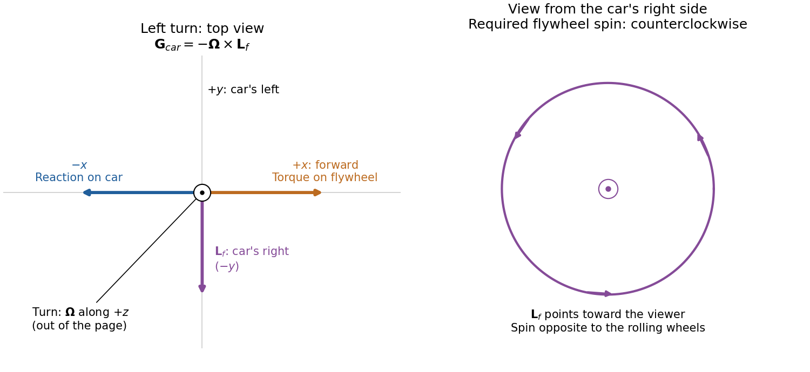

<h1 id="section-b/6/solution">Solution</h1>

↑ **Parent:** [6](../6.md)

**Translation and rotation.** For particles constituting a [rigid body](../../../../rigid-body-dynamics-split.md), the total [linear momentum](../../../../momentum-split.md) is

$$
\mathbf P=\sum_i m_i\mathbf v_i=M\mathbf V_{\rm CM},\qquad\frac{d\mathbf P}{dt}=\sum_i\mathbf F_{i,\rm ext}.
$$

Thus the total external [force](../../../../force-split.md) governs the motion of the [centre of mass](../../../../center-of-mass.md). About that [centre of mass](../../../../center-of-mass.md), the [angular momentum](../../../../angular-momentum.md) and applied [torque](../../../../torque.md) are

$$
\mathbf L_{\rm CM}=\sum_i\mathbf r_i'\times m_i\mathbf v_i',\qquad\mathbf G_{\rm CM}=\sum_i\mathbf r_i'\times\mathbf F_{i,\rm ext},\qquad\frac{d\mathbf L_{\rm CM}}{dt}=\mathbf G_{\rm CM},
$$

where primes denote relative positions and [velocities](../../../../velocity.md). The [derivative](../../../../derivative.md) of the vector is taken relative to nonrotating axes. The [inertia tensor](../../../../inertia-tensor.md) relates [angular momentum](../../../../angular-momentum.md) to [angular velocity](../../../../angular-velocity.md), $\mathbf L_{\rm CM}=\mathsf I\boldsymbol\omega$. For rotation about a fixed unit direction $\mathbf n$, the [moment of inertia](../../../../moment-of-inertia.md) is $I_{\mathbf n}=\int r_\perp^2\,dm=\mathbf n\cdot\mathsf I\mathbf n$; it measures the resistance to changing that rotation and gives rotational [kinetic energy](../../../../kinetic-energy.md) $I_{\mathbf n}\omega^2/2$. The simpler vector relation $\mathbf L=I\boldsymbol\omega$ applies when the rotation axis is a [principal axis](../../../../principal-axis.md), not for every orientation of an arbitrary [rigid body](../../../../rigid-body-dynamics-split.md). These translational and rotational balances must be applied together; a nonzero [torque](../../../../torque.md) does not replace the net-[force](../../../../force-split.md) equation.

**Gyroscope precession.** A rapidly spinning [gyroscope](../../../../gyroscope.md) has a large [angular momentum](../../../../angular-momentum.md) approximately along its spin axis. The [torque](../../../../torque.md) component parallel to this vector changes its magnitude, while the perpendicular component turns its direction. If the vector undergoes [precession](../../../../precession.md) with [angular velocity](../../../../angular-velocity.md) $\boldsymbol\Omega$, then over $dt$ its change is the infinitesimal rotation $d\mathbf L=(\boldsymbol\Omega\,dt)\times\mathbf L$. Hence

$$
\boxed{\mathbf G=\frac{d\mathbf L}{dt}=\boldsymbol\Omega\times\mathbf L.}
$$

This describes direction-changing [precession](../../../../precession.md) at constant $|\mathbf L|$; any spin-up contribution must be added separately. For perpendicular [torque](../../../../torque.md) and [angular momentum](../../../../angular-momentum.md), the precessional component perpendicular to $\mathbf L$ is $\boldsymbol\Omega_\perp=\mathbf L\times\mathbf G/L^2$. The familiar tendency of a supported [gyroscope](../../../../gyroscope.md) to turn sideways is this vector balance, not the absence of gravitational [force](../../../../force-split.md).

**Wheel-lift threshold without the flywheel.** Let $h=0.50\,\mathrm m$ be the [centre of mass](../../../../center-of-mass.md) height, $a=1.0\,\mathrm m$ half the wheel separation, and $R_b=10\,\mathrm m$ the bend radius. The required inward [force](../../../../force-split.md) is $F=Mv^2/R_b$, provided by [static friction](../../../../static-friction.md). Let $N_o,N_i$ be the summed outer and inner wheel [normal forces](../../../../normal-force.md). Vertical balance gives $N_o+N_i=Mg$. Moment balance about the [centre of mass](../../../../center-of-mass.md) gives

$$
a(N_o-N_i)=h\frac{Mv^2}{R_b},\qquad N_i=\frac M2\left(g-\frac{hv^2}{aR_b}\right).
$$

The inner wheels lift when $N_i=0$. Thus the [vehicle rollover threshold](../../../../vehicle-rollover-threshold.md) is

$$
\boxed{v_{\max}=\sqrt{\frac{gaR_b}{h}}=14.01\,\mathrm{m\,s^{-1}}=50.4\,\mathrm{km\,h^{-1}}.}
$$

The stated [mass](../../../../mass.md) cancels. This assumes the rigid geometry and sufficient [static friction](../../../../static-friction.md) specified in the paper; the threshold is set by loss of contact, not by sliding.

**Engine flywheel.** The [moment of inertia of a uniform disc](../../../../moment-of-inertia-of-a-uniform-disc.md) gives

$$
I_f=\frac12M_fr_f^2=\frac12(50)(0.4)^2=4.00\,\mathrm{kg\,m^2}.
$$

Its spin [angular speed](../../../../angular-speed.md), spin [angular momentum](../../../../angular-momentum.md), and turn [angular speed](../../../../angular-speed.md) at $40\,\mathrm{km\,h^{-1}}$ are

$$
\omega_f=4000\frac{2\pi}{60}=418.88\,\mathrm{rad\,s^{-1}},\quad L_f=I_f\omega_f=1675.52\,\mathrm{kg\,m^2\,s^{-1}},\quad\Omega=\frac{40/3.6}{10}=1.1111\,\mathrm{rad\,s^{-1}}.
$$

The transverse flywheel axis is perpendicular to the vertical turn axis, so

$$
\boxed{G=\Omega L_f=1.862\times10^3\,\mathrm{N\,m}.}
$$

To specify its direction, use right-handed axes $+x$ forward, $+y$ to the car's left, and $+z$ upward, and consider a left turn. Then $\boldsymbol\Omega=+\Omega\widehat{\mathbf z}$. Choose the flywheel [angular momentum](../../../../angular-momentum.md) to the car's right, $\mathbf L_f=-L_f\widehat{\mathbf y}$. The car must apply

$$
\mathbf G_{\rm on\ flywheel}=+\Omega L_f\widehat{\mathbf x},\qquad\boxed{\mathbf G_{\rm on\ car}=-\Omega L_f\widehat{\mathbf x}}
$$

to obtain the required [precession](../../../../precession.md). This [gyroscopic roll torque in a turning vehicle](../../../../gyroscopic-roll-torque-in-a-turning-vehicle.md) opposes the outward roll tendency in a left turn. By the [right-hand rule](../../../../right-hand-rule.md), the flywheel must turn **counterclockwise viewed from the car's right side toward its centre**, opposite to the rotation of wheels rolling forward. Reversing flywheel spin would aggravate the outward roll. Reversing the turn reverses both roll and gyroscopic [torques](../../../../torque.md), so the same flywheel spin remains helpful.

**[Figure 1](#section-b/6/image-gyroscope-vector-directions-for-a-left-turning-car-and-the-flywheel-spin-needed-to-oppose-outward-roll). Gyroscope vector directions for a left-turning car and the flywheel spin needed to oppose outward roll**.

For comparison, the outward inertial roll moment at the stated [speed](../../../../speed.md) is $Mhv^2/R_b=6173\,\mathrm{N\,m}$, and the limiting gravitational restoring moment is $Mga=9810\,\mathrm{N\,m}$. The gyroscopic reaction is about $30\%$ of the former and $19\%$ of the latter, so it is appreciable for this large flywheel. If this ideal model is extended to include the favorable gyroscopic reaction in the wheel-lift condition, it gives $Mhv^2/R_b-L_fv/R_b=Mga$, or about $56.8\,\mathrm{km\,h^{-1}}$ rather than $50.4\,\mathrm{km\,h^{-1}}$. This quantifies a useful but finite increase in the rollover threshold.

## ↑ Ancestors (12)

1. [6](../6.md)
2. [Section B](../../section-b.md)
3. [2021](../../../2021-split.md)
4. [Past exam of the physics course of the year 1 of the natural sciences course of the University of Cambridge](../../../split.md)
5. [Physics course of the year 1 of the natural sciences course of the University of Cambridge](../../../../physics-course-of-the-year-1-of-the-natural-sciences-course-of-the-university-of-cambridge.md)
6. [Year 1 of the natural sciences course of the University of Cambridge](../../../../year-1-of-the-natural-sciences-course-of-the-university-of-cambridge.md)
7. [Year of the natural sciences course of the University of Cambridge](../../../../year-of-the-natural-sciences-course-of-the-university-of-cambridge.md)
8. [Natural sciences course of the University of Cambridge](../../../../natural-sciences-course-of-the-university-of-cambridge.md)
9. [Course of the University of Cambridge](../../../../course-of-the-university-of-cambridge.md)
10. [University of Cambridge](../../../../university-of-cambridge-split.md)
11. [List of universities](../../../../list-of-universities.md)
12. [Codex Wiki](../../../../split.md)
