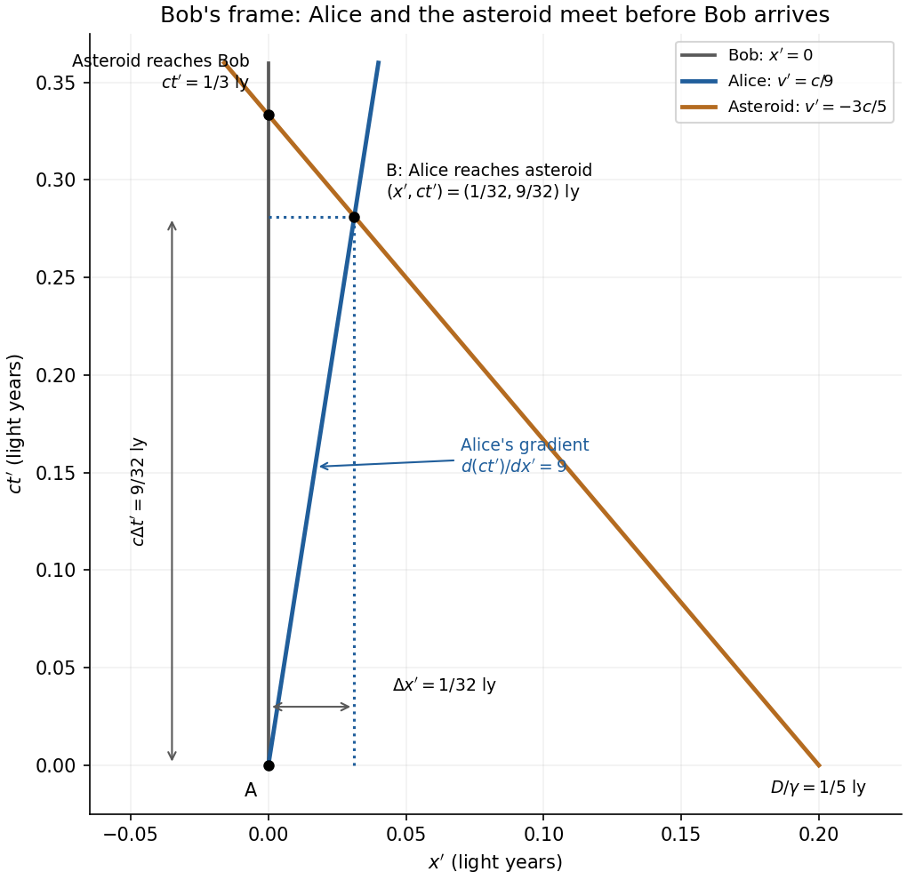

<h1 id="section-b/7/solution">Solution</h1>

↑ **Parent:** [7](../7.md)

**Frame definitions and relativistic effects.** Let $S$ be the [inertial frame](../../../../inertial-frame.md) of Earth and the stationary asteroid, with $+x$ pointing toward the asteroid. Bob's [inertial frame](../../../../inertial-frame.md) $S'$ moves at $+v$ relative to $S$. For two events at Bob's fixed position, $\Delta x'=0$, the inverse [Lorentz transformation](../../../../lorentz-transformation.md) gives

$$
\Delta t=\gamma\Delta t',\qquad\gamma=(1-v^2/c^2)^{-1/2}.
$$

The elapsed [proper time](../../../../proper-time.md) on Bob's clock is $\Delta\tau=\Delta t'$, so [time dilation](../../../../time-dilation.md) means $\Delta t=\gamma\Delta\tau$: the separation of his clock ticks is larger in Earth coordinates. For a rod at rest in $S'$ with [proper length](../../../../proper-length.md) $L_0$, a length measurement in $S$ uses simultaneous endpoints, $\Delta t=0$. The direct spatial [Lorentz transformation](../../../../lorentz-transformation.md) gives $L_0=\Delta x'=\gamma\Delta x$, hence [length contraction](../../../../length-contraction.md):

$$
\boxed{L=L_0/\gamma.}
$$

The simultaneity condition is essential: the endpoint events used to measure length are different from the two clock-tick events used to demonstrate [time dilation](../../../../time-dilation.md).

**Bob's speed.** Food consumption measures Bob's own [proper time](../../../../proper-time.md), $\tau_B=4\text{ months}=1/3\,\mathrm{yr}$. The Earth-frame distance is $D=1/4\,\mathrm{ly}$ and the Earth travel [time](../../../../time-in-physics.md) is $D/v$. Consequently

$$
\tau_B=\frac{D}{\gamma v},\qquad\gamma\frac vc=\frac{D}{c\tau_B}=\frac34.
$$

Putting $\beta=v/c$, $\beta^2/(1-\beta^2)=9/16$, so

$$
\boxed{v=\frac35c=0.600c,\qquad\gamma=\frac54.}
$$

The Earth travel [time](../../../../time-in-physics.md) is $5/12\,\mathrm{yr}=5$ months. Equivalently Bob measures the contracted Earth-asteroid separation $D/\gamma=0.20\,\mathrm{ly}$ and sees the asteroid approach at $0.60c$, taking $1/3\,\mathrm{yr}$ to reach him.

**Events A and B.** Set both coordinate origins at Event A. Alice reaches the asteroid at Event B, travelling at $u=2c/3$ in $S$, so

$$
\boxed{\Delta x=\frac14\,\mathrm{ly},\qquad\Delta t=\frac{D}{u}=\frac38\,\mathrm{yr}=4.5\text{ months}.}
$$

The [Lorentz transformations](../../../../lorentz-transformation.md) into Bob's frame give

$$
\begin{aligned}
\Delta t'&=\frac54\left(\frac38-\frac35\frac14\right)\mathrm{yr}=\boxed{\frac9{32}\,\mathrm{yr}=3.375\text{ months}},\\
\Delta x'&=\frac54\left(\frac14-\frac35\frac38\right)\mathrm{ly}=\boxed{\frac1{32}\,\mathrm{ly}=0.03125\,\mathrm{ly}}.
\end{aligned}
$$

Here $c(1\,\mathrm{yr})=1\,\mathrm{ly}$ has been used consistently. With the time-positive sign convention, the [Minkowski interval](../../../../minkowski-interval.md) is

$$
\begin{aligned}
\Delta s^2&=c^2\Delta t^2-\Delta x^2=\left(\frac9{64}-\frac4{64}\right)\mathrm{ly^2}=\boxed{\frac5{64}\,\mathrm{ly^2}},\\
\Delta s'^2&=c^2\Delta t'^2-\Delta x'^2=\left(\frac{81}{1024}-\frac1{1024}\right)\mathrm{ly^2}=\boxed{\frac5{64}\,\mathrm{ly^2}}.
\end{aligned}
$$

Thus the [Minkowski interval](../../../../minkowski-interval.md) is invariant. It is timelike, as expected for two events on Alice's subluminal [worldline](../../../../world-line.md). Using the opposite metric sign convention would change both signs together, without changing invariance.

**Relative velocity and spacetime diagram.** Divide the differential spatial and temporal [Lorentz transformations](../../../../lorentz-transformation.md) for the same trajectory:

$$
u_x'=\frac{dx'}{dt'}=\frac{\gamma(dx-v\,dt)}{\gamma(dt-v\,dx/c^2)}=\boxed{\frac{u_x-v}{1-vu_x/c^2}}.
$$

For Alice,

$$
\boxed{u'_{\rm Alice}=\frac{(2/3-3/5)c}{1-(2/3)(3/5)}=\frac19c.}
$$

The [spacetime diagram](../../../../spacetime-diagram.md) uses horizontal $x'$ and vertical $ct'$. In these coordinates Bob's [worldline](../../../../world-line.md) is $x'=0$, Alice's is $x'=ct'/9$, and the asteroid's is

$$
x'_{\rm asteroid}=\frac D\gamma-vt'=\frac15\,\mathrm{ly}-\frac35ct'.
$$

Thus Alice has slope $d(ct')/dx'=9$, while the asteroid has slope $-5/3$. Their intersection is exactly B, $(x',ct')=(1/32,9/32)\,\mathrm{ly}$. The asteroid later reaches Bob at $(0,1/3)\,\mathrm{ly}$. These intercepts and gradients show the [relativistic velocity addition](../../../../velocity-addition-formula.md) geometrically.

**[Figure 2](#section-b/7/image-spacetime-diagram-in-bob-s-inertial-frame-with-alice-s-velocity-asteroid-motion-and-the-a-to-b-coordinate-differences). Spacetime diagram in Bob's inertial frame, with Alice's velocity, asteroid motion and the A-to-B coordinate differences**.

## ↑ Ancestors (12)

1. [7](../7.md)
2. [Section B](../../section-b.md)
3. [2021](../../../2021-split.md)
4. [Past exam of the physics course of the year 1 of the natural sciences course of the University of Cambridge](../../../split.md)
5. [Physics course of the year 1 of the natural sciences course of the University of Cambridge](../../../../physics-course-of-the-year-1-of-the-natural-sciences-course-of-the-university-of-cambridge.md)
6. [Year 1 of the natural sciences course of the University of Cambridge](../../../../year-1-of-the-natural-sciences-course-of-the-university-of-cambridge.md)
7. [Year of the natural sciences course of the University of Cambridge](../../../../year-of-the-natural-sciences-course-of-the-university-of-cambridge.md)
8. [Natural sciences course of the University of Cambridge](../../../../natural-sciences-course-of-the-university-of-cambridge.md)
9. [Course of the University of Cambridge](../../../../course-of-the-university-of-cambridge.md)
10. [University of Cambridge](../../../../university-of-cambridge-split.md)
11. [List of universities](../../../../list-of-universities.md)
12. [Codex Wiki](../../../../split.md)
