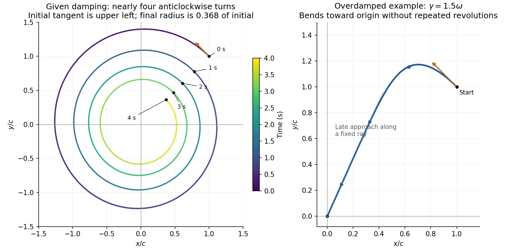

<h1 id="section-b/8/f/solution">Solution</h1>

↑ **Parent:** [F](../f.md)

The parameters give

$$
\omega=\sqrt{3.95/0.10}=6.28490\,\mathrm{rad\,s^{-1}},\qquad\gamma=\frac{0.05}{2(0.10)}=0.2500\,\mathrm{s^{-1}},\qquad\nu=6.27993\,\mathrm{rad\,s^{-1}}.
$$

The coordinate expressions for the [initially circular damped planar oscillator](../../../../../initially-circular-damped-planar-oscillator.md) are

$$
\boxed{\begin{aligned}
\frac{x(t)}c&=e^{-\gamma t}\left[\cos\nu t+\frac{\gamma-\omega}{\nu}\sin\nu t\right],\\
\frac{y(t)}c&=e^{-\gamma t}\left[\cos\nu t+\frac{\gamma+\omega}{\nu}\sin\nu t\right].
\end{aligned}}
$$

The damped [oscillation period](../../../../../period-of-an-oscillation.md) $2\pi/\nu=1.00052\,\mathrm s$ gives almost four anticlockwise turns in four seconds. The radius envelope falls by $e^{-\gamma(4\,\mathrm s)}=e^{-1}=0.3679$. Substitution into the exact coordinates gives

$$
\boxed{(x(4\,\mathrm s),y(4\,\mathrm s))=(0.37245c,0.36286c),\qquad r(4\,\mathrm s)/r_0=0.36769.}
$$

The left panel annotates the initial tangent, time marks and endpoint. Because $c$ is an unspecified starting coordinate, the axes are normalized by $c$ rather than assigned numerical lengths.

**[Figure 4](#section-b/8/f/image-exact-underdamped-trajectory-over-four-seconds-and-a-representative-overdamped-trajectory-for-the-same-initial-circular-velocity). Exact underdamped trajectory over four seconds and a representative overdamped trajectory for the same initial circular velocity**.

## ↑ Ancestors (13)

1. [F](../f.md)
2. [8](../../8.md)
3. [Section B](../../../section-b.md)
4. [2021](../../../../2021-split.md)
5. [Past exam of the physics course of the year 1 of the natural sciences course of the University of Cambridge](../../../../split.md)
6. [Physics course of the year 1 of the natural sciences course of the University of Cambridge](../../../../../physics-course-of-the-year-1-of-the-natural-sciences-course-of-the-university-of-cambridge.md)
7. [Year 1 of the natural sciences course of the University of Cambridge](../../../../../year-1-of-the-natural-sciences-course-of-the-university-of-cambridge.md)
8. [Year of the natural sciences course of the University of Cambridge](../../../../../year-of-the-natural-sciences-course-of-the-university-of-cambridge.md)
9. [Natural sciences course of the University of Cambridge](../../../../../natural-sciences-course-of-the-university-of-cambridge.md)
10. [Course of the University of Cambridge](../../../../../course-of-the-university-of-cambridge.md)
11. [University of Cambridge](../../../../../university-of-cambridge-split.md)
12. [List of universities](../../../../../list-of-universities.md)
13. [Codex Wiki](../../../../../split.md)
