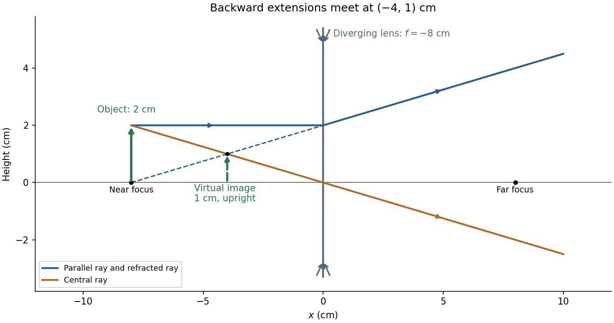

<h1 id="section-b/9/d/solution">Solution</h1>

↑ **Parent:** [D](../d.md)

For $u=8\,\mathrm{cm}$ and negative [focal length](../../../../../focal-length.md) $f=-8\,\mathrm{cm}$,

$$
\frac1v=\frac1f-\frac1u=-\frac18-\frac18=-\frac14\,\mathrm{cm^{-1}},\qquad\boxed{v=-4.0\,\mathrm{cm}.}
$$

The [transverse magnification](../../../../../transverse-magnification.md) is $M=-v/u=+1/2$, so

$$
\boxed{h_i=+1.0\,\mathrm{cm}.}
$$

Thus the [virtual image](../../../../../virtual-image.md) is upright, half the object's height, and **$4.0\,\mathrm{cm}$ from the lens on the object's side**. A parallel incident [light ray](../../../../../light-ray.md) diverges after the lens as though it originated at the near [optical focus](../../../../../focus-optics.md); the central [light ray](../../../../../light-ray.md) continues undeviated in the ideal [thin lens](../../../../../thin-lens.md) model. Their backward extensions meet at the image tip, $(-4,1)\,\mathrm{cm}$.

**[Figure 5](#section-b/9/d/image-ray-tracing-for-the-diverging-thin-lens-backward-extensions-locate-the-upright-virtual-image). Ray tracing for the diverging thin lens: backward extensions locate the upright virtual image**.

## ↑ Ancestors (13)

1. [D](../d.md)
2. [9](../../9.md)
3. [Section B](../../../section-b.md)
4. [2021](../../../../2021-split.md)
5. [Past exam of the physics course of the year 1 of the natural sciences course of the University of Cambridge](../../../../split.md)
6. [Physics course of the year 1 of the natural sciences course of the University of Cambridge](../../../../../physics-course-of-the-year-1-of-the-natural-sciences-course-of-the-university-of-cambridge.md)
7. [Year 1 of the natural sciences course of the University of Cambridge](../../../../../year-1-of-the-natural-sciences-course-of-the-university-of-cambridge.md)
8. [Year of the natural sciences course of the University of Cambridge](../../../../../year-of-the-natural-sciences-course-of-the-university-of-cambridge.md)
9. [Natural sciences course of the University of Cambridge](../../../../../natural-sciences-course-of-the-university-of-cambridge.md)
10. [Course of the University of Cambridge](../../../../../course-of-the-university-of-cambridge.md)
11. [University of Cambridge](../../../../../university-of-cambridge-split.md)
12. [List of universities](../../../../../list-of-universities.md)
13. [Codex Wiki](../../../../../split.md)
