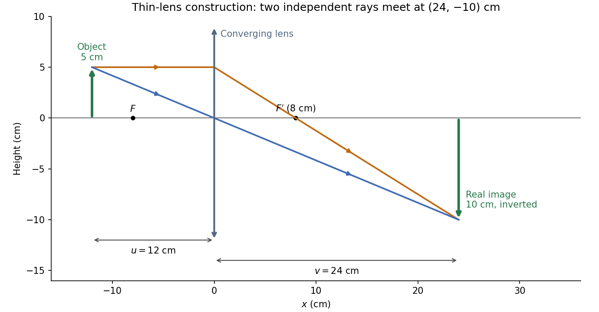
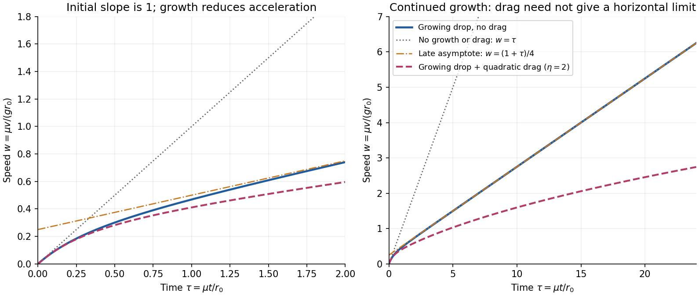
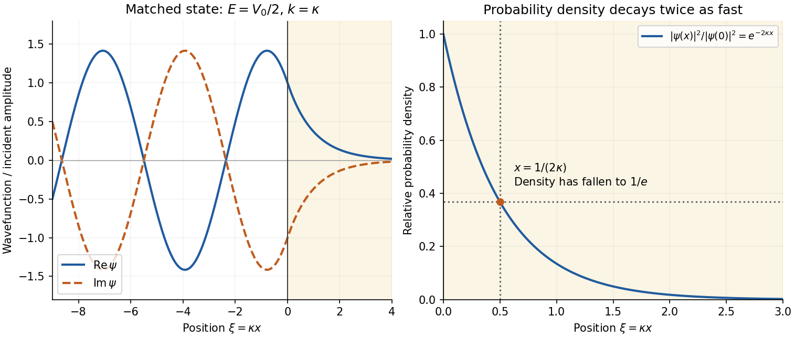
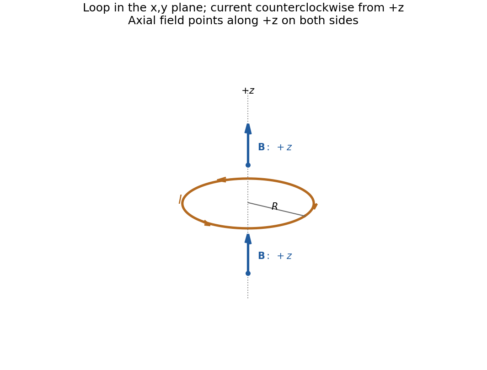

# 2022

↑ **Parent:** [Past exam of the physics course of the year 1 of the natural sciences course of the University of Cambridge](../past-exam-of-the-physics-course-of-the-year-1-of-the-natural-sciences-course-of-the-university-of-cambridge.md)

[Original paper, released PDF pages 53–60](https://www.whatdotheyknow.com/request/natural_science_tripos_physics_e/response/2127325/attach/3/FOI%202022%20639%20Sullivan%20materials.pdf?cookie_passthrough=1#page=53)

The released examiner commentary is not a complete worked solution set. It records an accepted ambiguity in question 8(d); question 7(e) also requires care about its unstated [drag](../fluid-mechanics.md#drag-physics) model.[Examiner commentary for this paper, released PDF pages 61–64](https://www.whatdotheyknow.com/request/natural_science_tripos_physics_e/response/2127325/attach/3/FOI%202022%20639%20Sullivan%20materials.pdf?cookie_passthrough=1#page=61)

**Table of contents**

- [Section A](#section-a)
  - [1](#section-a/1)
    - [Solution](#section-a/1/solution)
  - [2](#section-a/2)
    - [Solution](#section-a/2/solution)
  - [3](#section-a/3)
    - [Solution](#section-a/3/solution)
  - [4](#section-a/4)
    - [Solution](#section-a/4/solution)
  - [5](#section-a/5)
    - [Solution](#section-a/5/solution)
- [Section B](#section-b)
  - [6](#section-b/6)
    - [a](#section-b/6/a)
      - [Solution](#section-b/6/a/solution)
    - [b](#section-b/6/b)
      - [Solution](#section-b/6/b/solution)
    - [c](#section-b/6/c)
      - [Solution](#section-b/6/c/solution)
    - [d](#section-b/6/d)
      - [Solution](#section-b/6/d/solution)
    - [e](#section-b/6/e)
      - [Solution](#section-b/6/e/solution)
  - [7](#section-b/7)
    - [a](#section-b/7/a)
      - [Solution](#section-b/7/a/solution)
    - [b](#section-b/7/b)
      - [Solution](#section-b/7/b/solution)
    - [c](#section-b/7/c)
      - [Solution](#section-b/7/c/solution)
    - [d](#section-b/7/d)
      - [Solution](#section-b/7/d/solution)
    - [e](#section-b/7/e)
      - [Solution](#section-b/7/e/solution)
  - [8](#section-b/8)
    - [a](#section-b/8/a)
      - [Solution](#section-b/8/a/solution)
    - [b](#section-b/8/b)
      - [Solution](#section-b/8/b/solution)
    - [c](#section-b/8/c)
      - [Solution](#section-b/8/c/solution)
    - [d](#section-b/8/d)
      - [Solution](#section-b/8/d/solution)
  - [9](#section-b/9)
    - [a](#section-b/9/a)
      - [Solution](#section-b/9/a/solution)
    - [b](#section-b/9/b)
      - [Solution](#section-b/9/b/solution)
    - [c](#section-b/9/c)
      - [Solution](#section-b/9/c/solution)
  - [10](#section-b/10)
    - [a](#section-b/10/a)
      - [Solution](#section-b/10/a/solution)
    - [b](#section-b/10/b)
      - [Solution](#section-b/10/b/solution)
    - [c](#section-b/10/c)
      - [Solution](#section-b/10/c/solution)
    - [d](#section-b/10/d)
      - [Solution](#section-b/10/d/solution)

## Section A

↑ **Parent:** [2022](2022.md)

<h3 id="section-a/1">1</h3>

↑ **Parent:** [Section A](#section-a)

<h4 id="section-a/1/solution">Solution</h4>

↑ **Parent:** [1](#section-a/1)

By [dimensional analysis](../mathematical-physics.md#dimensional-analysis), [power](../energy.md#power) has dimensions $\mathsf{M L^2 T^{-3}}$, [mass density](../fluid-mechanics.md#density) has dimensions $\mathsf{M L^{-3}}$, and [angular velocity](../rigid-body-dynamics.md#angular-velocity) has dimensions $\mathsf{T^{-1}}$; [radians](../geometry-and-topology.md#radian) are dimensionless. Thus

$$
\mathsf{M L^2 T^{-3}}=\mathsf{M^\alpha L^{\gamma-3\alpha}T^{-\beta}}.
$$

Matching the three independent dimensions gives $\alpha=1$, $\beta=3$ and $\gamma-3\alpha=2$, hence

$$
\boxed{\alpha=1,\quad\beta=3,\quad\gamma=5,\qquad P\propto\rho\omega^3D^5.}
$$

With unchanged [mass density](../fluid-mechanics.md#density), [angular velocity](../rigid-body-dynamics.md#angular-velocity) and the same performance coefficient (a [dimensionless quantity](../physics.md#dimensionless-quantity)), the [pump power affinity law](../mathematical-physics.md#pump-power-affinity-law) gives

$$
\frac{P_{\rm new}}{P_{\rm old}}=\left(\frac{D_{\rm new}}{D_{\rm old}}\right)^5=1.1^5=1.61051.
$$

The required [power](../energy.md#power) therefore **increases by $61.1\%$**. This uses the stipulated dependence on only these three quantities, with comparable pump geometry and performance; [dimensional analysis](../mathematical-physics.md#dimensional-analysis) alone does not guarantee that unrelated pumps have the same performance coefficient.

<h3 id="section-a/2">2</h3>

↑ **Parent:** [Section A](#section-a)

<h4 id="section-a/2/solution">Solution</h4>

↑ **Parent:** [2](#section-a/2)

The [relativistic kinetic energy](../energy.md#relativistic-kinetic-energy) is the total [energy](../energy.md) minus the [rest energy](../special-relativity.md#rest-energy):

$$
\boxed{K=(\gamma-1)Mc^2,\qquad\gamma=\frac1{\sqrt{1-v^2/c^2}}.}
$$

Here $\gamma$ is the [Lorentz factor](../special-relativity.md#lorentz-factor) and $c$ the [speed of light](../special-relativity.md#speed-of-light). The [binomial series](../sequence-and-series.md#binomial-series), with $b=v/c$, gives

$$
(1-b^2)^{-1/2}=1+\frac12b^2+\frac38b^4+O(b^6),\qquad K=\frac12Mv^2+\frac38M\frac{v^4}{c^2}+O\!\left(M\frac{v^6}{c^4}\right).
$$

For $v\ll c$, the leading term is the classical [kinetic energy](../energy.md#kinetic-energy) $Mv^2/2$. The ratio of the fourth-order term to that leading term is $3v^2/(4c^2)$. Consequently

$$
\frac34\frac{v^2}{c^2}=0.01\quad\Longrightarrow\quad\boxed{\frac vc=\sqrt{\frac{0.04}{3}}=0.11547\simeq11.5\%.}
$$

The condition concerns one term of the [binomial series](../sequence-and-series.md#binomial-series); it is not the condition that the entire relativistic correction be exactly $1\%$.

<h3 id="section-a/3">3</h3>

↑ **Parent:** [Section A](#section-a)

<h4 id="section-a/3/solution">Solution</h4>

↑ **Parent:** [3](#section-a/3)

Let $x$ be signed displacement along the rails, measured from the centre. The diagram in the original paper shows a guide extending across the centre, so the signed coordinate can pass through zero. [Hooke's law](../elasticity-physics.md#hooke-s-law) gives the radial [force](../force.md) $-kx$. In the [rotating reference frame](../mathematical-physics.md#rotating-reference-frame), the radial [centrifugal force](../mathematical-physics.md#centrifugal-force) is $+m\Omega^2x$. The [Coriolis force](../mathematical-physics.md#coriolis-force) is perpendicular to the rails and is balanced by their reaction; it has no radial component. Therefore [Newton's second law](../force.md#newton-s-second-law) gives

$$
m\ddot x=-kx+m\Omega^2x,\qquad\ddot x+\left(\frac km-\Omega^2\right)x=0.
$$

Equivalently, the radial component of [acceleration in polar coordinates](../classical-mechanics.md#acceleration-in-polar-coordinates) in the [inertial frame](../mathematical-physics.md#inertial-frame) is $\ddot x-\Omega^2x$. The [radial spring oscillator on a rotating guide](../classical-mechanics.md#radial-spring-oscillator-on-a-rotating-guide) has [simple harmonic motion](../classical-mechanics.md#simple-harmonic-motion) only when $k/m-\Omega^2>0$, with

$$
\boxed{\omega_{\rm osc}=\sqrt{\frac km-\Omega^2},\qquad f_{\rm osc}=\frac1{2\pi}\sqrt{\frac km-\Omega^2}.}
$$

The [angular frequency](../lagrangian-mechanics.md#angular-frequency) is in $\mathrm{rad\,s^{-1}}$ and the [frequency](../wave.md#frequency) in $\mathrm{Hz}$. The critical [angular speed](../rigid-body-dynamics.md#angular-speed) is

$$
\boxed{\Omega_{\rm crit}=\sqrt{k/m},\qquad 0\le\Omega<\Omega_{\rm crit}.}
$$

Strictly this is an upper bound, not an attained maximum for [oscillations](../wave.md#oscillation): at equality $\ddot x=0$, so a displaced object released from rest stays at its displaced position relative to the rails; above it, the central [equilibrium](../dynamical-systems.md#equilibrium-point-of-a-dynamical-system) is unstable.

<h3 id="section-a/4">4</h3>

↑ **Parent:** [Section A](#section-a)

<h4 id="section-a/4/solution">Solution</h4>

↑ **Parent:** [4](#section-a/4)

Take the [thin lens](../geometrical-optics.md#thin-lens) at $x=0$, with the object on the left and [light rays](../geometrical-optics.md#light-ray) travelling to the right. The positive object distance is $u=12\,\mathrm{cm}$ and the [focal length](../geometrical-optics.md#focal-length) is $f=8\,\mathrm{cm}$. The [thin lens](../geometrical-optics.md#thin-lens) equation gives

$$
\frac1v=\frac1f-\frac1u=\left(\frac18-\frac1{12}\right)\mathrm{cm^{-1}}=\frac1{24}\,\mathrm{cm^{-1}},\qquad\boxed{v=24\,\mathrm{cm}.}
$$

The [transverse magnification](../optics.md#transverse-magnification) and signed image height are

$$
M=-\frac vu=-2,\qquad h_i=Mh_o=-2(5\,\mathrm{cm})=\boxed{-10\,\mathrm{cm}}.
$$

Thus the [real image](../optics.md#real-image) is **$24\,\mathrm{cm}$ beyond the lens, inverted and $10\,\mathrm{cm}$ high**. For the [ray tracing](../dispersion-relation.md#ray-tracing), a [light ray](../geometrical-optics.md#light-ray) parallel to the [optical axis](../geometrical-optics.md#optical-axis) emerges through the far [optical focus](../geometrical-optics.md#focus-optics); a [light ray](../geometrical-optics.md#light-ray) through the optical centre continues straight in the ideal [thin lens](../geometrical-optics.md#thin-lens) model. They intersect at $(24,-10)\,\mathrm{cm}$, independently reading off both answers from the diagram.

**[Figure 1](#section-a/4/image-ray-tracing-for-the-converging-thin-lens-object-and-image-heights-and-both-focal-points). Ray tracing for the converging thin lens: object and image heights and both focal points**.

The calculation and diagram use the ideal [paraxial approximation](../partial-differential-equation.md#paraxial-approximation) implicit in the [thin lens](../geometrical-optics.md#thin-lens) equation. The comparatively large object height does not supply enough information to calculate [optical aberrations](../geometrical-optics.md#optical-aberration) of a real lens.

<h3 id="section-a/5">5</h3>

↑ **Parent:** [Section A](#section-a)

<h4 id="section-a/5/solution">Solution</h4>

↑ **Parent:** [5](#section-a/5)

Write $a=0.020\,\mathrm m$ for the side length. In an [equilateral triangle](../euclidean-geometry.md#equilateral-triangle), the distance from centre to a vertex is $a/\sqrt3$; it is two thirds of the altitude $\sqrt3a/2$. By the [superposition principle](../vector-space.md#superposition-principle), the [electric potential](../electric-field.md#electric-potential) at the centre due to the three fixed [electrons](../physics.md#electron) is

$$
\Phi(0)=-\frac{3e}{4\pi\varepsilon_0(a/\sqrt3)}.
$$

Here $e>0$ is the [elementary charge](../electric-charge.md#elementary-charge) and $\varepsilon_0$ the [vacuum permittivity](../permittivity.md#vacuum-permittivity). The approaching [electron](../physics.md#electron) has [electric charge](../electric-charge.md) $-e$, so its [potential energy](../energy.md#potential-energy), measured relative to infinity, is positive:

$$
U(0)=(-e)\Phi(0)=\frac{3\sqrt3e^2}{4\pi\varepsilon_0a}.
$$

The fixed sources do not move, and radiation is excluded. Hence [conservation of mechanical energy](../energy.md#conservation-of-mechanical-energy) gives

$$
\frac12m_ev_\infty^2=U(0),\qquad\boxed{v_\infty=\sqrt{\frac{6\sqrt3e^2}{4\pi\varepsilon_0m_ea}}.}
$$

Using $e=1.60218\times10^{-19}\,\mathrm C$, $m_e=9.10938\times10^{-31}\,\mathrm{kg}$ for the [electron mass](../physics.md#electron-mass), and $(4\pi\varepsilon_0)^{-1}=8.98755\times10^9\,\mathrm{N\,m^2\,C^{-2}}$ gives

$$
U(0)=5.99\times10^{-26}\,\mathrm J=3.74\times10^{-7}\,\mathrm{eV},\qquad\boxed{v_\infty\simeq3.63\times10^2\,\mathrm{m\,s^{-1}}.}
$$

This [speed](../classical-mechanics.md#speed) is small enough to justify classical [kinetic energy](../energy.md#kinetic-energy). There is an idealization in the word “stops”: along the line normal to the triangle through its centre, this threshold [energy](../energy.md) makes the [electron](../physics.md#electron) approach the central [equilibrium](../dynamical-systems.md#equilibrium-point-of-a-dynamical-system) asymptotically. A smooth, conservative trajectory cannot reach an [equilibrium](../dynamical-systems.md#equilibrium-point-of-a-dynamical-system) with exactly zero [velocity](../classical-mechanics.md#velocity) in finite time unless it was already there. The energy threshold, and therefore the requested initial [speed](../classical-mechanics.md#speed), is nevertheless unambiguous.

## Section B

↑ **Parent:** [2022](2022.md)

<h3 id="section-b/6">6</h3>

↑ **Parent:** [Section B](#section-b)

<h4 id="section-b/6/a">a</h4>

↑ **Parent:** [6](#section-b/6)

<h5 id="section-b/6/a/solution">Solution</h5>

↑ **Parent:** [A](#section-b/6/a)

Choose three mutually perpendicular axes through the same point, and label coordinates $x,y,z$. The [moments of inertia](../rigid-body-dynamics.md#moment-of-inertia) of any [rigid body](../rigid-body-dynamics.md) are

$$
I_x=\int(y^2+z^2)\,dm,\qquad I_y=\int(z^2+x^2)\,dm,\qquad I_z=\int(x^2+y^2)\,dm.
$$

Subtracting gives

$$
I_x+I_y-I_z=2\int z^2\,dm\ge0.
$$

For a thin [planar lamina](../classical-mechanics.md#planar-lamina) lying in $z=0$, the right-hand side vanishes, proving the [perpendicular axis theorem](../rigid-body-dynamics.md#perpendicular-axis-theorem):

$$
\boxed{I_z=I_x+I_y.}
$$

The two in-plane axes and the perpendicular axis must intersect at one point; this need not be the [centre of mass](../classical-mechanics.md#center-of-mass). For an extended three-dimensional [mass distribution](../classical-mechanics.md#mass-distribution), the equality generally fails. The general [moment-of-inertia triangle inequalities](../rigid-body-dynamics.md#moment-of-inertia-triangle-inequalities) are

$$
\boxed{I_x+I_y\ge I_z,\quad I_y+I_z\ge I_x,\quad I_z+I_x\ge I_y,}
$$

with equality in the first precisely when all [mass](../classical-mechanics.md#mass) lies in the plane perpendicular to its $z$ axis, and cyclically for the others. None of these identities requires [principal axes](../rigid-body-dynamics.md#principal-axis).

<h4 id="section-b/6/b">b</h4>

↑ **Parent:** [6](#section-b/6)

<h5 id="section-b/6/b/solution">Solution</h5>

↑ **Parent:** [B](#section-b/6/b)

Let $I_\perp$ denote the [moment of inertia](../rigid-body-dynamics.md#moment-of-inertia) normal to the disc and $I_d$ that about any central diameter. [Rotational symmetry](../linear-algebra.md#rotational-symmetry) makes the two perpendicular diameter values equal. By the [perpendicular axis theorem](../rigid-body-dynamics.md#perpendicular-axis-theorem), $I_\perp=2I_d$. The intended [angular impulse](../momentum.md#angular-impulse) has magnitude $J=I_\perp\omega_0$; delivering that magnitude about a diameter instead gives $J=I_d\omega$. Thus

$$
I_d\omega=2I_d\omega_0,\qquad\boxed{\omega=2\omega_0.}
$$

These are [principal axes](../rigid-body-dynamics.md#principal-axis), so [angular momentum](../momentum.md#angular-momentum) is parallel to [angular velocity](../rigid-body-dynamics.md#angular-velocity) in both cases. Equal delivered [angular impulse](../momentum.md#angular-impulse) means equal magnitude of the change in [angular momentum](../momentum.md#angular-momentum), not equal rotational [kinetic energy](../energy.md#kinetic-energy); the actual rotational [kinetic energy](../energy.md#kinetic-energy) is twice the intended value.

<h4 id="section-b/6/c">c</h4>

↑ **Parent:** [6](#section-b/6)

<h5 id="section-b/6/c/solution">Solution</h5>

↑ **Parent:** [C](#section-b/6/c)

Take $+x$ along the upper ship's initial [velocity](../classical-mechanics.md#velocity), and take $+y$ from the lower ship to the upper ship at closest approach. The upper and lower ships then have initial [velocities](../classical-mechanics.md#velocity) $v_1\widehat{\mathbf x}$ and $-v_2\widehat{\mathbf x}$. Their equal [masses](../classical-mechanics.md#mass) put each at distance $l/2$ from the [centre of mass](../classical-mechanics.md#center-of-mass), so

$$
\boxed{I_{\rm CM}=2m(l/2)^2=\frac12ml^2.}
$$

By [momentum conservation](../momentum.md#momentum-conservation), the [centre of mass](../classical-mechanics.md#center-of-mass) keeps moving with constant [velocity](../classical-mechanics.md#velocity)

$$
\boxed{\mathbf V_{\rm CM}=\frac{v_1-v_2}{2}\widehat{\mathbf x}.}
$$

In that frame the ships have opposite [velocities](../classical-mechanics.md#velocity) of magnitude $u=(v_1+v_2)/2$. Their initial [angular momentum about the centre of mass](../classical-mechanics.md#angular-momentum-about-the-centre-of-mass) is nonzero even though their trajectories were straight:

$$
\mathbf L=-ml\frac{v_1+v_2}{2}\widehat{\mathbf z},\qquad L=\frac{ml(v_1+v_2)}2.
$$

The tether exerts central internal [forces](../force.md), so [conservation of angular momentum](../momentum.md#conservation-of-angular-momentum) gives

$$
\boxed{\omega=\frac L{I_{\rm CM}}=\frac{v_1+v_2}{l}.}
$$

Each ship follows uniform [circular motion](../classical-mechanics.md#circular-motion) of radius $l/2$ around the translating [centre of mass](../classical-mechanics.md#center-of-mass), clockwise viewed from $+z$. More explicitly, put the initial centre at the origin and define

$$
\mathbf n(t)=\sin(\omega t)\widehat{\mathbf x}+\cos(\omega t)\widehat{\mathbf y},\qquad\mathbf r_{1,2}(t)=\mathbf V_{\rm CM}t\pm\frac l2\mathbf n(t).
$$

The [kinetic-energy decomposition about the centre of mass](../classical-mechanics.md#kinetic-energy-decomposition-about-the-centre-of-mass) verifies [conservation of mechanical energy](../energy.md#conservation-of-mechanical-energy) directly:

$$
\begin{aligned}
E_{\rm after}&=\frac12(2m)V_{\rm CM}^2+\frac12I_{\rm CM}\omega^2\\
&=\frac m4(v_1-v_2)^2+\frac m4(v_1+v_2)^2\\
&=\boxed{\frac12mv_1^2+\frac12mv_2^2=E_{\rm before}.}
\end{aligned}
$$

At closest approach the relative radial [velocity](../classical-mechanics.md#velocity) is already zero, so connecting the tether requires no dissipative radial impulse. Subsequently its [tension](../force.md#tension) is perpendicular to each ship's [velocity](../classical-mechanics.md#velocity) relative to the [centre of mass](../classical-mechanics.md#center-of-mass) and does no net [work](../energy.md#work) on the pair at fixed $l$.

<h4 id="section-b/6/d">d</h4>

↑ **Parent:** [6](#section-b/6)

<h5 id="section-b/6/d/solution">Solution</h5>

↑ **Parent:** [D](#section-b/6/d)

Each ship needs [centripetal acceleration](../classical-mechanics.md#centripetal-acceleration) $\omega^2(l/2)$, supplied entirely by the [tension](../force.md#tension). Thus

$$
\boxed{T=m\omega^2\frac l2=\frac{m(v_1+v_2)^2}{2l}=\frac{2L^2}{ml^3}.}
$$

The result has units of [force](../force.md), $\mathrm N$.

<h4 id="section-b/6/e">e</h4>

↑ **Parent:** [6](#section-b/6)

<h5 id="section-b/6/e/solution">Solution</h5>

↑ **Parent:** [E](#section-b/6/e)

During [quasi-static tether contraction](../momentum.md#quasi-static-tether-contraction), [momentum conservation](../momentum.md#momentum-conservation) keeps $\mathbf V_{\rm CM}$ constant and [conservation of angular momentum](../momentum.md#conservation-of-angular-momentum) keeps $L$ constant. To leading order in the slow radial motion, the [kinetic energy](../energy.md#kinetic-energy) is

$$
E=mV_{\rm CM}^2+\frac{L^2}{2I_{\rm CM}}=mV_{\rm CM}^2+\frac{L^2}{ml^2}.
$$

Its [derivative](../calculus.md#derivative) at fixed $L$, not fixed $\omega$, is

$$
\boxed{\frac{dE}{dt}=-\frac{2L^2}{ml^3}\dot l>0\quad(\dot l<0).}
$$

To compute the [power](../energy.md#power) supplied by the [tension](../force.md#tension), use the instantaneous unit vector $\mathbf n$ from the lower to the upper ship. Their radial [velocities](../classical-mechanics.md#velocity) relative to the [centre of mass](../classical-mechanics.md#center-of-mass) are $\pm(\dot l/2)\mathbf n$, and the [tension](../force.md#tension) forces are $\mp T\mathbf n$. Consequently

$$
\dot W=(-T\mathbf n)\cdot\left(\frac{\dot l}{2}\mathbf n\right)+(T\mathbf n)\cdot\left(-\frac{\dot l}{2}\mathbf n\right)=-T\dot l=\boxed{-\frac{2L^2}{ml^3}\dot l=\frac{dE}{dt}.}
$$

The translational contributions cancel between the two ships and the tangential contributions are zero. The contraction mechanism supplies positive [work](../energy.md#work), increasing the rotational [kinetic energy](../energy.md#kinetic-energy).

The slow-contraction approximation matters: for a prescribed smooth $l(t)$ with a taut tether, the exact [kinetic energy](../energy.md#kinetic-energy) and [tension](../force.md#tension) include radial terms,

$$
E_{\rm exact}=mV_{\rm CM}^2+\frac{L^2}{ml^2}+\frac m4\dot l^2,\qquad T_{\rm exact}=\frac{2L^2}{ml^3}-\frac m2\ddot l.
$$

These still satisfy $dE_{\rm exact}/dt=-T_{\rm exact}\dot l$. Thus the paper's displayed formula is the leading result for slow, smooth contraction, or is exact when the radial [kinetic energy](../energy.md#kinetic-energy) is constant; it is not an identity for every possible shrinking schedule.

<h3 id="section-b/7">7</h3>

↑ **Parent:** [Section B](#section-b)

<h4 id="section-b/7/a">a</h4>

↑ **Parent:** [7](#section-b/7)

<h5 id="section-b/7/a/solution">Solution</h5>

↑ **Parent:** [A](#section-b/7/a)

The [mass](../classical-mechanics.md#mass) and surface [area](../differential-geometry.md#surface-area) of the spherical droplet are $m=(4\pi/3)\rho r^3$ and $A=4\pi r^2$. Constant surface [mass accretion rate](../astrophysical-black-hole.md#mass-accretion-rate) $\beta$ means

$$
\dot m=4\pi r^2\beta=4\pi\rho r^2\dot r.
$$

Therefore $\dot r=\beta/\rho=\mu$, and the initial radius gives

$$
\boxed{r(t)=r_0+\mu t,\qquad\mu=\frac\beta\rho.}
$$

Here $[\beta]=\mathrm{kg\,m^{-2}\,s^{-1}}$, $[\rho]=\mathrm{kg\,m^{-3}}$, and $[\mu]=\mathrm{m\,s^{-1}}$. This [surface-fed growth of an accreting sphere](../classical-mechanics.md#surface-fed-growth-of-an-accreting-sphere) law assumes constant droplet [mass density](../fluid-mechanics.md#density).

<h4 id="section-b/7/b">b</h4>

↑ **Parent:** [7](#section-b/7)

<h5 id="section-b/7/b/solution">Solution</h5>

↑ **Parent:** [B](#section-b/7/b)

Choose downward [velocity](../classical-mechanics.md#velocity) $v$ positive, and assume the collected material is initially at rest in the cloud's [inertial frame](../mathematical-physics.md#inertial-frame). This assumption is required for the equation in the question. During $dt$, [momentum conservation](../momentum.md#momentum-conservation) for the droplet plus the material it collects gives

$$
(m+dm)(v+dv)=mv+mg\,dt,
$$

up to second-order increments. Thus the [variable-mass system](../classical-mechanics.md#variable-mass-system) satisfies

$$
m\dot v+v\dot m=mg,\qquad\dot v+\frac{\dot m}{m}v=g.
$$

Since $m\propto r^3$, $\dot m/m=3\dot r/r=3\mu/(r_0+\mu t)$, giving

$$
\boxed{\frac{dv}{dt}+\frac{3\mu}{r_0+\mu t}v=g.}
$$

The notation $dv/dt$ is appropriate because $v$ here depends only on [time](../classical-mechanics.md#time-in-physics). The extra term accounts for the [momentum](../momentum.md) needed to accelerate newly collected [mass](../classical-mechanics.md#mass); using $m\dot v=mg$ would omit it. For incoming material with downward [velocity](../classical-mechanics.md#velocity) $u$, the more general equation is $m\dot v=mg+(u-v)\dot m$.

<h4 id="section-b/7/c">c</h4>

↑ **Parent:** [7](#section-b/7)

<h5 id="section-b/7/c/solution">Solution</h5>

↑ **Parent:** [C](#section-b/7/c)

Set $s=r_0+\mu t$. The proposed [velocity](../classical-mechanics.md#velocity) and its [derivative](../calculus.md#derivative) are

$$
v=\frac{g}{4\mu}\left(s-\frac{r_0^4}{s^3}\right),\qquad\dot v=\frac g4\left(1+\frac{3r_0^4}{s^4}\right).
$$

The remaining term in the [linear ordinary differential equation](../linear-ordinary-differential-equation.md) is

$$
\frac{3\mu}{s}v=\frac{3g}{4}\left(1-\frac{r_0^4}{s^4}\right),
$$

so the sum is exactly $g$. Also $v(0)=g(r_0-r_0)/(4\mu)=0$, establishing both the equation and its [initial condition](../differential-equation.md#initial-condition):

$$
\boxed{v(t)=\frac g{4\mu}\left[(r_0+\mu t)-\frac{r_0^4}{(r_0+\mu t)^3}\right].}
$$

The [integrating factor](../linear-ordinary-differential-equation.md#integrating-factor) $(r_0+\mu t)^3$ explains where the expression comes from:

$$
\frac d{dt}(s^3v)=gs^3,\qquad s^3v=\frac{g}{4\mu}(s^4-r_0^4).
$$

The result has units of [velocity](../classical-mechanics.md#velocity). Its continuous $\mu\to0$ limit is $gt$, despite the apparent $1/\mu$ in the written expression.

<h4 id="section-b/7/d">d</h4>

↑ **Parent:** [7](#section-b/7)

<h5 id="section-b/7/d/solution">Solution</h5>

↑ **Parent:** [D](#section-b/7/d)

Introduce the [dimensionless quantities](../physics.md#dimensionless-quantity) $\tau=\mu t/r_0$ and $w=\mu v/(gr_0)$. Then

$$
w(\tau)=\frac14\left[(1+\tau)-(1+\tau)^{-3}\right].
$$

The [Taylor series](../calculus.md#taylor-series) at $t=0$ gives

$$
\boxed{v(t)=gt-\frac{3g\mu}{2r_0}t^2+\frac{5g\mu^2}{2r_0^2}t^3+O(t^4),\qquad t\ll r_0/\mu.}
$$

Thus the initial slope is $g$, as for [free fall](../newton-s-law-of-universal-gravitation.md#free-fall). At late [times](../classical-mechanics.md#time-in-physics),

$$
\boxed{v(t)=\frac{gt}{4}+\frac{gr_0}{4\mu}-\frac{gr_0^4}{4\mu(r_0+\mu t)^3}\sim\frac{gt}{4},\qquad t\gg r_0/\mu.}
$$

The oblique [asymptote](../topology.md#asymptote) is $v=gt/4+gr_0/(4\mu)$, approached from below. Direct differentiation gives

$$
\dot v=\frac g4\left[1+3(1+\tau)^{-4}\right]>0,\qquad\ddot v=-\frac{3g\mu}{r_0}(1+\tau)^{-5}<0.
$$

The [speed](../classical-mechanics.md#speed) increases monotonically with decreasing slope, from $g$ towards $g/4$. It does not reach a [terminal velocity](../classical-mechanics.md#terminal-velocity) in this drag-free model. Without [mass](../classical-mechanics.md#mass) accumulation, and still without [drag](../fluid-mechanics.md#drag-physics), a drop released from rest has $v=gt$: its [acceleration](../classical-mechanics.md#acceleration) remains $g$, whereas the growing drop continually shares its [momentum](../momentum.md) with newly acquired material.

**[Figure 2](#section-b/7/d/image-growing-droplet-speed-its-early-and-late-limits-and-an-explicitly-assumed-quadratic-drag-example). Growing-droplet speed, its early and late limits, and an explicitly assumed quadratic drag example**.

<h4 id="section-b/7/e">e</h4>

↑ **Parent:** [7](#section-b/7)

<h5 id="section-b/7/e/solution">Solution</h5>

↑ **Parent:** [E](#section-b/7/e)

An upward [drag force](../fluid-mechanics.md#drag-physics) $F_D\ge0$ changes the [variable-mass system](../classical-mechanics.md#variable-mass-system) equation to

$$
\dot v+\frac{3\mu}{r_0+\mu t}v=g-\frac{F_D}{m}.
$$

For an ordinary [drag force](../fluid-mechanics.md#drag-physics) increasing with positive [speed](../classical-mechanics.md#speed), the new curve lies below the no-drag curve. It still starts with slope $g$ if $F_D=0$ at rest. The dashed curve illustrates [quadratic drag on a sphere with constant radial growth](../classical-mechanics.md#quadratic-drag-on-a-sphere-with-constant-radial-growth), using $F_D=\tfrac12 C_D\rho_{\rm air}\pi r^2v^2$ with constant [drag coefficient](../fluid-mechanics.md#drag-coefficient) $C_D$ and air [mass density](../fluid-mechanics.md#density) $\rho_{\rm air}$. The equation for these [dimensionless quantities](../physics.md#dimensionless-quantity) is

$$
\frac{dw}{d\tau}=1-\frac{3w}{1+\tau}-\eta\frac{w^2}{1+\tau},\qquad\eta=\frac{3C_D\rho_{\rm air}gr_0}{8\rho\mu^2}>0.
$$

The figure uses $\eta=2$ solely to show the shape; it is not an additional datum of the paper.

There is a limitation to the usual [terminal velocity](../classical-mechanics.md#terminal-velocity) sketch here. The examiner's commentary describes a curve approaching [terminal velocity](../classical-mechanics.md#terminal-velocity), but the paper maintains unbounded radius growth and specifies no drag law. A horizontal limit is justified if one additionally treats the radius as approximately fixed, or otherwise assumes a drag-to-mass ratio with a fixed limiting balance. With the growing radius and constant-$C_D$ [quadratic drag](../fluid-mechanics.md#quadratic-drag) just written, the late balance instead gives

$$
\boxed{w\sim\sqrt{\tau/\eta},\qquad v\sim\sqrt{\frac{8\rho g\mu}{3C_D\rho_{\rm air}}\,t}.}
$$

This curve flattens in the sense that its slope tends to zero, but its [speed](../classical-mechanics.md#speed) remains unbounded. Thus **a lower, more strongly flattening curve is warranted; a finite terminal speed requires an additional assumption**. The no-growth approximation gives the familiar finite value $v_T=\sqrt{8\rho gr/(3C_D\rho_{\rm air})}$ for a specified fixed radius.[Examiner commentary, B7, released PDF page 62: the stated terminal-velocity expectation](https://www.whatdotheyknow.com/request/natural_science_tripos_physics_e/response/2127325/attach/3/FOI%202022%20639%20Sullivan%20materials.pdf?cookie_passthrough=1#page=62)

<h3 id="section-b/8">8</h3>

↑ **Parent:** [Section B](#section-b)

<h4 id="section-b/8/a">a</h4>

↑ **Parent:** [8](#section-b/8)

<h5 id="section-b/8/a/solution">Solution</h5>

↑ **Parent:** [A](#section-b/8/a)

For [electric potential difference](../electric-field.md#electric-potential-difference) and [electric current](../electric-charge.md#electric-current) varying as [sinusoids](../geometry-and-topology.md#sinusoid), choose the [phasor](../wave.md#phasor) convention

$$
V(t)=\operatorname{Re}(\widetilde V e^{i\omega t}),\qquad I(t)=\operatorname{Re}(\widetilde I e^{i\omega t}).
$$

The [electrical impedance](../electrical-circuit.md#electrical-impedance) is

$$
\boxed{Z(\omega)=\frac{\widetilde V}{\widetilde I},\qquad [Z]=\Omega.}
$$

Its [modulus](../complex-analysis.md#modulus) gives the voltage-to-current [amplitude](../wave.md#wave-amplitude) ratio, and its [complex argument](../complex-analysis.md#argument-complex-analysis) gives the voltage-minus-current [phase difference](../wave.md#phase-difference). For ideal components,

$$
\boxed{Z_R=R,\qquad Z_C=\frac1{i\omega C}=-\frac{i}{\omega C},\qquad Z_L=i\omega L.}
$$

These follow from [Ohm's law](../electric-charge.md#ohm-s-law) $V=RI$, the [capacitor](../electromagnetism.md#capacitor) law $I=C\,dV/dt$, and the [inductor](../electromagnetism.md#inductor) law $V=L\,dI/dt$. In [phasor](../wave.md#phasor) notation a [time derivative](../multivariable-calculus.md#time-derivative) becomes multiplication by $i\omega$, turning the [linear ordinary differential equations](../linear-ordinary-differential-equation.md) of the [electrical circuit](../electrical-circuit.md) into algebraic equations. [Electrical impedances](../electrical-circuit.md#electrical-impedance) add in a [series circuit](../electrical-circuit.md#series-circuit); their reciprocals, the [electrical admittances](../electrical-circuit.md#electrical-admittance), add in a [parallel circuit](../electrical-circuit.md#parallel-circuit). This computes both [amplitudes](../wave.md#wave-amplitude) and [phase differences](../wave.md#phase-difference) in the steady response to [sinusoids](../geometry-and-topology.md#sinusoid).

<h4 id="section-b/8/b">b</h4>

↑ **Parent:** [8](#section-b/8)

<h5 id="section-b/8/b/solution">Solution</h5>

↑ **Parent:** [B](#section-b/8/b)

The original diagram has a [series circuit](../electrical-circuit.md#series-circuit) containing $R$ and $L$, in parallel with $C$; it is not three separate parallel components. The [electrical admittance](../electrical-circuit.md#electrical-admittance) is therefore

$$
Y=\frac1Z=\frac1{R+i\omega L}+i\omega C=\frac R{R^2+\omega^2L^2}+i\left[\omega C-\frac{\omega L}{R^2+\omega^2L^2}\right].
$$

For $R>0$, voltage and current are in phase when the [imaginary part](../complex-analysis.md#imaginary-part) of $Y$ vanishes. Excluding the zero-[frequency](../wave.md#frequency) solution, division by $\omega$ gives

$$
C=\frac L{R^2+\omega_r^2L^2},\qquad\boxed{\omega_r=\sqrt{\frac1{LC}-\frac{R^2}{L^2}}.}
$$

A nonzero [lossy parallel coil resonance](../electrical-circuit.md#lossy-parallel-coil-resonance) exists only if $L>R^2C$. With $R=10\,\Omega$, $L=0.150\,\mathrm H$ and $C=1.00\times10^{-5}\,\mathrm F$,

$$
\omega_r=\sqrt{666666.7-4444.44}\,\mathrm{s^{-1}}=\boxed{813.77\,\mathrm{rad\,s^{-1}}},\qquad\boxed{f_r=\frac{\omega_r}{2\pi}=129.52\,\mathrm{Hz}.}
$$

For zero [electrical resistance](../electric-charge.md#electrical-resistance), the ideal parallel [inductor](../electromagnetism.md#inductor)-[capacitor](../electromagnetism.md#capacitor) cancellation occurs at

$$
\boxed{\omega_0=\frac1{\sqrt{LC}}=816.50\,\mathrm{rad\,s^{-1}},\qquad f_0=129.95\,\mathrm{Hz}.}
$$

The fractional reduction relative to the zero-resistance coil is

$$
\boxed{\frac{f_0-f_r}{f_0}=1-\sqrt{1-\frac{R^2C}{L}}=0.00333891=0.3339\%.}
$$

At exactly $R=0$ and $\omega=\omega_0$, $Y=0$, so finite applied voltage draws zero net current in the ideal model. The quoted [frequency](../wave.md#frequency) is the limiting parallel-resonance value; the phase of an exactly zero current is undefined.

<h4 id="section-b/8/c">c</h4>

↑ **Parent:** [8](#section-b/8)

<h5 id="section-b/8/c/solution">Solution</h5>

↑ **Parent:** [C](#section-b/8/c)

Let $C_T=C+C_1$ be the total parallel [capacitance](../electromagnetism.md#capacitance), since [capacitors](../electromagnetism.md#capacitor) in a [parallel circuit](../electrical-circuit.md#parallel-circuit) have additive [capacitances](../electromagnetism.md#capacitance). Put $\omega_*=2\pi(50\,\mathrm{Hz})$ into the [lossy parallel coil resonance](../electrical-circuit.md#lossy-parallel-coil-resonance) condition:

$$
C_T=\frac{L}{R^2+\omega_*^2L^2}=\frac{0.150}{10^2+[2\pi(50)(0.150)]^2}\,\mathrm F=64.6368\,\mu\mathrm F.
$$

The additional [capacitance](../electromagnetism.md#capacitance) is therefore

$$
\boxed{C_1=C_T-C=64.6368-10.0000=54.6368\,\mu\mathrm F\simeq54.6\,\mu\mathrm F.}
$$

This is the added [capacitance](../electromagnetism.md#capacitance), rather than the new total, and the conversion from [frequency](../wave.md#frequency) to [angular frequency](../lagrangian-mechanics.md#angular-frequency) is essential.

<h4 id="section-b/8/d">d</h4>

↑ **Parent:** [8](#section-b/8)

<h5 id="section-b/8/d/solution">Solution</h5>

↑ **Parent:** [D](#section-b/8/d)

For a long [solenoid](../magnetic-field.md#solenoid), [solenoid inductance](../magnetic-field.md#solenoid-inductance) obeys $L=\mu_0N^2A/\ell$, where $N$ is the number of turns, $A$ the cross-sectional [area](../differential-geometry.md#surface-area) and $\ell$ the axial winding length. The natural reading of half as many turns occupying half the axial length gives

$$
N'=N/2,\qquad\ell'=\ell/2,\qquad L'=L/2.
$$

With unchanged wire material and gauge, halving the wire length also halves its [electrical resistance](../electric-charge.md#electrical-resistance): $R'=R/2$. With the total [capacitance](../electromagnetism.md#capacitance) $C_T$ fixed, the new [angular frequency](../lagrangian-mechanics.md#angular-frequency) satisfies

$$
\omega'^2=\frac2{LC_T}-\frac{R^2}{L^2}=2\omega_*^2+\frac{R^2}{L^2}.
$$

Thus

$$
\boxed{\frac{f'}{50\,\mathrm{Hz}}=\sqrt{2+\left[\frac{R}{L\omega_*}\right]^2}=1.43005,\qquad f'=71.50\,\mathrm{Hz}.}
$$

Neglecting the small resistive correction gives the estimate $\sqrt2$.

There is a documented alternative interpretation: if half the turns are distributed over the original axial length, then $L'=L/4$ while $R'=R/2$, giving

$$
\omega'^2=\frac4{LC_T}-\frac{4R^2}{L^2}=4\omega_*^2,\qquad\boxed{f'=2f_*=100\,\mathrm{Hz}.}
$$

This corresponds to treating “length of the winding” as wire length while preserving axial geometry. The examiner's report explicitly accepted either inductance scaling, provided the resistance change was included. The first interpretation follows the statement that the axial winding length is halved; the second records the accepted ambiguity rather than silently choosing a different geometry.[Examiner commentary, B8(d), released PDF page 63: both inductance scalings accepted, with resistance halved](https://www.whatdotheyknow.com/request/natural_science_tripos_physics_e/response/2127325/attach/3/FOI%202022%20639%20Sullivan%20materials.pdf?cookie_passthrough=1#page=63)

<h3 id="section-b/9">9</h3>

↑ **Parent:** [Section B](#section-b)

<h4 id="section-b/9/a">a</h4>

↑ **Parent:** [9](#section-b/9)

<h5 id="section-b/9/a/solution">Solution</h5>

↑ **Parent:** [A](#section-b/9/a)

The [time-independent Schrödinger equation](../mathematical-physics.md#time-independent-schrodinger-equation) is the [energy eigenvalue](../energy-eigenvalue.md) equation $\widehat H\psi=E\psi$ for a particle of [mass](../classical-mechanics.md#mass) $m$. The [Hamiltonian operator](../quantum-system.md#hamiltonian-quantum-mechanics) is the sum of the kinetic operator $-(\hbar^2/2m)d^2/dx^2$ and the prescribed [potential energy](../energy.md#potential-energy) $V(x)$. Here $\hbar$ is the [reduced Planck constant](../quantum-mechanics.md#reduced-planck-constant). A corresponding [stationary state](../quantum-system.md#stationary-state) is $\Psi(x,t)=\psi(x)e^{-iEt/\hbar}$. The [Born rule](../wave-function.md#born-rule) identifies $|\Psi|^2=|\psi|^2$ as [probability density](../wave-function.md#probability-density) for a state with [wavefunction normalization](../wave-function.md#wavefunction-normalization) $\int|\Psi|^2dx=1$; integrating it over an interval gives a position [probability](../probability-theory.md#probability). A [plane wave](../wave-function.md#plane-wave) scattering state is not a [normalizable wavefunction](../wave-function.md#normalizable-wavefunction) on the whole line, but its [probability currents](../wave-function.md#probability-current) give the reflection and transmission fractions of an incident [wave packet](../dispersion-relation.md#wave-packet).

There is a notation discrepancy in the sources: the original PDF prints an unbarred $h^2$ in the kinetic term, whereas the local TeX uses $\hbar^2$. The standard physical equation uses the [reduced Planck constant](../quantum-mechanics.md#reduced-planck-constant) $\hbar=h/(2\pi)$, where $h$ is the [Planck constant](../quantum-mechanics.md#planck-constant); that convention is used below. Reading the printed $h$ literally as the [Planck constant](../quantum-mechanics.md#planck-constant) would scale all lengths in this model by $2\pi$ relative to the standard answers, but would leave the amplitude ratios unchanged.

For $E>V_0$, both sides allow oscillatory [wavefunctions](../wave-function.md). A classical particle always crosses the [potential step](../quantum-scattering.md#step-potential) and slows because its [kinetic energy](../energy.md#kinetic-energy) falls from $E$ to $E-V_0$. In [quantum mechanics](../quantum-mechanics.md) there is generally both reflection and transmission even though the particle is above the step. Define the positive [wavenumbers](../wave-equation.md#wavenumber)

$$
k=\frac{\sqrt{2mE}}\hbar,\qquad q=\frac{\sqrt{2m(E-V_0)}}\hbar.
$$

With no wave incident from the right, write

$$
\psi(x)=\begin{cases}Ae^{ikx}+Be^{-ikx},&x\le0,\\Ce^{iqx},&x>0.\end{cases}
$$

A finite [potential step](../quantum-scattering.md#step-potential) with constant [mass](../classical-mechanics.md#mass) makes both the [wavefunction](../wave-function.md) and its first [derivative](../calculus.md#derivative) continuous. The two [boundary conditions](../differential-equation.md#boundary-condition) at $x=0$ are

$$
A+B=C,\qquad k(A-B)=qC.
$$

Solving gives the reflected and transmitted [wavefunctions](../wave-function.md)

$$
\boxed{\psi_{\rm ref}(x)=A\frac{k-q}{k+q}e^{-ikx},\qquad\psi_{\rm tr}(x)=A\frac{2k}{k+q}e^{iqx}.}
$$

For the specified [electron](../physics.md#electron) energies, $q/k=\sqrt{10/50}=1/\sqrt5$, so the relative [probability amplitudes](../wave-function.md#probability-amplitude) are

$$
\boxed{\frac BA=\frac{\sqrt5-1}{\sqrt5+1}=0.381966,\qquad\frac CA=\frac{2\sqrt5}{\sqrt5+1}=1.381966.}
$$

The transmitted [probability amplitude](../wave-function.md#probability-amplitude) exceeding one is compatible with [conservation of quantum probability](../wave-function.md#conservation-of-quantum-probability), since the outgoing [speed](../classical-mechanics.md#speed) is smaller. In fact the [probability current](../wave-function.md#probability-current) $j=(\hbar/m)\operatorname{Im}(\psi^*\psi')$ gives

$$
\boxed{\mathcal R=\left|\frac BA\right|^2=0.145898,\qquad\mathcal T=\frac qk\left|\frac CA\right|^2=0.854102,\qquad\mathcal R+\mathcal T=1.}
$$

These are the [quantum reflection probability](../quantum-scattering.md#quantum-reflection-probability) and [transmission probability](../quantum-scattering.md#transmission-probability), which must be distinguished from the requested relative [amplitudes](../wave.md#wave-amplitude).

<h4 id="section-b/9/b">b</h4>

↑ **Parent:** [9](#section-b/9)

<h5 id="section-b/9/b/solution">Solution</h5>

↑ **Parent:** [B](#section-b/9/b)

Classically, a particle with $0<E<V_0$ is completely reflected and never enters the raised region. In [quantum mechanics](../quantum-mechanics.md) the [wavefunction](../wave-function.md) penetrates the classically forbidden side as an [evanescent wave](../elasticity-physics.md#evanescent-wave). Define the [tunnelling decay constant](../quantum-mechanics.md#tunnelling-decay-constant)

$$
\kappa=\frac{\sqrt{2m(V_0-E)}}\hbar.
$$

Boundedness at positive infinity excludes $e^{+\kappa x}$, so

$$
\psi(x)=\begin{cases}Ae^{ikx}+Be^{-ikx},&x\le0,\\Ce^{-\kappa x},&x>0.\end{cases}
$$

Matching the [wavefunction](../wave-function.md) and its [derivative](../calculus.md#derivative) gives

$$
\frac BA=\frac{k-i\kappa}{k+i\kappa},\qquad\frac CA=\frac{2k}{k+i\kappa}.
$$

The reflected [probability amplitude](../wave-function.md#probability-amplitude) has unit [modulus](../complex-analysis.md#modulus), hence [quantum reflection probability](../quantum-scattering.md#quantum-reflection-probability) one. The decaying tail carries zero [probability current](../wave-function.md#probability-current): this semi-infinite [potential step](../quantum-scattering.md#step-potential) has no transmitted beam at infinity, unlike a finite [potential barrier](../quantum-mechanics.md#potential-barrier). The sketch shows an exact matched example rather than attempting to assign a single real value to a complex [wavefunction](../wave-function.md).

**[Figure 3](#section-b/9/b/image-real-and-imaginary-components-of-a-matched-wavefunction-at-a-potential-step-with-exponential-decay-of-the-probability-density). Real and imaginary components of a matched wavefunction at a potential step, with exponential decay of the probability density**.

Because the [probability density](../wave-function.md#probability-density) decays as $|C|^2e^{-2\kappa x}$, the requested $1/e$ penetration distance is

$$
\boxed{d=\frac1{2\kappa}=\frac{\hbar}{2\sqrt{2m(V_0-E)}}.}
$$

For a [proton](../physics.md#proton), take $m_p=1.67262\times10^{-27}\,\mathrm{kg}$, $V_0-E=10\,\mathrm{MeV}=1.60218\times10^{-12}\,\mathrm J$ and $\hbar=1.05457\times10^{-34}\,\mathrm{J\,s}$. Then

$$
\boxed{d=7.20\times10^{-16}\,\mathrm m=0.720\,\mathrm{fm}.}
$$

The [wavefunction](../wave-function.md) amplitude decay length $1/\kappa=1.44\,\mathrm{fm}$ is twice this value. The nonrelativistic equation supplied in the paper is appropriate for this estimate since $10\,\mathrm{MeV}$ is small compared with the [proton](../physics.md#proton) [rest energy](../special-relativity.md#rest-energy), approximately $938\,\mathrm{MeV}$. If the original PDF's unbarred $h$ is instead read literally as the [Planck constant](../quantum-mechanics.md#planck-constant), the displayed differential equation gives $d_{\rm literal}=2\pi d=4.53\,\mathrm{fm}$. This is a valid calculation for that literal coefficient, but $0.720\,\mathrm{fm}$ is the physical estimate using the standard [Schrödinger equation](../mathematical-physics.md#schrodinger-equation).

<h4 id="section-b/9/c">c</h4>

↑ **Parent:** [9](#section-b/9)

<h5 id="section-b/9/c/solution">Solution</h5>

↑ **Parent:** [C](#section-b/9/c)

A [scanning tunneling microscope](../quantum-mechanics.md#scanning-tunneling-microscope) brings a tip and surface, both [electrical conductors](../electric-charge.md#electrical-conductor), close enough to leave only a small [vacuum](../physics.md#vacuum) gap. An applied [electric potential difference](../electric-field.md#electric-potential-difference) makes occupied [electron](../physics.md#electron) states on one side able to feed unoccupied states on the other. Although the gap is a classically forbidden [potential barrier](../quantum-mechanics.md#potential-barrier), [quantum tunnelling](../quantum-mechanics.md#quantum-tunnelling) through its finite width produces an [electric current](../electric-charge.md#electric-current).

For an approximate [rectangular potential barrier](../quantum-mechanics.md#rectangular-potential-barrier) of gap width $d$, the [transmission probability](../quantum-scattering.md#transmission-probability), and thus the [electric current](../electric-charge.md#electric-current) at fixed small bias, varies approximately as $e^{-2\kappa d}$. This strong distance dependence makes the device sensitive to changes in separation on the scale of a [chemical atom](../physics.md#atom-physics). [Feedback control](../control-theory.md#closed-loop-control) moves the tip vertically to keep the [electric current](../electric-charge.md#electric-current) constant during a scan; the required height changes form an image of the surface, with contrast also depending on its electronic states. The finite gap permits transmitted [probability current](../wave-function.md#probability-current), whereas the semi-infinite step in part (b) does not.

<h3 id="section-b/10">10</h3>

↑ **Parent:** [Section B](#section-b)

<h4 id="section-b/10/a">a</h4>

↑ **Parent:** [10](#section-b/10)

<h5 id="section-b/10/a/solution">Solution</h5>

↑ **Parent:** [A](#section-b/10/a)

For an infinite straight wire in [vacuum](../physics.md#vacuum), [Ampère's circuital law](../maxwell-equations.md#ampere-s-circuital-law) around a circle of radius $R$ gives $B(2\pi R)=\mu_0I$. Therefore

$$
\boxed{\mathbf B=\frac{\mu_0I}{2\pi R}\widehat{\boldsymbol\phi}.}
$$

Here $\mu_0$ is the [vacuum permeability](../maxwell-equations.md#vacuum-permeability) and the azimuthal direction follows the [right-hand rule](../electromagnetism.md#right-hand-rule) around the [electric current](../electric-charge.md#electric-current). The [magnetic field](../magnetic-field.md) is measured in $\mathrm T$.

<h4 id="section-b/10/b">b</h4>

↑ **Parent:** [10](#section-b/10)

<h5 id="section-b/10/b/solution">Solution</h5>

↑ **Parent:** [B](#section-b/10/b)

Choose the [electric current](../electric-charge.md#electric-current) counterclockwise as viewed from $+z$; reversing it reverses the [magnetic field](../magnetic-field.md). Parameterize the circular wire by

$$
\mathbf r'(\phi)=R(\cos\phi,\sin\phi,0),\quad d\mathbf l=R(-\sin\phi,\cos\phi,0)\,d\phi,\quad\mathbf s=(0,0,z)-\mathbf r'.
$$

The [cross product](../vector-space.md#cross-product) in the [Biot-Savart law](../electromagnetism.md#biot-savart-law) is

$$
d\mathbf l\times\mathbf s=(Rz\cos\phi,Rz\sin\phi,R^2)\,d\phi,\qquad |\mathbf s|=\sqrt{R^2+z^2}.
$$

Consequently the transverse terms integrate to zero over $0\le\phi\le2\pi$, while the axial term is constant:

$$
\mathbf B(0,0,z)=\frac{\mu_0I}{4\pi(R^2+z^2)^{3/2}}\int_0^{2\pi}(Rz\cos\phi,Rz\sin\phi,R^2)\,d\phi.
$$

Thus

$$
\boxed{\mathbf B(0,0,z)=\frac{\mu_0IR^2}{2(R^2+z^2)^{3/2}}\widehat{\mathbf z}.}
$$

The direction is $+z$ on both halves of the axis for this [electric current](../electric-charge.md#electric-current) orientation, including $z<0$; it is not “away from the plane” on both sides. The [right-hand rule](../electromagnetism.md#right-hand-rule) gives the same direction.

**[Figure 4](#section-b/10/b/image-direction-of-the-axial-magnetic-field-of-a-circular-current-loop-with-counterclockwise-electric-current-viewed-from-plus-z). Direction of the axial magnetic field of a circular current loop, with counterclockwise electric current viewed from $+z$**.

<h4 id="section-b/10/c">c</h4>

↑ **Parent:** [10](#section-b/10)

<h5 id="section-b/10/c/solution">Solution</h5>

↑ **Parent:** [C](#section-b/10/c)

Read the original diagram as a clockwise arc carrying [electric current](../electric-charge.md#electric-current) from its upper endpoint to its lower endpoint, with tangent semi-infinite leads extending to the right. Their crossing is insulated, so there is no extra junction. Choose $+z$ out of the page. At the centre the arc produces a negative axial [magnetic field](../magnetic-field.md), and each straight lead a positive one, by the [right-hand rule](../electromagnetism.md#right-hand-rule).

For the arc, every element is at distance $R$, with $d\mathbf l$ perpendicular to its displacement to the centre. The [Biot-Savart law](../electromagnetism.md#biot-savart-law) therefore gives

$$
B_{z,\rm arc}=-\frac{\mu_0I}{4\pi R}\int_{-\theta/2}^{\theta/2}d\phi=-\frac{\mu_0I\theta}{4\pi R}.
$$

For each straight lead, write $s\ge0$ for distance along the tangent measured from its endpoint. Its perpendicular distance from the centre is $R$, so

$$
B_{z,\rm lead}=\frac{\mu_0I}{4\pi}\int_0^\infty\frac{R\,ds}{(R^2+s^2)^{3/2}}=\frac{\mu_0I}{4\pi R}.
$$

The integral equals $1/R$ because an [antiderivative](../integral.md#antiderivative) is $s/[R\sqrt{R^2+s^2}]$. Adding both leads and the arc,

$$
B_z(0)=\frac{\mu_0I}{4\pi R}(2-\theta),\qquad\boxed{\theta=2\,\mathrm{rad}\simeq114.6^\circ.}
$$

Using the full infinite-wire [magnetic field](../magnetic-field.md) for either lead would incorrectly double its contribution.

<h4 id="section-b/10/d">d</h4>

↑ **Parent:** [10](#section-b/10)

<h5 id="section-b/10/d/solution">Solution</h5>

↑ **Parent:** [D](#section-b/10/d)

To calculate [magnetic-field cancellation of an arc and tangent leads](../electromagnetism.md#magnetic-field-cancellation-of-an-arc-and-tangent-leads) away from the plane, put $a^2=R^2+h^2$. Each point on the arc is distance $a$ from $(0,0,h)$, and the axial component of $d\mathbf l\times\mathbf s$ still has magnitude $R^2d\phi$. Thus its axial [magnetic field](../magnetic-field.md) is

$$
\boxed{B_{z,\rm arc}(h)=-\frac{\mu_0I\theta R^2}{4\pi(R^2+h^2)^{3/2}}.}
$$

For either tangent lead the axial numerator remains $R\,ds$, while the cubed distance is $(R^2+h^2+s^2)^{3/2}$. Hence

$$
\boxed{B_{z,\rm lead}(h)=\frac{\mu_0I}{4\pi}\int_0^\infty\frac{R\,ds}{(a^2+s^2)^{3/2}}=\frac{\mu_0IR}{4\pi(R^2+h^2)}.}
$$

Adding both leads gives

$$
\boxed{B_z(h)=\frac{\mu_0I}{4\pi R}\left[\frac2{1+(h/R)^2}-\frac{\theta}{[1+(h/R)^2]^{3/2}}\right].}
$$

For $\epsilon=h/R\ll1$, a [binomial series](../sequence-and-series.md#binomial-series) yields

$$
B_z(h)=\frac{\mu_0I}{4\pi R}\left[(2-\theta)+\left(-2+\frac32\theta\right)\epsilon^2+O(\epsilon^4)\right].
$$

The exact condition for cancellation of the axial component is

$$
\theta(h)=2\sqrt{1+\epsilon^2},\qquad\boxed{\theta(h)=2+\frac{h^2}{R^2}+O\!\left(\frac{h^4}{R^4}\right)\quad\text{in radians}.}
$$

For example, keeping $\theta=2$ would leave a small positive axial [magnetic field](../magnetic-field.md) proportional to $h^2/R^2$. Both contributions weaken with height, but the arc factor is $(1+\epsilon^2)^{-3/2}$ whereas the lead factor is $(1+\epsilon^2)^{-1}$. The arc therefore loses a greater fraction of its axial [magnetic field](../magnetic-field.md). Increasing its angle compensates for this loss. Physically, the arc is all at the same finite radius, whereas distant elements of the semi-infinite leads undergo a smaller fractional change in distance on moving a little out of the plane.

The cancellation here concerns $B_z$ only; off the plane it does not assert that every component of the [magnetic field](../magnetic-field.md) vanishes. The small-height result also stays within the tangent-lead geometry shown in the original paper.

## ↑ Ancestors (9)

1. [Past exam of the physics course of the year 1 of the natural sciences course of the University of Cambridge](../past-exam-of-the-physics-course-of-the-year-1-of-the-natural-sciences-course-of-the-university-of-cambridge.md)
2. [Physics course of the year 1 of the natural sciences course of the University of Cambridge](../university-of-cambridge.md#physics-course-of-the-year-1-of-the-natural-sciences-course-of-the-university-of-cambridge)
3. [Year 1 of the natural sciences course of the University of Cambridge](../university-of-cambridge.md#year-1-of-the-natural-sciences-course-of-the-university-of-cambridge)
4. [Year of the natural sciences course of the University of Cambridge](../university-of-cambridge.md#year-of-the-natural-sciences-course-of-the-university-of-cambridge)
5. [Natural sciences course of the University of Cambridge](../university-of-cambridge.md#natural-sciences-course-of-the-university-of-cambridge)
6. [Course of the University of Cambridge](../university-of-cambridge.md#course-of-the-university-of-cambridge)
7. [University of Cambridge](../university-of-cambridge.md)
8. [List of universities](../README.md#list-of-universities)
9. [Codex Wiki](../README.md)
