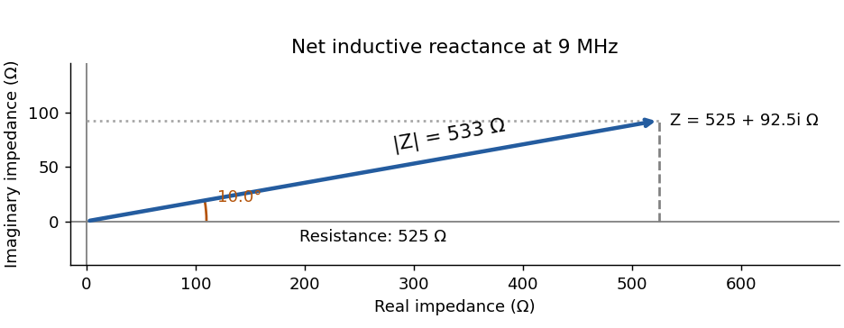
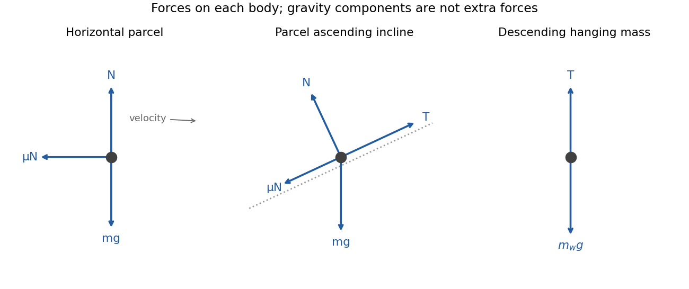
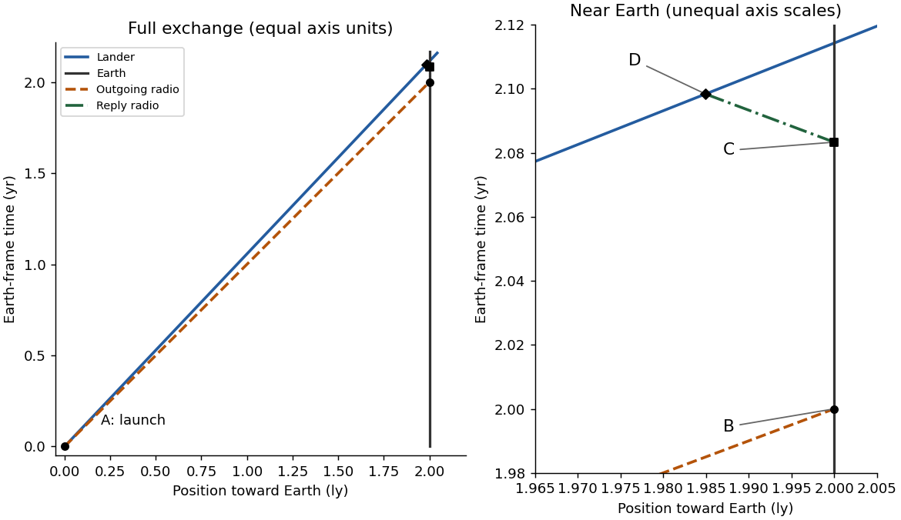

# Paper 1

↑ **Parent:** [2024](../2024.md)

[Original paper, released PDF pages 9–16](https://www.whatdotheyknow.com/request/request_for_nst_past_papers/response/3572306/attach/4/FOI%202026%20862%20Stack%20materials.pdf?cookie_passthrough=1#page=9)

**Table of contents**

- [Section A](#section-a)
  - [1](#section-a/1)
    - [Solution](#section-a/1/solution)
  - [2](#section-a/2)
    - [Solution](#section-a/2/solution)
  - [3](#section-a/3)
    - [Solution](#section-a/3/solution)
  - [4](#section-a/4)
    - [Solution](#section-a/4/solution)
  - [5](#section-a/5)
    - [Solution](#section-a/5/solution)
- [Section B](#section-b)
  - [6](#section-b/6)
    - [a](#section-b/6/a)
      - [Solution](#section-b/6/a/solution)
    - [b](#section-b/6/b)
      - [Solution](#section-b/6/b/solution)
    - [c](#section-b/6/c)
      - [Solution](#section-b/6/c/solution)
    - [d](#section-b/6/d)
      - [Solution](#section-b/6/d/solution)
    - [e](#section-b/6/e)
      - [Solution](#section-b/6/e/solution)
    - [f](#section-b/6/f)
      - [Solution](#section-b/6/f/solution)
    - [g](#section-b/6/g)
      - [Solution](#section-b/6/g/solution)
  - [7](#section-b/7)
    - [a](#section-b/7/a)
      - [Solution](#section-b/7/a/solution)
    - [b](#section-b/7/b)
      - [Solution](#section-b/7/b/solution)
    - [c](#section-b/7/c)
      - [Solution](#section-b/7/c/solution)
    - [d](#section-b/7/d)
      - [Solution](#section-b/7/d/solution)
    - [e](#section-b/7/e)
      - [Solution](#section-b/7/e/solution)
  - [8](#section-b/8)
    - [a](#section-b/8/a)
      - [Solution](#section-b/8/a/solution)
    - [b](#section-b/8/b)
      - [Solution](#section-b/8/b/solution)
    - [c](#section-b/8/c)
      - [Solution](#section-b/8/c/solution)
    - [d](#section-b/8/d)
      - [Solution](#section-b/8/d/solution)
    - [e](#section-b/8/e)
      - [Solution](#section-b/8/e/solution)
  - [9](#section-b/9)
    - [a](#section-b/9/a)
      - [Solution](#section-b/9/a/solution)
    - [b](#section-b/9/b)
      - [Solution](#section-b/9/b/solution)
    - [c](#section-b/9/c)
      - [Solution](#section-b/9/c/solution)
    - [d](#section-b/9/d)
      - [Solution](#section-b/9/d/solution)
    - [e](#section-b/9/e)
      - [Solution](#section-b/9/e/solution)
    - [f](#section-b/9/f)
      - [Solution](#section-b/9/f/solution)
    - [g](#section-b/9/g)
      - [Solution](#section-b/9/g/solution)
  - [10](#section-b/10)
    - [a](#section-b/10/a)
      - [Solution](#section-b/10/a/solution)
    - [b](#section-b/10/b)
      - [Solution](#section-b/10/b/solution)
    - [c](#section-b/10/c)
      - [Solution](#section-b/10/c/solution)
    - [d](#section-b/10/d)
      - [Solution](#section-b/10/d/solution)

## Section A

↑ **Parent:** [Paper 1](paper-1.md)

<h3 id="section-a/1">1</h3>

↑ **Parent:** [Section A](#section-a)

<h4 id="section-a/1/solution">Solution</h4>

↑ **Parent:** [1](#section-a/1)

The [surface tension](../../surface-tension.md) has dimensions $[\gamma]=MT^{-2}$, while $[\rho]=ML^{-3}$ and $[g]=LT^{-2}$. Consequently

$$
\left[\frac{\gamma}{\rho gd^n}\right]=\frac{MT^{-2}}{(ML^{-3})(LT^{-2})L^n}=L^{2-n}.
$$

Matching the dimension of height gives $2-n=1$, so **$n=1$**. [Dimensional analysis](../../mathematical-physics.md#dimensional-analysis) fixes this exponent but cannot determine a dimensionless prefactor or a contact-angle dependence.

<h3 id="section-a/2">2</h3>

↑ **Parent:** [Section A](#section-a)

<h4 id="section-a/2/solution">Solution</h4>

↑ **Parent:** [2](#section-a/2)

Using the convention $e^{i\omega t}$, the series [RLC circuit](../../electrical-circuit.md#rlc-circuit) has [complex impedance](../../electrical-circuit.md#electrical-impedance)

$$
Z=R+i\left(\omega L-\frac1{\omega C}\right),\qquad\omega=2\pi f.
$$

At the stated [frequency](../../wave.md#frequency), $\omega L=180.956\,\Omega$ and $1/(\omega C)=88.4194\,\Omega$. Thus

$$
\boxed{\operatorname{Im}Z=+92.5\,\Omega,\quad |Z|=533\,\Omega,\quad\arg Z=+10.0^\circ.}
$$

The vector is $(525,92.5)$ in the resistance–[reactance](../../electrical-circuit.md#electrical-reactance) plane. Positive [reactance](../../electrical-circuit.md#electrical-reactance) means that the net circuit is inductive and current lags voltage. With the alternative $e^{-i\omega t}$ convention the imaginary signs reverse, while the magnitude and physical [phase](../../wave.md#phase-waves) relationship agree.

**[Figure 1](#section-a/2/image-series-circuit-impedance-in-the-resistance-reactance-plane). Series-circuit impedance in the resistance–reactance plane**.

<h3 id="section-a/3">3</h3>

↑ **Parent:** [Section A](#section-a)

<h4 id="section-a/3/solution">Solution</h4>

↑ **Parent:** [3](#section-a/3)

The string's no-slip condition gives $v=R\omega$. Conservation of [mechanical energy](../../energy.md#mechanical-energy) from release to the stated height drop yields

$$
mgh=\frac12mv^2+\frac12I\frac{v^2}{R^2}.
$$

Solving for the spool's [moment of inertia](../../rigid-body-dynamics.md#moment-of-inertia),

$$
\boxed{I=\frac{2mghR^2}{v^2}-mR^2,\qquad A=2mghR^2,\quad B=mR^2.}
$$

The axle does no work because its point of application is fixed, and the ideal string and axle introduce no losses. The spool [mass](../../classical-mechanics.md#mass) $M$ is not needed to infer $I$ from this energy measurement.

<h3 id="section-a/4">4</h3>

↑ **Parent:** [Section A](#section-a)

<h4 id="section-a/4/solution">Solution</h4>

↑ **Parent:** [4](#section-a/4)

The slit spacing is $d=(600\times10^3)^{-1}\,\mathrm m=1.6667\,\mu\mathrm m$. At normal incidence, the [diffraction grating](../../physical-optics.md#diffraction-grating) maxima satisfy $d\sin\theta_m=m\lambda$. Therefore

$$
\boxed{\theta_1=\pm22.3^\circ,\qquad\theta_2=\pm49.4^\circ.}
$$

The third order would require $\sin\theta_3=3\lambda/d=1.1394>1$, so it cannot propagate. At fixed order and spacing, a longer [wavelength](../../wave-equation.md#wavelength) requires larger $|\theta|$. **Green light has a larger first-order [diffraction](../../quantum-scattering.md#diffraction) [angle](../../geometry-and-topology.md#angle) than blue light.**

<h3 id="section-a/5">5</h3>

↑ **Parent:** [Section A](#section-a)

<h4 id="section-a/5/solution">Solution</h4>

↑ **Parent:** [5](#section-a/5)

At closest approach the [velocity](../../classical-mechanics.md#velocity) is tangential. The conserved specific [orbital energy](../../celestial-mechanics.md#orbital-energy) and [specific angular momentum](../../celestial-mechanics.md#specific-angular-momentum) are

$$
\varepsilon=\frac{v_p^2}{2}-\frac{GM}{r_p}=-2.1972\times10^8\,\mathrm{m^2s^{-2}},\qquad\ell=r_pv_p.
$$

The negative energy gives an [elliptic orbit](../../celestial-mechanics.md#elliptic-orbit). Its [semi-major axis](../../celestial-mechanics.md#semi-major-axis) is

$$
a=-\frac{GM}{2\varepsilon}=3.0376\times10^{11}\,\mathrm m.
$$

Since $r_p+r_a=2a$,

$$
\boxed{r_a=2a-r_p=5.58\times10^{11}\,\mathrm m.}
$$

This treats the star as fixed, appropriate to $m\ll M$. Equivalently, equate the energy at the two turning points using $v_a=\ell/r_a$. The planet [mass](../../classical-mechanics.md#mass) cancels; a circular-orbit relation would be inappropriate here.

## Section B

↑ **Parent:** [Paper 1](paper-1.md)

<h3 id="section-b/6">6</h3>

↑ **Parent:** [Section B](#section-b)

<h4 id="section-b/6/a">a</h4>

↑ **Parent:** [6](#section-b/6)

<h5 id="section-b/6/a/solution">Solution</h5>

↑ **Parent:** [A](#section-b/6/a)

After the push, the [forces](../../force.md) are weight $mg$ downward, [normal reaction](../../force.md#normal-force) $N$ upward and sliding [friction](../../newtonian-mechanics.md#friction) $F=\mu N$ opposite the [velocity](../../classical-mechanics.md#velocity). There is no continuing applied push. The table has constant slope

$$
a=\frac{1.02-1.20}{1.50}=-0.120\,\mathrm{m\,s^{-2}}.
$$

Vertical balance gives $N=mg$, and horizontal motion gives $ma=-\mu mg$. Thus

$$
\boxed{\mu=\frac{0.120}{9.81}=0.0122.}
$$

The [friction](../../newtonian-mechanics.md#friction) magnitude is $0.0300\,\mathrm N$.

**[Figure 2](#section-b/6/a/image-free-body-diagrams-for-horizontal-sliding-the-inclined-parcel-and-the-hanging-weight). Free-body diagrams for horizontal sliding, the inclined parcel and the hanging weight**.

<h4 id="section-b/6/b">b</h4>

↑ **Parent:** [6](#section-b/6)

<h5 id="section-b/6/b/solution">Solution</h5>

↑ **Parent:** [B](#section-b/6/b)

The inclined parcel has [tension](../../force.md#tension) $T$ up the slope, weight $mg$ vertically downward, [normal reaction](../../force.md#normal-force) $N=mg\cos\theta$ and [friction](../../newtonian-mechanics.md#friction) $\mu mg\cos\theta$ down the slope. The hanging [mass](../../classical-mechanics.md#mass) has weight downward and [tension](../../force.md#tension) upward. The ideal string makes the two [acceleration](../../classical-mechanics.md#acceleration) magnitudes equal.

The [velocity](../../classical-mechanics.md#velocity) slope is **$a=2.4/1.5=1.60\,\mathrm{m\,s^{-2}}$**, up the track for the parcel and downward for the hanging [mass](../../classical-mechanics.md#mass). The [free-body diagrams](../../force.md#free-body-diagram) show gravity itself as one vector; its slope-parallel and normal components are used in the equations rather than counted as additional [forces](../../force.md).

<h4 id="section-b/6/c">c</h4>

↑ **Parent:** [6](#section-b/6)

<h5 id="section-b/6/c/solution">Solution</h5>

↑ **Parent:** [C](#section-b/6/c)

Let $m_p=0.250\,\mathrm{kg}$ and let $m_w$ be the hanging [mass](../../classical-mechanics.md#mass). Taking up-slope and downward respectively as positive,

$$
T-m_pg\sin\theta-\mu m_pg\cos\theta=m_pa,\qquad m_wg-T=m_wa.
$$

Eliminate the common [tension](../../force.md#tension) to obtain

$$
\boxed{m_w=\frac{m_p\{a+g(\sin\theta+\mu\cos\theta)\}}{g-a}=0.130\,\mathrm{kg}.}
$$

Here $\theta=10^\circ$, $\mu=0.1$ and $a=1.60\,\mathrm{m\,s^{-2}}$. The pulley changes the direction of the string [force](../../force.md); in the ideal model it does not change its magnitude.

<h4 id="section-b/6/d">d</h4>

↑ **Parent:** [6](#section-b/6)

<h5 id="section-b/6/d/solution">Solution</h5>

↑ **Parent:** [D](#section-b/6/d)

The required constant deceleration follows from $v^2=u^2+2as$:

$$
a=-\frac{4.8^2}{2(2)}=-5.76\,\mathrm{m\,s^{-2}}.
$$

Both gravity and sliding [friction](../../newtonian-mechanics.md#friction) oppose ascent, so $g(\sin\theta+0.1\cos\theta)=5.76$. Write

$$
\sin\theta+0.1\cos\theta=\sqrt{1.01}\sin(\theta+\arctan0.1).
$$

The physical incline solution is **$\theta=30.0^\circ$** more precisely $30.0389^\circ$. The combined [mass](../../classical-mechanics.md#mass) cancels from the equation. The top of the track is consequently $H=2\sin\theta=1.00117\,\mathrm m$ above its base.

<h4 id="section-b/6/e">e</h4>

↑ **Parent:** [6](#section-b/6)

<h5 id="section-b/6/e/solution">Solution</h5>

↑ **Parent:** [E](#section-b/6/e)

Let $x=0.400\,\mathrm m$ be the compression and $m_t=0.550\,\mathrm{kg}$ the combined [mass](../../classical-mechanics.md#mass). Starting from rest at the top, it falls through $H+x$ before maximum compression. Hence

$$
\frac12kx^2=m_tg(H+x),\qquad\boxed{k=94.5\,\mathrm{N\,m^{-1}}.}
$$

The gravitational drop during compression must be included. Equating $kx$ to the weight would instead describe a static equilibrium, not the turning point after a fall.

<h4 id="section-b/6/f">f</h4>

↑ **Parent:** [6](#section-b/6)

<h5 id="section-b/6/f/solution">Solution</h5>

↑ **Parent:** [F](#section-b/6/f)

Immediately after the parcel leaves, the [spring](../../elasticity-physics.md#spring) still stores $\tfrac12kx^2$, but only the $m_s=0.300\,\mathrm{kg}$ sledge is launched. Choose [gravitational potential](../../newton-s-law-of-universal-gravitation.md#newtonian-potential-of-a-point-mass) zero at the ramp base. Its initial position is $-x$, so [conservation of energy](../../mathematical-physics.md#conservation-of-energy) to the apex gives

$$
\frac12kx^2-m_sgx=m_sgH_s.
$$

Therefore

$$
\boxed{H_s=\frac{kx^2}{2m_sg}-x=2.17\,\mathrm m}
$$

above the ramp base. Its upward travel from the compressed position is $H_s+x=2.56882\,\mathrm m$, a different distance from the height above the base.

<h4 id="section-b/6/g">g</h4>

↑ **Parent:** [6](#section-b/6)

<h5 id="section-b/6/g/solution">Solution</h5>

↑ **Parent:** [G](#section-b/6/g)

For actual complete bounce distances $D_1=4\,\mathrm m$ and $D_{n+1}=rD_n$, the [geometric series](../../sequence-and-series.md#geometric-series) gives

$$
\boxed{D_{\rm total}=\frac{4}{1-r}\,\mathrm m,\qquad0\leq r<1.}
$$

A natural intended estimate compares the observed first round trip with the loss-free round trip from the initially compressed position,

$$
D_{\rm ideal}=2(H_s+x)=5.13764\,\mathrm m.
$$

If the reduction factor is taken to be $r=D_1/D_{\rm ideal}=0.77857$, the answer is **$D_{\rm total}\simeq18.1\,\mathrm m$**. The first term is the actual 4 m, not the hypothetical loss-free distance.

This numerical inference needs the stated comparison assumption. Strictly, knowing the first actual bounce distance and saying subsequent distances share a ratio does not independently specify that ratio. A change in [spring](../../elasticity-physics.md#spring) compression also means that an energy-loss fraction is not automatically the same as a vertical-distance ratio.

<h3 id="section-b/7">7</h3>

↑ **Parent:** [Section B](#section-b)

<h4 id="section-b/7/a">a</h4>

↑ **Parent:** [7](#section-b/7)

<h5 id="section-b/7/a/solution">Solution</h5>

↑ **Parent:** [A](#section-b/7/a)

The collinear [relativistic velocity addition](../../special-relativity.md#velocity-addition-formula) formula is

$$
u=\frac{v+u'}{1+vu'/c^2}.
$$

With both [velocities](../../classical-mechanics.md#velocity) directed toward Earth,

$$
\boxed{u=\frac{0.6c+0.8c}{1+0.48}=\frac{35}{37}c=0.946c.}
$$

The denominator keeps the result below $c$. Adding the two speeds by the Galilean rule would give an inadmissible $1.4c$.

<h4 id="section-b/7/b">b</h4>

↑ **Parent:** [7](#section-b/7)

<h5 id="section-b/7/b/solution">Solution</h5>

↑ **Parent:** [B](#section-b/7/b)

The separation simultaneous in the mothership frame at launch is the [length contraction](../../special-relativity.md#length-contraction) of the Earth-frame simultaneous separation:

$$
D'=\frac{2\,\mathrm{ly}}{\gamma_m}=1.60\,\mathrm{ly},\qquad\gamma_m=\frac1{\sqrt{1-0.6^2}}=1.25.
$$

In that frame Earth approaches the launch position at $0.6c$ while the lander travels toward Earth at $0.8c$. Their coordinate separation closes at $1.4c$, so

$$
\boxed{t'_{\rm arrival}=\frac{1.60\,\mathrm{ly}}{1.4c}=\frac87\,\mathrm{yr}=1.14\,\mathrm{yr}.}
$$

A closing rate between two objects can exceed $c$; it is not either object's speed in the other's rest frame. Simultaneity matters: simply transforming the Earth event at Earth-frame launch time would not give the simultaneous mothership-frame separation.

<h4 id="section-b/7/c">c</h4>

↑ **Parent:** [7](#section-b/7)

<h5 id="section-b/7/c/solution">Solution</h5>

↑ **Parent:** [C](#section-b/7/c)

For the lander, $u/c=35/37$, so

$$
\gamma_u=\frac1{\sqrt{1-(35/37)^2}}=\frac{37}{12}.
$$

The [relativistic kinetic energy](../../energy.md#relativistic-kinetic-energy) is

$$
\boxed{K=(\gamma_u-1)mc^2=\frac{25}{12}(4\times10^5)c^2=7.49\times10^{22}\,\mathrm J.}
$$

The rest energy $mc^2$ is excluded from [kinetic energy](../../energy.md#kinetic-energy).

<h4 id="section-b/7/d">d</h4>

↑ **Parent:** [7](#section-b/7)

<h5 id="section-b/7/d/solution">Solution</h5>

↑ **Parent:** [D](#section-b/7/d)

Set the launch event to $(t,x)=(0,0)$ and measure $x$ toward Earth in light-years and $t$ in years, so light has coordinate slope magnitude one. Earth's [worldline](../../special-relativity.md#world-line) is $x=2$, and the lander's is $x=(35/37)t$. The outgoing signal is $x=t$ and reaches Earth at $B=(2,2)$. Earth's reply is sent at $C=(25/12,2)$.

The return signal has $x=2-(t-25/12)$. Its intersection with the lander gives $D=(1813/864,1715/864)$. Both signal lines are null; the lander's [worldline](../../special-relativity.md#world-line) lies inside the [light cone](../../special-relativity.md#light-cone). The drawing exaggerates the small gap near Earth in an inset so that B, C and D remain distinguishable.

**[Figure 3](#section-b/7/d/image-earth-frame-spacetime-diagram-of-the-outgoing-signal-delayed-reply-and-lander-worldline). Earth-frame spacetime diagram of the outgoing signal, delayed reply and lander worldline**.

<h4 id="section-b/7/e">e</h4>

↑ **Parent:** [7](#section-b/7)

<h5 id="section-b/7/e/solution">Solution</h5>

↑ **Parent:** [E](#section-b/7/e)

Equating the lander and return-signal positions gives

$$
\frac{35}{37}t_D=2-\left(t_D-\frac{25}{12}\right),\qquad\boxed{t_D=\frac{1813}{864}\,\mathrm{yr}=2.09838\,\mathrm{yr}.}
$$

This is measured from launch, so about 25.18 months pass on Earth-frame synchronized clocks. D occurs slightly before the lander reaches Earth at $t=74/35\,\mathrm{yr}$.

The two events A and D lie on the inertial lander's own [worldline](../../special-relativity.md#world-line), and their [proper time](../../special-relativity.md#proper-time) difference is

$$
\boxed{\Delta\tau=\frac{t_D}{\gamma_u}=\frac{49}{72}\,\mathrm{yr}=0.68056\,\mathrm{yr}\simeq8.17\text{ months}.}
$$

Equivalently, applying the [Lorentz transformation](../../special-relativity.md#lorentz-transformation) with $\Delta x=u\Delta t$ gives $\Delta t'=\gamma_u\Delta t(1-u^2/c^2)=\Delta t/\gamma_u$.

<h3 id="section-b/8">8</h3>

↑ **Parent:** [Section B](#section-b)

<h4 id="section-b/8/a">a</h4>

↑ **Parent:** [8](#section-b/8)

<h5 id="section-b/8/a/solution">Solution</h5>

↑ **Parent:** [A](#section-b/8/a)

The central rod occupies the holes in the discs, so the disc masses must be annular rather than counted as solid discs overlapping the rod. Define $C=L_1\rho_1=2L_2\rho_2$. Then

$$
M=\pi r_1^2L_1\rho_1+2\pi(r_2^2-r_1^2)L_2\rho_2=\pi Cr_2^2.
$$

The axial [moment of inertia](../../rigid-body-dynamics.md#moment-of-inertia) is

$$
I=\frac\pi2L_1\rho_1r_1^4+\pi L_2\rho_2(r_2^4-r_1^4)=\frac\pi2Cr_2^4.
$$

Thus **$I=\tfrac12Mr_2^2$**, exactly the axial inertia of a uniform disc of outer radius $r_2$ and [mass](../../classical-mechanics.md#mass) $M$. The cancellation uses the given [density](../../fluid-mechanics.md#density)–length relation.

<h4 id="section-b/8/b">b</h4>

↑ **Parent:** [8](#section-b/8)

<h5 id="section-b/8/b/solution">Solution</h5>

↑ **Parent:** [B](#section-b/8/b)

The contact radius is $r_1$, so [rolling without slipping](../../rigid-body-dynamics.md#rolling-without-slipping) gives $v=r_1\omega$. With $I=Mr_2^2/2$, the energy at the minimum of the stated parabolic motion model is

$$
Mgh_0=\frac12Mv_{\max}^2+\frac12\frac{Mr_2^2}{2}\frac{v_{\max}^2}{r_1^2}.
$$

Consequently

$$
\boxed{v_{\max}=\frac{2\sqrt{gh_0}}{\sqrt{(r_2/r_1)^2+2}}=0.148\,\mathrm{m\,s^{-1}}.}
$$

The corresponding spin [angular frequency](../../lagrangian-mechanics.md#angular-frequency) is **$\omega_{\max}=v_{\max}/r_1=14.8\,\mathrm{rad\,s^{-1}}$**. It is the rod radius, not the disc radius, that relates translation and rotation; the discs determine the larger rotational inertia.

<h4 id="section-b/8/c">c</h4>

↑ **Parent:** [8](#section-b/8)

<h5 id="section-b/8/c/solution">Solution</h5>

↑ **Parent:** [C](#section-b/8/c)

In the small-amplitude approximation, $\dot x$ is the speed along the track, and $y=Bx^2$ supplies the [gravitational potential](../../newton-s-law-of-universal-gravitation.md#newtonian-potential-of-a-point-mass). The conserved energy is

$$
E=\frac M2\left(1+\frac{r_2^2}{2r_1^2}\right)\dot x^2+MgBx^2.
$$

Differentiating and extending through turning points by continuity gives

$$
\left(1+\frac{r_2^2}{2r_1^2}\right)\ddot x+2gBx=0.
$$

This is [simple harmonic motion](../../classical-mechanics.md#simple-harmonic-motion) with $\omega_0^2=4gB/\{(r_2/r_1)^2+2\}$. Hence

$$
\boxed{f_0=\frac{\sqrt{gB}}{\pi\sqrt{(r_2/r_1)^2+2}}=0.235\,\mathrm{Hz}.}
$$

The [frequency](../../wave.md#frequency) is lower than for a sliding point [mass](../../classical-mechanics.md#mass) because energy is also stored in rotation.

<h4 id="section-b/8/d">d</h4>

↑ **Parent:** [8](#section-b/8)

<h5 id="section-b/8/d/solution">Solution</h5>

↑ **Parent:** [D](#section-b/8/d)

For weak linear [damping](../../wave-equation.md#damping), write the amplitude envelope as $A(t)=A_0e^{-\omega_0t/(2Q)}$. The amplitude e-folding time is $2Q/\omega_0$, and one period is approximately $2\pi/\omega_0$. Thus

$$
\boxed{N=\frac Q\pi=31.8\text{ oscillations}.}
$$

Energy, being proportional to amplitude squared, decays twice as rapidly in its exponent. Using its e-folding time instead would introduce a factor-of-two error.

<h4 id="section-b/8/e">e</h4>

↑ **Parent:** [8](#section-b/8)

<h5 id="section-b/8/e/solution">Solution</h5>

↑ **Parent:** [E](#section-b/8/e)

At the initial turning point the oscillation energy is $E=Mgh_0=0.04905\,\mathrm J$. In the high-[quality factor](../../dynamical-systems.md#q-factor) regime, $Q=2\pi E/\Delta E$, so the required input per period is

$$
\boxed{\Delta E\simeq\frac{2\pi}{100}(0.04905)=3.08\times10^{-3}\,\mathrm J.}
$$

This replaces the small dissipated energy each cycle, rather than supplying the entire stored energy again.

<h3 id="section-b/9">9</h3>

↑ **Parent:** [Section B](#section-b)

<h4 id="section-b/9/a">a</h4>

↑ **Parent:** [9](#section-b/9)

<h5 id="section-b/9/a/solution">Solution</h5>

↑ **Parent:** [A](#section-b/9/a)

$V(x)$ is the particle's [potential energy](../../energy.md#potential-energy) as a function of position, and $E$ is its total energy [eigenvalue](../../linear-operator-theory.md#eigenvalue) in this [time-independent Schrödinger equation](../../mathematical-physics.md#time-independent-schrodinger-equation). Solving it with the boundary conditions determines the allowed [stationary states](../../quantum-system.md#stationary-state) and energy levels.

The [wavefunction](../../wave-function.md) is a [probability](../../probability-theory.md#probability) amplitude: the [Born rule](../../wave-function.md#born-rule) gives position [probability](../../probability-theory.md#probability) [density](../../fluid-mechanics.md#density) $|\psi(x)|^2$, normalized to unit [integral](../../integral.md) for one particle. $\psi$ itself need not be real or positive and is not a classical matter-density profile. The full stationary-state time dependence is $\Psi(x,t)=\psi(x)e^{-iEt/\hbar}$, leaving $|\Psi|^2$ time independent.

<h4 id="section-b/9/b">b</h4>

↑ **Parent:** [9](#section-b/9)

<h5 id="section-b/9/b/solution">Solution</h5>

↑ **Parent:** [B](#section-b/9/b)

For a nonzero integer mode, normalize the [wavefunction](../../wave-function.md):

$$
1=|A|^2\int_0^L\sin^2\frac{n\pi x}{L}\,dx=|A|^2\frac L2.
$$

Thus **$|A|=\sqrt{2/L}$**. Choosing an arbitrary overall [phase](../../wave.md#phase-waves) makes $A=\sqrt{2/L}$ real and positive. The physical modes are conventionally indexed $n=1,2,\ldots$; $n=0$ would be the zero function and cannot be normalized.

<h4 id="section-b/9/c">c</h4>

↑ **Parent:** [9](#section-b/9)

<h5 id="section-b/9/c/solution">Solution</h5>

↑ **Parent:** [C](#section-b/9/c)

Substitution into the [Schrödinger equation](../../mathematical-physics.md#schrodinger-equation) gives $E_n=V_0+n^2\pi^2\hbar^2/(2mL^2)$. For the stated [electron](../../physics.md#electron) well,

$$
\boxed{E_2=37.6\,\mathrm{eV}=6.02\times10^{-18}\,\mathrm J.}
$$

The transition emits the energy difference, $\Delta E=E_2-E_1=3E_1=28.2\,\mathrm{eV}$, so

$$
\boxed{\lambda=\frac{hc}{\Delta E}=44.0\,\mathrm{nm}.}
$$

Using the full excited-state energy as the [photon](../../quantum-mechanics.md#photon) energy would neglect the nonzero ground-state energy.

<h4 id="section-b/9/d">d</h4>

↑ **Parent:** [9](#section-b/9)

<h5 id="section-b/9/d/solution">Solution</h5>

↑ **Parent:** [D](#section-b/9/d)

The position [probability](../../probability-theory.md#probability) [density](../../fluid-mechanics.md#density) is

$$
p(x)=\frac2L\sin^2\frac{2\pi x}{L}\quad(0\leq x\leq L),
$$

and zero outside. It has zeros at $0,L/2,L$ and equal maxima $2/L$ at $L/4,3L/4$. The two lobes have equal integrated [probability](../../probability-theory.md#probability). The vertical axis is a [density](../../fluid-mechanics.md#density) with units of inverse length, not a dimensionless [probability](../../probability-theory.md#probability) at a point.

**[Figure 4](#section-b/9/d/image-second-state-position-densities-for-an-infinite-well-and-an-illustrative-finite-well-including-evanescent-tails). Second-state position densities for an infinite well and an illustrative finite well, including evanescent tails**.

<h4 id="section-b/9/e">e</h4>

↑ **Parent:** [9](#section-b/9)

<h5 id="section-b/9/e/solution">Solution</h5>

↑ **Parent:** [E](#section-b/9/e)

Use the dimensionless coordinate $u=x/L$:

$$
P=\int_{0.45}^{0.55}2\sin^2(2\pi u)\,du=\left[u-\frac{\sin4\pi u}{4\pi}\right]_{0.45}^{0.55}.
$$

Therefore

$$
\boxed{P=0.1-\frac{\sin(\pi/5)}{2\pi}=0.00645\simeq0.645\%.}
$$

The central interval surrounds a node, which explains why the [probability](../../probability-theory.md#probability) is much smaller than its ten-percent share of the well's length.

<h4 id="section-b/9/f">f</h4>

↑ **Parent:** [9](#section-b/9)

<h5 id="section-b/9/f/solution">Solution</h5>

↑ **Parent:** [F](#section-b/9/f)

The [density](../../fluid-mechanics.md#density) is symmetric about $L/2$: $p(L-x)=p(x)$. Denote the [expectation](../../expected-value.md) by $\mu=\int_0^Lxp(x)\,dx$. Substitution $u=L-x$ gives

$$
\mu=\int_0^L(L-u)p(u)\,du=L\int_0^Lp(u)\,du-\mu=L-\mu.
$$

Thus **$\langle x\rangle=L/2$**. An [expectation](../../expected-value.md) need not coincide with a high-density position: the centre is a node of this particular state, but the two equally weighted lobes balance about it.

<h4 id="section-b/9/g">g</h4>

↑ **Parent:** [9](#section-b/9)

<h5 id="section-b/9/g/solution">Solution</h5>

↑ **Parent:** [G](#section-b/9/g)

For a symmetric finite well supporting this excited bound state, the [wavefunction](../../wave-function.md) and its derivative match continuously at each finite potential step. Outside, where $V_{\rm wall}>E$, the solution decays exponentially with

$$
\kappa=\frac{\sqrt{2m(V_{\rm wall}-E)}}\hbar.
$$

The [density](../../fluid-mechanics.md#density) therefore extends into the classically forbidden region instead of dropping to zero at the walls. Its interior lobes and normalization change, and the energy is lower than for the corresponding infinite-wall state at the same well bottom. [Symmetry](../../physics.md#symmetry-physics) preserves the central node for the first [excited state](../../energy-eigenvalue.md#excited-state). The diagram shows an explicitly illustrative barrier height, not an extra numerical value supplied by the question.

<h3 id="section-b/10">10</h3>

↑ **Parent:** [Section B](#section-b)

<h4 id="section-b/10/a">a</h4>

↑ **Parent:** [10](#section-b/10)

<h5 id="section-b/10/a/solution">Solution</h5>

↑ **Parent:** [A](#section-b/10/a)

In [magnetostatics](../../electromagnetism.md#magnetostatics), [Ampère's circuital law](../../maxwell-equations.md#ampere-s-circuital-law) is

$$
\oint_C\mathbf B\cdot d\boldsymbol\ell=\mu_0I_{\rm enclosed}.
$$

It relates magnetic circulation around a closed curve to the steady current through a spanning surface. It is especially useful when [symmetry](../../physics.md#symmetry-physics) makes the tangential field constant on a chosen path: an infinite straight wire gives $B=\mu_0I/(2\pi r)$, while an ideal long [solenoid](../../magnetic-field.md#solenoid) gives approximately $B=\mu_0nI$ inside.

The [Biot-Savart law](../../electromagnetism.md#biot-savart-law) gives the field contribution from the actual current geometry:

$$
\mathbf B(\mathbf r)=\frac{\mu_0I}{4\pi}\int\frac{d\boldsymbol\ell'\times(\mathbf r-\mathbf r')}{|\mathbf r-\mathbf r'|^3}.
$$

The [cross product](../../vector-space.md#cross-product) determines the direction by the [right-hand rule](../../electromagnetism.md#right-hand-rule). Integrating around a circular loop of radius $a$ gives $B=\mu_0I/(2a)$ at its centre. A finite wire segment can also be integrated directly, even though it lacks enough [symmetry](../../physics.md#symmetry-physics) for an Ampère-loop shortcut. The full steady-current circuit includes a return path; a segment calculation specifies that segment's contribution.

<h4 id="section-b/10/b">b</h4>

↑ **Parent:** [10](#section-b/10)

<h5 id="section-b/10/b/solution">Solution</h5>

↑ **Parent:** [B](#section-b/10/b)

Place the wire on the $y$ axis, its endpoints at $-a$ and $b$, and the observation point at $(-d,0)$. With current along $+y$, $d\boldsymbol\ell'\times\mathbf r$ points out of the page. Its magnitude gives

$$
B=\frac{\mu_0I}{4\pi}\int_{-a}^b\frac{d\,dy}{(d^2+y^2)^{3/2}}=\frac{\mu_0I}{4\pi d}\left[\frac y{\sqrt{d^2+y^2}}\right]_{-a}^{b}.
$$

In the question's [angle](../../geometry-and-topology.md#angle) convention, $\cos\beta=b/\sqrt{d^2+b^2}$ and $\cos\alpha=-a/\sqrt{d^2+a^2}$. Therefore

$$
\boxed{B=\frac{\mu_0I}{4\pi d}(\cos\beta-\cos\alpha).}
$$

The minus sign in $\cos\alpha$ matters because $\alpha$ is the exterior obtuse [angle](../../geometry-and-topology.md#angle).

<h4 id="section-b/10/c">c</h4>

↑ **Parent:** [10](#section-b/10)

<h5 id="section-b/10/c/solution">Solution</h5>

↑ **Parent:** [C](#section-b/10/c)

For a regular hexagon of side $a$, the perpendicular centre-to-side distance is $d=\sqrt3a/2$. Each side subtends endpoint [angles](../../geometry-and-topology.md#angle) with $\cos\beta=1/2$ and $\cos\alpha=-1/2$. Its centre field is consequently $\mu_0I/(4\pi d)$.

All six contributions have the same normal direction, so

$$
\boxed{B_{\rm centre}=6\frac{\mu_0I}{4\pi d}=\frac{\sqrt3\,\mu_0I}{\pi a}.}
$$

The direction follows the current's [right-hand rule](../../electromagnetism.md#right-hand-rule). Equal side lengths alone would not fix an arbitrary distorted hexagon's field; the usual regular-coil geometry is used here.

<h4 id="section-b/10/d">d</h4>

↑ **Parent:** [10](#section-b/10)

<h5 id="section-b/10/d/solution">Solution</h5>

↑ **Parent:** [D](#section-b/10/d)

The regular hexagon has area $A=6(\sqrt3a^2/4)=3\sqrt3a^2/2$. Choose $t=0$ with its positive normal parallel to the imposed field. The external [magnetic flux](../../magnetic-field.md#magnetic-flux) is $\Phi=B_0A\cos\omega t$, so [Faraday's law of induction](../../maxwell-equations.md#faraday-s-law-of-induction) gives

$$
\mathcal E=-\frac{d\Phi}{dt}=B_0A\omega\sin\omega t.
$$

Taking the stated resistance to determine the loop response,

$$
\boxed{I(t)=\frac{3\sqrt3B_0a^2\omega}{2R}\sin\omega t.}
$$

A different initial orientation adds a [phase](../../wave.md#phase-waves). The sign is with respect to the chosen loop orientation and obeys [Lenz's law](../../maxwell-equations.md#lenz-s-law); reversal of that orientation reverses the signed current. This expression neglects [self-inductance](../../electromagnetism.md#self-inductance), as in the resistive-loop model.

## ↑ Ancestors (10)

1. [2024](../2024.md)
2. [Past exam of the physics course of the year 1 of the natural sciences course of the University of Cambridge](../../past-exam-of-the-physics-course-of-the-year-1-of-the-natural-sciences-course-of-the-university-of-cambridge.md)
3. [Physics course of the year 1 of the natural sciences course of the University of Cambridge](../../university-of-cambridge.md#physics-course-of-the-year-1-of-the-natural-sciences-course-of-the-university-of-cambridge)
4. [Year 1 of the natural sciences course of the University of Cambridge](../../university-of-cambridge.md#year-1-of-the-natural-sciences-course-of-the-university-of-cambridge)
5. [Year of the natural sciences course of the University of Cambridge](../../university-of-cambridge.md#year-of-the-natural-sciences-course-of-the-university-of-cambridge)
6. [Natural sciences course of the University of Cambridge](../../university-of-cambridge.md#natural-sciences-course-of-the-university-of-cambridge)
7. [Course of the University of Cambridge](../../university-of-cambridge.md#course-of-the-university-of-cambridge)
8. [University of Cambridge](../../university-of-cambridge.md)
9. [List of universities](../../README.md#list-of-universities)
10. [Codex Wiki](../../README.md)
