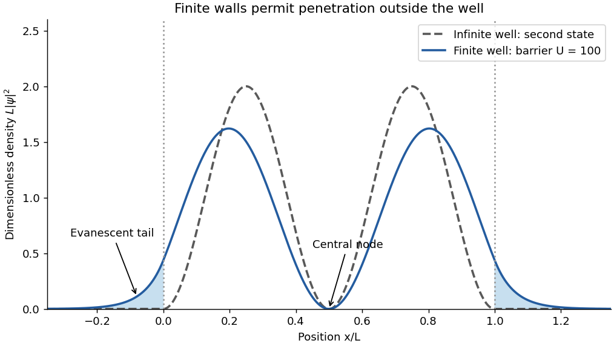

<h1 id="section-b/9/d/solution">Solution</h1>

↑ **Parent:** [D](../d.md)

The position [probability](../../../../../../probability.md) [density](../../../../../../density.md) is

$$
p(x)=\frac2L\sin^2\frac{2\pi x}{L}\quad(0\leq x\leq L),
$$

and zero outside. It has zeros at $0,L/2,L$ and equal maxima $2/L$ at $L/4,3L/4$. The two lobes have equal integrated [probability](../../../../../../probability.md). The vertical axis is a [density](../../../../../../density.md) with units of inverse length, not a dimensionless [probability](../../../../../../probability.md) at a point.

**[Figure 4](#section-b/9/d/image-second-state-position-densities-for-an-infinite-well-and-an-illustrative-finite-well-including-evanescent-tails). Second-state position densities for an infinite well and an illustrative finite well, including evanescent tails**.

## ↑ Ancestors (14)

1. [D](../d.md)
2. [9](../../9.md)
3. [Section B](../../../section-b.md)
4. [Paper 1](../../../../paper-1-split.md)
5. [2024](../../../../split.md)
6. [Past exam of the physics course of the year 1 of the natural sciences course of the University of Cambridge](../../../../../split.md)
7. [Physics course of the year 1 of the natural sciences course of the University of Cambridge](../../../../../../physics-course-of-the-year-1-of-the-natural-sciences-course-of-the-university-of-cambridge.md)
8. [Year 1 of the natural sciences course of the University of Cambridge](../../../../../../year-1-of-the-natural-sciences-course-of-the-university-of-cambridge.md)
9. [Year of the natural sciences course of the University of Cambridge](../../../../../../year-of-the-natural-sciences-course-of-the-university-of-cambridge.md)
10. [Natural sciences course of the University of Cambridge](../../../../../../natural-sciences-course-of-the-university-of-cambridge.md)
11. [Course of the University of Cambridge](../../../../../../course-of-the-university-of-cambridge.md)
12. [University of Cambridge](../../../../../../university-of-cambridge-split.md)
13. [List of universities](../../../../../../list-of-universities.md)
14. [Codex Wiki](../../../../../../split.md)
