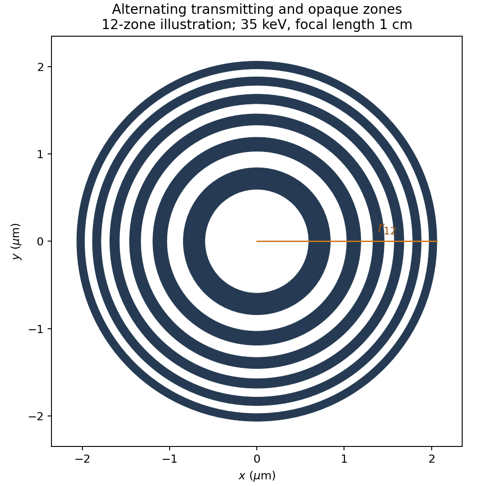
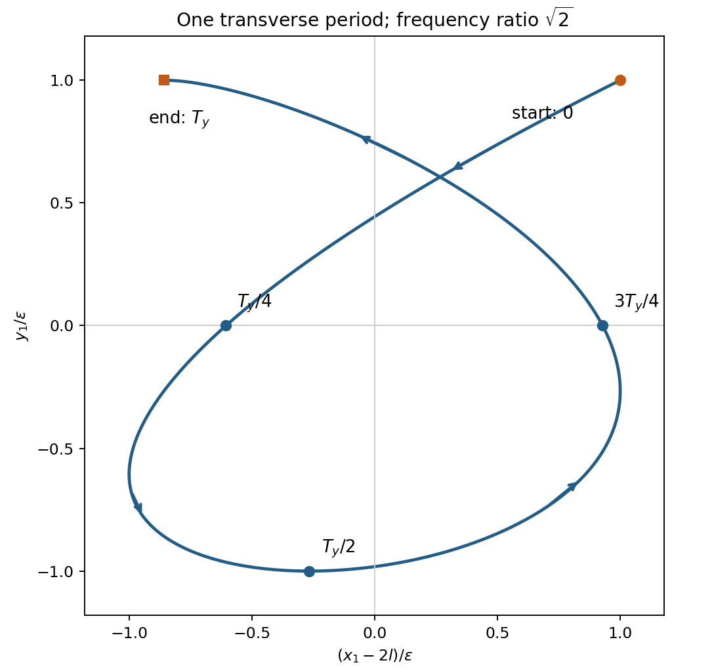
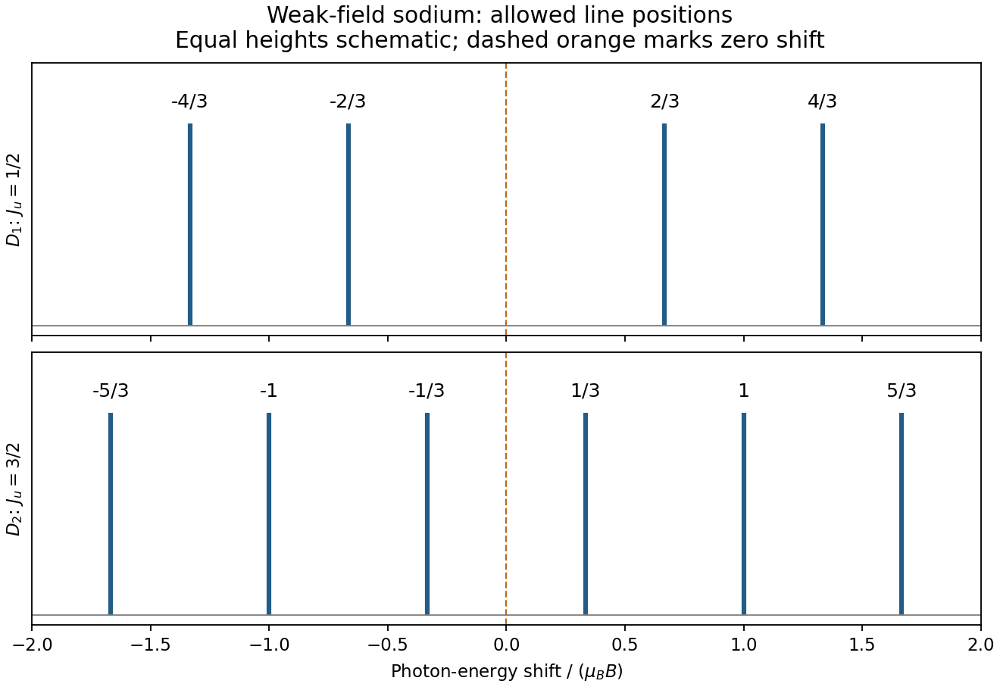
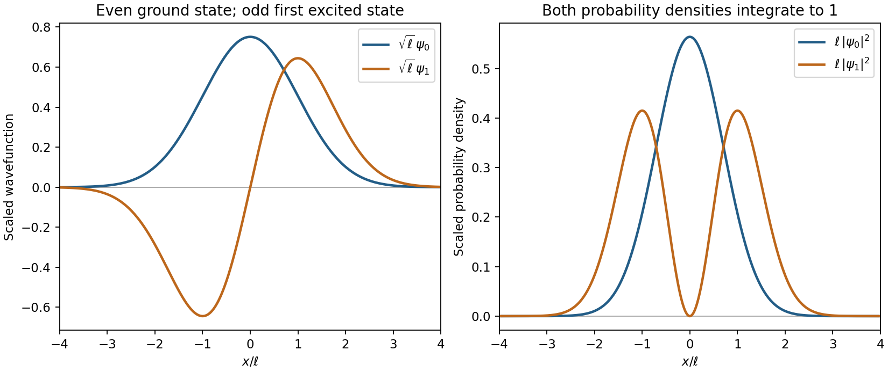

# Paper 1

↑ **Parent:** [2012](../2012.md)

Original paper: [Public original PDF, physical pages 427–434; cover on page 427 and questions on pages 428–434](https://www.whatdotheyknow.com/request/natural_science_tripos_physics_e_2/response/2340776/attach/2/FOI%202023%20399%20Zahid%20materials.pdf?cookie_passthrough=1#page=427).

**Table of contents**

- [Section A](#section-a)
  - [A1](#section-a/a1)
    - [a](#section-a/a1/a)
      - [Solution](#section-a/a1/a/solution)
    - [b](#section-a/a1/b)
      - [Solution](#section-a/a1/b/solution)
  - [A2](#section-a/a2)
    - [Solution](#section-a/a2/solution)
  - [A3](#section-a/a3)
    - [Solution](#section-a/a3/solution)
  - [A4](#section-a/a4)
    - [Solution](#section-a/a4/solution)
  - [A5](#section-a/a5)
    - [Solution](#section-a/a5/solution)
  - [A6](#section-a/a6)
    - [Solution](#section-a/a6/solution)
  - [A7](#section-a/a7)
    - [Solution](#section-a/a7/solution)
  - [A8](#section-a/a8)
    - [Solution](#section-a/a8/solution)
  - [A9](#section-a/a9)
    - [Solution](#section-a/a9/solution)
  - [A10](#section-a/a10)
    - [Solution](#section-a/a10/solution)
- [Section B](#section-b)
  - [B1](#section-b/b1)
    - [Solution](#section-b/b1/solution)
    - [a](#section-b/b1/a)
      - [Solution](#section-b/b1/a/solution)
    - [b](#section-b/b1/b)
      - [Solution](#section-b/b1/b/solution)
  - [B2](#section-b/b2)
    - [Solution](#section-b/b2/solution)
  - [B3](#section-b/b3)
    - [Solution](#section-b/b3/solution)
  - [B4](#section-b/b4)
    - [Solution](#section-b/b4/solution)
  - [B5](#section-b/b5)
    - [Solution](#section-b/b5/solution)
  - [B6](#section-b/b6)
    - [Solution](#section-b/b6/solution)
  - [B7](#section-b/b7)
    - [Solution](#section-b/b7/solution)
  - [B8](#section-b/b8)
    - [Solution](#section-b/b8/solution)

## Section A

↑ **Parent:** [Paper 1](paper-1.md)

<h3 id="section-a/a1">A1</h3>

↑ **Parent:** [Section A](#section-a)

<h4 id="section-a/a1/a">a</h4>

↑ **Parent:** [A1](#section-a/a1)

<h5 id="section-a/a1/a/solution">Solution</h5>

↑ **Parent:** [A](#section-a/a1/a)

The [probability density](../../wave-function.md#probability-density) is proportional to $|a+ix|^2=a^2+x^2$, not to the [complex amplitude](../../wave.md#complex-amplitude) itself. For equal small intervals approached from inside the support,

$$
\boxed{P_{0}:P_a=a^2:2a^2=1:2.}
$$

<h4 id="section-a/a1/b">b</h4>

↑ **Parent:** [A1](#section-a/a1)

<h5 id="section-a/a1/b/solution">Solution</h5>

↑ **Parent:** [B](#section-a/a1/b)

[Wavefunction normalization](../../wave-function.md#wavefunction-normalization) cancels in the ratio of integrals:

$$
\boxed{P(a/2<x<a)=\frac{\int_{a/2}^a(a^2+x^2)dx}{\int_0^a(a^2+x^2)dx}
=\frac{19a^3/24}{4a^3/3}=\frac{19}{32}.}
$$

A normalized version of the specified [wavefunction](../../wave-function.md) is $\sqrt3(a+ix)/(2a^{3/2})$ on its support.

<h3 id="section-a/a2">A2</h3>

↑ **Parent:** [Section A](#section-a)

<h4 id="section-a/a2/solution">Solution</h4>

↑ **Parent:** [A2](#section-a/a2)

For an [elastic eccentric impact of a thin disc](../../classical-mechanics.md#elastic-eccentric-impact-of-a-thin-disc), take upward [velocity](../../classical-mechanics.md#velocity) as positive and let $J$ be the short upward [impulse](../../classical-mechanics.md#impulse). The disc's [moment of inertia](../../rigid-body-dynamics.md#moment-of-inertia) about a horizontal diameter is $I=Ma^2/4$. With impact offset $d=a/2$,

$$
v_C=-u+J/M,\qquad \omega=Jd/I.
$$

The contact point has upward [velocity](../../classical-mechanics.md#velocity) $v_C+d\omega$. Unit restitution against the fixed post requires that [velocity](../../classical-mechanics.md#velocity) to be $+u$, so

$$
J\left(\frac1M+\frac{d^2}I\right)=2u.
$$

Since $I=Md^2$, **$J=Mu$ and the centre's instantaneous [speed](../../classical-mechanics.md#speed) is zero**. The disc rotates with $\omega=2u/a$; its [rotational kinetic energy](../../energy.md#rotational-kinetic-energy) $I\omega^2/2=Mu^2/2$ equals the entire initial [energy](../../energy.md). [Gravity](../../physics.md#gravity)'s [impulse](../../classical-mechanics.md#impulse) during the impact is neglected. Using the polar-axis [moment of inertia](../../rigid-body-dynamics.md#moment-of-inertia) would describe the wrong rotation axis.

<h3 id="section-a/a3">A3</h3>

↑ **Parent:** [Section A](#section-a)

<h4 id="section-a/a3/solution">Solution</h4>

↑ **Parent:** [A3](#section-a/a3)

Treat the repeated angles as independent measurements of one fixed angle. Their [sample mean](../../variance.md#sample-mean), sample [standard deviation](../../variance.md#standard-deviation) and [standard error](../../statistical-inference.md#standard-error) of the [mean](../../expected-value.md) are

$$
\bar\theta=31.24^\circ,\qquad s_\theta=1.997^\circ,\qquad
\sigma_{\bar\theta}=s_\theta/\sqrt5=0.8931^\circ=0.01559\,\mathrm{rad}.
$$

For $y=A\cos\theta$, uncorrelated [standard uncertainties](../../physics.md#standard-uncertainty) give

$$
\left(\frac{\sigma_y}{|y|}\right)^2
=\left(\frac{\sigma_A}A\right)^2+\tan^2\bar\theta\,\sigma_{\bar\theta}^2.
$$

Interpreting the stated 1% [amplitude](../../wave.md#wave-amplitude) accuracy as a [standard uncertainty](../../physics.md#standard-uncertainty),

$$
\boxed{\sigma_y/|y|=0.01376\simeq1.38\%.}
$$

Use radians in the derivative. This is uncertainty in the result using the [mean](../../expected-value.md) angle, not the spread of individual angle measurements; the latter convention would use $s_\theta$ and give about $2.34\%$. An accuracy bound or systematic angular calibration error would require a different uncertainty model.

<h3 id="section-a/a4">A4</h3>

↑ **Parent:** [Section A](#section-a)

<h4 id="section-a/a4/solution">Solution</h4>

↑ **Parent:** [A4](#section-a/a4)

The [photon](../../quantum-mechanics.md#photon) [wavelength](../../wave-equation.md#wavelength) is $\lambda=hc/E=3.5424\times10^{-11}\,\mathrm m$. The [exact half-period zone radii](../../physical-optics.md#exact-half-period-zone-radii) for incident [plane waves](../../wave-function.md#plane-wave) are chosen so that the path to the axial focus increases by $\lambda/2$ per zone:

$$
\sqrt{f^2+r_n^2}-f=\frac{n\lambda}{2},\qquad
\boxed{r_n=\sqrt{nf\lambda+\frac{n^2\lambda^2}{4}}\simeq\sqrt{nf\lambda}.}
$$

Transmit alternate zones and block the others, with $r_0=0$. For $f=1.00\,\mathrm{cm}$, $r_1=0.5952\,\mathrm{\mu m}$. The number of zones is a design choice: **100 zones give outer [radius](../../topology.md#radius) $5.952\,\mathrm{\mu m}$ and outermost width about $29.8\,\mathrm{nm}$**. Adjacent open zones then arrive in [phase](../../wave.md#phase-waves) at the principal focus.

**[Figure 1](#section-a/a4/image-zone-plate-geometry). Zone-plate geometry**. Original illustrative binary amplitude plate with twelve zones for legibility; the numerical design in the solution uses one hundred zones. Boundary radii follow the derived half-period optical-path condition.

The blocking material must be sufficiently opaque at 35 keV; no attenuation coefficient or fabrication thickness is specified. A binary [amplitude](../../wave.md#wave-amplitude) plate also has zero-order transmission and other odd-order foci, so an aperture/order stop may be needed. The principal [focal length](../../geometrical-optics.md#focal-length) is chromatic, varying as $1/\lambda$ for fixed [radii](../../topology.md#radius).

<h3 id="section-a/a5">A5</h3>

↑ **Parent:** [Section A](#section-a)

<h4 id="section-a/a5/solution">Solution</h4>

↑ **Parent:** [A5](#section-a/a5)

The [geostationary gravitational clock gain](../../general-relativity.md#geostationary-gravitational-clock-gain) uses only the potential contribution, as requested. In the weak field, $d\tau/dt\simeq1+\Phi/c^2$ and $\Phi=-GM/r$. The geostationary [radius](../../topology.md#radius) follows from $GM/r_g^3=\Omega_\oplus^2$. Taking $GM\simeq gR^2$ with $g=9.81\,\mathrm{m\,s^{-2}}$, $R=6.4\times10^6\,\mathrm m$ and [sidereal day](../../astrophysics.md#sidereal-day) $86164\,\mathrm s$ gives $r_g\simeq4.23\times10^7\,\mathrm m$.

$$
\frac{\Delta\dot\tau}{\dot\tau}\simeq\frac{GM}{c^2}\left(\frac1R-\frac1{r_g}\right)
=5.93\times10^{-10},\qquad
\boxed{\Delta\tau_{\rm day}\simeq+51\,\mathrm{\mu s}.}
$$

The satellite clock gains time because it is at higher [gravitational potential](../../newton-s-law-of-universal-gravitation.md#newtonian-potential-of-a-point-mass). This is not the combined gravitational-plus-kinematic correction; the orbital and surface rotational [velocities](../../classical-mechanics.md#velocity) are deliberately outside the requested potential contribution.

<h3 id="section-a/a6">A6</h3>

↑ **Parent:** [Section A](#section-a)

<h4 id="section-a/a6/solution">Solution</h4>

↑ **Parent:** [A6](#section-a/a6)

For a reversible [refrigerator](../../thermodynamics.md#refrigerator), zero net [entropy](../../entropy.md) production gives $Q_h/T_h=Q_c/T_c$. Thus

$$
\boxed{Q_h^{\min}=1\,\mathrm J\times\frac{300}{4}=75\,\mathrm J.}
$$

The necessary work is $W=Q_h-Q_c=74\,\mathrm J$. Irreversibility increases the heat dumped to the surroundings; $74\,\mathrm J$ is the minimum work, not the requested rejected heat.

<h3 id="section-a/a7">A7</h3>

↑ **Parent:** [Section A](#section-a)

<h4 id="section-a/a7/solution">Solution</h4>

↑ **Parent:** [A7](#section-a/a7)

For the usual nonrelativistic dispersion, the three-dimensional [density of states](../../quantum-ideal-gas-statistics.md#density-of-states) is $g(\epsilon)=C\epsilon^{1/2}$. Filling all states through the [Fermi energy](../../quantum-ideal-gas-statistics.md#fermi-energy) gives

$$
\boxed{\frac UN=\frac{\int_0^{\epsilon_F}\epsilon^{3/2}d\epsilon}{\int_0^{\epsilon_F}\epsilon^{1/2}d\epsilon}=\frac35\epsilon_F.}
$$

Degeneracy factors cancel. More generally $\epsilon\propto p^s$ gives $U/N=3\epsilon_F/(3+s)$; an ultrarelativistic gas would give $3\epsilon_F/4$. The nonrelativistic result is the standard massive ideal-gas interpretation.

<h3 id="section-a/a8">A8</h3>

↑ **Parent:** [Section A](#section-a)

<h4 id="section-a/a8/solution">Solution</h4>

↑ **Parent:** [A8](#section-a/a8)

**Prefer molecular [rotational spectroscopy](../../molecule.md#rotational-spectroscopy) or [rovibrational spectroscopy](../../molecule.md#rovibrational-spectroscopy)**, because nuclear [masses](../../classical-mechanics.md#mass) enter their [reduced mass](../../classical-mechanics.md#reduced-mass) directly. For an [isotopologue](../../chemical-substance.md#isotopologue) with nuclear [reduced mass](../../classical-mechanics.md#reduced-mass) $\mu_N$,

$$
E_{\rm rot}\propto\frac1{\mu_NR_e^2},\qquad
\omega_{\rm vib}\simeq\sqrt{\frac K{\mu_N}}.
$$

[Isotope](../../chemical-substance.md#isotope) substitution therefore produces appreciable shifts and distinct sets of lines, assuming the same electronic potential and approximately unchanged [bond length](../../chemical-bond.md#bond-length) and [force](../../force.md) constant. A suitable heteronuclear molecule can provide electric-dipole rotational/vibrational spectra; other molecules may require [Raman spectroscopy](../../optics.md#raman-spectroscopy).

Atomic electronic energies instead depend on the electron-nucleus [reduced mass](../../classical-mechanics.md#reduced-mass) $m_eM/(m_e+M)$, whose fractional change is suppressed by $m_e/M$. High-resolution atomic [spectroscopy](../../physics.md#spectroscopy) can still detect [isotope shifts](../../physics.md#isotope-shift), including nuclear-size and many-electron [mass](../../classical-mechanics.md#mass) effects; it is not intrinsically incapable of identifying [isotopes](../../chemical-substance.md#isotope). Molecular spectra generally offer the stronger [mass](../../classical-mechanics.md#mass) sensitivity for this purpose.

<h3 id="section-a/a9">A9</h3>

↑ **Parent:** [Section A](#section-a)

<h4 id="section-a/a9/solution">Solution</h4>

↑ **Parent:** [A9](#section-a/a9)

The [vacuum](../../physics.md#vacuum) [wave equation](../../wave-equation.md) gives $\omega^2=c^2[k_g^2+(\pi/a)^2]$. The [cutoff frequency](../../electrical-engineering.md#cutoff-frequency) is $f_c=c/(2a)=1.499\,\mathrm{GHz}$. In a lossless empty guide, [energy](../../energy.md) travels at [group velocity](../../dispersion-relation.md#group-velocity),

$$
\boxed{v_E=\frac{d\omega}{dk_g}=c\sqrt{1-\frac{f_c^2}{f^2}}
=0.8003c\simeq2.40\times10^8\,\mathrm{m\,s^{-1}}.}
$$

The larger [phase velocity](../../dispersion-relation.md#phase-velocity) $\omega/k_g=c^2/v_E$ is not the [speed](../../classical-mechanics.md#speed) of [energy](../../energy.md) transport.

<h3 id="section-a/a10">A10</h3>

↑ **Parent:** [Section A](#section-a)

<h4 id="section-a/a10/solution">Solution</h4>

↑ **Parent:** [A10](#section-a/a10)

For a cylinder of [radius](../../topology.md#radius) $R_c$ in unbounded two-dimensional incompressible [potential flow](../../fluid-mechanics.md#potential-flow), a [velocity potential](../../fluid-mechanics.md#velocity-potential) is $\varphi=u(r+R_c^2/r)\cos\theta$. It gives

$$
v_r=u(1-R_c^2/r^2)\cos\theta,\qquad
v_\theta=-u(1+R_c^2/r^2)\sin\theta.
$$

On the surface $v_r=0$. The points nearest the banks are the sides perpendicular to the stream, $\theta=\pi/2,3\pi/2$, hence **the [speed](../../classical-mechanics.md#speed) is $2u$ at each**. This is the inviscid outer-flow [speed](../../classical-mechanics.md#speed); a real no-slip [boundary layer](../../continuum-mechanics.md#boundary-layer) has zero [velocity](../../classical-mechanics.md#velocity) at the material surface. The small-radius/wide-river assumption neglects bank effects.

## Section B

↑ **Parent:** [Paper 1](paper-1.md)

<h3 id="section-b/b1">B1</h3>

↑ **Parent:** [Section B](#section-b)

<h4 id="section-b/b1/solution">Solution</h4>

↑ **Parent:** [B1](#section-b/b1)

A [normal mode](../../wave-equation.md#normal-mode) is a small motion in which all coordinates oscillate at one common [angular frequency](../../lagrangian-mechanics.md#angular-frequency) with fixed relative [amplitudes](../../wave.md#wave-amplitude). For conservative linearized motion, these are [eigenvectors](../../linear-operator-theory.md#eigenvector) of the mass-weighted [stiffness matrix](../../finite-element-method.md#stiffness-matrix).

All three [springs](../../elasticity-physics.md#spring) are initially stretched from $l$ to $2l$, giving equal [tension](../../force.md#tension) $T_0=kl$ and zero resultant [force](../../force.md) on each [mass](../../classical-mechanics.md#mass). This prestress is essential for the transverse modes found below.

For the final [mixed-axis trajectory of a prestressed spring pair](../../wave-equation.md#mixed-axis-trajectory-of-a-prestressed-spring-pair), the initial displacements excite only the symmetric mode in each direction. Therefore, to first order in $\epsilon/l$,

$$
\boxed{x_1(t)=2l+\epsilon\cos(\sqrt{k/m}\,t),\qquad
y_1(t)=\epsilon\cos(\sqrt{k/(2m)}\,t).}
$$

The second [mass](../../classical-mechanics.md#mass) has the same displacements about $4l$. Over the first transverse [period](../../mathematics.md#period-of-a-function) $T_y=2\pi\sqrt{2m/k}$, write $s=t/T_y$:

$$
\frac{x_1-2l}{\epsilon}=\cos(2\pi\sqrt2\,s),\qquad
\frac{y_1}{\epsilon}=\cos(2\pi s),\qquad 0\le s\le1.
$$

The trajectory is not closed after $T_y$, because the [frequency](../../wave.md#frequency) ratio is $\sqrt2$. It ends at approximately $(-0.858,1)$ in these scaled coordinates rather than $(1,1)$.

**[Figure 2](#section-b/b1/image-prestressed-spring-trajectory). Prestressed spring trajectory**. Original first-transverse-period trajectory of the first mass. Markers distinguish initial and final points and intermediate quarter-period positions; both normal-coordinate amplitudes equal the release displacement.

<h4 id="section-b/b1/a">a</h4>

↑ **Parent:** [B1](#section-b/b1)

<h5 id="section-b/b1/a/solution">Solution</h5>

↑ **Parent:** [A](#section-b/b1/a)

Let $X_1,X_2$ be longitudinal displacements. [Hooke's law](../../elasticity-physics.md#hooke-s-law) gives

$$
m\begin{pmatrix}\ddot X_1\\\ddot X_2\end{pmatrix}
=-k\begin{pmatrix}2&-1\\-1&2\end{pmatrix}\begin{pmatrix}X_1\\X_2\end{pmatrix}.
$$

The symmetric and antisymmetric [eigenvectors](../../linear-operator-theory.md#eigenvector) are respectively $(1,1)$ and $(1,-1)$, so

$$
\boxed{\omega_{x,+}=\sqrt{k/m},\qquad \omega_{x,-}=\sqrt{3k/m}.}
$$

Ordinary [frequencies](../../wave.md#frequency) are these values divided by $2\pi$.

<h4 id="section-b/b1/b">b</h4>

↑ **Parent:** [B1](#section-b/b1)

<h5 id="section-b/b1/b/solution">Solution</h5>

↑ **Parent:** [B](#section-b/b1/b)

The [transverse stiffness of a stretched spring](../../elasticity-physics.md#transverse-stiffness-of-a-stretched-spring) follows because a [spring](../../elasticity-physics.md#spring) of [length](../../physics.md#length) $2l$ develops transverse [force](../../force.md) $T_0\Delta y/(2l)$ to first order. Its extension changes only at second order, so the leading transverse stiffness comes from its existing [tension](../../force.md#tension), not from that extension change. Here $T_0/(2l)=k/2$, giving

$$
m\begin{pmatrix}\ddot Y_1\\\ddot Y_2\end{pmatrix}
=-\frac k2\begin{pmatrix}2&-1\\-1&2\end{pmatrix}\begin{pmatrix}Y_1\\Y_2\end{pmatrix},\qquad
\boxed{\omega_{y,+}=\sqrt{k/(2m)},\quad\omega_{y,-}=\sqrt{3k/(2m)}.}
$$

The mode vectors are again $(1,1)$ and $(1,-1)$. Treating the [springs](../../elasticity-physics.md#spring) as unstretched would incorrectly remove this linear restoring [force](../../force.md).

<h3 id="section-b/b2">B2</h3>

↑ **Parent:** [Section B](#section-b)

<h4 id="section-b/b2/solution">Solution</h4>

↑ **Parent:** [B2](#section-b/b2)

The first-order [grating equation](../../physical-optics.md#grating-equation) is $d\sin\theta=\lambda$, so **$d=2.879\,\mathrm{\mu m}$**, about $347$ lines per millimetre. For $N$ equally illuminated lines,

$$
I(\theta)\propto I_1(\theta)\left|\frac{\sin(N\delta/2)}{\sin(\delta/2)}\right|^2,\qquad
\delta=2\pi d\sin\theta/\lambda.
$$

Principal maxima stay at the same angles, their peaks scale as $N^2$ for fixed illumination per line, and their angular widths shrink as $1/N$. The [resolving power of a diffraction grating](../../physical-optics.md#resolving-power-of-a-diffraction-grating) is $\lambda/\Delta\lambda=mN$. Thus first order needs **$N=1000$ and illuminated width $Nd\simeq2.88\,\mathrm{mm}$**.

The [grating dispersion](../../physical-optics.md#grating-dispersion) follows by differentiation: $d\theta/d\lambda=1/(d\cos\theta)$. With a detector centred on the chief ray, one pixel corresponds approximately to

$$
\boxed{\Delta\lambda_{\rm pixel}=\frac{w d\cos\theta}{f}=2.27\,\mathrm{nm}.}
$$

This exceeds the nominal $0.5\,\mathrm{nm}$ grating width. The practical resolution scale is therefore a few nanometres; two-pixel sampling gives about **$4.5\,\mathrm{nm}$**. Exact resolvability also depends on slit width and image sampling. Taking the detector coordinate as $f\tan\theta$ about the original axis instead changes the single-pixel estimate only to $2.20\,\mathrm{nm}$.

For ideal [photon counting](../../quantum-optics.md#photon-counting), [Poisson distribution](../../discrete-probability-distribution.md#poisson-distribution) statistics give SNR $=\sqrt{N_\gamma}$. Hence $N_\gamma=10^4$ and **$t_{\min}=10^4/(2\times10^5)=0.050\,\mathrm s$**.

Use a [lock-in amplifier](../../electrical-circuit.md#lock-in-amplifier) for [phase-sensitive detection](../../electrical-circuit.md#phase-sensitive-detection): chop or otherwise modulate the source before the entrance slit, retaining a synchronous reference. At each grating setting amplify the [photodiode](../../optical-instrument.md#photodiode) output, multiply it by a reference and [low-pass filter](../../electrical-engineering.md#low-pass-filter). For a signal $s\cos(\omega_rt+\phi)$ and reference $2\cos\omega_rt$, the low-pass output is $s\cos\phi$; [quadrature demodulation](../../electrical-engineering.md#quadrature-demodulation) also recovers $s\sin\phi$. Choose the modulation [frequency](../../wave.md#frequency) above slow drift while within the source/detector bandwidth and away from strong electrical [interference](../../physical-optics.md#interference-wave-propagation). Average for many cycles before changing the grating setting.

**[Figure 3](#section-b/b2/image-chopped-source-spectral-detection). Chopped-source spectral detection**. Original functional diagram separates modulation of the wanted source from unmodulated detector dark current and stray light. A shared reference drives demodulation; low-pass averaging sets the detected bandwidth.

This rejects steady backgrounds and reduces low-frequency noise through narrow-band detection. It does not remove random dark-current/stray-light [shot noise](../../electrical-engineering.md#shot-noise) within that bandwidth, nor a background modulated coherently with the source. The chopping geometry must therefore distinguish wanted light from stray paths.[physical pp. 1–2: phase-sensitive multiplication, low-pass filtering, bandwidth and quadrature outputs](../../physics-bibliography.md#about-lock-in-amplifiers-by-stanford-research-systems)

<h3 id="section-b/b3">B3</h3>

↑ **Parent:** [Section B](#section-b)

<h4 id="section-b/b3/solution">Solution</h4>

↑ **Parent:** [B3](#section-b/b3)

With microstate energies held fixed when differentiating,

$$
\boxed{\langle E\rangle=-\frac{Z'}Z=-\partial_\beta\ln Z,\qquad
\langle E^2\rangle=\frac{Z''}Z,\qquad
\sigma_E^2=\partial_\beta^2\ln Z.}
$$

Since $d\beta/dT=-1/(k_BT^2)$,

$$
\boxed{\sigma_E^2=k_BT^2C_V.}
$$

The [canonical ensemble](../../canonical-ensemble.md) fixes [volume](../../geometry-and-topology.md#volume) and [particle number](../../physics.md#particle-number), and any other external [Hamiltonian](../../hamiltonian-mechanics.md#hamiltonian) parameters. Thus the derivative is $C_V$; pressure-fixed fluctuations would naturally involve [enthalpy](../../enthalpy.md) in a different ensemble.

The [translational and two-level energy variance](../../canonical-ensemble.md#translational-and-two-level-energy-variance) follows because translation and internal states factorize for this dilute classical gas:

$$
Z=Z_{\rm tr}(1+e^{-\beta\epsilon})^N,\qquad
\ln Z_{\rm tr}=\text{constant}-\frac{3N}{2}\ln\beta.
$$

Differentiating twice yields

$$
\boxed{\sigma_E^2=\frac32N(k_BT)^2+
N\epsilon^2\frac{e^{\epsilon/(k_BT)}}{[1+e^{\epsilon/(k_BT)}]^2}.}
$$

The terms are independent translational and two-level binomial [variances](../../variance.md). At $k_BT\ll\epsilon$, excitation freezes out exponentially and translation dominates. At $k_BT\gg\epsilon$, the internal [variance](../../variance.md) tends to $N\epsilon^2/4$ while the translational [variance](../../variance.md) grows as $T^2$; the internal [heat capacity](../../heat.md#heat-capacity) consequently tends to zero. Fractional total-energy fluctuations are of order $N^{-1/2}$ for large $N$. The low-temperature statement presumes translation is still nondegenerate; at strictly zero [temperature](../../temperature.md) the classical-gas model fails.

<h3 id="section-b/b4">B4</h3>

↑ **Parent:** [Section B](#section-b)

<h4 id="section-b/b4/solution">Solution</h4>

↑ **Parent:** [B4](#section-b/b4)

Use [energy](../../energy.md) units $m=m_pc^2$, $M=m_Ac^2$, $e=E_\gamma$ and $P=pc=\sqrt{E^2-m^2}$. The [soft-photon resonant capture threshold](../../special-relativity.md#soft-photon-resonant-capture-threshold) follows from [four-momentum conservation](../../special-relativity.md#four-momentum-conservation):

$$
M^2=m^2+2e(E-P\cos\theta),\qquad
E-P\cos\theta=2E_0,\quad E_0=\frac{M^2-m^2}{4e}.
$$

For fixed [proton](../../physics.md#proton) [energy](../../energy.md) the left side is largest at head-on incidence. Its threshold is $E+P=2E_0$. Combining that with $(E-P)(E+P)=m^2$ gives

$$
\boxed{E_{\min}=E_0+\frac{m^2}{4E_0},\qquad
\frac{E_{\min}}m=\frac{E_0}m+\frac m{4E_0}.}
$$

Equality is allowed for a head-on [photon](../../quantum-mechanics.md#photon). Here $e=k_BT=2.3482\times10^{-4}\,\mathrm{eV}$, so

$$
\boxed{E_0=6.786\times10^{20}\,\mathrm{eV},\qquad E_{\min}/m\simeq7.23\times10^{11}.}
$$

A very soft [photon](../../quantum-mechanics.md#photon) needs an enormous [proton](../../physics.md#proton) [Lorentz factor](../../special-relativity.md#lorentz-factor) to reach the specified [invariant mass](../../special-relativity.md#invariant-mass). A true thermal [photon](../../quantum-mechanics.md#photon) distribution and a finite-width [resonance](../../dynamical-systems.md#resonance) would smear this monoenergetic threshold.

For $\theta=0$, $E-P=m^2/(E+P)\le m$, whereas $2E_0\gg m$, so production is impossible. For each nonzero angle, sufficiently large [energy](../../energy.md) is possible, and $P\simeq E$ gives

$$
\boxed{E\simeq\frac{2E_0}{1-\cos\theta}.}
$$

To find the [maximum deflection in soft-photon capture](../../special-relativity.md#maximum-deflection-in-soft-photon-capture), note that the final particle's transverse [momentum](../../momentum.md) comes entirely from the [photon](../../quantum-mechanics.md#photon):

$$
\tan\phi=\frac{e\sin\theta}{P+e\cos\theta}
\simeq\frac e{2E_0}\sin\theta(1-\cos\theta).
$$

Writing $x=\cos\theta$, maximization gives $(1-x)(2x+1)=0$ and the interior maximum $x=-1/2$. Therefore, to the same extraordinarily accurate ultrarelativistic order,

$$
\boxed{\theta_{\max}\simeq120^\circ,\qquad
\phi_{\max}\simeq\frac{3\sqrt3\,e}{8E_0}=2.25\times10^{-25}\,\mathrm{rad}.}
$$

The neglected relative corrections are of order $m^2/E_0^2$ and $e/E_0$, both around $10^{-24}$. The final particle is effectively collinear with the [proton](../../physics.md#proton) despite a large [photon](../../quantum-mechanics.md#photon) incidence angle.

<h3 id="section-b/b5">B5</h3>

↑ **Parent:** [Section B](#section-b)

<h4 id="section-b/b5/solution">Solution</h4>

↑ **Parent:** [B5](#section-b/b5)

In the weak-field [Zeeman effect](../../atomic-physics.md#zeeman-splitting), [spin-orbit coupling](../../atomic-physics.md#spin-orbit-interaction) keeps $L,S,J$ good and a level shifts by $\mu_Bg_JBm_J$. At fields large compared with fine-structure coupling but still within the linear electronic Zeeman approximation, $L$ and $S$ decouple: the [Paschen-Back effect](../../atomic-physics.md#paschen-back-effect) gives shifts $\mu_BB(m_L+2m_S)$. Electric-dipole transitions obey $\Delta m_L=0,\pm1$, $\Delta m_S=0$ in that limit, recovering an orbital triplet pattern. Intermediate fields mix the coupled states.

For the weak-field [sodium D-line Zeeman pattern](../../atomic-physics.md#sodium-d-line-zeeman-pattern), the given [Landé g-factor](../../atomic-physics.md#lande-g-factor) formula gives

$$
g({}^2S_{1/2})=2,\qquad g({}^2P_{1/2})=2/3,\qquad g({}^2P_{3/2})=4/3.
$$

Allowed [photon](../../quantum-mechanics.md#photon) shifts are $\delta E=\mu_BB(g_um_u-2m_l)$ with $m_u-m_l=0,\pm1$. Thus

$$
\boxed{D_1:\ \delta E/(\mu_BB)=\pm2/3,\pm4/3,\qquad
D_2:\ \delta E/(\mu_BB)=\pm1/3,\pm1,\pm5/3.}
$$

These are the four- and six-component patterns. Both $\pi$ and $\sigma$ components are represented, so an observation strictly along the field, which removes $\pi$ emission, would not show this complete pattern. [Hyperfine structure](../../quantum-mechanics.md#hyperfine-structure) is neglected.

**[Figure 4](#section-b/b5/image-calculated-sodium-zeeman-shifts). Calculated sodium Zeeman shifts**. Original stick positions calculated from selection rules and Landé factors, in units of magnetic energy. Equal plotted stick heights are illustrative and do not assert equal transition intensities. No source spectral figure is copied.

To determine the [magnetic field from a Zeeman diagram](../../atomic-physics.md#magnetic-field-from-a-zeeman-diagram), the unsplit separation provides its [energy](../../energy.md) scale:

$$
\Delta E_D=hc(1/\lambda_2-1/\lambda_1)=2.1315\times10^{-3}\,\mathrm{eV}.
$$

The smallest adjacent split spacing $s_E=2\mu_BB_1/3$ is approximately $0.070$ of that separation in the sketch. Therefore

$$
\boxed{B_1\simeq\frac{3(0.070)\Delta E_D}{2\mu_B}\simeq3.9\,\mathrm T\approx4\,\mathrm T.}
$$

This is a graphical estimate; the drawing does not warrant high precision. Its splitting [energy](../../energy.md) is small compared with $\Delta E_D$, consistent with the weak-field approximation.

For [Doppler resolution of a Zeeman pattern](../../quantum-ideal-gas-statistics.md#doppler-resolution-of-a-zeeman-pattern), thermal [velocities](../../classical-mechanics.md#velocity) give [Gaussian](../../probability-distribution.md#normal-distribution) [Doppler broadening](../../quantum-ideal-gas-statistics.md#doppler-broadening) with width

$$
\frac{\Delta\nu_D}{\nu}=\sqrt{\frac{8k_BT\ln2}{m_{\rm Na}c^2}},\qquad m_{\rm Na}=\frac{0.0230}{N_A}\,\mathrm{kg}.
$$

At $350\,\mathrm K$, the photon-energy FWHM near $589\,\mathrm{nm}$ is $5.88\times10^{-6}\,\mathrm{eV}$. Equating the smallest adjacent Zeeman spacing to this width gives **$B\sim0.15\,\mathrm T$** for loss of individually resolved components. There is no sharp [Gaussian](../../probability-distribution.md#normal-distribution) resolution threshold; using whole-pattern width instead gives a smaller field of order $0.03$–$0.04\,\mathrm T$ for complete disappearance into a single envelope. Instrumental and collisional broadening would also affect the estimate.

<h3 id="section-b/b6">B6</h3>

↑ **Parent:** [Section B](#section-b)

<h4 id="section-b/b6/solution">Solution</h4>

↑ **Parent:** [B6](#section-b/b6)

For the [quantum harmonic oscillator](../../quantum-harmonic-oscillator.md), using $[\hat x,\hat p]=i\hbar$, direct multiplication gives

$$
\hat a^\dagger\hat a=\frac{\hat p^2}{2m\hbar\omega}+\frac{m\omega\hat x^2}{2\hbar}-\frac12,
\qquad
\boxed{\hat H=(\hat a^\dagger\hat a+\tfrac12)\hbar\omega.}
$$

The [commutators](../../lie-algebra.md#commutator) are

$$
\boxed{[\hat a,\hat a^\dagger]=1,\quad
[\hat H,\hat a]=-\hbar\omega\hat a,\quad
[\hat H,\hat a^\dagger]=\hbar\omega\hat a^\dagger.}
$$

Thus each ladder operation shifts [energy](../../energy.md) by one quantum. The [ladder operator](../../semisimple-lie-algebra.md#ladder-operator) norms $\|a|n\rangle\|^2=n$ and $\|a^\dagger|n\rangle\|^2=n+1$, with conventional [phases](../../wave.md#phase-waves), give

$$
\boxed{\hat a|n\rangle=\sqrt n\,|n-1\rangle,\qquad
\hat a^\dagger|n\rangle=\sqrt{n+1}\,|n+1\rangle.}
$$

Let $\ell=\sqrt{\hbar/(m\omega)}$. In position space $\hat p=-i\hbar\partial_x$, so $a\psi_0=0$ becomes $(x+\ell^2\partial_x)\psi_0=0$. Normalizing and then applying $a^\dagger$ gives

$$
\boxed{\psi_0=(\pi\ell^2)^{-1/4}e^{-x^2/(2\ell^2)},\qquad
\psi_1=\sqrt2\frac{x}{\ell}\psi_0.}
$$

Their overlap vanishes because $\psi_0^*\psi_1$ is odd on the full real line; the [Gaussian](../../probability-distribution.md#normal-distribution) second moment verifies $\int|\psi_1|^2dx=1$.

**[Figure 5](#section-b/b6/image-oscillator-ground-and-first-states). Oscillator ground and first states**. Original normalized oscillator wavefunctions show even ground-state parity, odd first-excited parity and one interior node in the excited state.

<h3 id="section-b/b7">B7</h3>

↑ **Parent:** [Section B](#section-b)

<h4 id="section-b/b7/solution">Solution</h4>

↑ **Parent:** [B7](#section-b/b7)

For a normal from medium 1 to 2, the magnetic [boundary conditions](../../differential-equation.md#boundary-condition) are

$$
\boxed{\widehat{\mathbf n}\cdot(\mathbf B_2-\mathbf B_1)=0,\qquad
\widehat{\mathbf n}\times(\mathbf H_2-\mathbf H_1)=\mathbf K_{\rm free}.}
$$

Without a free surface current, tangential $H$ is continuous. To obtain the [magnetization of a permeable sphere](../../statistical-physics.md#magnetization-of-a-permeable-sphere) of [radius](../../topology.md#radius) $R$ and permeability $\mu_0(1+\chi)$, choose [magnetic scalar potentials](../../electromagnetism.md#magnetic-scalar-potential)

$$
\varphi_{\rm in}=-H_i r\cos\theta,\qquad
\varphi_{\rm out}=-H_0r\cos\theta+C\cos\theta/r^2.
$$

Tangential continuity gives $H_i=H_0-C/R^3$, and normal $B$ continuity gives $(1+\chi)H_i=H_0+2C/R^3$. Hence

$$
\boxed{\mathbf H_i=\frac{\mathbf H_0}{1+\chi/3},\qquad
\mathbf M=\frac{\chi\mathbf H_0}{1+\chi/3}.}
$$

The fields are uniform inside. For negative susceptibility, [magnetization](../../electromagnetism.md#magnetization) is antiparallel to the applied field; the scalar formula retains its negative sign.

For a small weakly magnetic body, the induced [magnetic energy](../../electromagnetic-wave.md#magnetic-energy) is $U_m=-\chi VB^2/(2\mu_0)$. The factor one-half accounts for building the induced moment. The vertical [force](../../force.md) is $F_z=\chi VBB'/\mu_0$. Balancing [gravity](../../physics.md#gravity) therefore gives

$$
\boxed{BB'=\frac{\mu_0\rho g}{\chi}.}
$$

A diamagnet needs a field decreasing in magnitude with height for an upward [force](../../force.md). For [diamagnetic levitation in an inverse-height field](../../electromagnetism.md#diamagnetic-levitation-in-an-inverse-height-field),

$$
BB'=-\frac{(B_0r_0)^2}{z^3},\qquad
\boxed{z_0=\left[\frac{-\chi(B_0r_0)^2}{\mu_0\rho g}\right]^{1/3}=0.0902\,\mathrm m\simeq9.0\,\mathrm{cm}.}
$$

The [force](../../force.md) falls as $z^{-3}$, giving a restoring vertical derivative at equilibrium. Full lateral stability would require the transverse field geometry, which is not specified.

<h3 id="section-b/b8">B8</h3>

↑ **Parent:** [Section B](#section-b)

<h4 id="section-b/b8/solution">Solution</h4>

↑ **Parent:** [B8](#section-b/b8)

The far fields obey $E_\theta=cB_\phi$. The radial component of their [Poynting vector](../../electromagnetic-wave.md#poynting-vector) is $E_\theta B_\phi/\mu_0$. Averaging $\ddot p^2=p_0^2\omega^4\cos^2\omega(t-r/c)$ and integrating $\int\sin^2\theta\,d\Omega=8\pi/3$ gives

$$
\boxed{P=\frac{\mu_0p_0^2\omega^4}{12\pi c}.}
$$

For a small isotropically polarizable particle, $p_0=\alpha E_0$ and incident [intensity](../../wave.md#intensity-physics) is $I=\epsilon_0cE_0^2/2$. Thus the total [Rayleigh scattering](../../electromagnetic-radiation.md#rayleigh-scattering) cross-section is

$$
\boxed{\sigma=\frac PI=\frac{\alpha^2\omega^4}{6\pi\epsilon_0^2c^4}
=\frac{8\pi^3\alpha^2}{3\epsilon_0^2\lambda^4}.}
$$

Each incident [linear polarization](../../electromagnetic-wave.md#linear-polarization) gives the same integrated [power](../../energy.md#power); averaging [unpolarized light](../../wave.md#unpolarized-light) does not add another factor of two. The scalar real [polarizability](../../electrostatics.md#electric-polarizability) approximation neglects absorption and molecular anisotropy.

For [Rayleigh attenuation from refractivity](../../electromagnetic-radiation.md#rayleigh-attenuation-from-refractivity) in dilute air, [polarization](../../wave.md#polarization-waves) [density](../../fluid-mechanics.md#density) is $\mathbf P=N\alpha\mathbf E$. Consequently $\epsilon_r=1+N\alpha/\epsilon_0$ and, with $\mu_r\simeq1$ and $n-1\ll1$,

$$
\boxed{n-1\simeq\frac{N\alpha}{2\epsilon_0}.}
$$

The ideal-gas [number density](../../statistical-physics.md#number-density) at the supplied pressure and [temperature](../../temperature.md) is $N=P/(k_BT)=2.47\times10^{25}\,\mathrm{m^{-3}}$, yielding $\alpha=2.15\times10^{-40}\,\mathrm{C\,m^2\,V^{-1}}$. For an explicit representative visible [wavelength](../../wave-equation.md#wavelength) $\lambda=550\,\mathrm{nm}$,

$$
\sigma\simeq5.33\times10^{-31}\,\mathrm{m^2},\qquad
\boxed{L_{\rm att}=\frac1{N\sigma}\simeq7.6\times10^4\,\mathrm m\approx76\,\mathrm{km}.}
$$

Direct-beam [intensity](../../wave.md#intensity-physics) follows $I(x)=I(0)e^{-x/L_{\rm att}}$. Equivalently $L_{\rm att}=3N\lambda^4/[32\pi^3(n-1)^2]$. Its strong [wavelength](../../wave-equation.md#wavelength) dependence gives roughly $21$–$200\,\mathrm{km}$ across $400$–$700\,\mathrm{nm}$ if refractivity is held fixed. This is a uniform-density dry-air scattering estimate, not absorption or transmission through a vertically stratified atmosphere; aerosols and molecular depolarization corrections are outside the given model.

## ↑ Ancestors (10)

1. [2012](../2012.md)
2. [Past exam of the physics course of the year 4 of the natural sciences course of the University of Cambridge](../../past-exam-of-the-physics-course-of-the-year-4-of-the-natural-sciences-course-of-the-university-of-cambridge.md)
3. [Physics course of the year 4 of the natural sciences course of the University of Cambridge](../../university-of-cambridge.md#physics-course-of-the-year-4-of-the-natural-sciences-course-of-the-university-of-cambridge)
4. [Year 4 of the natural sciences course of the University of Cambridge](../../university-of-cambridge.md#year-4-of-the-natural-sciences-course-of-the-university-of-cambridge)
5. [Year of the natural sciences course of the University of Cambridge](../../university-of-cambridge.md#year-of-the-natural-sciences-course-of-the-university-of-cambridge)
6. [Natural sciences course of the University of Cambridge](../../university-of-cambridge.md#natural-sciences-course-of-the-university-of-cambridge)
7. [Course of the University of Cambridge](../../university-of-cambridge.md#course-of-the-university-of-cambridge)
8. [University of Cambridge](../../university-of-cambridge.md)
9. [List of universities](../../README.md#list-of-universities)
10. [Codex Wiki](../../README.md)
