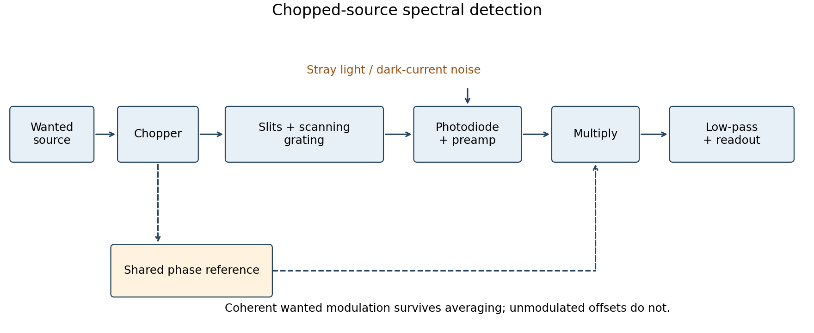

<h1 id="section-b/b2/solution">Solution</h1>

↑ **Parent:** [B2](../b2.md)

The first-order [grating equation](../../../../../grating-equation.md) is $d\sin\theta=\lambda$, so **$d=2.879\,\mathrm{\mu m}$**, about $347$ lines per millimetre. For $N$ equally illuminated lines,

$$
I(\theta)\propto I_1(\theta)\left|\frac{\sin(N\delta/2)}{\sin(\delta/2)}\right|^2,\qquad
\delta=2\pi d\sin\theta/\lambda.
$$

Principal maxima stay at the same angles, their peaks scale as $N^2$ for fixed illumination per line, and their angular widths shrink as $1/N$. The [resolving power of a diffraction grating](../../../../../resolving-power-of-a-diffraction-grating.md) is $\lambda/\Delta\lambda=mN$. Thus first order needs **$N=1000$ and illuminated width $Nd\simeq2.88\,\mathrm{mm}$**.

The [grating dispersion](../../../../../grating-dispersion.md) follows by differentiation: $d\theta/d\lambda=1/(d\cos\theta)$. With a detector centred on the chief ray, one pixel corresponds approximately to

$$
\boxed{\Delta\lambda_{\rm pixel}=\frac{w d\cos\theta}{f}=2.27\,\mathrm{nm}.}
$$

This exceeds the nominal $0.5\,\mathrm{nm}$ grating width. The practical resolution scale is therefore a few nanometres; two-pixel sampling gives about **$4.5\,\mathrm{nm}$**. Exact resolvability also depends on slit width and image sampling. Taking the detector coordinate as $f\tan\theta$ about the original axis instead changes the single-pixel estimate only to $2.20\,\mathrm{nm}$.

For ideal [photon counting](../../../../../photon-counting.md), [Poisson distribution](../../../../../poisson-distribution.md) statistics give SNR $=\sqrt{N_\gamma}$. Hence $N_\gamma=10^4$ and **$t_{\min}=10^4/(2\times10^5)=0.050\,\mathrm s$**.

Use a [lock-in amplifier](../../../../../lock-in-amplifier.md) for [phase-sensitive detection](../../../../../phase-sensitive-detection.md): chop or otherwise modulate the source before the entrance slit, retaining a synchronous reference. At each grating setting amplify the [photodiode](../../../../../photodiode.md) output, multiply it by a reference and [low-pass filter](../../../../../low-pass-filter.md). For a signal $s\cos(\omega_rt+\phi)$ and reference $2\cos\omega_rt$, the low-pass output is $s\cos\phi$; [quadrature demodulation](../../../../../quadrature-demodulation.md) also recovers $s\sin\phi$. Choose the modulation [frequency](../../../../../frequency.md) above slow drift while within the source/detector bandwidth and away from strong electrical [interference](../../../../../interference-wave-propagation.md). Average for many cycles before changing the grating setting.

**[Figure 3](#section-b/b2/image-chopped-source-spectral-detection). Chopped-source spectral detection**. Original functional diagram separates modulation of the wanted source from unmodulated detector dark current and stray light. A shared reference drives demodulation; low-pass averaging sets the detected bandwidth.

This rejects steady backgrounds and reduces low-frequency noise through narrow-band detection. It does not remove random dark-current/stray-light [shot noise](../../../../../shot-noise.md) within that bandwidth, nor a background modulated coherently with the source. The chopping geometry must therefore distinguish wanted light from stray paths.[physical pp. 1–2: phase-sensitive multiplication, low-pass filtering, bandwidth and quadrature outputs](../../../../../about-lock-in-amplifiers-by-stanford-research-systems.md)

## ↑ Ancestors (13)

1. [B2](../b2.md)
2. [Section B](../../section-b.md)
3. [Paper 1](../../../paper-1-split.md)
4. [2012](../../../split.md)
5. [Past exam of the physics course of the year 4 of the natural sciences course of the University of Cambridge](../../../../split.md)
6. [Physics course of the year 4 of the natural sciences course of the University of Cambridge](../../../../../physics-course-of-the-year-4-of-the-natural-sciences-course-of-the-university-of-cambridge.md)
7. [Year 4 of the natural sciences course of the University of Cambridge](../../../../../year-4-of-the-natural-sciences-course-of-the-university-of-cambridge.md)
8. [Year of the natural sciences course of the University of Cambridge](../../../../../year-of-the-natural-sciences-course-of-the-university-of-cambridge.md)
9. [Natural sciences course of the University of Cambridge](../../../../../natural-sciences-course-of-the-university-of-cambridge.md)
10. [Course of the University of Cambridge](../../../../../course-of-the-university-of-cambridge.md)
11. [University of Cambridge](../../../../../university-of-cambridge-split.md)
12. [List of universities](../../../../../list-of-universities.md)
13. [Codex Wiki](../../../../../split.md)
