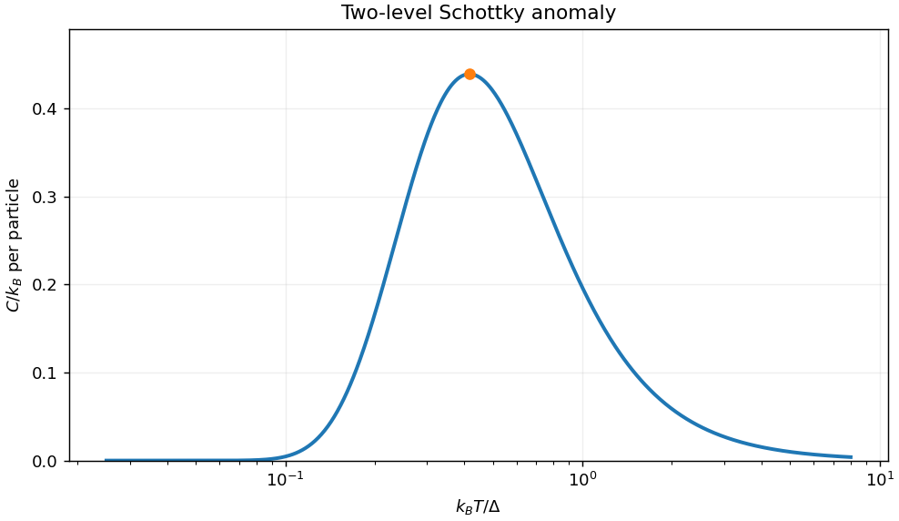

<h1 id="section-a/a4/solution">Solution</h1>

↑ **Parent:** [A4](../a4.md)

For equally nondegenerate levels, the [partition function](../../../../../canonical-partition-function.md) is $Z=e^{-\beta\epsilon}(1+e^{-\beta\Delta})$. The mean [energy](../../../../../energy-split.md) per particle is $U=\epsilon+\Delta/(1+e^{\beta\Delta})$, so the [Schottky anomaly](../../../../../schottky-anomaly.md) has [heat capacity](../../../../../heat-capacity.md)

$$
\boxed{C=k_B\left(\frac{\Delta}{k_BT}\right)^2
\frac{e^{\Delta/(k_BT)}}{[1+e^{\Delta/(k_BT)}]^2}.}
$$

At low [temperature](../../../../../temperature-split.md), $C\sim k_B(\Delta/k_BT)^2e^{-\Delta/(k_BT)}$ because excitation is suppressed. At high [temperature](../../../../../temperature-split.md), $C\sim\Delta^2/(4k_BT^2)$ because the two populations approach equality and the [energy](../../../../../energy-split.md) saturates. The peak is about $0.439k_B$ at $k_BT\simeq0.417\Delta$. The common offset $\epsilon$ does not affect [heat capacity](../../../../../heat-capacity.md). Multiply by particle number for the total [heat capacity](../../../../../heat-capacity.md), or divide by the corresponding [mass](../../../../../mass.md) for a mass-specific quantity.

**[Figure 1](#section-a/a4/image-two-level-schottky-heat-capacity-and-its-low-and-high-temperature-suppression). Two-level Schottky heat capacity and its low- and high-temperature suppression**.

## ↑ Ancestors (13)

1. [A4](../a4.md)
2. [Section A](../../section-a.md)
3. [Paper 1](../../../paper-1-split.md)
4. [2013](../../../split.md)
5. [Past exam of the physics course of the year 4 of the natural sciences course of the University of Cambridge](../../../../split.md)
6. [Physics course of the year 4 of the natural sciences course of the University of Cambridge](../../../../../physics-course-of-the-year-4-of-the-natural-sciences-course-of-the-university-of-cambridge.md)
7. [Year 4 of the natural sciences course of the University of Cambridge](../../../../../year-4-of-the-natural-sciences-course-of-the-university-of-cambridge.md)
8. [Year of the natural sciences course of the University of Cambridge](../../../../../year-of-the-natural-sciences-course-of-the-university-of-cambridge.md)
9. [Natural sciences course of the University of Cambridge](../../../../../natural-sciences-course-of-the-university-of-cambridge.md)
10. [Course of the University of Cambridge](../../../../../course-of-the-university-of-cambridge.md)
11. [University of Cambridge](../../../../../university-of-cambridge-split.md)
12. [List of universities](../../../../../list-of-universities.md)
13. [Codex Wiki](../../../../../split.md)
