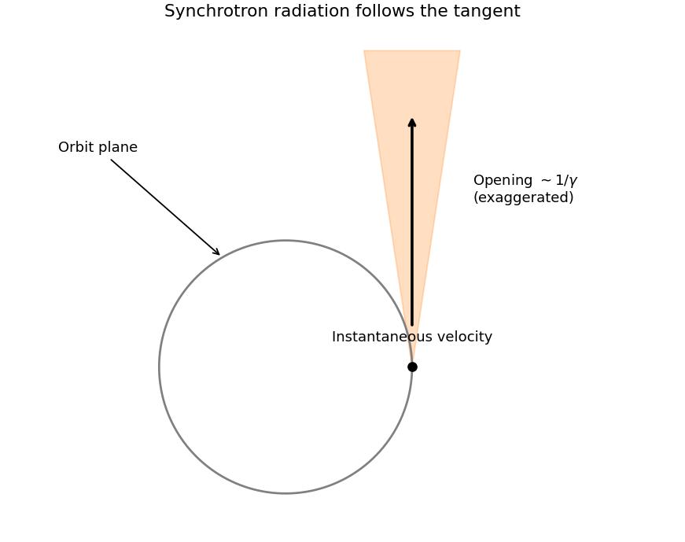

<h1 id="section-a/a7/solution">Solution</h1>

↑ **Parent:** [A7](../a7.md)

Relativistic [synchrotron radiation](../../../../../synchrotron-radiation.md) is concentrated within angle of order $1/\gamma$ around the instantaneous velocity, tangent to the circular orbit. The narrow instantaneous beam sweeps around with the particle; over a whole orbit the emission forms a thin fan about the orbital plane. With $E\gg m_ec^2$, $\gamma\simeq5000/0.5=10^4$. Since $\nu_{\rm orb}\simeq c/(2\pi R)$, the supplied characteristic-frequency scaling gives

$$
\boxed{\lambda_{\rm char}\sim\frac{2\pi R}{\gamma^3}\simeq6.3\times10^{-10}\,\mathrm m.}
$$

This is subnanometer X-ray radiation, with a beaming angle of order $10^{-4}\,\mathrm{rad}$. The conventional critical-angular-frequency normalization $\omega_c=3\gamma^3c/(2R)$ gives $4.2\times10^{-10}\,\mathrm m$ instead; the question's order-of-magnitude [frequency](../../../../../frequency.md) prescription does not distinguish these order-one factors.

**[Figure 2](#section-a/a7/image-instantaneous-synchrotron-beaming-along-the-tangent-opening-exaggerated-for-visibility). Instantaneous synchrotron beaming along the tangent; opening exaggerated for visibility**.

## ↑ Ancestors (13)

1. [A7](../a7.md)
2. [Section A](../../section-a.md)
3. [Paper 1](../../../paper-1-split.md)
4. [2013](../../../split.md)
5. [Past exam of the physics course of the year 4 of the natural sciences course of the University of Cambridge](../../../../split.md)
6. [Physics course of the year 4 of the natural sciences course of the University of Cambridge](../../../../../physics-course-of-the-year-4-of-the-natural-sciences-course-of-the-university-of-cambridge.md)
7. [Year 4 of the natural sciences course of the University of Cambridge](../../../../../year-4-of-the-natural-sciences-course-of-the-university-of-cambridge.md)
8. [Year of the natural sciences course of the University of Cambridge](../../../../../year-of-the-natural-sciences-course-of-the-university-of-cambridge.md)
9. [Natural sciences course of the University of Cambridge](../../../../../natural-sciences-course-of-the-university-of-cambridge.md)
10. [Course of the University of Cambridge](../../../../../course-of-the-university-of-cambridge.md)
11. [University of Cambridge](../../../../../university-of-cambridge-split.md)
12. [List of universities](../../../../../list-of-universities.md)
13. [Codex Wiki](../../../../../split.md)
