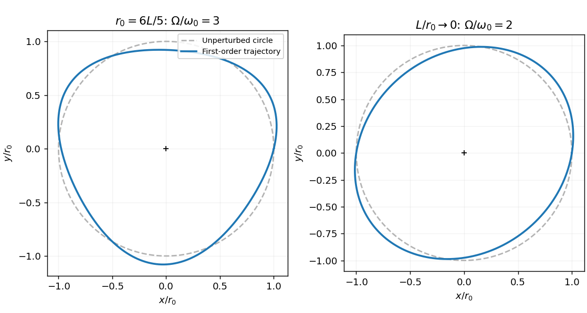

<h1 id="section-b/b1/solution">Solution</h1>

↑ **Parent:** [B1](../b1.md)

In a central potential, $J=mr^2\dot\theta$ is conserved. Substituting it into $U=m(\dot r^2+r^2\dot\theta^2)/2+V(r)$ gives

$$
U=\frac m2\dot r^2+V_{\rm eff}(r),\qquad V_{\rm eff}=\frac{J^2}{2mr^2}+V(r).
$$

While the string stays taut, $V=k(r-L)^2/2$. Circular [force](../../../../../force-split.md) balance gives $mr_0\omega_0^2=k(r_0-L)$, hence $\omega_0^2=k(r_0-L)/(mr_0)$. A radial impulse changes no [angular momentum](../../../../../angular-momentum.md). The [radial oscillation of an elastic-string orbit](../../../../../radial-oscillation-of-an-elastic-string-orbit.md) follows by expanding the same fixed-$J$ effective potential about its minimum:

$$
m\ddot{\delta r}=-V_{\rm eff}''(r_0)\delta r,\quad
\Omega^2=\frac{k}{m}+3\omega_0^2=\frac{k}{m}\left(4-\frac{3L}{r_0}\right),
$$

so

$$
\boxed{\frac\Omega{\omega_0}=\sqrt{\frac{4r_0-3L}{r_0-L}}.}
$$

For an outward impulse, one convenient linear approximation is $r=r_0+\epsilon\sin\Omega t$ and $\theta=\omega_0t+[2\omega_0\epsilon/(r_0\Omega)](\cos\Omega t-1)$. The angular modulation follows from $\dot\theta=J/(mr^2)$ and is needed for a consistent trajectory sketch.

**[Figure 3](#section-b/b1/image-small-radial-impulse-trajectories-threefold-modulation-and-the-harmonic-orbit-limit). Small radial-impulse trajectories: threefold modulation and the harmonic-orbit limit**.

## ↑ Ancestors (13)

1. [B1](../b1.md)
2. [Section B](../../section-b.md)
3. [Paper 1](../../../paper-1-split.md)
4. [2013](../../../split.md)
5. [Past exam of the physics course of the year 4 of the natural sciences course of the University of Cambridge](../../../../split.md)
6. [Physics course of the year 4 of the natural sciences course of the University of Cambridge](../../../../../physics-course-of-the-year-4-of-the-natural-sciences-course-of-the-university-of-cambridge.md)
7. [Year 4 of the natural sciences course of the University of Cambridge](../../../../../year-4-of-the-natural-sciences-course-of-the-university-of-cambridge.md)
8. [Year of the natural sciences course of the University of Cambridge](../../../../../year-of-the-natural-sciences-course-of-the-university-of-cambridge.md)
9. [Natural sciences course of the University of Cambridge](../../../../../natural-sciences-course-of-the-university-of-cambridge.md)
10. [Course of the University of Cambridge](../../../../../course-of-the-university-of-cambridge.md)
11. [University of Cambridge](../../../../../university-of-cambridge-split.md)
12. [List of universities](../../../../../list-of-universities.md)
13. [Codex Wiki](../../../../../split.md)
