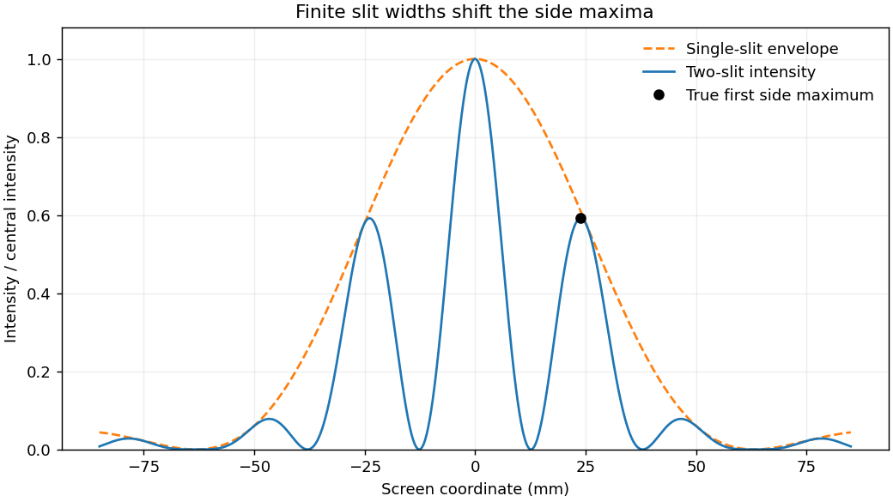

<h1 id="section-b/b2/solution">Solution</h1>

↑ **Parent:** [B2](../b2.md)

Expand the propagation distance at small angles:

$$
r\simeq L+\frac{x_0^2+y_0^2}{2L}-\frac{x_0x+y_0y}{L}+\frac{x^2+y^2}{2L}.
$$

The first two terms supply an aperture-independent phase. If the aperture quadratic phase is small, $k(x^2+y^2)/(2L)\ll1$, it too may be dropped from the integrand. The remaining [Fraunhofer diffraction](../../../../../fraunhofer-diffraction.md) amplitude is the aperture's [Fourier transform](../../../../../fourier-transform-split.md) at transverse wavevector $(kx_0/L,ky_0/L)$, as required.

For slit width $w$ and center spacing $d$, adding the two shifted top-hat transforms gives the normalized intensity

$$
\boxed{\frac{I(X)}{I(0)}=\left[\frac{\sin(\pi wX/(\lambda L))}{\pi wX/(\lambda L)}\right]^2
\cos^2\left(\frac{\pi dX}{\lambda L}\right).}
$$

The aperture outer half-width is $17.5\,\mathrm{\mu m}$; its maximum quadratic phase is only about $1.5\times10^{-3}$ radians at the given wavelength and distance, so the Fraunhofer approximation is excellent. Fringe spacing is $\lambda L/d=25.28\,\mathrm{mm}$ and the first single-slit envelope zero is at $\lambda L/w=63.2\,\mathrm{mm}$.

**[Figure 4](#section-b/b2/image-two-finite-width-slits-interference-fringes-diffraction-envelope-and-shifted-side-maximum). Two finite-width slits: interference fringes, diffraction envelope and shifted side maximum**.

The [side maximum of a finite-width double-slit pattern](../../../../../side-maximum-of-a-finite-width-double-slit-pattern.md) shifts slightly inward from $25.28\,\mathrm{mm}$. Differentiating the full intensity gives, away from zeros,

$$
\frac{\pi w}{\lambda L}\left[\cot u-\frac1u\right]
=\frac{\pi d}{\lambda L}\tan v,\quad u=\frac{\pi wX}{\lambda L},\quad v=\frac{\pi dX}{\lambda L}.
$$

Its first side maximum is at $X\simeq23.88\,\mathrm{mm}$ with $I/I(0)\simeq0.592$. The expected rate is therefore $59.2\,\mathrm{s^{-1}}$. Poisson shot noise gives signal-to-noise ratio $N/\sqrt N=\sqrt N$, so one needs $N=100$ counts:

$$
\boxed{t\simeq100/(59.2\,\mathrm{s^{-1}})=1.69\,\mathrm s.}
$$

Using the common fringe-center approximation instead gives relative intensity $\operatorname{sinc}^2(\pi w/d)\simeq0.573$ and $t\simeq1.75\,\mathrm s$. Both express the same order of exposure; the first uses the true maximum. Dark counts, background subtraction and uncertainty in the reference rate are excluded by the ideal stated noise model.

## ↑ Ancestors (13)

1. [B2](../b2.md)
2. [Section B](../../section-b.md)
3. [Paper 1](../../../paper-1-split.md)
4. [2013](../../../split.md)
5. [Past exam of the physics course of the year 4 of the natural sciences course of the University of Cambridge](../../../../split.md)
6. [Physics course of the year 4 of the natural sciences course of the University of Cambridge](../../../../../physics-course-of-the-year-4-of-the-natural-sciences-course-of-the-university-of-cambridge.md)
7. [Year 4 of the natural sciences course of the University of Cambridge](../../../../../year-4-of-the-natural-sciences-course-of-the-university-of-cambridge.md)
8. [Year of the natural sciences course of the University of Cambridge](../../../../../year-of-the-natural-sciences-course-of-the-university-of-cambridge.md)
9. [Natural sciences course of the University of Cambridge](../../../../../natural-sciences-course-of-the-university-of-cambridge.md)
10. [Course of the University of Cambridge](../../../../../course-of-the-university-of-cambridge.md)
11. [University of Cambridge](../../../../../university-of-cambridge-split.md)
12. [List of universities](../../../../../list-of-universities.md)
13. [Codex Wiki](../../../../../split.md)
