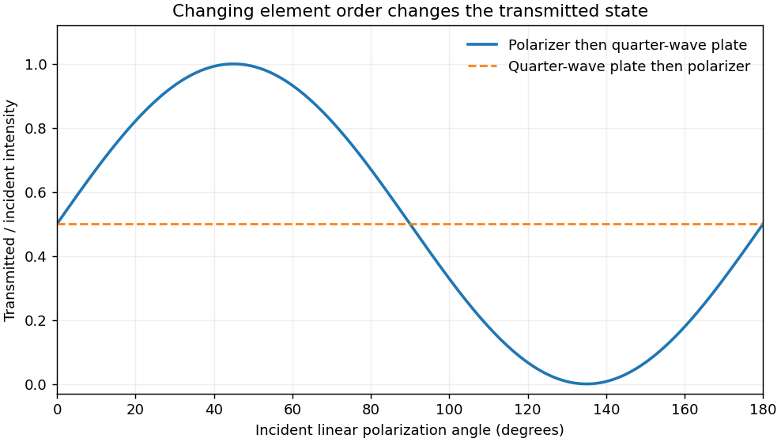

<h1 id="section-b/b3/solution">Solution</h1>

↑ **Parent:** [B3](../b3.md)

An ideal linear polarizer projects onto $\mathbf e_\theta=(\cos\theta,\sin\theta)^T$. Thus its [Jones matrix](../../../../../jones-matrix.md) is $P_\theta=\mathbf e_\theta\mathbf e_\theta^T$, immediately giving the specified entries. For time convention $e^{-i\omega t}$, a birefringent plate of thickness $d$ produces relative phase $2\pi(n_y-n_x)d/\lambda$. A quarter-wave thickness $d=\lambda/[4(n_y-n_x)]$ gives, after removing a common phase, $Q=\operatorname{diag}(1,i)$ when $x$ is fast.

For incident linear state $\mathbf E=E_0(\cos\theta,\sin\theta)^T$, the original order gives

$$
QP_{\pi/4}\mathbf E=\frac{E_0}{2}(\cos\theta+\sin\theta)\binom1i,
\qquad\boxed{I/I_0=\cos^2(\theta-\pi/4).}
$$

The transmitted state is circular wherever its amplitude is nonzero. Reversing the components gives

$$
P_{\pi/4}Q\mathbf E=\frac{E_0}{2}(\cos\theta+i\sin\theta)\binom11,
\qquad\boxed{I/I_0=\frac12,}
$$

and the output is linearly polarized at $45^\circ$. The incident circular state $\mathbf E\propto(1,i)^T$, called left-circular in the paper's convention, becomes $(1,-1)^T$ after $Q$ and is extinguished by $P_{\pi/4}$. Explicit Jones vectors fix the handedness convention without relying on an ambiguous viewing direction.

**[Figure 5](#section-b/b3/image-transmitted-intensity-versus-incident-linear-polarization-for-the-two-element-orders). Transmitted intensity versus incident linear polarization for the two element orders**.

With the stated normal mirror after the original system, an arbitrary incident field is first projected onto $45^\circ$ and then made circular. In fixed laboratory transverse axes, the mirror contributes a common reflection phase, and the reciprocal return plate contributes another $Q$. The round-trip matrix is consequently proportional to

$$
P_{\pi/4}Q^2P_{\pi/4}=P_{\pi/4}\begin{pmatrix}1&0\\0&-1\end{pmatrix}P_{\pi/4}=0.
$$

The returned field is orthogonal to the polarizer and is blocked. This suppresses the stipulated specular return toward a source, useful for avoiding optical feedback. The result concerns that mirror and return geometry; a reciprocal circular-polarizer assembly does not provide the general nonreciprocal two-port property of a Faraday optical isolator.

## ↑ Ancestors (13)

1. [B3](../b3.md)
2. [Section B](../../section-b.md)
3. [Paper 1](../../../paper-1-split.md)
4. [2013](../../../split.md)
5. [Past exam of the physics course of the year 4 of the natural sciences course of the University of Cambridge](../../../../split.md)
6. [Physics course of the year 4 of the natural sciences course of the University of Cambridge](../../../../../physics-course-of-the-year-4-of-the-natural-sciences-course-of-the-university-of-cambridge.md)
7. [Year 4 of the natural sciences course of the University of Cambridge](../../../../../year-4-of-the-natural-sciences-course-of-the-university-of-cambridge.md)
8. [Year of the natural sciences course of the University of Cambridge](../../../../../year-of-the-natural-sciences-course-of-the-university-of-cambridge.md)
9. [Natural sciences course of the University of Cambridge](../../../../../natural-sciences-course-of-the-university-of-cambridge.md)
10. [Course of the University of Cambridge](../../../../../course-of-the-university-of-cambridge.md)
11. [University of Cambridge](../../../../../university-of-cambridge-split.md)
12. [List of universities](../../../../../list-of-universities.md)
13. [Codex Wiki](../../../../../split.md)
