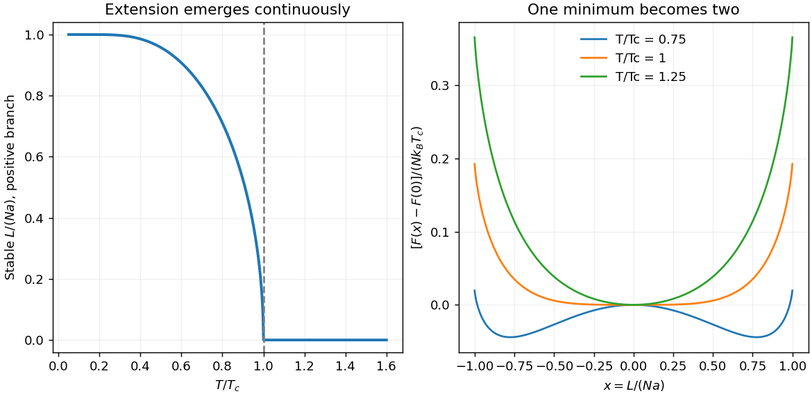

<h1 id="section-b/b4/solution">Solution</h1>

↑ **Parent:** [B4](../b4.md)

[Configurational entropy](../../../../../configurational-entropy.md) counts the arrangements compatible with a macroscopic configuration: $S=k_B\ln\Omega$. Let $x=L/(Na)$, $N_\downarrow=N(1+x)/2$ and $N_\uparrow=N(1-x)/2$. The multiplicity is $N!/(N_\downarrow!N_\uparrow!)$. [Stirling's approximation](../../../../../stirling-formula.md) therefore gives

$$
S=Nk_B\left[\ln2-\frac{1+x}{2}\ln(1+x)-\frac{1-x}{2}\ln(1-x)\right],\qquad |x|\le1.
$$

With downward $L$ positive, the gravitational [potential energy](../../../../../potential-energy.md) is $-mgL$. Minimizing the [Helmholtz free energy](../../../../../helmholtz-free-energy.md) $F=-mgL-TS$ gives $\operatorname{artanh}x=mga/(k_BT)$, hence

$$
\boxed{L=Na\tanh\left(\frac{mga}{k_BT}\right).}
$$

Raising [temperature](../../../../../temperature-split.md) reduces the extension: the entropic preference for many up/down arrangements opposes alignment by the load. For small loads, $L\simeq Na^2mg/(k_BT)$.

For the [positive-feedback entropic chain](../../../../../positive-feedback-entropic-chain.md) with replacement [force](../../../../../force-split.md) $f(L)=f_0L/a$, $f_0>0$, the conservative potential is $U(L)=-\int_0^Lf(s)\,ds=-f_0L^2/(2a)$. Using $-f(L)L$ would overcount it by a factor two. The stationary equation becomes

$$
\boxed{x=\tanh\left(\frac{T_c}{T}x\right),\qquad T_c=\frac{Naf_0}{k_B}.}
$$

Expansion about $x=0$ gives

$$
F=F(0)+\frac{Nk_B}{2}(T-T_c)x^2+\frac{Nk_BT}{12}x^4+O(x^6).
$$

For $T>T_c$ the stable extension is zero. Below $T_c$, nonzero minima appear, with $x\simeq\pm\sqrt{3(T_c-T)/T}$ close to the transition and $|x|\to1$ as $T\to0$. Restricting to downward extensions selects the positive branch. **The onset is continuous in this model**, with a nonanalytic mean-field change at $T_c$; a finite jump in $L$ does not follow from the printed [force](../../../../../force-split.md) law, despite the question's discontinuity wording. A finite chain has rounded fluctuations rather than a literal thermodynamic singularity.

**[Figure 6](#section-b/b4/image-positive-feedback-chain-continuous-mean-field-extension-and-changing-free-energy-minima). Positive-feedback chain: continuous mean-field extension and changing free-energy minima**.

This is the same self-consistency equation as the zero-field mean-field treatment of the [Ising model](../../../../../ising-model.md): the segment orientation corresponds to a spin, extension to magnetization, and the extension-dependent [force](../../../../../force-split.md) to the self-consistent molecular field. The competition between alignment [energy](../../../../../energy-split.md) and binary configurational [entropy](../../../../../entropy-split.md) explains the shared [temperature](../../../../../temperature-split.md) dependence.

## ↑ Ancestors (13)

1. [B4](../b4.md)
2. [Section B](../../section-b.md)
3. [Paper 1](../../../paper-1-split.md)
4. [2013](../../../split.md)
5. [Past exam of the physics course of the year 4 of the natural sciences course of the University of Cambridge](../../../../split.md)
6. [Physics course of the year 4 of the natural sciences course of the University of Cambridge](../../../../../physics-course-of-the-year-4-of-the-natural-sciences-course-of-the-university-of-cambridge.md)
7. [Year 4 of the natural sciences course of the University of Cambridge](../../../../../year-4-of-the-natural-sciences-course-of-the-university-of-cambridge.md)
8. [Year of the natural sciences course of the University of Cambridge](../../../../../year-of-the-natural-sciences-course-of-the-university-of-cambridge.md)
9. [Natural sciences course of the University of Cambridge](../../../../../natural-sciences-course-of-the-university-of-cambridge.md)
10. [Course of the University of Cambridge](../../../../../course-of-the-university-of-cambridge.md)
11. [University of Cambridge](../../../../../university-of-cambridge-split.md)
12. [List of universities](../../../../../list-of-universities.md)
13. [Codex Wiki](../../../../../split.md)
