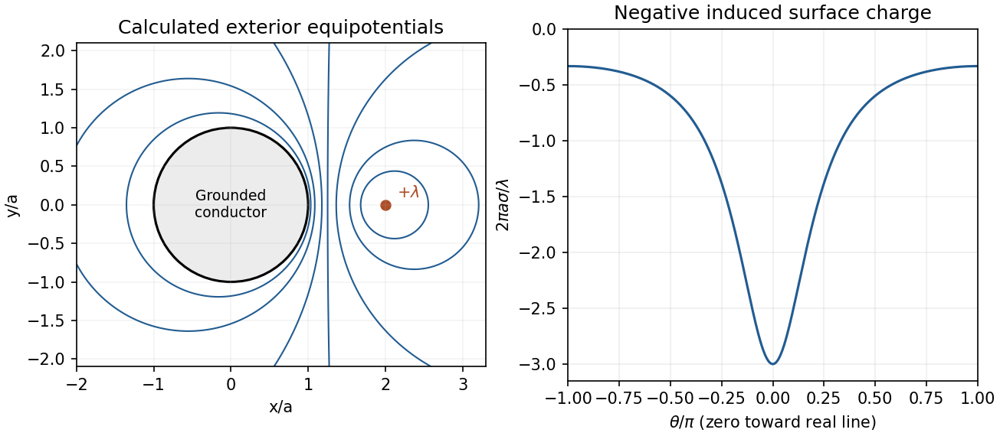
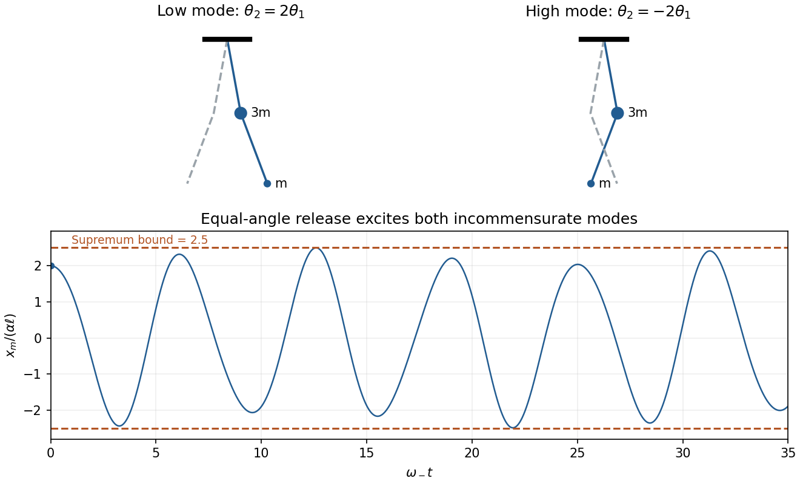
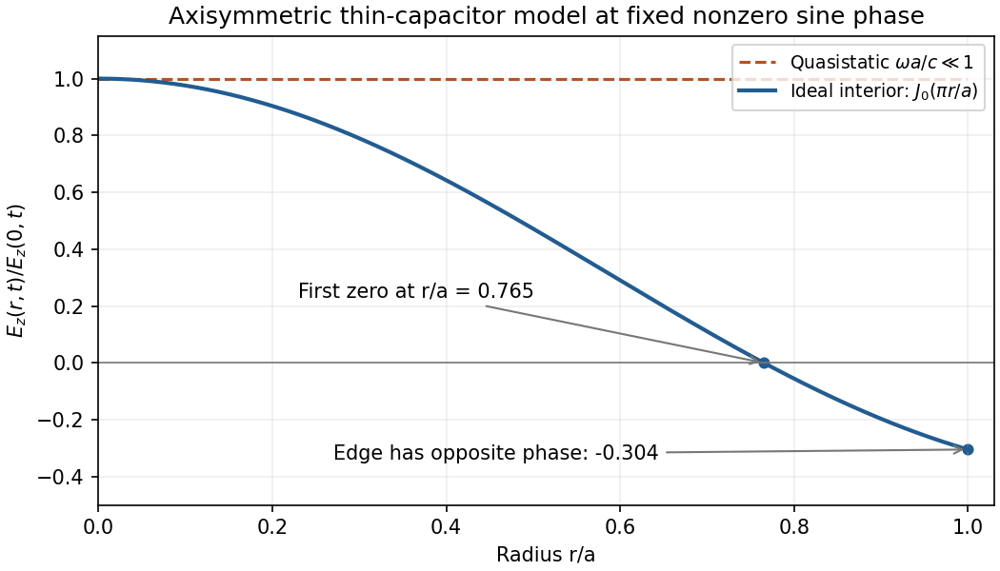

# Paper 1

↑ **Parent:** [2014](../2014.md)

Original paper: [Public original PDF, physical pages 619–626; cover on page 619 and questions on pages 620–626](https://www.whatdotheyknow.com/request/natural_science_tripos_physics_e_2/response/2340776/attach/2/FOI%202023%20399%20Zahid%20materials.pdf?cookie_passthrough=1#page=619).

**Table of contents**

- [A1](#a1)
  - [Solution](#a1/solution)
- [A2](#a2)
  - [Solution](#a2/solution)
- [A3](#a3)
  - [Solution](#a3/solution)
- [A4](#a4)
  - [Solution](#a4/solution)
- [A5](#a5)
  - [Solution](#a5/solution)
- [A6](#a6)
  - [Solution](#a6/solution)
- [A7](#a7)
  - [Solution](#a7/solution)
- [A8](#a8)
  - [Solution](#a8/solution)
- [A9](#a9)
  - [Solution](#a9/solution)
- [A10](#a10)
  - [a](#a10/a)
    - [Solution](#a10/a/solution)
  - [b](#a10/b)
    - [Solution](#a10/b/solution)
- [B1](#b1)
  - [Solution](#b1/solution)
- [B2](#b2)
  - [Solution](#b2/solution)
- [B3](#b3)
  - [Solution](#b3/solution)
- [B4](#b4)
  - [a](#b4/a)
    - [Solution](#b4/a/solution)
  - [b](#b4/b)
    - [Solution](#b4/b/solution)
  - [c](#b4/c)
    - [Solution](#b4/c/solution)
- [B5](#b5)
  - [Solution](#b5/solution)
- [B6](#b6)
  - [Solution](#b6/solution)
- [B7](#b7)
  - [Solution](#b7/solution)
  - [a](#b7/a)
    - [Solution](#b7/a/solution)
  - [b](#b7/b)
    - [Solution](#b7/b/solution)
  - [c](#b7/c)
    - [Solution](#b7/c/solution)
  - [d](#b7/d)
    - [Solution](#b7/d/solution)
- [B8](#b8)
  - [Solution](#b8/solution)

## A1

↑ **Parent:** [Paper 1](paper-1.md)

<h3 id="a1/solution">Solution</h3>

↑ **Parent:** [A1](#a1)

The solar [flux](../../mathematical-physics.md#flux) at [Earth](../../planetary-science.md#earth) is $\sigma T_\odot^4R_\odot^2/L^2$. A spherical [Earth](../../planetary-science.md#earth) intercepts sunlight over its cross section but radiates over its whole surface, giving

$$
\pi R_E^2\sigma T_\odot^4\frac{R_\odot^2}{L^2}=4\pi R_E^2\sigma T_E^4,
\qquad
\boxed{T_E=T_\odot\sqrt{\frac{R_\odot}{2L}}=275\,\mathrm K.}
$$

This is **below the observed mean surface [temperature](../../temperature.md)**. Atmospheric infrared absorption and emission produce a [greenhouse effect](../../exoplanet.md#greenhouse-effect) that raises the surface [temperature](../../temperature.md) relative to the effective radiating [temperature](../../temperature.md). Including reflected sunlight alone would lower the estimate further; [albedo](../../geophysics.md#albedo) does not explain a warmer surface.[Sections The Natural Greenhouse Effect and Effect on Surface Temperature](../../physics-bibliography.md#climate-and-earth-s-energy-budget-by-nasa-earth-observatory)

## A2

↑ **Parent:** [Paper 1](paper-1.md)

<h3 id="a2/solution">Solution</h3>

↑ **Parent:** [A2](#a2)

Let $a$ be the cube's side and $z$ a small upward displacement. Its displaced water [volume](../../geometry-and-topology.md#volume) decreases by $a^2z$, so the change in [buoyancy](../../fluid-mechanics.md#buoyancy) is $-\rho_wga^2z$. With cube [mass](../../classical-mechanics.md#mass) $m=0.9\rho_wa^3$,

$$
m\ddot z=-\rho_wga^2z,\qquad
\boxed{\omega^2=\frac{g}{0.9a},\qquad T=2\pi\sqrt{\frac{0.9a}{g}}=0.426\,\mathrm s.}
$$

The displacement must be small enough that the upper face remains above water and the bottom remains submerged. This [buoyancy](../../fluid-mechanics.md#buoyancy) estimate neglects fluid [added mass](../../mathematical-physics.md#added-mass), [damping](../../wave-equation.md#damping) and melting.

## A3

↑ **Parent:** [Paper 1](paper-1.md)

<h3 id="a3/solution">Solution</h3>

↑ **Parent:** [A3](#a3)

For the [photopion threshold on a photon background](../../galaxy.md#photopion-threshold-on-a-photon-background), write $M=m_pc^2$ and $m=m_\pi c^2$ in [energy](../../energy.md) units. For a head-on [photon](../../quantum-mechanics.md#photon) of [energy](../../energy.md) $\epsilon$ and a highly relativistic [proton](../../physics.md#proton) of total [energy](../../energy.md) $E$, the invariant squared centre-of-momentum [energy](../../energy.md) is approximately $M^2+4E\epsilon$. At threshold the final [proton](../../physics.md#proton) and [pion](../../standard-model.md#pion) are at rest relative to one another, so

$$
M^2+4E_{\rm th}\epsilon=(M+m)^2,
\qquad
\boxed{E_{\rm th}=\frac{m(2M+m)}{4\epsilon}.}
$$

Using a typical CMB [photon energy](../../quantum-mechanics.md#photon-energy) $\epsilon\simeq2.70k_BT=6.28\times10^{-4}\,\mathrm{eV}$ gives

$$
\boxed{E_{\rm th}\simeq1.1\times10^{20}\,\mathrm{eV}.}
$$

Thus photopion losses suppress the arrival of [protons](../../physics.md#proton) of order $10^{20}\,\mathrm{eV}$ from sufficiently distant sources. A [blackbody](../../astrophysics.md#blackbody) contains a range of [photon energies](../../quantum-mechanics.md#photon-energy) and collision angles, so the observed attenuation is gradual and distance-dependent, rather than an absolute maximum [energy](../../energy.md) for every [proton](../../physics.md#proton).

## A4

↑ **Parent:** [Paper 1](paper-1.md)

<h3 id="a4/solution">Solution</h3>

↑ **Parent:** [A4](#a4)

The central value is $S=150\cos45^\circ=106.07$. Treating the stated errors as [independent](../../random-variable.md#independent-random-variables) [standard uncertainties](../../physics.md#standard-uncertainty), convert the angular uncertainty to radians and propagate derivatives:

$$
\sigma_S^2=(\cos2\theta\,\sigma_{S_0})^2+
(2S_0\sin2\theta\,\sigma_\theta)^2,
\qquad
\boxed{S=106.1\pm6.5.}
$$

The two measured values differ by $10.8/\sqrt{6.0^2+5.6^2}=1.32$ combined [standard deviations](../../variance.md#standard-deviation). Our prediction differs from them by $0.19$ and $1.07$ combined [standard deviations](../../variance.md#standard-deviation) respectively. **All three values are statistically compatible.** If the input errors are strict bounds instead, the first-order bound on the calculated value is about $\pm9.0$; consistency remains possible, but a Gaussian significance test then has no stated justification.

## A5

↑ **Parent:** [Paper 1](paper-1.md)

<h3 id="a5/solution">Solution</h3>

↑ **Parent:** [A5](#a5)

Moving one Michelson mirror changes [optical path difference](../../physical-optics.md#optical-path-difference) by twice its displacement. Therefore

$$
\boxed{2d=10\lambda,\qquad d=2.50\,\mathrm{\mu m}.}
$$

For [two-wavelength Michelson rephasing](../../physical-optics.md#two-wavelength-michelson-rephasing), start from a position where both colours are bright: the next simultaneous bright centre requires $2\Delta d$ to be a common integer multiple of both [wavelengths](../../wave-equation.md#wavelength). The smallest is $6(500\,\mathrm{nm})=5(600\,\mathrm{nm})=3.00\,\mathrm{\mu m}$, giving **an additional mirror movement of $1.50\,\mathrm{\mu m}$**.

## A6

↑ **Parent:** [Paper 1](paper-1.md)

<h3 id="a6/solution">Solution</h3>

↑ **Parent:** [A6](#a6)

[Zero-point energy](../../quantum-harmonic-oscillator.md#zero-point-energy) is the [ground-state energy](../../quantum-mechanics.md#ground-state-energy) above the classical minimum, remaining even at zero [temperature](../../temperature.md). For a [harmonic oscillator](../../classical-mechanics.md#simple-harmonic-motion) it is $\hbar\omega/2$; simultaneous vanishing position and [momentum](../../momentum.md) fluctuations is forbidden by the uncertainty principle.

A concrete test is the Casimir interaction: changing conducting boundaries changes electromagnetic ground-state [modes](../../probability-and-statistics.md#mode-statistics) and produces a measurable [force](../../force.md). Ideal parallel plates have pressure

$$
\boxed{P_C=-\frac{\pi^2\hbar c}{240a^4}.}
$$

A torsion-pendulum experiment measured the attraction of closely spaced conducting surfaces, testing this boundary-dependent interaction.[Physical Review Letters 78, 5 (1997), primary abstract: electromechanical torsion-pendulum measurement; later erratum noted in bibliography](../../physics-bibliography.md#demonstration-of-the-casimir-force-in-the-0-6-to-6-micrometre-range-by-s-k-lamoreaux) Such measurements test **changes in [ground-state energy](../../quantum-mechanics.md#ground-state-energy)**, not an arbitrary absolute additive vacuum [energy](../../energy.md); real-material and thermal corrections must be included when comparing precision data.

## A7

↑ **Parent:** [Paper 1](paper-1.md)

<h3 id="a7/solution">Solution</h3>

↑ **Parent:** [A7](#a7)

For [nonequivalent p-s and p-p term counting](../../angular-momentum-operator.md#nonequivalent-p-s-and-p-p-term-counting), the closed $3s^2$ shell has $L=S=0$. For $3p4s$, the open orbitals give $L=1$ and $S=0,1$, hence

$$
\boxed{3p4s:\quad{}^1P_1,\quad{}^3P_{0,1,2}.}
$$

[Hund's rules](../../chemistry.md#hund-s-rules) predict the order $^3P_0<{}^3P_1<{}^3P_2<{}^1P_1$.

For $3p4p$, the electrons are in **nonequivalent orbitals**. All $L=0,1,2$ and $S=0,1$ combinations are allowed:

$$
\boxed{3p4p:\quad{}^1S_0,\ {}^1P_1,\ {}^1D_2,\
{}^3S_1,\ {}^3P_{0,1,2},\ {}^3D_{1,2,3}.}
$$

Applying maximum [spin](../../angular-momentum-operator.md#spin) first, maximum [orbital angular momentum](../../quantum-mechanics.md#orbital-angular-momentum) next, and smallest $J$ first for these less-than-half-filled open subshells gives the qualitative ordering

$$
\boxed{{}^3D_1<{}^3D_2<{}^3D_3<{}^3P_0<{}^3P_1<{}^3P_2
<{}^3S_1<{}^1D_2<{}^1P_1<{}^1S_0.}
$$

The state counts are $12$ for $3p4s$ and $36$ for $3p4p$. Imposing the equivalent-$p^2$ restrictions would incorrectly discard allowed terms. These are Hund-rule predictions; exact interleavings in a real excited configuration require the actual Coulomb and spin-orbit matrix elements.

## A8

↑ **Parent:** [Paper 1](paper-1.md)

<h3 id="a8/solution">Solution</h3>

↑ **Parent:** [A8](#a8)

In the rigid-rotor approximation, $E_J=\hbar^2J(J+1)/(2I)$ and electric-dipole absorption has $\Delta J=+1$. A line labelled $J'$ therefore has

$$
\nu_{J'}=\frac{hJ'}{4\pi^2I},\qquad
\Delta\nu=\frac h{4\pi^2I}.
$$

The original graph gives adjacent spacing about $0.115\,\mathrm{THz}$; for example the $J'=5$ line is near $0.575\,\mathrm{THz}$. Thus $I\simeq1.46\times10^{-46}\,\mathrm{kg\,m^2}$. Using the [reduced mass](../../classical-mechanics.md#reduced-mass),

$$
\mu=\frac{12\times16}{12+16}m_H=1.145\times10^{-26}\,\mathrm{kg},
\qquad
\boxed{r=\sqrt{I/\mu}\simeq1.13\times10^{-10}\,\mathrm m=0.113\,\mathrm{nm}.}
$$

[Centrifugal distortion](../../molecule.md#centrifugal-distortion) of a nonrigid molecule explains small departures from equal spacing at higher $J$.

## A9

↑ **Parent:** [Paper 1](paper-1.md)

<h3 id="a9/solution">Solution</h3>

↑ **Parent:** [A9](#a9)

Approximate the beam as uniform over its circular cross section. Its mean [intensity](../../wave.md#intensity-physics) is $I=P/[\pi(D/2)^2]=1.27\times10^6\,\mathrm{W\,m^{-2}}$. For the [root mean square magnetic field from beam power](../../electromagnetic-wave.md#root-mean-square-magnetic-field-from-beam-power) in a vacuum electromagnetic wave, $I=cB_{\rm rms}^2/\mu_0$, so

$$
\boxed{B_{\rm rms}=\sqrt{\frac{\mu_0P}{c\pi(D/2)^2}}=7.3\times10^{-5}\,\mathrm T.}
$$

This is an rms field, not the peak sinusoidal [amplitude](../../wave.md#wave-amplitude). A Gaussian-beam peak would need a stated diameter convention.

## A10

↑ **Parent:** [Paper 1](paper-1.md)

<h3 id="a10/a">a</h3>

↑ **Parent:** [A10](#a10)

<h4 id="a10/a/solution">Solution</h4>

↑ **Parent:** [A](#a10/a)

The point-dipole interaction is

$$
U=\frac1{4\pi\epsilon_0r^3}
[\mathbf p_1\cdot\mathbf p_2-3(\mathbf p_1\cdot\hat{\mathbf r})(\mathbf p_2\cdot\hat{\mathbf r})].
$$

Here $\mathbf p_1\cdot\hat{\mathbf r}=0$. For parallel axes, $\mathbf p_1\cdot\mathbf p_2=p^2$, hence

$$
\boxed{U=\frac{p^2}{4\pi\epsilon_0r^3}=1.20\times10^{-20}\,\mathrm J=+0.0748\,\mathrm{eV}.}
$$

This side-by-side parallel arrangement is repulsive in the point-dipole model.

<h3 id="a10/b">b</h3>

↑ **Parent:** [A10](#a10)

<h4 id="a10/b/solution">Solution</h4>

↑ **Parent:** [B](#a10/b)

The first dipole remains perpendicular to the separation and is now also perpendicular to the second dipole. Both terms in the point-dipole interaction vanish, giving **$U=0$**. This is the electrostatic point-dipole contribution, not a claim that real finite water molecules have no other intermolecular interaction.

## B1

↑ **Parent:** [Paper 1](paper-1.md)

<h3 id="b1/solution">Solution</h3>

↑ **Parent:** [B1](#b1)

For an isolated system with equally probable accessible microstates, [Boltzmann entropy](../../entropy.md#boltzmann-s-entropy-formula) is $S=k_B\ln\Omega$. The second law states that an isolated system's total [entropy](../../entropy.md) cannot decrease; it remains constant in a reversible process and increases in an irreversible one.

The insulated mixture exchanges no heat with its surroundings. At constant pressure, with only pressure-volume work, its [enthalpy](../../enthalpy.md) is conserved. Constant and equal [specific heat capacities](../../heat.md#specific-heat-capacity) therefore give $T_f=(T_1+T_2)/2$. Calculate each [entropy](../../entropy.md) change along a hypothetical reversible [temperature](../../temperature.md) path:

$$
\Delta S=Mc_P\ln\frac{T_f}{T_1}+Mc_P\ln\frac{T_f}{T_2}
=\boxed{2Mc_P\ln\left[\frac{T_1+T_2}{2\sqrt{T_1T_2}}\right].}
$$

The surroundings gain no [entropy](../../entropy.md) through heat exchange; ideal mechanical work carries no [entropy](../../entropy.md). The [arithmetic-geometric mean inequality](../../mathematical-optimization.md#arithmetic-geometric-mean-inequality) gives **$\Delta S\ge0$**, with equality only for $T_1=T_2$. Mixing unequal [temperatures](../../temperature.md) is irreversible even though total [energy](../../energy.md) is conserved.

## B2

↑ **Parent:** [Paper 1](paper-1.md)

<h3 id="b2/solution">Solution</h3>

↑ **Parent:** [B2](#b2)

Perturbation theory expands known [eigenvalues](../../linear-operator-theory.md#eigenvalue) and [eigenfunctions](../../linear-operator-theory.md#eigenfunction) about a solvable Hamiltonian. Small corrections require appropriate energy-gap and matrix-element scales; degeneracies must first be diagonalized within their subspace. The [variational method](../../quantum-theory.md#variational-method) instead minimizes a normalized trial state's [energy](../../energy.md) expectation. It gives an upper bound on the ground [energy](../../energy.md) without requiring a small perturbation; excited-state bounds need orthogonality constraints or an appropriate symmetry subspace.

Normalize the unperturbed oscillator states:

$$
|\psi_0|^2=\frac\alpha{\sqrt\pi}e^{-\alpha^2x^2},\qquad
|\psi_1|^2=\frac{2\alpha^3}{\sqrt\pi}x^2e^{-\alpha^2x^2}.
$$

For the [Gaussian perturbation of a quantum harmonic oscillator](../../quantum-mechanics.md#gaussian-perturbation-of-a-quantum-harmonic-oscillator), the first-order shifts are its expectation values:

$$
\boxed{\Delta E_0=\frac{V_0\alpha}{\sqrt{\alpha^2+\beta^2}},\qquad
\Delta E_1=\frac{V_0\alpha^3}{(\alpha^2+\beta^2)^{3/2}}.}
$$

For $\beta\gg\alpha$, they scale as $V_0\alpha/\beta$ and $V_0(\alpha/\beta)^3$ respectively: a narrow central perturbation couples weakly to the odd state's central [node](../../dynamical-systems.md#node-dynamical-systems). For $\beta\ll\alpha$, both approach $V_0$ because the perturbation is nearly constant over the wavefunctions. The leading corrections are $V_0[1-\beta^2/(2\alpha^2)]$ and $V_0[1-3\beta^2/(2\alpha^2)]$.

For an improved variational estimate, replace the fixed width $\alpha$ by an adjustable positive width $s$ in each even/odd Gaussian. Their [energy](../../energy.md) functionals are

$$
E_{\rm even}(s)=\frac{\hbar^2s^2}{4m}+\frac{m\omega^2}{4s^2}
+\frac{V_0s}{\sqrt{s^2+\beta^2}},
$$

$$
E_{\rm odd}(s)=\frac{3\hbar^2s^2}{4m}+\frac{3m\omega^2}{4s^2}
+\frac{V_0s^3}{(s^2+\beta^2)^{3/2}}.
$$

Minimize each separately. At $s=\alpha$ they recover the unperturbed [energy](../../energy.md) plus the first-order shift, so optimization cannot raise those trial estimates. For this even one-dimensional potential the lowest odd state is the first [excited state](../../energy-eigenvalue.md#excited-state), making its odd-sector minimum an upper bound on $E_1$. Enlarging each parity-preserving trial basis can improve the estimates further.

## B3

↑ **Parent:** [Paper 1](paper-1.md)

<h3 id="b3/solution">Solution</h3>

↑ **Parent:** [B3](#b3)

For noninteracting particles, a many-particle configuration has $E=\sum_jn_j\epsilon_j$ and $N=\sum_jn_j$. Summing independently over allowed occupations therefore factorizes the grand [partition function](../../canonical-ensemble.md#canonical-partition-function):

$$
\Theta=\prod_j\Theta_j,\qquad
\boxed{\Phi=-k_BT\sum_j\ln\Theta_j.}
$$

At fixed $T,V$, differentiating the original state sum gives $\partial_\mu\ln\Theta=\beta\langle N\rangle$ and $\partial_\mu^2\ln\Theta=\beta^2\operatorname{Var}N$, so

$$
\boxed{\langle N\rangle=-\partial_\mu\Phi,\qquad
\operatorname{Var}N=-k_BT\partial_\mu^2\Phi
=k_BT\partial_\mu\langle N\rangle.}
$$

For one level, write $q=e^{-\beta(\epsilon-\mu)}$. [Fermions](../../tensor-product-of-quantum-systems.md#fermion) allow $n=0,1$, giving $\Theta_F=1+q$ and $\bar n=q/(1+q)$. [Bosons](../../tensor-product-of-quantum-systems.md#boson) allow all nonnegative integers, giving $\Theta_B=1/(1-q)$ and $\bar n=q/(1-q)$, with $q<1$. Thus

$$
\boxed{\bar n_F=\frac1{e^{\beta(\epsilon-\mu)}+1},\qquad
\bar n_B=\frac1{e^{\beta(\epsilon-\mu)}-1}.}
$$

The [grand-canonical single-level occupation variance](../../statistical-physics.md#grand-canonical-single-level-occupation-variance) follows from the same derivative identity applied to one level:

$$
\boxed{\operatorname{Var}n=k_BT\partial_\mu\bar n
=\begin{cases}\bar n(1-\bar n),&\text{fermions},\\
\bar n(1+\bar n),&\text{bosons}.\end{cases}}
$$

In the high-temperature nondegenerate regime, $\bar n\ll1$ and both approach classical Poisson-like fluctuations, $\operatorname{Var}n\simeq\bar n$. At low [temperature](../../temperature.md), nearly filled or empty [fermion](../../tensor-product-of-quantum-systems.md#fermion) levels have strongly suppressed fluctuations; only the Fermi-surface window changes occupation. Highly occupied low-energy [boson](../../tensor-product-of-quantum-systems.md#boson) levels can instead have $\operatorname{Var}n\sim\bar n^2$, showing bosonic enhancement. This last statement depends on occupation and reservoir [chemical potential](../../chemical-potential.md), not [temperature](../../temperature.md) alone; grand-canonical condensate fluctuations must not be confused with a fixed-total-number ensemble.

## B4

↑ **Parent:** [Paper 1](paper-1.md)

<h3 id="b4/a">a</h3>

↑ **Parent:** [B4](#b4)

<h4 id="b4/a/solution">Solution</h4>

↑ **Parent:** [A](#b4/a)

In the instantaneous mirror frame the incident [frequency](../../wave.md#frequency) is $f_m=\gamma(1-\beta)f$. Ideal reflection reverses propagation without changing that frame's [frequency](../../wave.md#frequency). Transforming the backward [photon](../../quantum-mechanics.md#photon) to [Earth](../../planetary-science.md#earth) gives another factor $\gamma(1-\beta)$:

$$
\boxed{f_r=\gamma^2(1-\beta)^2f
=\frac{1-\beta}{1+\beta}f.}
$$

This uses a classical mirror with negligible recoil per individual [photon](../../quantum-mechanics.md#photon).

<h3 id="b4/b">b</h3>

↑ **Parent:** [B4](#b4)

<h4 id="b4/b/solution">Solution</h4>

↑ **Parent:** [B](#b4/b)

A [photon](../../quantum-mechanics.md#photon) reaching spacecraft position $x(t)$ at [Earth](../../planetary-science.md#earth) time $t$ was emitted at $t_e=t-x(t)/c$. Differentiating gives $dt_e/dt=1-\beta$. Since $R\,dt_e$ [photons](../../quantum-mechanics.md#photon) arrive in $dt$,

$$
\boxed{R_{\rm hit}=R(1-\beta).}
$$

The emission rate and impact rate refer to different events, even though both are expressed in [Earth](../../planetary-science.md#earth) coordinate time.

<h3 id="b4/c">c</h3>

↑ **Parent:** [B4](#b4)

<h4 id="b4/c/solution">Solution</h4>

↑ **Parent:** [C](#b4/c)

For [proper-time acceleration by reflected laser light](../../pressure.md#proper-time-acceleration-by-reflected-laser-light), the spacecraft receives [momentum](../../momentum.md) $(hf+hf_r)/c=2hf/[c(1+\beta)]$ per incident [photon](../../quantum-mechanics.md#photon). Combining with the impact rate gives

$$
F=\frac{2Rhf}{c}\frac{1-\beta}{1+\beta},\qquad
\frac{d(\gamma\beta)}{dt}=\frac1{\tau_0}\frac{1-\beta}{1+\beta},\qquad
\tau_0=\frac{Mc^2}{2Rhf}.
$$

Because $dt/d\tau=\gamma$ and $d(\gamma\beta)/d\beta=\gamma^3$,

$$
\gamma^2\frac{d\beta}{d\tau}=\frac1{\tau_0}\frac{1-\beta}{1+\beta}
\quad\Longrightarrow\quad
\frac{d\beta}{d\tau}=\frac{(1-\beta)^2}{\tau_0}.
$$

Integrating from rest gives $1/(1-\beta)-1=\tau/\tau_0$, hence

$$
\boxed{\beta(\tau)=\frac{\tau}{\tau+\tau_0}.}
$$

The mirror's [rest mass](../../special-relativity.md#invariant-mass) is assumed constant and the laser illuminates it continuously; [diffraction](../../quantum-scattering.md#diffraction) losses, incomplete interception and microscopic recoil are neglected.

## B5

↑ **Parent:** [Paper 1](paper-1.md)

<h3 id="b5/solution">Solution</h3>

↑ **Parent:** [B5](#b5)

The [method of images](../../mathematics.md#method-of-images) replaces conductors by fictitious charges outside the physical solution domain. Choose images so the real-plus-image potential obeys the specified conductor boundary values. The electrostatic uniqueness theorem then identifies that potential in the physical domain; fields inside the replaced conductor are not physical predictions.

Put the cylinder axis at the origin, real line at $(2a,0)$ and image at $(a/2,0)$. Let $r_1,r_2$ be distances from these lines. The exterior potential can be written

$$
\boxed{\phi=\frac{\lambda}{2\pi\epsilon_0}\ln\frac{2r_2}{r_1}.}
$$

On the surface, $r_1^2=a^2(5-4\cos\theta)$ and $r_2^2=r_1^2/4$, so $\phi=0$ everywhere as required. The additive constant is essential for a grounded cylinder; the two-dimensional potential need not also be zero at infinity.

The physical line feels the image field at separation $3a/2$. Its [force](../../force.md) per unit length is attractive:

$$
\boxed{\frac{\mathbf F}{\mathcal L}=-\frac{\lambda^2}{3\pi\epsilon_0a}\,\hat{\mathbf x}.}
$$

Measure $\theta$ from the radius toward the real line, as in the original diagram. The radial field just outside the surface is

$$
E_r=\frac\lambda{2\pi\epsilon_0}
\left[\frac{a-2a\cos\theta}{a^2(5-4\cos\theta)}
-\frac{a-(a/2)\cos\theta}{(a^2/4)(5-4\cos\theta)}\right].
$$

Since the interior field is zero,

$$
\boxed{\sigma(\theta)=\epsilon_0E_r=-\frac{3\lambda}{2\pi a(5-4\cos\theta)}.}
$$

Integrating $a\sigma(\theta)$ around the circumference gives total induced charge $-\lambda$ per unit length.

**[Figure 1](#b5/image-original-calculated-exterior-equipotentials-and-induced-surface-charge-distribution-for-the-grounded-cylinder-conductor-interior-excluded-from-the-field-solution). Original calculated exterior equipotentials and induced surface-charge distribution for the grounded cylinder; conductor interior excluded from the field solution**.

## B6

↑ **Parent:** [Paper 1](paper-1.md)

<h3 id="b6/solution">Solution</h3>

↑ **Parent:** [B6](#b6)

A [normal mode](../../wave-equation.md#normal-mode) is a motion in which all generalized coordinates oscillate at one [frequency](../../wave.md#frequency) with fixed [amplitude](../../wave.md#wave-amplitude) ratios. Small [oscillations](../../wave.md#oscillation) about [stable equilibrium](../../dynamical-systems.md#stable-equilibrium) in a time-independent conservative system give $\mathsf M\ddot{\boldsymbol\theta}+\mathsf K\boldsymbol\theta=0$, with positive [mass matrix](../../finite-element-method.md#mass-matrix) and symmetric [stiffness matrix](../../finite-element-method.md#stiffness-matrix), allowing a generalized normal-mode eigenproblem.

For the [three-to-one mass double-pendulum modes](../../lagrangian-mechanics.md#three-to-one-mass-double-pendulum-modes), the angles are absolute displacements from vertical, as printed. To quadratic order,

$$
K=\frac{m\ell^2}{2}(4\dot\theta_1^2+2\dot\theta_1\dot\theta_2+\dot\theta_2^2),\qquad
U=\frac{mg\ell}{2}(4\theta_1^2+\theta_2^2).
$$

For $\boldsymbol\theta=\mathbf A\cos\omega t$ and $q=\omega^2\ell/g$, the determinant is

$$
\det\begin{pmatrix}4-4q&-q\\-q&1-q\end{pmatrix}
=3q^2-8q+4=(3q-2)(q-2).
$$

Thus

$$
\boxed{\omega_-^2=\frac{2g}{3\ell},\quad(\theta_1,\theta_2)\propto(1,2);
\qquad\omega_+^2=\frac{2g}{\ell},\quad(\theta_1,\theta_2)\propto(1,-2).}
$$

The low [mode](../../probability-and-statistics.md#mode-statistics) has the strings leaning together, with the lower angle twice as large; the high [mode](../../probability-and-statistics.md#mode-statistics) has opposite angular signs. Both reverse together after half their respective periods.

For the specified release, decompose $(\alpha,\alpha)=(3\alpha/4)(1,2)+(\alpha/4)(1,-2)$. Therefore

$$
\theta_1=\frac\alpha4(3\cos\omega_-t+\cos\omega_+t),\qquad
\theta_2=\frac\alpha2(3\cos\omega_-t-\cos\omega_+t),
$$

and the lower [mass](../../classical-mechanics.md#mass)'s horizontal displacement is

$$
\boxed{x_m\simeq\ell(\theta_1+\theta_2)
=\frac{\alpha\ell}{4}(9\cos\omega_-t-\cos\omega_+t),\qquad
\sup|x_m|=\frac52|\alpha|\ell.}
$$

This is the [supremum of two incommensurate harmonic modes](../../hamiltonian-mechanics.md#supremum-of-two-incommensurate-harmonic-modes), conventionally described as the maximum-amplitude estimate. Strictly, $\omega_+/\omega_-=\sqrt3$ is irrational, so the opposite cosine extrema are approached arbitrarily closely but never coincide at a finite time. The quoted value is a [supremum](../../real-analysis.md#supremum) of the ideal linearized motion.

**[Figure 2](#b6/image-original-normal-mode-motion-sketches-and-the-lower-mass-displacement-after-equal-angle-release-with-the-limiting-amplitude-bound-marked). Original normal-mode motion sketches and the lower-mass displacement after equal-angle release, with the limiting amplitude bound marked**.

## B7

↑ **Parent:** [Paper 1](paper-1.md)

<h3 id="b7/solution">Solution</h3>

↑ **Parent:** [B7](#b7)

[Fresnel diffraction](../../physical-optics.md#fresnel-diffraction) retains quadratic aperture-dependent propagation [phases](../../wave.md#phase-waves) and generally depends on both aperture and screen distance. [Fraunhofer diffraction](../../physical-optics.md#fraunhofer-diffraction) neglects those [phases](../../wave.md#phase-waves) and gives the [Fourier transform](../../fourier-transform.md) of the aperture in angle space, either sufficiently far away or in a suitable lens's focal plane.

The calculations below use the **Fraunhofer, [paraxial approximation](../../partial-differential-equation.md#paraxial-approximation)**. For an overall aperture scale $D\sim1000\lambda$, free propagation requires $L\gg D^2/\lambda\sim10^6\lambda$. The printed $L\gg1000\lambda$ alone only makes the separation small relative to distance; it is not by itself the full far-field condition.

<h3 id="b7/a">a</h3>

↑ **Parent:** [B7](#b7)

<h4 id="b7/a/solution">Solution</h4>

↑ **Parent:** [A](#b7/a)

The relative slit-centre [phase](../../wave.md#phase-waves) is $2\pi d\sin\theta/\lambda$. Near the optical axis, $x\simeq L\theta$, so adjacent [interference](../../physical-optics.md#interference-wave-propagation) maxima have spacing

$$
\boxed{\delta x\simeq\frac{\lambda L}{d}=\frac L{1000}.}
$$

Slow diffraction-envelope variation can slightly shift the exact local maxima.

<h3 id="b7/b">b</h3>

↑ **Parent:** [B7](#b7)

<h4 id="b7/b/solution">Solution</h4>

↑ **Parent:** [B](#b7/b)

A slit of width $w$ has its first zeros at $\sin\theta=\pm\lambda/w$. Thus the full central-envelope widths are

$$
\boxed{W_1\simeq\frac{2L\lambda}{w_1}=\frac L{10},\qquad
W_2\simeq\frac{2L\lambda}{w_2}=\frac L{20}.}
$$

The narrower envelope determines the overlap, so it spans

$$
\boxed{\frac{W_2}{\delta x}=50\ \text{fringe spacings}.}
$$

This is the usual approximate “50 fringes” count. If counting nominal bright fringe centres strictly inside both first zeros, they have indices $-24,\ldots,24$, giving **49 centres**. The endpoints $\pm25$ lie at the wider slit's first zeros, where two-slit visibility vanishes; they should not be counted as fully interfering bright centres.

<h3 id="b7/c">c</h3>

↑ **Parent:** [B7](#b7)

<h4 id="b7/c/solution">Solution</h4>

↑ **Parent:** [C](#b7/c)

At the centre, equal illumination gives slit [amplitudes](../../wave.md#wave-amplitude) proportional to widths, so $A_2=2A_1$. The local [interference](../../physical-optics.md#interference-wave-propagation) extrema are $(A_1+A_2)^2$ and $(A_2-A_1)^2$, giving

$$
\boxed{\frac{I_{\max}}{I_{\min}}=\frac{(1+2)^2}{(2-1)^2}=9.}
$$

These are the central-envelope extrema as relative [phase](../../wave.md#phase-waves) varies, or equivalently the near-centre fringe limits where the envelope is nearly constant.

**[Figure 3](#b7/c/image-original-unequal-slit-fraunhofer-intensity-and-its-envelopes-with-central-overlap-edges-and-local-nine-to-one-intensity-contrast). Original unequal-slit Fraunhofer intensity and its envelopes, with central-overlap edges and local nine-to-one intensity contrast**.

<h3 id="b7/d">d</h3>

↑ **Parent:** [B7](#b7)

<h4 id="b7/d/solution">Solution</h4>

↑ **Parent:** [D](#b7/d)

Treat the transparent plate as a [phase plate](../../optical-instrument.md#phase-plate) at normal incidence. Its extra optical path is $(n-1)50\lambda$. An unchanged [interference](../../physical-optics.md#interference-wave-propagation) pattern requires an integer number of full [phase](../../wave.md#phase-waves) cycles:

$$
50(n-1)=m\in\mathbb Z,\qquad n=1+\frac m{50}.
$$

For [full-cycle phase-plate invisibility](../../physical-optics.md#full-cycle-phase-plate-invisibility) in an ordinary nontrivial material with $n>1$, the two smallest are **$n=1.02$ and $1.04$**. If the optically null case $n=1$ is admitted, the first two nondecreasing-$n\ge1$ values are $1$ and $1.02$. A different allowed range of [refractive indices](../../electromagnetic-wave.md#refractive-index) would need to be specified before calling these the absolute smallest possibilities.

## B8

↑ **Parent:** [Paper 1](paper-1.md)

<h3 id="b8/solution">Solution</h3>

↑ **Parent:** [B8](#b8)

Here $\mathbf H$ is [magnetic field intensity](../../electromagnetism.md#magnetic-field-intensity), $\mathbf J$ free [electric current](../../electric-charge.md#electric-current) [density](../../fluid-mechanics.md#density), and $\mathbf D$ electric displacement. In vacuum, $\mathbf B=\mu_0\mathbf H$ and $\mathbf D=\epsilon_0\mathbf E$. Integrating the equation gives [Ampère's circuital law](../../maxwell-equations.md#ampere-s-circuital-law) with [displacement current](../../maxwell-equations.md#displacement-current); in a [steady state](../../dynamical-systems.md#steady-state) the displacement term vanishes.

Take $z$ upward and define $V=\phi_{\rm upper}-\phi_{\rm lower}=V_0\sin\omega t$. Neglect fringing and use the low-frequency thin-capacitor approximation. Then

$$
\boxed{\mathbf E=E_z(t)\hat{\mathbf z},\qquad
E_z=-\frac{V_0}{L}\sin\omega t,\qquad E_r=E_\phi=0.}
$$

Inside the gap, a circular Ampère loop encloses only [displacement current](../../maxwell-equations.md#displacement-current):

$$
2\pi rH_\phi=\epsilon_0\pi r^2\dot E_z,
\qquad
\boxed{\mathbf H=\frac{\epsilon_0r}{2}\dot E_z\,\hat{\boldsymbol\phi}
=-\frac{\epsilon_0r\omega V_0}{2L}\cos\omega t\,\hat{\boldsymbol\phi}.}
$$

Because $\hat{\mathbf z}\times\hat{\boldsymbol\phi}=-\hat{\mathbf r}$, the [Poynting vector](../../electromagnetic-wave.md#poynting-vector) is

$$
\boxed{\mathbf S=-\frac{\epsilon_0r}{2}E_z\dot E_z\,\hat{\mathbf r}.}
$$

It points inward while the electrical [energy](../../energy.md) is increasing and outward while it decreases. The net [power](../../energy.md#power) entering the curved side is

$$
-2\pi aL S_r(a)=\epsilon_0\pi a^2L E_z\dot E_z
=\frac d{dt}\left(\frac{\epsilon_0\pi a^2L}{2}E_z^2\right)
=\dot U_E.
$$

This is the leading quasistatic [energy](../../energy.md) balance. The time-averaged field energies are

$$
\overline U_E=\frac{\epsilon_0\pi a^2V_0^2}{4L},\qquad
\overline U_B=\frac{\mu_0\epsilon_0^2\omega^2\pi a^4V_0^2}{32L},
\qquad
\boxed{\frac{\overline U_B}{\overline U_E}=\frac18\left(\frac{\omega a}{c}\right)^2.}
$$

For the [axisymmetric high-frequency capacitor field](../../maxwell-equations.md#axisymmetric-high-frequency-capacitor-field) when $\omega a/c$ is not small, induction and radial propagation prevent a spatially uniform $E_z$. In an ideal axially uniform axisymmetric interior model, Faraday's and Ampère's equations give

$$
\frac1r\frac d{dr}\left(r\frac{dE_z}{dr}\right)+\frac{\omega^2}{c^2}E_z=0.
$$

The solution regular at the axis and normalized to the central [voltage](../../random-walk.md#voltage) is approximately

$$
\boxed{E_z(r,t)=-\frac{V_0}{L}J_0(\omega r/c)\sin\omega t.}
$$

At $\omega=\pi c/a$, the radial profile is $J_0(\pi r/a)$: its first zero is at $r\simeq0.765a$, and the edge has opposite [phase](../../wave.md#phase-waves), $J_0(\pi)\simeq-0.304$. This is an illustrative thin-disc interior profile; the exact driven high-frequency field also depends on the feed and edge/radiation [boundary conditions](../../differential-equation.md#boundary-condition). Continuing the uniform quasistatic field would be inconsistent.

**[Figure 4](#b8/image-original-ideal-axisymmetric-capacitor-field-profiles-comparing-the-uniform-quasistatic-limit-with-the-bessel-radial-profile-at-angular-frequency-pi-times-c-over-a). Original ideal axisymmetric capacitor field profiles, comparing the uniform quasistatic limit with the Bessel radial profile at angular frequency pi times c over a**.

## ↑ Ancestors (10)

1. [2014](../2014.md)
2. [Past exam of the physics course of the year 4 of the natural sciences course of the University of Cambridge](../../past-exam-of-the-physics-course-of-the-year-4-of-the-natural-sciences-course-of-the-university-of-cambridge.md)
3. [Physics course of the year 4 of the natural sciences course of the University of Cambridge](../../university-of-cambridge.md#physics-course-of-the-year-4-of-the-natural-sciences-course-of-the-university-of-cambridge)
4. [Year 4 of the natural sciences course of the University of Cambridge](../../university-of-cambridge.md#year-4-of-the-natural-sciences-course-of-the-university-of-cambridge)
5. [Year of the natural sciences course of the University of Cambridge](../../university-of-cambridge.md#year-of-the-natural-sciences-course-of-the-university-of-cambridge)
6. [Natural sciences course of the University of Cambridge](../../university-of-cambridge.md#natural-sciences-course-of-the-university-of-cambridge)
7. [Course of the University of Cambridge](../../university-of-cambridge.md#course-of-the-university-of-cambridge)
8. [University of Cambridge](../../university-of-cambridge.md)
9. [List of universities](../../README.md#list-of-universities)
10. [Codex Wiki](../../README.md)
