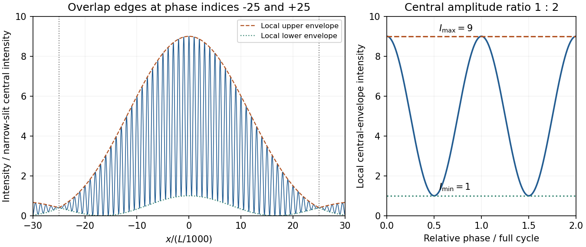

<h1 id="b7/c/solution">Solution</h1>

↑ **Parent:** [C](../c.md)

At the centre, equal illumination gives slit [amplitudes](../../../../../wave-amplitude.md) proportional to widths, so $A_2=2A_1$. The local [interference](../../../../../interference-wave-propagation.md) extrema are $(A_1+A_2)^2$ and $(A_2-A_1)^2$, giving

$$
\boxed{\frac{I_{\max}}{I_{\min}}=\frac{(1+2)^2}{(2-1)^2}=9.}
$$

These are the central-envelope extrema as relative [phase](../../../../../phase-waves.md) varies, or equivalently the near-centre fringe limits where the envelope is nearly constant.

**[Figure 3](#b7/c/image-original-unequal-slit-fraunhofer-intensity-and-its-envelopes-with-central-overlap-edges-and-local-nine-to-one-intensity-contrast). Original unequal-slit Fraunhofer intensity and its envelopes, with central-overlap edges and local nine-to-one intensity contrast**.

## ↑ Ancestors (13)

1. [C](../c.md)
2. [B7](../../b7.md)
3. [Paper 1](../../../paper-1-split.md)
4. [2014](../../../split.md)
5. [Past exam of the physics course of the year 4 of the natural sciences course of the University of Cambridge](../../../../split.md)
6. [Physics course of the year 4 of the natural sciences course of the University of Cambridge](../../../../../physics-course-of-the-year-4-of-the-natural-sciences-course-of-the-university-of-cambridge.md)
7. [Year 4 of the natural sciences course of the University of Cambridge](../../../../../year-4-of-the-natural-sciences-course-of-the-university-of-cambridge.md)
8. [Year of the natural sciences course of the University of Cambridge](../../../../../year-of-the-natural-sciences-course-of-the-university-of-cambridge.md)
9. [Natural sciences course of the University of Cambridge](../../../../../natural-sciences-course-of-the-university-of-cambridge.md)
10. [Course of the University of Cambridge](../../../../../course-of-the-university-of-cambridge.md)
11. [University of Cambridge](../../../../../university-of-cambridge-split.md)
12. [List of universities](../../../../../list-of-universities.md)
13. [Codex Wiki](../../../../../split.md)
