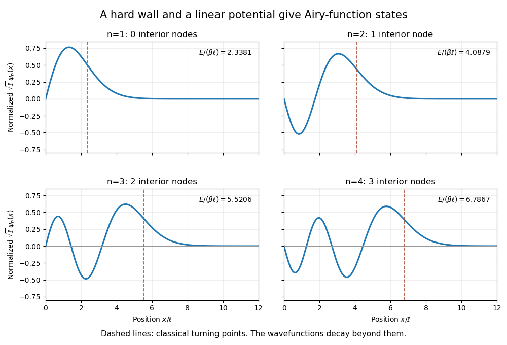
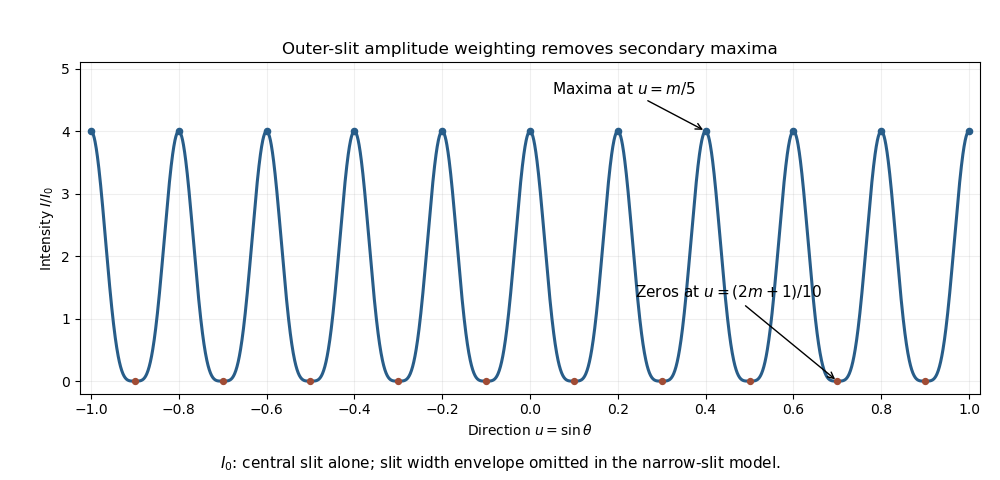
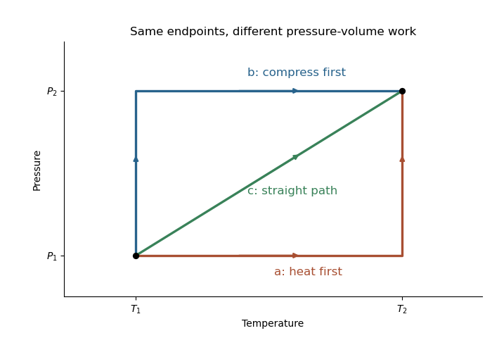
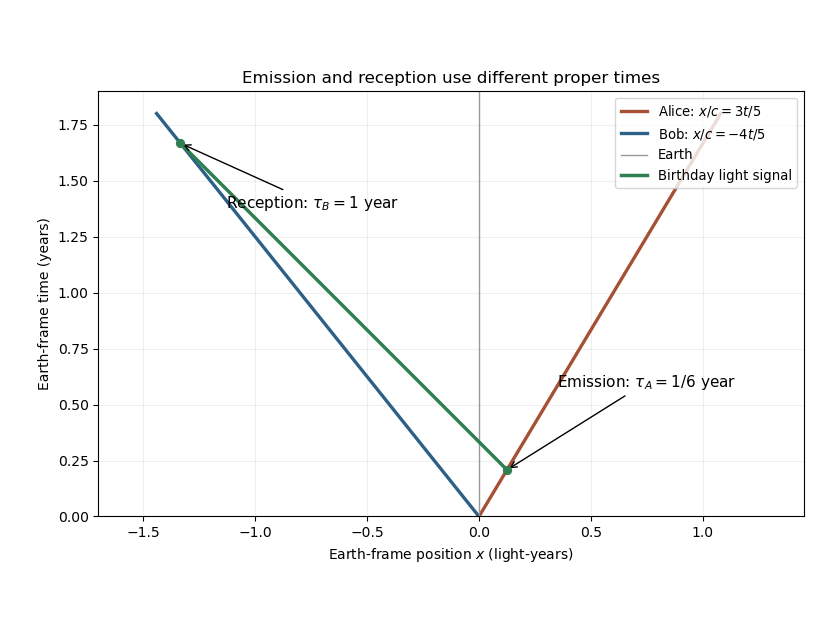
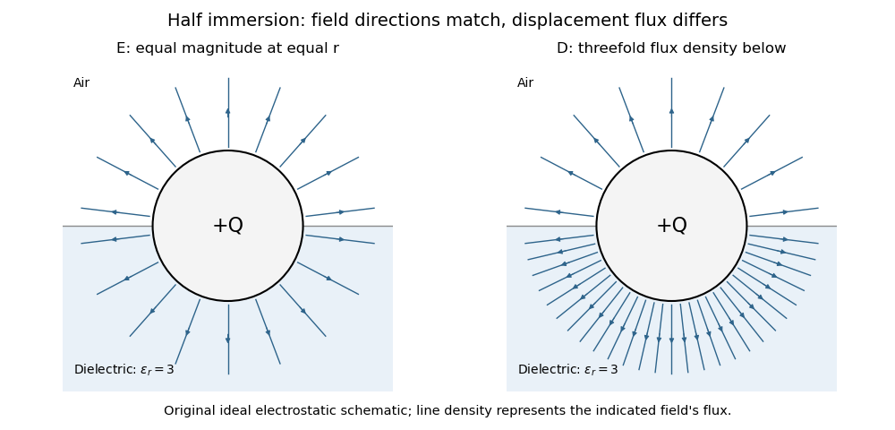

# Paper 1

↑ **Parent:** [2015](../2015.md)

Original public paper: [Physical PDF pages 689–699](https://www.whatdotheyknow.com/request/natural_science_tripos_physics_e_2/response/2340776/attach/2/FOI%202023%20399%20Zahid%20materials.pdf?cookie_passthrough=1#page=689). All questions and alternatives are answered. Idealizations and phase conventions are stated where they affect the answer.

**Table of contents**

- [Section A](#section-a)
  - [A1](#section-a/a1)
    - [Solution](#section-a/a1/solution)
  - [A2](#section-a/a2)
    - [Solution](#section-a/a2/solution)
  - [A3](#section-a/a3)
    - [Solution](#section-a/a3/solution)
  - [A4](#section-a/a4)
    - [Solution](#section-a/a4/solution)
  - [A5](#section-a/a5)
    - [Solution](#section-a/a5/solution)
  - [A6](#section-a/a6)
    - [Solution](#section-a/a6/solution)
  - [A7](#section-a/a7)
    - [Solution](#section-a/a7/solution)
  - [A8](#section-a/a8)
    - [Solution](#section-a/a8/solution)
  - [A9](#section-a/a9)
    - [Solution](#section-a/a9/solution)
  - [A10](#section-a/a10)
    - [Solution](#section-a/a10/solution)
- [Section B](#section-b)
  - [B1](#section-b/b1)
    - [Solution](#section-b/b1/solution)
  - [B2](#section-b/b2)
    - [Solution](#section-b/b2/solution)
    - [a](#section-b/b2/a)
      - [Solution](#section-b/b2/a/solution)
    - [b](#section-b/b2/b)
      - [Solution](#section-b/b2/b/solution)
    - [c](#section-b/b2/c)
      - [Solution](#section-b/b2/c/solution)
  - [B3](#section-b/b3)
    - [a](#section-b/b3/a)
      - [Solution](#section-b/b3/a/solution)
    - [b](#section-b/b3/b)
      - [Solution](#section-b/b3/b/solution)
    - [c](#section-b/b3/c)
      - [Solution](#section-b/b3/c/solution)
    - [d](#section-b/b3/d)
      - [Solution](#section-b/b3/d/solution)
  - [B4](#section-b/b4)
    - [Solution](#section-b/b4/solution)
  - [B5](#section-b/b5)
    - [Solution](#section-b/b5/solution)
  - [B6](#section-b/b6)
    - [Solution](#section-b/b6/solution)
  - [B7](#section-b/b7)
    - [Solution](#section-b/b7/solution)
  - [B8](#section-b/b8)
    - [Solution](#section-b/b8/solution)

## Section A

↑ **Parent:** [Paper 1](paper-1.md)

<h3 id="section-a/a1">A1</h3>

↑ **Parent:** [Section A](#section-a)

<h4 id="section-a/a1/solution">Solution</h4>

↑ **Parent:** [A1](#section-a/a1)

For an infinite cubic [potential well](../../energy.md#potential-well) of side $L$, the one-particle [energy eigenvalues](../../energy-eigenvalue.md) are $E_{n_xn_yn_z}=E_0(n_x^2+n_y^2+n_z^2)$, where $E_0=\pi^2\hbar^2/(2mL^2)$ and each quantum number is a positive integer. The lowest spatial orbital is $(1,1,1)$, with [energy](../../energy.md) $3E_0$ and orbital degeneracy one. The next [energy](../../energy.md) is $6E_0$, with three orbitals given by permutations of $(2,1,1)$.

Spin-zero identical particles are [bosons](../../tensor-product-of-quantum-systems.md#boson). Both can occupy the lowest orbital, so **the two-boson [ground state](../../quantum-mechanics.md#ground-state) is nondegenerate**. The first excited total [energy](../../energy.md) is $9E_0$: one particle occupies the lowest orbital and one an excited orbital. Symmetrizing the two-particle [wavefunction](../../wave-function.md) gives one state for each of the three excited orbitals, so **the first-excited degeneracy is three**.

Spin-half identical particles are [fermions](../../tensor-product-of-quantum-systems.md#fermion), so the total state must be antisymmetric. Two particles in the same lowest orbital have a symmetric spatial [wavefunction](../../wave-function.md) and must form the unique [spin singlet state](../../bell-state.md#spin-singlet-state). Thus **the [fermion](../../tensor-product-of-quantum-systems.md#fermion) [ground state](../../quantum-mechanics.md#ground-state) is also nondegenerate**. At the first excited [energy](../../energy.md), each choice of excited spatial orbital permits a symmetric spatial state with a [singlet state](../../angular-momentum-operator.md#singlet-state), or an antisymmetric spatial state with a three-dimensional [triplet state](../../angular-momentum-operator.md#spin-one-half-triplet-state). Therefore

$$
\boxed{g_{\rm ground}=1,\qquad g_{\rm first}=3(1+3)=12\quad\text{for spin }\tfrac12.}
$$

The spin multiplicity is essential: counting only the three orbital choices would omit allowed triplet states. The result assumes ordinary spin-statistics, an unsplit spin degeneracy and the hard-wall cube model.

<h3 id="section-a/a2">A2</h3>

↑ **Parent:** [Section A](#section-a)

<h4 id="section-a/a2/solution">Solution</h4>

↑ **Parent:** [A2](#section-a/a2)

The hard wall imposes $\psi(0)=0$, while the increasing linear potential requires decay as $x\to\infty$. Set

$$
\ell=\left(\frac{\hbar^2}{2m\beta}\right)^{1/3},\qquad
\xi=\frac x\ell-\frac E{\beta\ell}.
$$

The stationary [Schrödinger equation](../../mathematical-physics.md#schrodinger-equation) becomes $d^2\psi/d\xi^2-\xi\psi=0$. The growing [Airy function](../../linear-ordinary-differential-equation.md#airy-function) solution is excluded, leaving

$$
\boxed{\psi_n(x)\propto\operatorname{Ai}(x/\ell-z_n),\quad
E_n=\beta\ell z_n,\quad\operatorname{Ai}(-z_n)=0.}
$$

This is the [quantum bouncer](../../quantum-system.md#quantum-bouncer). For the first four states, $z_n\simeq2.3381,4.0879,5.5206,6.7867$. Their interior node counts are respectively **zero, one, two and three**. Each [wavefunction](../../wave-function.md) starts at zero at the wall, oscillates in the classically allowed interval, and crosses smoothly into an exponentially decaying tail beyond the turning point $x_n=E_n/\beta=z_n\ell$. The turning point is not an extra hard wall: the [wavefunction](../../wave-function.md) generally remains nonzero there and beyond it.

**[Figure 1](#section-a/a2/image-the-first-four-quantum-bouncer-wavefunctions-and-their-classical-turning-points). The first four quantum-bouncer wavefunctions and their classical turning points**. Original normalized Airy-function calculation. The vertical dashed lines mark where the potential equals each energy; the decaying tail is retained.

<h3 id="section-a/a3">A3</h3>

↑ **Parent:** [Section A](#section-a)

<h4 id="section-a/a3/solution">Solution</h4>

↑ **Parent:** [A3](#section-a/a3)

In the [sudden approximation](../../quantum-mechanics.md#sudden-approximation), the nuclear charge changes before the electronic [wavefunction](../../wave-function.md) has time to evolve. Immediately afterward the state is still the original hydrogenic 1s [wavefunction](../../wave-function.md), now expanded in the eigenstates of the new Coulomb Hamiltonian. The final-ground-state [probability](../../probability-theory.md#probability) is the squared overlap, rather than one minus an [energy](../../energy.md) change.

For initial and final charges $Z_1,Z_2$, the normalized 1s overlap is

$$
\langle1s,Z_2|1s,Z_1\rangle
=\frac{4(Z_1Z_2)^{3/2}}{a_0^3}\int_0^\infty r^2e^{-(Z_1+Z_2)r/a_0}\,dr
=\frac{8(Z_1Z_2)^{3/2}}{(Z_1+Z_2)^3}.
$$

Using $Z_1=1,Z_2=2$ gives

$$
\boxed{P_{1s}=\left(\frac{16\sqrt2}{27}\right)^2=\frac{512}{729}\simeq0.7023.}
$$

The remaining [probability](../../probability-theory.md#probability) includes higher bound $ns$ states and the $s$-wave ionization continuum. In this central, instantaneous model the initial orbital has $l=0,m=0$, and angular orthogonality excludes states with $l\ne0$. The electronic spin is unchanged. Nuclear recoil and interactions with the emitted decay particles are outside this leading sudden-charge-change approximation.

<h3 id="section-a/a4">A4</h3>

↑ **Parent:** [Section A](#section-a)

<h4 id="section-a/a4/solution">Solution</h4>

↑ **Parent:** [A4](#section-a/a4)

For a homogeneous ideal gas in a two-dimensional box of area $A$, with dispersion $\epsilon=p^2/(2m)$ and one internal state, the [density of states](../../quantum-ideal-gas-statistics.md#density-of-states) is $g(\epsilon)=Am/(2\pi\hbar^2)$. The excited-particle density at [temperature](../../temperature.md) $T>0$ is

$$
n_{\rm ex}=\frac{m}{2\pi\hbar^2}\int_0^\infty\frac{d\epsilon}{z^{-1}e^{\epsilon/(k_BT)}-1}
=-\frac{mk_BT}{2\pi\hbar^2}\ln(1-z),\qquad z=e^{\mu/(k_BT)}<1.
$$

As $\mu\to0^-$, this diverges. Hence at every fixed positive [temperature](../../temperature.md) the [excited states](../../energy-eigenvalue.md#excited-state) can accommodate any finite areal density with $\mu<0$; they never saturate at a finite critical density. **There is no finite-temperature [Bose-Einstein condensation](../../quantum-ideal-gas-statistics.md#bose-einstein-condensation) in the homogeneous two-dimensional ideal gas thermodynamic limit.**

The low-energy logarithmic divergence is the reason, not merely the small number of spatial dimensions. A finite box has a low-energy cutoff and a crossover; a trap changes the [density of states](../../quantum-ideal-gas-statistics.md#density-of-states) and can change the conclusion. Condensation at zero [temperature](../../temperature.md) and an interacting gas's [Berezinskii–Kosterlitz–Thouless transition](../../critical-phenomenon.md#berezinskii-kosterlitz-thouless-transition) are separate issues. The proof assumes the uniform quadratic-dispersion model, rather than every conceivable two-dimensional trapping potential.

<h3 id="section-a/a5">A5</h3>

↑ **Parent:** [Section A](#section-a)

<h4 id="section-a/a5/solution">Solution</h4>

↑ **Parent:** [A5](#section-a/a5)

A spin-half gas has two spin states. Filling the [Fermi sphere](../../fermi-liquid.md#fermi-sphere) at zero [temperature](../../temperature.md) gives $n=k_F^3/(3\pi^2)$, so

$$
k_F=(3\pi^2\rho/m_3)^{1/3},\qquad
E_F=\frac{\hbar^2k_F^2}{2m_3},\qquad v_F=\frac{\hbar k_F}{m_3}.
$$

With $m_3\simeq5.008\times10^{-27}\,\mathrm{kg}$, the number density is $1.62\times10^{28}\,\mathrm{m^{-3}}$ and $k_F\simeq7.82\times10^9\,\mathrm{m^{-1}}$. Thus

$$
\boxed{E_F\simeq6.80\times10^{-23}\,\mathrm J\simeq0.424\,\mathrm{meV},\qquad
v_F\simeq165\,\mathrm{m\,s^{-1}}.}
$$

The associated [Fermi temperature](../../quantum-ideal-gas-statistics.md#fermi-temperature) is

$$
\boxed{T_F=E_F/k_B\simeq4.92\,\mathrm K.}
$$

Fermionic degeneracy matters on cooling to a few kelvin or below in this model, and is pronounced for $T\ll T_F$. Liquid helium-3 is interacting; its quasiparticle effective [mass](../../classical-mechanics.md#mass) and thermodynamics need not equal the bare-mass free-gas predictions. The requested calculation is the ideal Fermi-gas scale.

<h3 id="section-a/a6">A6</h3>

↑ **Parent:** [Section A](#section-a)

<h4 id="section-a/a6/solution">Solution</h4>

↑ **Parent:** [A6](#section-a/a6)

For total relativistic [energy](../../energy.md) $E=\gamma mc^2$, the speed is $v=c\sqrt{1-(mc^2/E)^2}$. Both beam energies are enormously greater than the rest [energy](../../energy.md), so expanding the square root avoids obscuring the small difference:

$$
\Delta v\simeq\frac c2(mc^2)^2\left(\frac1{E_1^2}-\frac1{E_2^2}\right).
$$

With all energies in GeV, $mc^2=0.9383$, $E_1=4000$ and $E_2=6500$, giving

$$
\boxed{\Delta v\simeq5.12\,\mathrm{m\,s^{-1}}.}
$$

The deficits below the speed of light are about $8.25\,\mathrm{m\,s^{-1}}$ and $3.12\,\mathrm{m\,s^{-1}}$. The large [energy](../../energy.md) increase therefore produces only a small speed increase; the [energy](../../energy.md) mainly changes the [Lorentz factor](../../special-relativity.md#lorentz-factor). These numbers use the quoted beam energies as total energies. Interpreting them as kinetic energies requires adding the rest [energy](../../energy.md), with only a tiny correction at these scales.

<h3 id="section-a/a7">A7</h3>

↑ **Parent:** [Section A](#section-a)

<h4 id="section-a/a7/solution">Solution</h4>

↑ **Parent:** [A7](#section-a/a7)

Let $x$ be the cylinder centre's small displacement away from the wall. Rolling without slipping gives rotation angle of magnitude $x/r$. The material point initially at the top moves horizontally by another $x$ relative to the centre to first order, so the spring extension is **$2x$**, not $x$. Its small vertical displacement affects the extension only at higher order.

The kinetic and potential energies are

$$
T=\frac12m\dot x^2+\frac12\left(\frac12mr^2\right)\frac{\dot x^2}{r^2}
=\frac34m\dot x^2,\qquad
U=\frac12k(2x)^2=2kx^2.
$$

The linearized equation is $(3m/2)\ddot x+4kx=0$, giving

$$
\boxed{\omega=\sqrt{\frac{8k}{3m}}.}
$$

Static friction enforces the rolling constraint and does no work at the instantaneous contact point. Omitting [rotational kinetic energy](../../energy.md#rotational-kinetic-energy), or attaching the spring to the centre instead of the top material point, would change the result.

<h3 id="section-a/a8">A8</h3>

↑ **Parent:** [Section A](#section-a)

<h4 id="section-a/a8/solution">Solution</h4>

↑ **Parent:** [A8](#section-a/a8)

An element at $a(\cos\phi,\sin\phi,0)$ carries charge $dq=\lambda_0a\sin\phi\,d\phi$. Its field at the origin points opposite its radial position. By [Coulomb's law](../../electrostatics.md#coulomb-s-law),

$$
\mathbf E(0)=-\frac{\lambda_0}{4\pi\epsilon_0a}
\int_0^{2\pi}\sin\phi\big(\cos\phi\,\hat{\mathbf x}+\sin\phi\,\hat{\mathbf y}\big)\,d\phi
=-\frac{\lambda_0}{4\epsilon_0a}\hat{\mathbf y}.
$$

Consequently

$$
\boxed{\mathbf a(0)=-\frac{q\lambda_0}{4\epsilon_0ma}\hat{\mathbf y}.}
$$

For $q\lambda_0>0$ the particle starts along $-y$; for the opposite sign it starts along $+y$. Reflection symmetries make the $y$ axis invariant for motion released there from rest. The ring has zero net charge but a nonzero dipole moment, so zero total charge does not imply zero field at its centre.

<h3 id="section-a/a9">A9</h3>

↑ **Parent:** [Section A](#section-a)

<h4 id="section-a/a9/solution">Solution</h4>

↑ **Parent:** [A9](#section-a/a9)

Assume independent arrivals at constant rate $r=2000\,\mathrm{s^{-1}}$, so the count follows a [Poisson distribution](../../discrete-probability-distribution.md#poisson-distribution). In $1\,\mathrm{ms}$ its mean is $\mu=2$. Therefore

$$
\boxed{P(N<3)=e^{-2}\left(1+2+\frac{2^2}{2}\right)=5e^{-2}\simeq0.6767.}
$$

Over observation time $T$, the rate estimate is $\widehat r=N/T$ and its standard deviation is $\sqrt{r/T}$. Thus the fractional one-standard-error uncertainty is $1/\sqrt{rT}$. To make this strictly less than ten per cent requires

$$
\boxed{rT>100,\qquad T>0.050\,\mathrm s.}
$$

The mean current magnitude is $er\simeq3.20\times10^{-16}\,\mathrm A$. The accuracy statement needs a confidence convention: the boxed time uses one standard error, not a guaranteed bound on every realization. A Gaussian 95-percent relative interval would instead require approximately $(1.96/0.1)^2$ events, or $T\gtrsim0.192\,\mathrm s$. Dead time and correlated arrivals would need another count model; the mean rate alone does not establish Poisson statistics.

<h3 id="section-a/a10">A10</h3>

↑ **Parent:** [Section A](#section-a)

<h4 id="section-a/a10/solution">Solution</h4>

↑ **Parent:** [A10](#section-a/a10)

Normalize the central slit amplitude to one. The two outer amplitudes are $1/2$ each, not $1/\sqrt2$, because the specified attenuation concerns amplitude. For centre spacing $d=5\lambda$, adjacent slits have phase difference $\delta=(2\pi d/\lambda)\sin\theta=10\pi\sin\theta$. The far-field amplitude and intensity are therefore

$$
A=\tfrac12e^{-i\delta}+1+\tfrac12e^{i\delta}=1+\cos\delta,
\qquad
\boxed{\frac I{I_0}=(1+\cos(10\pi\sin\theta))^2=4\cos^4(5\pi\sin\theta),}
$$

where $I_0$ is the central slit's intensity alone in the same narrow-slit approximation. Principal maxima have $\sin\theta=m/5$ and height $4I_0$; between them, zeros occur at $\sin\theta=(2m+1)/10$. Only values in $[-1,1]$ are physical. The endpoints are grazing-direction limits of this ideal angular model.

**[Figure 2](#section-a/a10/image-weighted-three-slit-interference-with-outer-amplitudes-one-half-of-the-central-amplitude). Weighted three-slit interference with outer amplitudes one half of the central amplitude**. Original narrow-slit far-field calculation. A finite slit width supplies an additional single-slit envelope, which is omitted here.

The amplitude weights form a binomial pattern. They remove the secondary maxima that an equal-amplitude three-slit array would have between its principal peaks. No [phase shift](../../wave.md#phase-shift) is needed: changing the coherent weights already changes the [interference](../../physical-optics.md#interference-wave-propagation) structure.

## Section B

↑ **Parent:** [Paper 1](paper-1.md)

<h3 id="section-b/b1">B1</h3>

↑ **Parent:** [Section B](#section-b)

<h4 id="section-b/b1/solution">Solution</h4>

↑ **Parent:** [B1](#section-b/b1)

For a finite step in a one-dimensional potential and constant [mass](../../classical-mechanics.md#mass), the stationary [Schrödinger equation](../../mathematical-physics.md#schrodinger-equation) requires continuity of the [wavefunction](../../wave-function.md) and its first derivative. A discontinuous derivative would introduce a delta-function term in its second derivative, unsupported by a merely finite step. A discontinuous [wavefunction](../../wave-function.md) is still more singular. A delta-function potential has a different derivative jump condition; an infinite wall instead imposes zero [wavefunction](../../wave-function.md) and does not require matching to an exterior zero derivative.

For a bound state of the half-well, $-V_0<E<0$. The wall at zero excludes a cosine term, and square integrability excludes exponential growth outside. Write

$$
\psi(x)=\begin{cases}A\sin kx,&0<x<a,\\B e^{-q(x-a)},&x>a,\end{cases}
\qquad
k^2=\frac{2m(E+V_0)}{\hbar^2},\quad q^2=\frac{-2mE}{\hbar^2}.
$$

Continuity at $a$ gives $A\sin ka=B$ and $Ak\cos ka=-qB$. Hence

$$
\boxed{k\cot ka=-q.}
$$

Put $z=ka$, $w=qa$, and $\nu=a\sqrt{2mV_0}/\hbar$. Matching becomes $z\cot z=-w$ with $z^2+w^2=\nu^2$, $w>0$. The negative branches of $z\cot z$ occur on $((n-1/2)\pi,n\pi)$. There is one bound-state intersection in the $n$th interval exactly when

$$
\nu>(n-\tfrac12)\pi.
$$

At equality the new level has $q=0$, so its outside tail is constant and not normalizable: it is a threshold state, not a bound state. Thus no bound state exists for $\nu\le\pi/2$, including the strict inequality asked in the question.

Exactly two negative-energy bound states require the second threshold to have been crossed and the third not crossed:

$$
\boxed{\frac{3\pi}{2}<\nu\le\frac{5\pi}{2},\qquad
9<\frac{8mV_0a^2}{\pi^2\hbar^2}\le25.}
$$

The lower endpoint is excluded and the upper endpoint included precisely because a zero-energy threshold state does not count as bound. This [half-line finite-well bound-state count](../../quantum-system.md#half-line-finite-well-bound-state-count) differs from an unrestricted symmetric one-dimensional well, which has no hard wall at its centre.

**[Figure 3](#section-b/b1/image-two-bound-state-intersections-for-a-hard-wall-finite-well-of-dimensionless-depth-two-pi). Two bound-state intersections for a hard-wall finite well of dimensionless depth two pi**. Original matching-curve illustration with a chosen depth. The graph uses only negative cotangent branches and marks the two normalizable intersections.

<h3 id="section-b/b2">B2</h3>

↑ **Parent:** [Section B](#section-b)

<h4 id="section-b/b2/solution">Solution</h4>

↑ **Parent:** [B2](#section-b/b2)

[Black-body radiation](../../statistical-physics.md#black-body-radiation) is the equilibrium electromagnetic radiation associated with a perfect absorber, whose spectrum is fixed by its [temperature](../../temperature.md) and the available modes. [Photons](../../quantum-mechanics.md#photon) can be emitted and absorbed, so their equilibrium [chemical potential](../../chemical-potential.md) is zero. The model here retains two transverse [polarizations](../../wave.md#polarization-waves) in an effectively one-dimensional cavity; the resulting [pressure](../../pressure.md) is a one-dimensional mechanical [force](../../force.md), not a three-dimensional [pressure](../../pressure.md) in pascals.

<h4 id="section-b/b2/a">a</h4>

↑ **Parent:** [B2](#section-b/b2)

<h5 id="section-b/b2/a/solution">Solution</h5>

↑ **Parent:** [A](#section-b/b2/a)

Standing-wave wave numbers are $k_n=n\pi/L$, with one positive mode index and two [polarizations](../../wave.md#polarization-waves). Since $\epsilon=\hbar ck$, the continuum [density of states](../../quantum-ideal-gas-statistics.md#density-of-states) is

$$
\boxed{g(\epsilon)=\frac{2L}{\pi\hbar c}.}
$$

The factor two counts [polarizations](../../wave.md#polarization-waves); counting independent positive and negative traveling momenta in addition would double count standing modes. The thermal [energy](../../energy.md) is

$$
U=\int_0^\infty g(\epsilon)\frac{\epsilon\,d\epsilon}{e^{\epsilon/(k_BT)}-1}
=\frac{2L(k_BT)^2}{\pi\hbar c}\frac{\pi^2}{6}.
$$

Thus the [one-dimensional photon-gas thermodynamics](../../statistical-physics.md#one-dimensional-photon-gas-thermodynamics) gives

$$
\boxed{U=\frac{\pi Lk_B^2T^2}{3\hbar c}.}
$$

Replacing the mode sum by an integral requires the stated [temperature](../../temperature.md) to be large compared with the level-spacing scale. This is thermal [energy](../../energy.md) above the vacuum contribution; a separate boundary-dependent vacuum [energy](../../energy.md) is not included.

<h4 id="section-b/b2/b">b</h4>

↑ **Parent:** [B2](#section-b/b2)

<h5 id="section-b/b2/b/solution">Solution</h5>

↑ **Parent:** [B](#section-b/b2/b)

Differentiating at fixed length gives the [heat capacity](../../heat.md#heat-capacity)

$$
\boxed{C_L=\left(\frac{\partial U}{\partial T}\right)_L
=\frac{2\pi Lk_B^2T}{3\hbar c}.}
$$

The linear [temperature](../../temperature.md) dependence reflects the constant one-dimensional mode density, in contrast to the cubic dependence of a three-dimensional [photon](../../quantum-mechanics.md#photon) gas.

<h4 id="section-b/b2/c">c</h4>

↑ **Parent:** [B2](#section-b/b2)

<h5 id="section-b/b2/c/solution">Solution</h5>

↑ **Parent:** [C](#section-b/b2/c)

Write $b=\pi k_B^2/(3\hbar c)$, so $U=bLT^2$. At fixed length, $dS=C_L\,dT/T$, giving $S=2bLT$ with the [entropy](../../entropy.md) constant fixed by the unique [photon](../../quantum-mechanics.md#photon) vacuum. The thermal [Helmholtz free energy](../../thermodynamic-potential.md#helmholtz-free-energy) and generalized [pressure](../../pressure.md) follow:

$$
\boxed{S=\frac{2\pi Lk_B^2T}{3\hbar c},\qquad
A=U-TS=-\frac{\pi Lk_B^2T^2}{3\hbar c},\qquad
P=-\left(\frac{\partial A}{\partial L}\right)_T=\frac{\pi k_B^2T^2}{3\hbar c}=\frac UL.}
$$

The [entropy](../../entropy.md) constant can also be checked from the exact discrete [photon](../../quantum-mechanics.md#photon) partition function; the continuum approximation should not be extrapolated blindly below its level-spacing regime. In one dimension $P=U/L$, whereas the isotropic three-dimensional relation is $p=U/(3V)$. Both follow from the number of spatial directions carrying [momentum](../../momentum.md) flux.

<h3 id="section-b/b3">B3</h3>

↑ **Parent:** [Section B](#section-b)

<h4 id="section-b/b3/a">a</h4>

↑ **Parent:** [B3](#section-b/b3)

<h5 id="section-b/b3/a/solution">Solution</h5>

↑ **Parent:** [A](#section-b/b3/a)

The quasistatic pressure-volume work done on the body is $\delta W=-P\,dV$. If its [volume](../../geometry-and-topology.md#volume) remains constant throughout the process, every $dV$ vanishes, so **the work is zero**. Equal initial and final [volumes](../../geometry-and-topology.md#volume) alone would not suffice: an expansion and compression cycle can have nonzero work. Other work modes are excluded by this simple elastic-volume model.

<h4 id="section-b/b3/b">b</h4>

↑ **Parent:** [B3](#section-b/b3)

<h5 id="section-b/b3/b/solution">Solution</h5>

↑ **Parent:** [B](#section-b/b3/b)

Within the stated small-volume-change approximation, treat $V,\kappa_T,\alpha$ in the differential constitutive law as constants. Then

$$
\delta W=V_1\kappa_T P\,dP-V_1\alpha P\,dT.
$$

Path (a) first changes [temperature](../../temperature.md) at [pressure](../../pressure.md) $P_1$, then changes [pressure](../../pressure.md) at fixed [temperature](../../temperature.md) $T_2$. The two contributions are $-V_1\alpha P_1(T_2-T_1)$ and $V_1\kappa_T(P_2^2-P_1^2)/2$. Therefore

$$
\boxed{W_a=\frac12V_1\kappa_T(P_2^2-P_1^2)-V_1\alpha P_1(T_2-T_1).}
$$

Work is path dependent even though the endpoints and approximate total [volume](../../geometry-and-topology.md#volume) change are the same.

<h4 id="section-b/b3/c">c</h4>

↑ **Parent:** [B3](#section-b/b3)

<h5 id="section-b/b3/c/solution">Solution</h5>

↑ **Parent:** [C](#section-b/b3/c)

Path (b) changes [pressure](../../pressure.md) before [temperature](../../temperature.md). Its [pressure](../../pressure.md) integral is unchanged, but the thermal expansion occurs at $P_2$:

$$
\boxed{W_b=\frac12V_1\kappa_T(P_2^2-P_1^2)-V_1\alpha P_2(T_2-T_1).}
$$

Along the straight path (c), $P=P_1+(P_2-P_1)(T-T_1)/(T_2-T_1)$. Thus $\int_{T_1}^{T_2}P\,dT=(P_1+P_2)(T_2-T_1)/2$, while $\int P\,dP$ depends only on the [pressure](../../pressure.md) endpoints. Consequently

$$
\boxed{W_c=\frac12V_1\kappa_T(P_2^2-P_1^2)
-\frac12V_1\alpha(P_1+P_2)(T_2-T_1)=\frac{W_a+W_b}{2}.}
$$

This [pressure-temperature path-work identity](../../thermodynamics.md#pressure-temperature-path-work-identity) is a consequence of the linearized [volume](../../geometry-and-topology.md#volume) law and the straight interpolation. It need not hold for strongly varying compressibility or expansion coefficient.

**[Figure 4](#section-b/b3/c/image-the-three-pressure-temperature-integration-paths-have-the-same-endpoints-but-different-work). The three pressure-temperature integration paths have the same endpoints but different work**. Original schematic with symbolic endpoint coordinates. Path a heats first, path b compresses first, and path c interpolates linearly.

<h4 id="section-b/b3/d">d</h4>

↑ **Parent:** [B3](#section-b/b3)

<h5 id="section-b/b3/d/solution">Solution</h5>

↑ **Parent:** [D](#section-b/b3/d)

The depicted endpoints have $P_2>P_1$ and $T_2>T_1$. For positive thermal expansion coefficient,

$$
W_a-W_b=V_1\alpha(P_2-P_1)(T_2-T_1)>0.
$$

Thus **path (b) requires the least work on the solid, path (a) the most, and path (c) lies midway between them**. Heating at the higher [pressure](../../pressure.md) produces more negative work on the system. The ordering would reverse for a negative expansion coefficient; if the product vanishes, the paths have equal work in this approximation.

<h3 id="section-b/b4">B4</h3>

↑ **Parent:** [Section B](#section-b)

<h4 id="section-b/b4/solution">Solution</h4>

↑ **Parent:** [B4](#section-b/b4)

Three experimental tests probe different consequences of [special relativity](../../special-relativity.md). The [Michelson-Morley experiment](../../special-relativity.md#michelson-morley-experiment) compares light round trips along perpendicular interferometer arms while changing the apparatus orientation. Its small observed orientation-dependent fringe shift contradicts the simple stationary-aether prediction and supports orientation-independent round-trip light speed. It does not, alone, exclude every alternative theory.[1887 apparatus and fringe-shift comparison](../../physics-bibliography.md#on-the-relative-motion-of-the-earth-and-the-luminiferous-ether-by-albert-abraham-michelson-and-edward-w-morley)

In the [muon storage-ring time-dilation experiment](../../special-relativity.md#muon-storage-ring-time-dilation-experiment), fast circulating muons live longer in laboratory time than muons at rest. Measuring decay counts versus elapsed laboratory time and independently determining the beam [Lorentz factor](../../special-relativity.md#lorentz-factor) tests $\tau_{\rm lab}=\gamma\tau_0$. Circular motion includes acceleration, so this also tests the applicability of accumulated [proper time](../../special-relativity.md#proper-time) along the stored trajectory.[storage-ring lifetime measurements and comparison with the relativistic factor](../../physics-bibliography.md#measurements-of-relativistic-time-dilatation-for-positive-and-negative-muons-in-a-circular-orbit-by-j-bailey-and-others)

[Bertozzi's electron speed-energy experiment](../../special-relativity.md#bertozzi-s-electron-speed-energy-experiment) measures [electron](../../physics.md#electron) time of flight and deposited [kinetic energy](../../energy.md#kinetic-energy) independently. An electrostatic accelerator and a linear accelerator increase the [energy](../../energy.md) while the measured speed approaches the light-speed limit. Calorimetry checks that the additional beam [energy](../../energy.md) is real, rather than inferring it only from an assumed voltage-to-speed relation. The result supports relativistic $K=(\gamma-1)mc^2$ rather than extending $K=mv^2/2$ to arbitrarily large speeds.[1964 abstract: time-of-flight measurements over 0.5–15 MeV and independent calorimetry](../../physics-bibliography.md#speed-and-kinetic-energy-of-relativistic-electrons-by-william-bertozzi)

For the two ships, set launch time to zero and measure Earth time in years. Their [Lorentz factors](../../special-relativity.md#lorentz-factor) are $\gamma_A=5/4$ and $\gamma_B=5/3$. Bob's thirtieth birthday occurs after one year of his [proper time](../../special-relativity.md#proper-time), so its Earth coordinates are

$$
t_B=\frac53\,\mathrm{yr},\qquad x_B=-\frac45ct_B=-\frac43c\,\mathrm{yr}.
$$

If Alice sends at Earth time $t_A$, her position is $x_A=3ct_A/5$. The left-going light signal obeys $x=x_A-c(t-t_A)$. Intersection with Bob gives

$$
\frac35t_A-(t_B-t_A)=-\frac45t_B,
\qquad t_A=\frac{t_B}{8}=\frac5{24}\,\mathrm{yr}.
$$

Alice's elapsed [proper time](../../special-relativity.md#proper-time) is therefore

$$
\boxed{\tau_A=\frac{t_A}{\gamma_A}=\frac16\,\mathrm{yr}.}
$$

**She sends two months after her twenty-ninth birthday.** This compares the emission and reception events; the captains' clocks need only be synchronized at launch, not kept numerically synchronized afterward.

**[Figure 5](#section-b/b4/image-a-left-going-birthday-signal-intersects-bob-s-world-line-one-year-into-his-proper-time). A left-going birthday signal intersects Bob's world line one year into his proper time**. Original Earth-frame spacetime calculation with c set to one light-year per year. The emission point is two months into Alice's proper time.

The relative recession speed is

$$
\frac{|u_{B|A}|}{c}=\frac{4/5+3/5}{1+(4/5)(3/5)}=\frac{35}{37}.
$$

The longitudinal [relativistic Doppler effect](../../wave.md#relativistic-doppler-effect) then gives

$$
\boxed{f_B=f_0\sqrt{\frac{1-35/37}{1+35/37}}=\frac{f_0}{6}.}
$$

Equivalently, the left-going [photon](../../quantum-mechanics.md#photon) has Earth [frequency](../../wave.md#frequency) $f_0/[\gamma_A(1+3/5)]=f_0/2$, and Bob's frame supplies another factor $\gamma_B(1-4/5)=1/3$. Both methods give the same redshift.

<h3 id="section-b/b5">B5</h3>

↑ **Parent:** [Section B](#section-b)

<h4 id="section-b/b5/solution">Solution</h4>

↑ **Parent:** [B5](#section-b/b5)

[Newton's law of universal gravitation](../../newton-s-law-of-universal-gravitation.md) gives the [force](../../force.md) $-GmM\hat{\mathbf r}/r^2$ on a test [mass](../../classical-mechanics.md#mass) a distance $r$ from a point source. [Gauss's law for gravity](../../newton-s-law-of-universal-gravitation.md#gauss-s-law-for-gravity) states

$$
\oint_S\mathbf g\cdot d\mathbf S=-4\pi GM_{\rm enclosed},
\qquad \nabla\cdot\mathbf g=-4\pi G\rho.
$$

The inverse-square point field has the stated flux through a surrounding sphere. Superposition extends it to distributed sources; the divergence theorem relates the integral and local forms. Symmetry is still needed to turn a flux into a pointwise field value.

For the [gravitational field of an infinite uniform cylinder](../../newton-s-law-of-universal-gravitation.md#gravitational-field-of-an-infinite-uniform-cylinder), a coaxial cylindrical Gaussian surface has no end-cap flux and constant inward field on its curved surface. The enclosed [mass](../../classical-mechanics.md#mass) per unit length is $\pi\rho r^2$ inside and $\pi\rho R^2$ outside. Hence

$$
\boxed{g_r(r)=\begin{cases}-2\pi G\rho r,&0\le r\le R,\\-2\pi G\rho R^2/r,&r\ge R.\end{cases}}
$$

Its magnitude rises linearly from zero, reaches $2\pi G\rho R$ at the surface, then decreases as $1/r$. The field is continuous at $R$, while its radial derivative changes because the density has a sharp edge.

**[Figure 6](#section-b/b5/image-gravity-inside-and-outside-an-infinite-uniform-cylinder). Gravity inside and outside an infinite uniform cylinder**. Original cylindrical Gauss-law result, normalized by the surface field. The narrow drilled hole and the thin test rod are neglected as perturbations of the source field.

Use signed distance $y$ along the diameter hole. A rod displaced by $x$ occupies $y\in[x-R,x+R]$, so its [force](../../force.md) is $F(x)=\lambda\int_{x-R}^{x+R}g_y(y)\,dy$. At equilibrium symmetry makes $F(0)=0$. Differentiating the moving endpoints gives

$$
F'(0)=\lambda[g_y(R)-g_y(-R)]=-4\pi G\rho\lambda R.
$$

Thus the leading restoring [force](../../force.md) and oscillation [frequency](../../wave.md#frequency) are

$$
\boxed{F(x)=-4\pi G\rho\lambda R\,x+o(x),\qquad
\omega^2=\frac{4\pi G\rho\lambda R}{2R\lambda}=2\pi G\rho.}
$$

For an explicit positive-displacement check, put $C=2\pi G\rho$ and integrate the inside and outside pieces for $0<x<2R$:

$$
F(x)=-C\lambda\left[Rx-\frac{x^2}{2}+R^2\ln(1+x/R)\right].
$$

Its first-order term is $-2C\lambda Rx$, agreeing with the endpoint argument. The result is the [diameter-rod oscillation in cylindrical gravity](../../newton-s-law-of-universal-gravitation.md#diameter-rod-oscillation-in-cylindrical-gravity); it assumes a sufficiently long source cylinder and a narrow hole whose removed [mass](../../classical-mechanics.md#mass) can be neglected.

<h3 id="section-b/b6">B6</h3>

↑ **Parent:** [Section B](#section-b)

<h4 id="section-b/b6/solution">Solution</h4>

↑ **Parent:** [B6](#section-b/b6)

The [electric displacement field](../../electromagnetism.md#electric-displacement-field) is $\mathbf D=\epsilon_0\mathbf E+\mathbf P$. A homogeneous linear isotropic dielectric has $\mathbf P=\epsilon_0\chi_e\mathbf E$, so $\mathbf D=\epsilon_0\epsilon_r\mathbf E$. At a free-charge-free interface the normal component of D is continuous, while electrostatics requires continuity of tangential E.

At half immersion the conductor centre lies in the flat air-liquid interface. Set $\phi=C/r$ in both media, with potential zero at infinity. The sphere is an equipotential, and the potential is continuous across the liquid plane. On that plane the radial E field is tangential, so tangential E agrees while both normal D components vanish. Each half-space also satisfies the source-free potential equation. The fields outside the sphere are

$$
\boxed{\mathbf E=\frac C{r^2}\hat{\mathbf r},\qquad
\mathbf D=\begin{cases}\epsilon_0C\hat{\mathbf r}/r^2,&\text{air},\\
\epsilon_0\epsilon_rC\hat{\mathbf r}/r^2,&\text{liquid}.\end{cases}}
$$

Gauss's law for D on a sphere gives $Q=2\pi\epsilon_0(1+\epsilon_r)C$. Therefore

$$
\boxed{C=\frac{Q}{2\pi\epsilon_0(1+\epsilon_r)},\qquad
V=\frac{Q}{2\pi\epsilon_0(1+\epsilon_r)a}.}
$$

The [half-immersed conducting sphere in a dielectric](../../electrostatics.md#half-immersed-conducting-sphere-in-a-dielectric) has radial E lines with equal field strength at equal radius on either side, whereas the D flux density is $\epsilon_r$ times larger in the liquid. The corresponding free surface charge is larger on the lower hemisphere. The unchanged field direction at this particular interface follows from its tangential geometry, not from a claim that [electric fields](../../electric-field.md) never refract at dielectric interfaces.

**[Figure 7](#section-b/b6/image-radial-electric-field-and-unequal-displacement-flux-for-a-half-immersed-conducting-sphere). Radial electric field and unequal displacement flux for a half-immersed conducting sphere**. Original electrostatic field-line schematic. The illustrated dielectric has relative permittivity three; D-line density, rather than line direction, differs between the media.

The outward [electrostatic pressure](../../electrostatics.md#electrostatic-pressure) is $p_e=\mathbf E\cdot\mathbf D/2$. Integrating its vertical component over the two hemispheres uses $\int_{\rm upper}\cos\theta\,dA=\pi a^2$ and the negative of that integral below. Thus

$$
F_z^{\rm electric}=\frac{\pi a^2\epsilon_0E(a)^2}{2}(1-\epsilon_r),
\qquad
F_{\rm down}=\frac{Q^2(\epsilon_r-1)}{8\pi\epsilon_0(1+\epsilon_r)^2a^2}.
$$

The [force](../../force.md) is downward for $\epsilon_r>1$. Initially, buoyancy on the uncharged sphere gives $\rho_\ell gf(4\pi a^3/3)=Mg$. At half immersion the upward buoyancy is therefore $Mg/(2f)$, leaving a required downward electric [force](../../force.md) $Mg(1/(2f)-1)$. Equating the two gives

$$
\boxed{Q^2=4\pi\epsilon_0\frac{(\epsilon_r+1)^2}{\epsilon_r-1}
\left(\frac1f-2\right)Mga^2.}
$$

This uses the ideal flat-interface, linear-dielectric model with surface tension and interface deformation neglected. If $\epsilon_r=1$, there is no electric [force](../../force.md) of this kind, consistently preventing this mechanism from pulling an initially less-than-half-immersed sphere down to the specified level.

<h3 id="section-b/b7">B7</h3>

↑ **Parent:** [Section B](#section-b)

<h4 id="section-b/b7/solution">Solution</h4>

↑ **Parent:** [B7](#section-b/b7)

A [magnetic dipole](../../electromagnetism.md#magnetic-dipole) is the leading magnetic source moment of a localized steady current distribution. For a small planar loop, $\mathbf m=I\mathbf A$ with area orientation set by the right-hand rule. A fixed permanent moment in a slowly varying external field has [energy](../../energy.md) $U=-\mathbf m\cdot\mathbf B$ and [force](../../force.md) $\mathbf F=\nabla(\mathbf m\cdot\mathbf B)$.

For the given purely azimuthal vector potential, the spherical curl gives

$$
B_r=\frac1{r\sin\theta}\frac\partial{\partial\theta}(A_\phi\sin\theta)
=\frac{\mu_0}{4\pi}\frac{2m\cos\theta}{r^3},
\qquad
B_\theta=-\frac1r\frac\partial{\partial r}(rA_\phi)
=\frac{\mu_0}{4\pi}\frac{m\sin\theta}{r^3},\qquad B_\phi=0.
$$

These are the [magnetic dipole field](../../magnetic-field.md#magnetic-dipole-field) components outside the localized source.

The conducting shell has $Q=4\pi\epsilon_0aV$ and [surface charge density](../../electrostatics.md#surface-charge-density) $\sigma=Q/(4\pi a^2)$. A latitude strip of area $2\pi a^2\sin\theta\,d\theta$ carries current $dI=\sigma\omega a^2\sin\theta\,d\theta$. Its loop area is $\pi a^2\sin^2\theta$, giving

$$
m=\pi\sigma\omega a^4\int_0^\pi\sin^3\theta\,d\theta
=\frac{Q\omega a^2}{3}.
$$

In vector form the [magnetic moment of a rotating charged spherical shell](../../electromagnetism.md#magnetic-moment-of-a-rotating-charged-spherical-shell) is

$$
\boxed{\mathbf m=\frac{Qa^2}{3}\boldsymbol\omega
=\frac{4\pi}{3}\epsilon_0a^3V\boldsymbol\omega.}
$$

The positive-z expression in the question takes $\boldsymbol\omega=\omega\hat{\mathbf z}$. “Clockwise” needs a viewing direction: this rotation looks clockwise when viewed looking along $+z$ from below, and counterclockwise when viewed from the positive-z side. Looking from the other end reverses the verbal label, not the vector relation.

Since the positive charge and the loop current circulate in the same stated sense, their dipole moments are parallel when judged from a common viewpoint. At $h\gg R$, the loop's axial field magnitude is $B\simeq\mu_0IR^2/(2h^3)$. With the sphere small compared with that variation scale,

$$
\boxed{F_z=m\frac{dB}{dh}=-\frac{3\mu_0IR^2m}{2h^4}
=-\frac{2\pi\mu_0\epsilon_0IR^2a^3\omega V}{h^4}.}
$$

**The magnetic [force](../../force.md) is attractive**, pulling the sphere toward the loop. Reversing only one circulation would reverse that magnetic [force](../../force.md). The calculation treats the rotating charge as a prescribed moment and uses the stated separated length scales; it does not add unrelated induction or electric interactions to the dipole model.

<h3 id="section-b/b8">B8</h3>

↑ **Parent:** [Section B](#section-b)

<h4 id="section-b/b8/solution">Solution</h4>

↑ **Parent:** [B8](#section-b/b8)

Let $R(\theta)$ be the real rotation matrix with columns along the plate's fast and slow axes. Expressing the input in those axes, applying the principal retardance, then rotating back gives the rotated [half-wave plate](../../maxwell-equations.md#half-wave-plate) matrix

$$
H(\theta)=R(\theta)\begin{pmatrix}1&0\\0&-1\end{pmatrix}R(-\theta)
=\begin{pmatrix}\cos2\theta&\sin2\theta\\\sin2\theta&-\cos2\theta\end{pmatrix}.
$$

Each fixed [quarter-wave plate](../../maxwell-equations.md#quarter-wave-plate) has $Q=\operatorname{diag}(1,i)$ in the supplied convention. Propagation through the three plates therefore gives

$$
\boxed{J(\theta)=QH(\theta)Q
=\begin{pmatrix}\cos2\theta&i\sin2\theta\\i\sin2\theta&\cos2\theta\end{pmatrix}
=e^{i2\theta\sigma_x}.}
$$

The order matters: this is a product of three propagating plates, not a similarity transformation $QHQ^{-1}$. For input Jones vector $\mathbf e_+=(1,1)^T/\sqrt2$, the Pauli matrix has eigenvalue $+1$, so $J\mathbf e_+=e^{i2\theta}\mathbf e_+$. The final [polarization](../../wave.md#polarization-waves) remains at 45 degrees, but its phase depends on the rotating angle.

Take the physical field as the real part of $\mathbf E e^{-i\omega t}$ and let $\theta=\Omega t$. Then

$$
\mathbf E_{\rm out}(t)\propto\mathbf e_+ e^{i2\Omega t}e^{-i\omega t}
=\mathbf e_+e^{-i(\omega-2\Omega)t}.
$$

Thus the [rotating half-wave plate frequency shift](../../wave.md#rotating-half-wave-plate-frequency-shift) has

$$
\boxed{\omega_{\rm out}-\omega=-2\Omega,\qquad |\Delta\omega|=2|\Omega|.}
$$

The magnitude is the stated $2\Omega$ shift. Its sign follows the explicit time and rotation conventions above; reversing the physical rotation or using the orthogonal linear input reverses the shift. A time-phasor convention must be changed consistently with the plate matrices, rather than used alone to change a physical redshift into a blueshift.

The physical origin is a [rotational Doppler effect](../../wave.md#rotational-doppler-effect) and angular-momentum exchange. In the stated convention, the first fixed quarter-wave plate changes the 45-degree input into circular [polarization](../../wave.md#polarization-waves) of spin $+\hbar$ per [photon](../../quantum-mechanics.md#photon). The rotating half-wave plate flips it to spin $-\hbar$, transferring $2\hbar$ to the rotating plate. Maintaining its rotation takes mechanical [energy](../../energy.md) $2\hbar\Omega$ from each [photon](../../quantum-mechanics.md#photon), agreeing with the redshift. The final fixed plate restores linear [polarization](../../wave.md#polarization-waves); fixed plates can exchange [angular momentum](../../momentum.md#angular-momentum) with their supports without the rotating element's corresponding mechanical work. The instantaneous Jones treatment assumes slow rotation compared with optical and transit-time scales and ideal retardances over the small shifted bandwidth.

## ↑ Ancestors (10)

1. [2015](../2015.md)
2. [Past exam of the physics course of the year 4 of the natural sciences course of the University of Cambridge](../../past-exam-of-the-physics-course-of-the-year-4-of-the-natural-sciences-course-of-the-university-of-cambridge.md)
3. [Physics course of the year 4 of the natural sciences course of the University of Cambridge](../../university-of-cambridge.md#physics-course-of-the-year-4-of-the-natural-sciences-course-of-the-university-of-cambridge)
4. [Year 4 of the natural sciences course of the University of Cambridge](../../university-of-cambridge.md#year-4-of-the-natural-sciences-course-of-the-university-of-cambridge)
5. [Year of the natural sciences course of the University of Cambridge](../../university-of-cambridge.md#year-of-the-natural-sciences-course-of-the-university-of-cambridge)
6. [Natural sciences course of the University of Cambridge](../../university-of-cambridge.md#natural-sciences-course-of-the-university-of-cambridge)
7. [Course of the University of Cambridge](../../university-of-cambridge.md#course-of-the-university-of-cambridge)
8. [University of Cambridge](../../university-of-cambridge.md)
9. [List of universities](../../README.md#list-of-universities)
10. [Codex Wiki](../../README.md)
