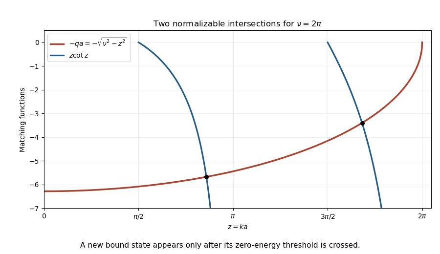

<h1 id="section-b/b1/solution">Solution</h1>

↑ **Parent:** [B1](../b1.md)

For a finite step in a one-dimensional potential and constant [mass](../../../../../mass.md), the stationary [Schrödinger equation](../../../../../schrodinger-equation.md) requires continuity of the [wavefunction](../../../../../wave-function-split.md) and its first derivative. A discontinuous derivative would introduce a delta-function term in its second derivative, unsupported by a merely finite step. A discontinuous [wavefunction](../../../../../wave-function-split.md) is still more singular. A delta-function potential has a different derivative jump condition; an infinite wall instead imposes zero [wavefunction](../../../../../wave-function-split.md) and does not require matching to an exterior zero derivative.

For a bound state of the half-well, $-V_0<E<0$. The wall at zero excludes a cosine term, and square integrability excludes exponential growth outside. Write

$$
\psi(x)=\begin{cases}A\sin kx,&0<x<a,\\B e^{-q(x-a)},&x>a,\end{cases}
\qquad
k^2=\frac{2m(E+V_0)}{\hbar^2},\quad q^2=\frac{-2mE}{\hbar^2}.
$$

Continuity at $a$ gives $A\sin ka=B$ and $Ak\cos ka=-qB$. Hence

$$
\boxed{k\cot ka=-q.}
$$

Put $z=ka$, $w=qa$, and $\nu=a\sqrt{2mV_0}/\hbar$. Matching becomes $z\cot z=-w$ with $z^2+w^2=\nu^2$, $w>0$. The negative branches of $z\cot z$ occur on $((n-1/2)\pi,n\pi)$. There is one bound-state intersection in the $n$th interval exactly when

$$
\nu>(n-\tfrac12)\pi.
$$

At equality the new level has $q=0$, so its outside tail is constant and not normalizable: it is a threshold state, not a bound state. Thus no bound state exists for $\nu\le\pi/2$, including the strict inequality asked in the question.

Exactly two negative-energy bound states require the second threshold to have been crossed and the third not crossed:

$$
\boxed{\frac{3\pi}{2}<\nu\le\frac{5\pi}{2},\qquad
9<\frac{8mV_0a^2}{\pi^2\hbar^2}\le25.}
$$

The lower endpoint is excluded and the upper endpoint included precisely because a zero-energy threshold state does not count as bound. This [half-line finite-well bound-state count](../../../../../half-line-finite-well-bound-state-count.md) differs from an unrestricted symmetric one-dimensional well, which has no hard wall at its centre.

**[Figure 3](#section-b/b1/image-two-bound-state-intersections-for-a-hard-wall-finite-well-of-dimensionless-depth-two-pi). Two bound-state intersections for a hard-wall finite well of dimensionless depth two pi**. Original matching-curve illustration with a chosen depth. The graph uses only negative cotangent branches and marks the two normalizable intersections.

## ↑ Ancestors (13)

1. [B1](../b1.md)
2. [Section B](../../section-b.md)
3. [Paper 1](../../../paper-1-split.md)
4. [2015](../../../split.md)
5. [Past exam of the physics course of the year 4 of the natural sciences course of the University of Cambridge](../../../../split.md)
6. [Physics course of the year 4 of the natural sciences course of the University of Cambridge](../../../../../physics-course-of-the-year-4-of-the-natural-sciences-course-of-the-university-of-cambridge.md)
7. [Year 4 of the natural sciences course of the University of Cambridge](../../../../../year-4-of-the-natural-sciences-course-of-the-university-of-cambridge.md)
8. [Year of the natural sciences course of the University of Cambridge](../../../../../year-of-the-natural-sciences-course-of-the-university-of-cambridge.md)
9. [Natural sciences course of the University of Cambridge](../../../../../natural-sciences-course-of-the-university-of-cambridge.md)
10. [Course of the University of Cambridge](../../../../../course-of-the-university-of-cambridge.md)
11. [University of Cambridge](../../../../../university-of-cambridge-split.md)
12. [List of universities](../../../../../list-of-universities.md)
13. [Codex Wiki](../../../../../split.md)
