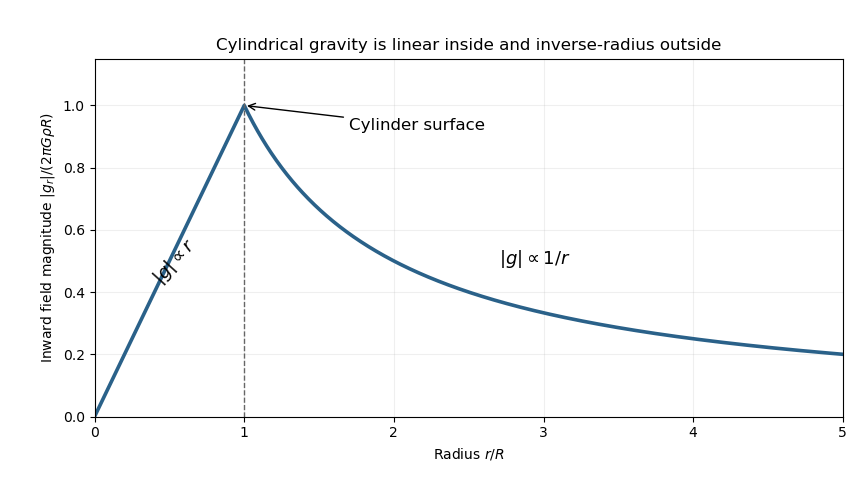

<h1 id="section-b/b5/solution">Solution</h1>

↑ **Parent:** [B5](../b5.md)

[Newton's law of universal gravitation](../../../../../newton-s-law-of-universal-gravitation-split.md) gives the [force](../../../../../force-split.md) $-GmM\hat{\mathbf r}/r^2$ on a test [mass](../../../../../mass.md) a distance $r$ from a point source. [Gauss's law for gravity](../../../../../gauss-s-law-for-gravity.md) states

$$
\oint_S\mathbf g\cdot d\mathbf S=-4\pi GM_{\rm enclosed},
\qquad \nabla\cdot\mathbf g=-4\pi G\rho.
$$

The inverse-square point field has the stated flux through a surrounding sphere. Superposition extends it to distributed sources; the divergence theorem relates the integral and local forms. Symmetry is still needed to turn a flux into a pointwise field value.

For the [gravitational field of an infinite uniform cylinder](../../../../../gravitational-field-of-an-infinite-uniform-cylinder.md), a coaxial cylindrical Gaussian surface has no end-cap flux and constant inward field on its curved surface. The enclosed [mass](../../../../../mass.md) per unit length is $\pi\rho r^2$ inside and $\pi\rho R^2$ outside. Hence

$$
\boxed{g_r(r)=\begin{cases}-2\pi G\rho r,&0\le r\le R,\\-2\pi G\rho R^2/r,&r\ge R.\end{cases}}
$$

Its magnitude rises linearly from zero, reaches $2\pi G\rho R$ at the surface, then decreases as $1/r$. The field is continuous at $R$, while its radial derivative changes because the density has a sharp edge.

**[Figure 6](#section-b/b5/image-gravity-inside-and-outside-an-infinite-uniform-cylinder). Gravity inside and outside an infinite uniform cylinder**. Original cylindrical Gauss-law result, normalized by the surface field. The narrow drilled hole and the thin test rod are neglected as perturbations of the source field.

Use signed distance $y$ along the diameter hole. A rod displaced by $x$ occupies $y\in[x-R,x+R]$, so its [force](../../../../../force-split.md) is $F(x)=\lambda\int_{x-R}^{x+R}g_y(y)\,dy$. At equilibrium symmetry makes $F(0)=0$. Differentiating the moving endpoints gives

$$
F'(0)=\lambda[g_y(R)-g_y(-R)]=-4\pi G\rho\lambda R.
$$

Thus the leading restoring [force](../../../../../force-split.md) and oscillation [frequency](../../../../../frequency.md) are

$$
\boxed{F(x)=-4\pi G\rho\lambda R\,x+o(x),\qquad
\omega^2=\frac{4\pi G\rho\lambda R}{2R\lambda}=2\pi G\rho.}
$$

For an explicit positive-displacement check, put $C=2\pi G\rho$ and integrate the inside and outside pieces for $0<x<2R$:

$$
F(x)=-C\lambda\left[Rx-\frac{x^2}{2}+R^2\ln(1+x/R)\right].
$$

Its first-order term is $-2C\lambda Rx$, agreeing with the endpoint argument. The result is the [diameter-rod oscillation in cylindrical gravity](../../../../../diameter-rod-oscillation-in-cylindrical-gravity.md); it assumes a sufficiently long source cylinder and a narrow hole whose removed [mass](../../../../../mass.md) can be neglected.

## ↑ Ancestors (13)

1. [B5](../b5.md)
2. [Section B](../../section-b.md)
3. [Paper 1](../../../paper-1-split.md)
4. [2015](../../../split.md)
5. [Past exam of the physics course of the year 4 of the natural sciences course of the University of Cambridge](../../../../split.md)
6. [Physics course of the year 4 of the natural sciences course of the University of Cambridge](../../../../../physics-course-of-the-year-4-of-the-natural-sciences-course-of-the-university-of-cambridge.md)
7. [Year 4 of the natural sciences course of the University of Cambridge](../../../../../year-4-of-the-natural-sciences-course-of-the-university-of-cambridge.md)
8. [Year of the natural sciences course of the University of Cambridge](../../../../../year-of-the-natural-sciences-course-of-the-university-of-cambridge.md)
9. [Natural sciences course of the University of Cambridge](../../../../../natural-sciences-course-of-the-university-of-cambridge.md)
10. [Course of the University of Cambridge](../../../../../course-of-the-university-of-cambridge.md)
11. [University of Cambridge](../../../../../university-of-cambridge-split.md)
12. [List of universities](../../../../../list-of-universities.md)
13. [Codex Wiki](../../../../../split.md)
