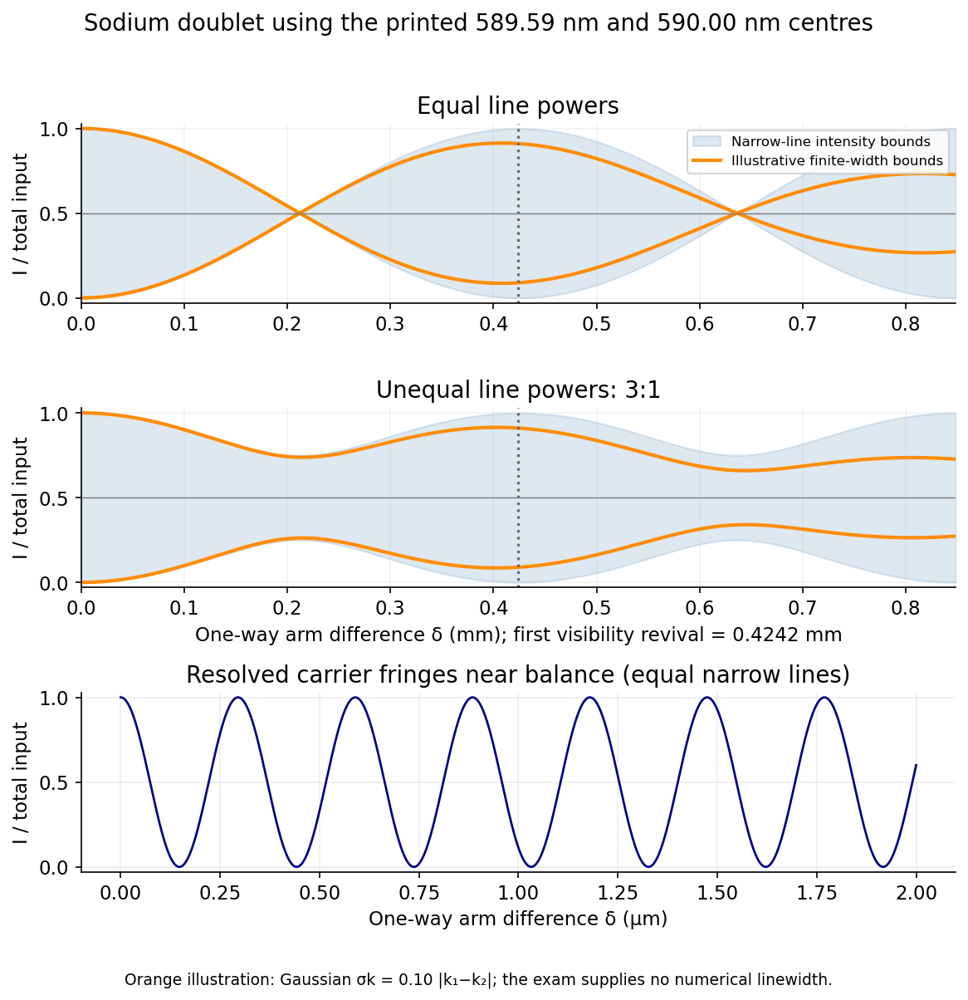

# Paper 1

↑ **Parent:** [2016](../2016.md)

[Original examination PDF, physical pages 768–778](https://www.whatdotheyknow.com/request/natural_science_tripos_physics_e_2/response/2340776/attach/2/FOI%202023%20399%20Zahid%20materials.pdf?cookie_passthrough=1#page=768)

**Table of contents**

- [Section A](#section-a)
  - [A1](#section-a/a1)
    - [Solution](#section-a/a1/solution)
  - [A2](#section-a/a2)
    - [Solution](#section-a/a2/solution)
  - [A3](#section-a/a3)
    - [Solution](#section-a/a3/solution)
  - [A4](#section-a/a4)
    - [Solution](#section-a/a4/solution)
  - [A5](#section-a/a5)
    - [Solution](#section-a/a5/solution)
  - [A6](#section-a/a6)
    - [Solution](#section-a/a6/solution)
  - [A7](#section-a/a7)
    - [Solution](#section-a/a7/solution)
  - [A8](#section-a/a8)
    - [Solution](#section-a/a8/solution)
  - [A9](#section-a/a9)
    - [Solution](#section-a/a9/solution)
  - [A10](#section-a/a10)
    - [Solution](#section-a/a10/solution)
- [Section B](#section-b)
  - [B1](#section-b/b1)
    - [a](#section-b/b1/a)
      - [Solution](#section-b/b1/a/solution)
    - [b](#section-b/b1/b)
      - [Solution](#section-b/b1/b/solution)
    - [c](#section-b/b1/c)
      - [Solution](#section-b/b1/c/solution)
  - [B2](#section-b/b2)
    - [a](#section-b/b2/a)
      - [Solution](#section-b/b2/a/solution)
    - [b](#section-b/b2/b)
      - [Solution](#section-b/b2/b/solution)
    - [c](#section-b/b2/c)
      - [Solution](#section-b/b2/c/solution)
    - [d](#section-b/b2/d)
      - [Solution](#section-b/b2/d/solution)
  - [B3](#section-b/b3)
    - [Solution](#section-b/b3/solution)
  - [B4](#section-b/b4)
    - [Solution](#section-b/b4/solution)
  - [B5](#section-b/b5)
    - [Solution](#section-b/b5/solution)
  - [B6](#section-b/b6)
    - [Solution](#section-b/b6/solution)
  - [B7](#section-b/b7)
    - [Solution](#section-b/b7/solution)
    - [a](#section-b/b7/a)
      - [Solution](#section-b/b7/a/solution)
    - [b](#section-b/b7/b)
      - [Solution](#section-b/b7/b/solution)
    - [c](#section-b/b7/c)
      - [Solution](#section-b/b7/c/solution)
  - [B8](#section-b/b8)
    - [Solution](#section-b/b8/solution)

## Section A

↑ **Parent:** [Paper 1](paper-1.md)

<h3 id="section-a/a1">A1</h3>

↑ **Parent:** [Section A](#section-a)

<h4 id="section-a/a1/solution">Solution</h4>

↑ **Parent:** [A1](#section-a/a1)

The [Stefan–Boltzmann law](../../heat.md#stefan-boltzmann-law) gives the radiated [luminosity](../../astrophysics.md#luminosity)

$$
L=4\pi R_\odot^2\sigma T_{\rm eff}^4\simeq3.69\times10^{26}\,\mathrm W.
$$

For [radiative mass loss at fixed luminosity](../../astrophysics.md#radiative-mass-loss-at-fixed-luminosity), using [mass-energy equivalence](../../special-relativity.md#mass-energy-equivalence), the mass-loss magnitude and one-percent time are

$$
\boxed{|\dot M|=L/c^2\simeq4.10\times10^9\,\mathrm{kg\,s^{-1}},\qquad t_{1\%}=\frac{0.01M_\odot c^2}{L}\simeq4.88\times10^{18}\,\mathrm s\simeq1.55\times10^{11}\,\mathrm{yr}.}
$$

The numerical constants are the external CODATA 2014 $\sigma=5.670367\times10^{-8}\,\mathrm{W\,m^{-2}K^{-4}}$ and $c=299792458\,\mathrm{m\,s^{-1}}$; years here mean 365.25 days.[Stefan-Boltzmann constant and vacuum light speed](../../physics-bibliography.md#codata-recommended-values-of-the-fundamental-physical-constants-2014-by-national-institute-of-standards-and-technology) This estimates radiative mass loss with the supplied radius and [temperature](../../temperature.md) held constant. It does not predict a real stellar lifetime or include solar-wind mass loss.

<h3 id="section-a/a2">A2</h3>

↑ **Parent:** [Section A](#section-a)

<h4 id="section-a/a2/solution">Solution</h4>

↑ **Parent:** [A2](#section-a/a2)

For this [molecular escape-speed temperature estimate](../../energy.md#molecular-escape-speed-temperature-estimate), $v_{\rm rms}^2=3k_BT/m$. Equating this to the surface escape-speed square $v_{\rm esc}^2=2GM_\oplus/R_\oplus$ gives

$$
\boxed{T=\frac{2mGM_\oplus}{3k_BR_\oplus}\simeq1.40\times10^5\,\mathrm K.}
$$

This evaluation keeps the paper's $R_\oplus=6.4\times10^6\,\mathrm m$ and $m=28u$, and uses externally documented $GM_\oplus=3.9860\times10^{14}\,\mathrm{m^3s^{-2}}$, $u=1.660539040\times10^{-27}\,\mathrm{kg}$ and $k_B=1.38064852\times10^{-23}\,\mathrm{J\,K^{-1}}$.[Bulk parameters: gravitational parameter GM](../../physics-bibliography.md#earth-fact-sheet-by-national-aeronautics-and-space-administration)[Atomic mass constant and Boltzmann constant](../../physics-bibliography.md#codata-recommended-values-of-the-fundamental-physical-constants-2014-by-national-institute-of-standards-and-technology) The corresponding escape speed is about $11.2\,\mathrm{km\,s^{-1}}$.

This is the requested speed-scale comparison. Atmospheric escape can occur from the high-speed tail at lower [temperature](../../temperature.md); molecular dissociation and ionization also prevent treating an actual gas at this [temperature](../../temperature.md) as unchanged neutral nitrogen molecules.

<h3 id="section-a/a3">A3</h3>

↑ **Parent:** [Section A](#section-a)

<h4 id="section-a/a3/solution">Solution</h4>

↑ **Parent:** [A3](#section-a/a3)

For the [potential of an inverse-radius spherical charge density](../../electrostatics.md#potential-of-an-inverse-radius-spherical-charge-density), assume there is no additional point charge at the origin and choose $\phi(\infty)=0$. The enclosed charge is $Q(r)=4\pi A\int_0^r r'\,dr'=2\pi Ar^2$ for $r<a$, and $Q(a)=2\pi Aa^2$ outside. [Gauss's law](../../maxwell-equations.md#gauss-s-law) then gives

$$
E_r=\begin{cases}A/(2\epsilon_0),&0<r<a,\\Aa^2/(2\epsilon_0r^2),&r>a.\end{cases}
$$

Integrating the field inward from infinity,

$$
\boxed{\phi(r)=\begin{cases}\dfrac{A}{2\epsilon_0}(2a-r),&0<r\leq a,\\[4pt]\dfrac{Aa^2}{2\epsilon_0r},&r\geq a.\end{cases}}
$$

The potential and its first radial derivative are continuous at $a$, since there is no surface charge there. The integrable [density](../../fluid-mechanics.md#density) singularity has a finite potential limit $\phi(0^+)=Aa/\epsilon_0$.

**[Figure 1](#section-a/a3/image-the-potential-falls-linearly-inside-the-inverse-radius-charge-cloud-and-joins-a-reciprocal-radius-exterior-tail). The potential falls linearly inside the inverse-radius charge cloud and joins a reciprocal-radius exterior tail**. [Source](paper-1-spherical-potential.py).

<h3 id="section-a/a4">A4</h3>

↑ **Parent:** [Section A](#section-a)

<h4 id="section-a/a4/solution">Solution</h4>

↑ **Parent:** [A4](#section-a/a4)

For the [ultrarelativistic magnetic bending radius](../../electromagnetism.md#ultrarelativistic-magnetic-bending-radius), the [Lorentz force](../../relativistic-electromagnetism.md#lorentz-force) supplies the transverse [momentum](../../momentum.md) change, so $r=p/(eB)$. At this energy the proton is ultrarelativistic, giving $pc\simeq E$ and

$$
\boxed{r\simeq\frac{7\times10^{12}\,\mathrm{eV}}{ec(9\,\mathrm T)}=2.59\times10^3\,\mathrm m\simeq2.6\,\mathrm{km}.}
$$

The electronvolt-to-joule conversion cancels the elementary-charge factor numerically. This uses external CODATA light speed and charge definitions.[Vacuum light speed and electronvolt conversion](../../physics-bibliography.md#codata-recommended-values-of-the-fundamental-physical-constants-2014-by-national-institute-of-standards-and-technology) If the stated beam energy means total energy, $pc=\sqrt{E^2-m_p^2c^4}$; if it means [kinetic energy](../../energy.md#kinetic-energy), $pc=\sqrt{T(T+2m_pc^2)}$. Either interpretation gives the quoted radius at the precision of the supplied numbers.

<h3 id="section-a/a5">A5</h3>

↑ **Parent:** [Section A](#section-a)

<h4 id="section-a/a5/solution">Solution</h4>

↑ **Parent:** [A5](#section-a/a5)

For [contact loss on a smooth sphere](../../classical-mechanics.md#contact-loss-on-a-smooth-sphere), let $\theta$ be the angle from the upward vertical. In the limit of an infinitesimal initial displacement, [conservation of energy](../../mathematical-physics.md#conservation-of-energy) gives $v^2=2gR(1-\cos\theta)$. The inward radial equation is

$$
mg\cos\theta-N=mv^2/R.
$$

Contact is lost at $N=0$, so $\cos\theta=2(1-\cos\theta)$ and $\theta=\arccos(2/3)$. The distance travelled **along the sphere** is therefore

$$
\boxed{s=R\arccos(2/3)=0.841\,\mathrm m.}
$$

The vertical drop is instead $R/3$; it is not the requested arc length. Exact rest at the unstable top would persist in the ideal mathematical solution, so the infinitesimal-displacement limit in the question is essential.

<h3 id="section-a/a6">A6</h3>

↑ **Parent:** [Section A](#section-a)

<h4 id="section-a/a6/solution">Solution</h4>

↑ **Parent:** [A6](#section-a/a6)

For the [focal length of a rotating liquid mirror](../../fluid-mechanics.md#focal-length-of-a-rotating-liquid-mirror), consider steady rigid rotation at [angular frequency](../../lagrangian-mechanics.md#angular-frequency) $\Omega=2\pi\nu$. The free surface is an [equipotential](../../electric-field.md#equipotential) of $gz-\Omega^2r^2/2$. Hence

$$
z-z_0=\frac{\Omega^2r^2}{2g}.
$$

A paraboloidal mirror has $z-z_0=r^2/(4f)$, giving

$$
\boxed{f=\frac{g}{2\Omega^2}=\frac{g}{8\pi^2\nu^2}\simeq3.1\,\mathrm m.}
$$

The numerical estimate uses the conventional standard acceleration $g_n=9.80665\,\mathrm{m\,s^{-2}}$, rather than an asserted local measurement or a recovered handbook entry.[Footnote 23: conventional standard acceleration of free fall](../../physics-bibliography.md#nist-guide-to-the-si-footnotes-by-national-institute-of-standards-and-technology) The mercury [density](../../fluid-mechanics.md#density) cancels; the ideal surface shape follows from gravity and rotation.

<h3 id="section-a/a7">A7</h3>

↑ **Parent:** [Section A](#section-a)

<h4 id="section-a/a7/solution">Solution</h4>

↑ **Parent:** [A7](#section-a/a7)

The first ideal linear polarizer transmits half of an unpolarized beam. Each subsequent polarizer is $60^\circ$ from the preceding transmitted [polarization](../../wave.md#polarization-waves), so [Malus's law](../../wave.md#malus-s-law) gives

$$
\boxed{\frac{I_{\rm out}}{I_{\rm in}}=\frac12\cos^2(60^\circ)\cos^2(60^\circ)=\frac1{32}.}
$$

Intensities, rather than coherent field amplitudes for different input [polarization](../../wave.md#polarization-waves) components, are averaged for the unpolarized beam. The output is polarized along the last polarizer's axis.

<h3 id="section-a/a8">A8</h3>

↑ **Parent:** [Section A](#section-a)

<h4 id="section-a/a8/solution">Solution</h4>

↑ **Parent:** [A8](#section-a/a8)

The [wave numbers](../../wave-equation.md#wavenumber) before and after the drop are $k=\sqrt{2mE}/\hbar$ and $q=\sqrt{2m(3E)}/\hbar=\sqrt3\,k$. Continuity of $\psi$ and $\psi'$ at the finite step gives

$$
1+r=t,\qquad k(1-r)=qt,\qquad r=\frac{k-q}{k+q}.
$$

Thus the reflected probability flux fraction is

$$
\boxed{R=|r|^2=\left(\frac{1-\sqrt3}{1+\sqrt3}\right)^2=7-4\sqrt3\simeq0.0718.}
$$

The transmission probability is $(q/k)|t|^2=1-R$, rather than simply $|t|^2$. Reflection is possible at a downward [potential step](../../quantum-scattering.md#step-potential) even though both sides are classically allowed.

<h3 id="section-a/a9">A9</h3>

↑ **Parent:** [Section A](#section-a)

<h4 id="section-a/a9/solution">Solution</h4>

↑ **Parent:** [A9](#section-a/a9)

For [hyperfine coupling for a spin-one nucleus](../../quantum-mechanics.md#hyperfine-coupling-for-a-spin-one-nucleus), let the [electron spin](../../angular-momentum-operator.md#electron-spin) be $s=1/2$ and the [nuclear spin](../../atomic-nucleus.md#nuclear-spin) $I=1$. First couple $\mathbf j=\mathbf L+\mathbf s$, giving $j=L\pm1/2$, then $\mathbf F=\mathbf j+\mathbf I$, giving $F=|j-I|,|j-I|+1,\ldots,j+I$.

| $L$ | $j$ | Allowed $F$ |
| --- | --- | --- |
| $1$ | $1/2$ | $1/2,3/2$ |
| $1$ | $3/2$ | $1/2,3/2,5/2$ |
| $2$ | $3/2$ | $1/2,3/2,5/2$ |
| $2$ | $5/2$ | $3/2,5/2,7/2$ |

For each $F$, the projection is $m_F=-F,-F+1,\ldots,F$; electron projections similarly satisfy $m_j=-j,\ldots,j$. Summing $2F+1$ gives 18 states for $L=1$ and 30 for $L=2$, agreeing with $(2L+1)(2s+1)(2I+1)$.

**Notation qualification:** if the printed leading “2” denotes the principal [quantum number](../../quantum-system.md#quantum-number), a hydrogenic $2d$ bound state does not exist because $L\leq n-1$; a physical $d$ state needs $n\geq3$. If a doublet term symbol $^{2}P$ or $^{2}D$ was intended, its leading 2 instead means $2s+1$, and the angular-[momentum](../../momentum.md) table applies without fixing $n$. The answers above use the explicitly specified $L$ values, while retaining this ambiguity.[Three-dimensional angular momentum and hydrogenic quantum-number restrictions](../../physics-bibliography.md#quantum-mechanics-by-david-tong)

<h3 id="section-a/a10">A10</h3>

↑ **Parent:** [Section A](#section-a)

<h4 id="section-a/a10/solution">Solution</h4>

↑ **Parent:** [A10](#section-a/a10)

The fastest clearly resolved late oscillations occupy roughly $0.004$–$0.005\,\mathrm s$ per cycle when compared with the $0.05\,\mathrm s$ major-tick spacing. Thus $f_{\max}$ is of order $200$–$250\,\mathrm{Hz}$ and the [Nyquist–Shannon sampling theorem](../../fourier-analysis.md#nyquist-shannon-sampling-theorem) requires

$$
\boxed{f_s>2f_{\max}\sim400\text{–}500\,\mathrm{samples\,s^{-1}}.}
$$

A [sampling rate](../../wave-equation.md#sampling-rate) of order $500\,\mathrm{samples\,s^{-1}}$ is the estimated lower boundary for the plotted signal bandwidth; practical acquisition needs anti-alias filtering and margin. This is not a determination of LIGO's actual acquisition rate.[MT-002: bandwidth-limited sampling and anti-alias filtering](../../physics-bibliography.md#what-the-nyquist-criterion-means-to-your-sampled-data-system-design-by-walt-kester)

The [bit-depth requirements for waveform digitization](../../electrical-engineering.md#bit-depth-requirements-for-waveform-digitization) need a specified precision. **The numerical bit depth is underdetermined by the figure.** If the digitizer covers a full-scale range $V_{\rm FS}$ and the required quantization step is at most $\Delta$, then

$$
\boxed{b\geq\left\lceil\log_2\frac{V_{\rm FS}}{\Delta}\right\rceil.}
$$

For a uniform quantizer its ideal quantization-noise rms is approximately $\Delta/\sqrt{12}$. No permitted quantization error, noise criterion or calibrated digitizer range is specified. The plotted reconstruction band does not itself define one. Therefore no unique finite bit count, or exact lossless digitization of an arbitrary real-valued waveform, follows from the supplied data.

## Section B

↑ **Parent:** [Paper 1](paper-1.md)

<h3 id="section-b/b1">B1</h3>

↑ **Parent:** [Section B](#section-b)

<h4 id="section-b/b1/a">a</h4>

↑ **Parent:** [B1](#section-b/b1)

<h5 id="section-b/b1/a/solution">Solution</h5>

↑ **Parent:** [A](#section-b/b1/a)

In the paper's convention $\mathbf J$ is measured in units of $\hbar$, and $g$ is dimensionless. For $m=-J,-J+1,\ldots,J$, the [magnetic moment](../../electromagnetism.md#magnetic-dipole-moment) and its [Zeeman energy](../../electromagnetism.md#zeeman-energy) are

$$
\boxed{\mu_z=-g\mu_Bm,\qquad E_m=-\mu_zB=g\mu_BBm.}
$$

If $\mathbf J$ instead denotes dimensional angular [momentum](../../momentum.md), its coefficient must contain $1/\hbar$. This resolves the units of the printed moment formula.

<h4 id="section-b/b1/b">b</h4>

↑ **Parent:** [B1](#section-b/b1)

<h5 id="section-b/b1/b/solution">Solution</h5>

↑ **Parent:** [B](#section-b/b1/b)

Write $y=g\mu_BB/(k_BT)$. Summing the [Boltzmann factors](../../canonical-ensemble.md#boltzmann-factor) gives the one-atom [partition function](../../canonical-ensemble.md#canonical-partition-function)

$$
Z_1=\sum_{m=-J}^Je^{-ym}=\frac{\sinh[(J+1/2)y]}{\sinh(y/2)}.
$$

Since $\langle m\rangle=-\partial_y\log Z_1$, the [Brillouin magnetization formula](../../electromagnetism.md#brillouin-magnetization-formula) is

$$
\boxed{\langle\mu_z\rangle=g\mu_B\left[(J+\tfrac12)\coth((J+\tfrac12)y)-\tfrac12\coth(y/2)\right],\qquad M=N\langle\mu_z\rangle.}
$$

Here $M$ is the total [magnetic moment](../../electromagnetism.md#magnetic-dipole-moment) used by the question; the [magnetization](../../electromagnetism.md#magnetization) per unit volume is $M/V$. For independent distinguishable atoms, $Z_N=Z_1^N$, with no indistinguishability factor.

Putting $J=1/2$ yields

$$
\boxed{M=Ng\mu_B[\coth y-\tfrac12\coth(y/2)]=\frac{Ng\mu_B}{2}\tanh(y/2).}
$$

The apparent singularities of the hyperbolic cotangents at $B=0$ cancel; the finite sum makes the zero-field limit explicit.[Chapter 1: canonical partition functions and independent two-state systems](../../physics-bibliography.md#statistical-physics-by-david-tong)

<h4 id="section-b/b1/c">c</h4>

↑ **Parent:** [B1](#section-b/b1)

<h5 id="section-b/b1/c/solution">Solution</h5>

↑ **Parent:** [C](#section-b/b1/c)

For $g>0$, $B\to+\infty$ at fixed $T>0$ selects $m=-J$, so all moments align with the field:

$$
\boxed{M\longrightarrow Ng\mu_BJ.}
$$

This is [magnetic saturation](../../electromagnetism.md#magnetic-saturation). The [Curie response of an arbitrary independent spin](../../electromagnetism.md#curie-response-of-an-arbitrary-independent-spin) follows at weak field: $\coth z=z^{-1}+z/3+O(z^3)$ gives

$$
\boxed{M=\frac{N(g\mu_B)^2J(J+1)}{3k_BT}B+O(B^3)\longrightarrow0.}
$$

This is the [Curie law](../../statistical-physics.md#curie-s-law) of independent moments with [paramagnetism](../../electromagnetism.md#paramagnetism). Thermal populations are symmetric at zero field, so the model has no spontaneous [magnetization](../../electromagnetism.md#magnetization). Both limits hold at fixed positive [temperature](../../temperature.md); taking $T\to0$ first is a different limiting procedure.

<h3 id="section-b/b2">B2</h3>

↑ **Parent:** [Section B](#section-b)

<h4 id="section-b/b2/a">a</h4>

↑ **Parent:** [B2](#section-b/b2)

<h5 id="section-b/b2/a/solution">Solution</h5>

↑ **Parent:** [A](#section-b/b2/a)

The [Van der Waals equation](../../pressure.md#van-der-waals-equation) replaces the freely available volume by $V-Nb$ to represent short-range repulsion and [excluded volume](../../statistical-physics.md#excluded-volume). The attractive mean field reduces the [pressure](../../pressure.md) by $aN^2/V^2$: particles near the boundary are pulled back into the gas, lowering their [momentum](../../momentum.md) transfer to the walls. Both are effective corrections, rather than an exact microscopic interaction law.

<h4 id="section-b/b2/b">b</h4>

↑ **Parent:** [B2](#section-b/b2)

<h5 id="section-b/b2/b/solution">Solution</h5>

↑ **Parent:** [B](#section-b/b2/b)

**The total [internal energy](../../internal-energy.md) and particle number are conserved.** The outer container is rigid and isolated, so there is no external work or heat transfer. Its total volume stays $V_0$, while the volume accessible to the gas increases from $V_0/3$ to $V_0$. Neither the gas [temperature](../../temperature.md) nor its [entropy](../../entropy.md) is generally conserved: this is an irreversible [free expansion](../../thermodynamics.md#free-expansion), with increasing [entropy](../../entropy.md).

<h4 id="section-b/b2/c">c</h4>

↑ **Parent:** [B2](#section-b/b2)

<h5 id="section-b/b2/c/solution">Solution</h5>

↑ **Parent:** [C](#section-b/b2/c)

At fixed particle number, $dU=T\,dS-P\,dV$. The stated [Maxwell relation](../../thermodynamics.md#maxwell-relations) gives

$$
\left(\frac{\partial U}{\partial V}\right)_T=T\left(\frac{\partial P}{\partial T}\right)_V-P=\frac{aN^2}{V^2},\qquad U(T,V)=f(T)-\frac{aN^2}{V}+C.
$$

For the intended classical monatomic [Van der Waals gas](../../pressure.md#van-der-waals-gas), [equipartition](../../canonical-ensemble.md#equipartition-theorem) supplies $f(T)=3Nk_BT/2$: the attractive mean-field term is [temperature](../../temperature.md) independent and there are three translational quadratic degrees of freedom. Consequently,

$$
\boxed{U_i=\frac32Nk_BT_i-\frac{3aN^2}{V_0}+C.}
$$

The [caloric closure of the van der Waals equation](../../pressure.md#caloric-closure-of-the-van-der-waals-equation) is essential. **Caloric assumption:** the [pressure](../../pressure.md) equation alone determines the volume dependence, but not the function $f(T)$. The monatomic kinetic-energy model is the additional assumption behind the claimed formula.[Chapter 2: classical monatomic gases and the van der Waals mean-field interaction](../../physics-bibliography.md#statistical-physics-by-david-tong)

<h4 id="section-b/b2/d">d</h4>

↑ **Parent:** [B2](#section-b/b2)

<h5 id="section-b/b2/d/solution">Solution</h5>

↑ **Parent:** [D](#section-b/b2/d)

Equating the initial and final [internal energies](../../internal-energy.md), with the same additive constant,

$$
\frac32Nk_BT_f-\frac{aN^2}{V_0}=\frac32Nk_BT_i-\frac{3aN^2}{V_0},
$$

so

$$
\boxed{T_f=T_i-\frac{4aN}{3k_BV_0}.}
$$

This is [cooling in free expansion of a van der Waals gas](../../thermodynamics.md#cooling-in-free-expansion-of-a-van-der-waals-gas). The gas cools because separating attractive particles raises their potential energy at the expense of [kinetic energy](../../energy.md#kinetic-energy). The excluded-volume coefficient $b$ cancels from this caloric model. The result assumes a homogeneous equilibrium gas with $V_0/3>Nb$ and positive $T_f$; a two-phase final state would require a coexistence calculation rather than this homogeneous formula. The ideal-gas limit $a=0$ has no [temperature](../../temperature.md) change.

<h3 id="section-b/b3">B3</h3>

↑ **Parent:** [Section B](#section-b)

<h4 id="section-b/b3/solution">Solution</h4>

↑ **Parent:** [B3](#section-b/b3)

For a fixed contour, [Faraday's law of induction](../../maxwell-equations.md#faraday-s-law-of-induction) is

$$
\oint_C\mathbf E\cdot d\mathbf l=-\frac{d}{dt}\int_\Sigma\mathbf B\cdot d\mathbf S,\qquad\nabla\times\mathbf E=-\frac{\partial\mathbf B}{\partial t}.
$$

The second equation is the differential Maxwell equation, related to the first by [Stokes theorem](../../multivariable-calculus.md#stokes-theorem). For a moving wire, the relevant [motional electromotive force](../../electric-charge.md#motional-electromotive-force) is $\mathcal E=\oint(\mathbf E+\mathbf v_{\rm wire}\times\mathbf B)\cdot d\mathbf l=-d\Phi_B/dt$. Thus a static magnetic field can induce current in a moving circuit even when $\nabla\times\mathbf E=0$.

For [translational magnetic damping of a square wire loop](../../electromagnetism.md#translational-magnetic-damping-of-a-square-wire-loop), while the upper horizontal leg remains in the field, a downward speed $v$ reduces the flux at rate $Bav$. Hence $|\mathcal E|=Bav$, $|I|=Bav/R$, and the upward [magnetic braking](../../electromagnetism.md#magnetic-braking) force is $B^2a^2v/R$. With negligible electrical self-inductance,

$$
m\dot v=mg-\frac{B^2a^2}{R}v,\qquad\boxed{v_t=\frac{mgR}{B^2a^2},\quad v(t)=v_t(1-e^{-t/\tau_t}),\quad\tau_t=\frac{mR}{B^2a^2}.}
$$

Let the wire cross-sectional area be $S$, mass [density](../../fluid-mechanics.md#density) $\rho_m$, and resistivity $\rho_e$. Since $m=4aS\rho_m$ and $R=4a\rho_e/S$,

$$
\boxed{\tau_t=\frac{16\rho_m\rho_e}{B^2}=2.403072\,\mathrm{ms},\qquad t_{95}=\tau_t\log20=7.20\,\mathrm{ms}.}
$$

These use the printed copper values and $B=1\,\mathrm T$. The wire dimensions cancel. The terminal-speed approximation is restricted to the interval before the upper leg leaves the field, as assumed in the question.

For [rotational magnetic damping of a square wire loop](../../electromagnetism.md#rotational-magnetic-damping-of-a-square-wire-loop), consider rotation about the central $x$ axis in a uniform field, the flux is $Ba^2\cos\theta$. The induced current produces torque $-B^2a^4\dot\theta\sin^2\theta/R$. A thin square loop has [moment of inertia](../../rigid-body-dynamics.md#moment-of-inertia) $\mathcal I_x=ma^2/6$: the two legs parallel to $x$ contribute $ma^2/8$, and the other two $ma^2/24$. Averaging $\sin^2\theta$ over a rotation gives

$$
\mathcal I_x\dot\omega=-\frac{B^2a^4}{2R}\omega,\qquad\boxed{\tau_{\rm rot,\omega}=\frac{2\mathcal I_xR}{B^2a^4}=\frac{\tau_t}{3}=0.801024\,\mathrm{ms}.}
$$

If “decay time” means rotational [kinetic energy](../../energy.md#kinetic-energy) rather than angular speed, $K\propto\omega^2$ gives $\tau_{\rm rot,K}=\tau_t/6=0.400512\,\mathrm{ms}$. This distinction, and the assumed separation between rotation period and slow decay, are essential. The [electrical and mechanical time scales in magnetic braking](../../electromagnetism.md#electrical-and-mechanical-time-scales-in-magnetic-braking) must be separated: electrical self-inductance is neglected in both calculations.

**[Figure 2](#section-b/b3/image-the-falling-loop-speed-deficit-decays-three-times-more-slowly-than-the-rotating-loop-angular-speed). The falling-loop speed deficit decays three times more slowly than the rotating-loop angular speed**. [Source](paper-1-loop-damping.py).

<h3 id="section-b/b4">B4</h3>

↑ **Parent:** [Section B](#section-b)

<h4 id="section-b/b4/solution">Solution</h4>

↑ **Parent:** [B4](#section-b/b4)

For the [normal modes of two spring-coupled equal pendulums](../../wave.md#normal-modes-of-two-spring-coupled-equal-pendulums), a [normal mode](../../wave-equation.md#normal-mode) has every coordinate oscillating at the same frequency with a fixed displacement ratio. The linearized equations here are

$$
m\ddot x_1=-m\omega_0^2x_1-k(x_1-x_2),\qquad m\ddot x_2=-m\omega_0^2x_2-k(x_2-x_1).
$$

Their normalized displacement patterns and angular frequencies are

$$
\boxed{\mathbf e_+=\frac{(1,1)}{\sqrt2},\quad\omega_+=\omega_0;\qquad\mathbf e_-=\frac{(1,-1)}{\sqrt2},\quad\omega_-=\sqrt{\omega_0^2+2k/m}=1.1\omega_0.}
$$

The spring is unstretched in the in-phase mode, and stretched or compressed in the opposite-phase mode. The numerical ratio follows from $k/m=(21/200)\omega_0^2$.

**[Figure 3](#section-b/b4/image-in-phase-and-opposite-phase-displacement-patterns-of-the-two-coupled-pendulums). In-phase and opposite-phase displacement patterns of the two coupled pendulums**. [Source](paper-1-pendulum-modes.py).

The initial displacement is the equal sum of the two mode patterns, and the initial velocities vanish. Therefore

$$
x_1(t)=\frac a2[\cos\omega_0t+\cos(1.1\omega_0t)],\qquad\boxed{x_2(t)=\frac a2[\cos\omega_0t-\cos(1.1\omega_0t)]=a\sin(1.05\omega_0t)\sin(0.05\omega_0t).}
$$

With the printed $\omega_0=2\pi\,\mathrm{rad\,s^{-1}}$ this is $x_2/a=\sin(2.1\pi t)\sin(0.1\pi t)$, with $t$ in seconds. The fast oscillation has frequency $1.05\,\mathrm{Hz}$ and the amplitude is bounded by $a|\sin(\pi t/10)|$. The first complete displacement transfer is at $t=5\,\mathrm s$, when $x_1=0$, $x_2=a$ and both velocities vanish; the original state returns at $10\,\mathrm s$. Distinguishing [absolute and signed beat envelopes](../../wave.md#absolute-and-signed-beat-envelopes), the absolute beat envelope repeats every $10\,\mathrm s$, although its signed sine factor has period $20\,\mathrm s$.

**[Figure 4](#section-b/b4/image-the-second-pendulum-oscillates-inside-a-ten-second-beat-envelope-and-first-receives-the-full-displacement-at-five-seconds). The second pendulum oscillates inside a ten-second beat envelope and first receives the full displacement at five seconds**. [Source](paper-1-pendulum-beats.py).

<h3 id="section-b/b5">B5</h3>

↑ **Parent:** [Section B](#section-b)

<h4 id="section-b/b5/solution">Solution</h4>

↑ **Parent:** [B5](#section-b/b5)

Nonrelativistic [momentum conservation](../../momentum.md#momentum-conservation) gives $\mathbf u=\mathbf v_1+\mathbf v_2$, while an [elastic collision](../../classical-mechanics.md#elastic-collision) conserves [kinetic energy](../../energy.md#kinetic-energy), $u^2=v_1^2+v_2^2$. Squaring the [momentum](../../momentum.md) equation yields $\mathbf v_1\cdot\mathbf v_2=0$. **The two nonzero outgoing velocities are perpendicular.** In the degenerate case where one outgoing particle is at rest, its direction is undefined.

For relativistic collisions conserve total [four-momentum](../../special-relativity.md#four-momentum), with $E=\gamma mc^2$, $\mathbf p=\gamma m\mathbf v$ and $E^2-p^2c^2=m^2c^4$. Rest energies must be included; for [photons](../../quantum-mechanics.md#photon) $E=pc$.

For the [symmetric relativistic equal-mass scattering angle](../../classical-mechanics.md#symmetric-relativistic-equal-mass-scattering-angle), the incident [momentum](../../momentum.md) is $mc\sqrt{\alpha(\alpha+2)}$. Energy conservation gives each final particle $E_f=(1+\alpha/2)mc^2$, hence $p_f=(mc/2)\sqrt{\alpha(\alpha+4)}$. Transverse momenta cancel and $2p_f\cos\theta=p_{\rm in}$, giving

$$
\cos\theta=\sqrt{\frac{\alpha+2}{\alpha+4}},\qquad\boxed{\tan\theta=\sqrt{\frac2{\alpha+2}}.}
$$

The nonrelativistic limit has $\theta\to45^\circ$, so the outgoing angle is $90^\circ$ as above.

For the [symmetric two-photon annihilation angle](../../relativistic-quantum-field.md#symmetric-two-photon-annihilation-angle) in the specified [electron-positron annihilation](../../relativistic-quantum-field.md#electron-positron-annihilation), each [photon](../../quantum-mechanics.md#photon) has energy $E_\gamma=(\alpha+2)m_ec^2/2$. [Momentum conservation](../../momentum.md#momentum-conservation) gives $2(E_\gamma/c)\cos\phi=m_ec\sqrt{\alpha(\alpha+2)}$, so

$$
\cos\phi=\sqrt{\frac\alpha{\alpha+2}},\qquad\boxed{\tan\phi=\sqrt{\frac2\alpha}\quad(\alpha>0).}
$$

As $\alpha\to0^+$ the two [photons](../../quantum-mechanics.md#photon) become back-to-back, transverse to the limiting incident direction; as $\alpha\to\infty$ they are forward collimated. Equal [photon](../../quantum-mechanics.md#photon) energies follow from the specified equal angles, and are not a general property of annihilation in a moving laboratory frame.

<h3 id="section-b/b6">B6</h3>

↑ **Parent:** [Section B](#section-b)

<h4 id="section-b/b6/solution">Solution</h4>

↑ **Parent:** [B6](#section-b/b6)

Two applications of [optical interferometry](../../physical-optics.md#optical-interferometry) are precision displacement or strain measurement, and [Fourier transform spectroscopy](../../optical-instrument.md#fourier-transform-spectroscopy), which recovers a spectrum from an interferogram.

For the [round-trip phase in a Michelson interferometer](../../physical-optics.md#round-trip-phase-in-a-michelson-interferometer), take a lossless 50:50 [beam splitter](../../optical-instrument.md#beam-splitter) with $t=1/\sqrt2$ and $r=i/\sqrt2$, and mirror reflection amplitude $-1$. At the depicted detector, each returning path has one beam-splitter transmission and one reflection. Their amplitudes are $-iA_0e^{2ikD}/2$ and $-iA_0e^{2ik(D+\delta)}/2$. Consequently,

$$
\boxed{I(\delta)=\frac{|A_0|^2}{2}[1+\cos(2k\delta)]=|A_0|^2\cos^2(k\delta).}
$$

The factor 2 in the phase is the return journey: the labelled $\delta$ is a one-way arm-length difference. The other output port has the complementary [intensity](../../wave.md#intensity-physics). **The printed $|A_0|^2(1+2\cos k\delta)$ cannot be an [intensity](../../wave.md#intensity-physics):** it becomes negative, and does not match the depicted path difference. No choice of normalization fixes that negative minimum. The expression above is the physically consistent result for the drawn output port.

For mutually incoherent spectral components with incident power [density](../../fluid-mechanics.md#density) $S(k)$,

$$
I(\delta)=\frac12\int S(k)[1+\cos(2k\delta)]\,dk.
$$

The plot labels are $\lambda_1=589.59\,\mathrm{nm}$ and $\lambda_2=590.00\,\mathrm{nm}$; these printed centres are used here. In the narrow-line, equal-power limit, each line has incident [intensity](../../wave.md#intensity-physics) $J$ and

$$
\boxed{I=J[1+\cos((k_1+k_2)\delta)\cos((k_1-k_2)\delta)].}
$$

There are rapid carrier fringes with approximately $0.2949\,\mathrm{\mu m}$ mirror-displacement spacing and a slowly varying [Interferometric visibility](../../physical-optics.md#interferometric-visibility) envelope. The first visibility zero is at $0.2121\,\mathrm{mm}$, and successive visibility revivals are separated by

$$
\boxed{\Delta\delta_{\rm vis}=\frac\pi{|k_1-k_2|}=\frac{\lambda_1\lambda_2}{2|\lambda_2-\lambda_1|}=0.4242\,\mathrm{mm}.}
$$

For the [unequal-line visibility in a spectral doublet](../../physical-optics.md#unequal-line-visibility-in-a-spectral-doublet), with incident line powers $J_1,J_2$, replace the [intensity](../../wave.md#intensity-physics) by $[J_1+J_2+J_1\cos(2k_1\delta)+J_2\cos(2k_2\delta)]/2$. The visibility becomes

$$
\mathcal V(\delta)=\frac{\sqrt{J_1^2+J_2^2+2J_1J_2\cos(2(k_1-k_2)\delta)}}{J_1+J_2}.
$$

The visibility minima rise from zero to $|J_1-J_2|/(J_1+J_2)$. The finite widths drawn in the spectrum also make coherence decay with path difference. For example, Gaussian lines of common wave-number [standard deviation](../../variance.md#standard-deviation) $\sigma_k$ multiply the oscillatory term by $e^{-2\sigma_k^2\delta^2}$; the actual linewidth is not specified numerically. Thus the narrow-line plot gives the beat positions, while the true long-delay oscillations die away.[Temporal coherence and interference of incoherent spectral components](../../physics-bibliography.md#interference-and-coherence-by-sander-konijnenberg-aurele-j-l-adam-and-h-paul-urbach)

**[Figure 5](#section-b/b6/image-doublet-interferograms-unequal-line-powers-prevent-complete-loss-of-visibility-finite-linewidth-damps-the-revival-envelope). Doublet interferograms: unequal line powers prevent complete loss of visibility; finite linewidth damps the revival envelope**. [Source](paper-1-doublet-interferogram.py).

The [common-arm phase cancellation in a balanced interferometer](../../physical-optics.md#common-arm-phase-cancellation-in-a-balanced-interferometer) means **there is no smallest positive common mirror distance $D$ in a balanced interferometer.** With $\delta=0$ the common factor $e^{2ikD}$ cancels from every [intensity](../../wave.md#intensity-physics), and both paths interfere constructively at this detector for every $D>0$. Their infimum is zero. The $0.4242\,\mathrm{mm}$ beat length describes changes of arm difference, not of the common arm length. It therefore cannot answer the final request as printed.

<h3 id="section-b/b7">B7</h3>

↑ **Parent:** [Section B](#section-b)

<h4 id="section-b/b7/solution">Solution</h4>

↑ **Parent:** [B7](#section-b/b7)

The classical minimum is **$E_{\rm cl}=0$**, attained at $x=p=0$. The quantum oscillator has **$E_0=\hbar\omega/2$**, its [zero-point energy](../../quantum-harmonic-oscillator.md#zero-point-energy); simultaneous zero position and [momentum](../../momentum.md) uncertainties are forbidden.

Let $\ell=\sqrt{\hbar/(m\omega)}$ and $\xi=x/\ell$. The first three normalized [harmonic oscillator eigenfunctions](../../quantum-harmonic-oscillator.md#harmonic-oscillator-eigenfunction) are

$$
\psi_0=\frac{e^{-\xi^2/2}}{\pi^{1/4}\sqrt\ell},\qquad\psi_1=\sqrt2\xi\psi_0,\qquad\psi_2=\frac{2\xi^2-1}{\sqrt2}\psi_0.
$$

They have respectively zero, one and two nodes, with even, odd and even [parity](../../quantum-mechanics.md#parity). Their phases may be reversed without changing the state.[Chapter 2: the harmonic oscillator](../../physics-bibliography.md#quantum-mechanics-by-david-tong)

**[Figure 6](#section-b/b7/image-the-first-three-harmonic-oscillator-wavefunctions-have-increasing-node-count-and-alternating-parity). The first three harmonic oscillator wavefunctions have increasing node count and alternating parity**. [Source](paper-1-oscillator-states.py).

<h4 id="section-b/b7/a">a</h4>

↑ **Parent:** [B7](#section-b/b7)

<h5 id="section-b/b7/a/solution">Solution</h5>

↑ **Parent:** [A](#section-b/b7/a)

Invert the given [ladder operators](../../semisimple-lie-algebra.md#ladder-operator):

$$
\hat x=\sqrt{\frac\hbar{2m\omega}}(\hat a_++\hat a_-),\qquad\hat p=i\sqrt{\frac{m\hbar\omega}2}(\hat a_+-\hat a_-).
$$

Because the [Energy eigenstate](../../energy-eigenvalue.md#energy-eigenstate) are orthonormal, $\langle n|\hat a_\pm|n\rangle=0$: each operator changes the state to one orthogonal to $|n\rangle$. Hence

$$
\boxed{\langle x\rangle_n=\langle p\rangle_n=0.}
$$

The result also follows from the definite [parity](../../quantum-mechanics.md#parity) of every oscillator energy eigenfunction, but here it follows directly from the specified operators.

<h4 id="section-b/b7/b">b</h4>

↑ **Parent:** [B7](#section-b/b7)

<h5 id="section-b/b7/b/solution">Solution</h5>

↑ **Parent:** [B](#section-b/b7/b)

Orthogonality gives $\langle\hat a_+^2\rangle=\langle\hat a_-^2\rangle=0$, while the ladder coefficients give $\langle\hat a_+\hat a_-\rangle=n$ and $\langle\hat a_-\hat a_+\rangle=n+1$. Squaring the expressions for $\hat x$ and $\hat p$ therefore gives

$$
\langle x^2\rangle=\frac\hbar{m\omega}(n+\tfrac12),\qquad\langle p^2\rangle=m\hbar\omega(n+\tfrac12).
$$

Thus

$$
\boxed{\langle V\rangle=\frac12m\omega^2\langle x^2\rangle=\frac12\hbar\omega(n+\tfrac12),\qquad\langle K\rangle=\frac{\langle p^2\rangle}{2m}=\frac12\hbar\omega(n+\tfrac12).}
$$

Their equality is the harmonic-potential case of the [quantum virial theorem](../../quantum-mechanics.md#quantum-virial-theorem), and their sum is the oscillator energy $E_n=\hbar\omega(n+1/2)$.

<h4 id="section-b/b7/c">c</h4>

↑ **Parent:** [B7](#section-b/b7)

<h5 id="section-b/b7/c/solution">Solution</h5>

↑ **Parent:** [C](#section-b/b7/c)

For the [uncertainty product of oscillator number states](../../quantum-harmonic-oscillator.md#uncertainty-product-of-oscillator-number-states), the two means vanish, so the [standard deviations](../../variance.md#standard-deviation) are the square roots of the second moments:

$$
\Delta x=\sqrt{\frac\hbar{m\omega}(n+\tfrac12)},\qquad\Delta p=\sqrt{m\hbar\omega(n+\tfrac12)}.
$$

Consequently,

$$
\boxed{\Delta x\Delta p=\hbar(n+\tfrac12).}
$$

Only the ground state $n=0$ saturates the [Heisenberg uncertainty principle](../../quantum-theory.md#heisenberg-uncertainty-relation) in this sequence of [energy eigenstates](../../energy-eigenvalue.md#energy-eigenstate); the excited number states have a larger uncertainty product.

<h3 id="section-b/b8">B8</h3>

↑ **Parent:** [Section B](#section-b)

<h4 id="section-b/b8/solution">Solution</h4>

↑ **Parent:** [B8](#section-b/b8)

In the position representation, the [momentum operators](../../quantum-mechanics.md#momentum-operator) are $\hat p_x=-i\hbar\partial_x$ and $\hat p_y=-i\hbar\partial_y$. Therefore

$$
\hat L_z=\hat x\hat p_y-\hat y\hat p_x=-i\hbar(x\partial_y-y\partial_x)=\boxed{-i\hbar\partial_\phi},
$$

since $\partial_\phi=-y\partial_x+x\partial_y$ at fixed radius. Solving the eigenvalue equation on the circle and imposing $2\pi$ periodicity gives

$$
\boxed{u_m(\phi)=\frac{e^{im\phi}}{\sqrt{2\pi}},\qquad L_z=\hbar m,\quad m\in\mathbb Z.}
$$

Their normalization uses the angular measure $d\phi$ on $[0,2\pi)$.

For the [half-ring sine-squared angular state](../../angular-momentum-operator.md#half-ring-sine-squared-angular-state), write $C=\sqrt{8/(3\pi)}$. The stated [wavefunction](../../wave-function.md) is normalized because $C^2\int_0^\pi\sin^4\phi\,d\phi=1$. It and its first derivative match continuously to zero at the boundaries, so the integrations by parts have no boundary contributions. The [angular momentum expectation](../../angular-momentum-operator.md#angular-momentum-expectation) and second moment are

$$
\langle L_z\rangle=-i\hbar\int\psi\psi'\,d\phi=0,\qquad\langle L_z^2\rangle=\hbar^2\int|\psi'|^2d\phi=C^2\hbar^2\int_0^\pi\sin^2(2\phi)\,d\phi=\frac43\hbar^2.
$$

Hence **$\operatorname{Var}(L_z)=4\hbar^2/3$**. The jumps in the second derivative do not invalidate this result: the periodic [wavefunction](../../wave-function.md) has a square-integrable second derivative and a continuous first derivative.

The probability of $L_z=\hbar$ is the squared projection onto $u_1$:

$$
c_1=\frac C{\sqrt{2\pi}}\int_0^\pi\sin^2\phi\,e^{-i\phi}d\phi=\frac2{\sqrt3\pi}\left(-\frac{4i}3\right)=-\frac{8i}{3\sqrt3\pi},\qquad\boxed{P(L_z=\hbar)=\frac{64}{27\pi^2}\simeq0.2402.}
$$

The odd sine term gives the imaginary overlap; a real [wavefunction](../../wave-function.md) need not have zero probability of nonzero angular [momentum](../../momentum.md). Its positive and negative angular-[momentum](../../momentum.md) probabilities are equal.[Chapters 3–4: operator expectation values, angular momentum and eigenstate projections](../../physics-bibliography.md#quantum-mechanics-by-david-tong)

**[Figure 7](#section-b/b8/image-a-real-state-confined-to-half-a-ring-has-zero-mean-angular-momentum-and-symmetric-nonzero-measurement-probabilities). A real state confined to half a ring has zero mean angular momentum and symmetric nonzero measurement probabilities**. [Source](paper-1-ring-momentum.py).

## ↑ Ancestors (10)

1. [2016](../2016.md)
2. [Past exam of the physics course of the year 4 of the natural sciences course of the University of Cambridge](../../past-exam-of-the-physics-course-of-the-year-4-of-the-natural-sciences-course-of-the-university-of-cambridge.md)
3. [Physics course of the year 4 of the natural sciences course of the University of Cambridge](../../university-of-cambridge.md#physics-course-of-the-year-4-of-the-natural-sciences-course-of-the-university-of-cambridge)
4. [Year 4 of the natural sciences course of the University of Cambridge](../../university-of-cambridge.md#year-4-of-the-natural-sciences-course-of-the-university-of-cambridge)
5. [Year of the natural sciences course of the University of Cambridge](../../university-of-cambridge.md#year-of-the-natural-sciences-course-of-the-university-of-cambridge)
6. [Natural sciences course of the University of Cambridge](../../university-of-cambridge.md#natural-sciences-course-of-the-university-of-cambridge)
7. [Course of the University of Cambridge](../../university-of-cambridge.md#course-of-the-university-of-cambridge)
8. [University of Cambridge](../../university-of-cambridge.md)
9. [List of universities](../../README.md#list-of-universities)
10. [Codex Wiki](../../README.md)
