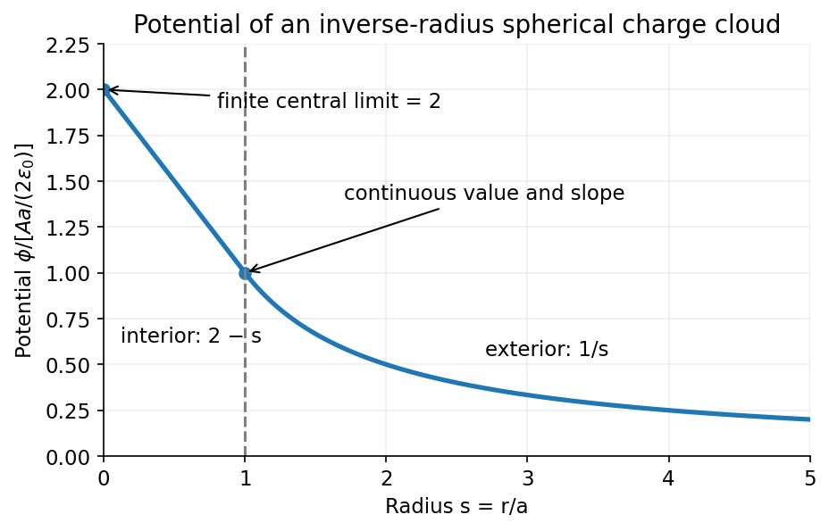

<h1 id="section-a/a3/solution">Solution</h1>

↑ **Parent:** [A3](../a3.md)

For the [potential of an inverse-radius spherical charge density](../../../../../potential-of-an-inverse-radius-spherical-charge-density.md), assume there is no additional point charge at the origin and choose $\phi(\infty)=0$. The enclosed charge is $Q(r)=4\pi A\int_0^r r'\,dr'=2\pi Ar^2$ for $r<a$, and $Q(a)=2\pi Aa^2$ outside. [Gauss's law](../../../../../gauss-s-law.md) then gives

$$
E_r=\begin{cases}A/(2\epsilon_0),&0<r<a,\\Aa^2/(2\epsilon_0r^2),&r>a.\end{cases}
$$

Integrating the field inward from infinity,

$$
\boxed{\phi(r)=\begin{cases}\dfrac{A}{2\epsilon_0}(2a-r),&0<r\leq a,\\[4pt]\dfrac{Aa^2}{2\epsilon_0r},&r\geq a.\end{cases}}
$$

The potential and its first radial derivative are continuous at $a$, since there is no surface charge there. The integrable [density](../../../../../density.md) singularity has a finite potential limit $\phi(0^+)=Aa/\epsilon_0$.

**[Figure 1](#section-a/a3/image-the-potential-falls-linearly-inside-the-inverse-radius-charge-cloud-and-joins-a-reciprocal-radius-exterior-tail). The potential falls linearly inside the inverse-radius charge cloud and joins a reciprocal-radius exterior tail**. [Source](paper-1-spherical-potential.py).

## ↑ Ancestors (13)

1. [A3](../a3.md)
2. [Section A](../../section-a.md)
3. [Paper 1](../../../paper-1-split.md)
4. [2016](../../../split.md)
5. [Past exam of the physics course of the year 4 of the natural sciences course of the University of Cambridge](../../../../split.md)
6. [Physics course of the year 4 of the natural sciences course of the University of Cambridge](../../../../../physics-course-of-the-year-4-of-the-natural-sciences-course-of-the-university-of-cambridge.md)
7. [Year 4 of the natural sciences course of the University of Cambridge](../../../../../year-4-of-the-natural-sciences-course-of-the-university-of-cambridge.md)
8. [Year of the natural sciences course of the University of Cambridge](../../../../../year-of-the-natural-sciences-course-of-the-university-of-cambridge.md)
9. [Natural sciences course of the University of Cambridge](../../../../../natural-sciences-course-of-the-university-of-cambridge.md)
10. [Course of the University of Cambridge](../../../../../course-of-the-university-of-cambridge.md)
11. [University of Cambridge](../../../../../university-of-cambridge-split.md)
12. [List of universities](../../../../../list-of-universities.md)
13. [Codex Wiki](../../../../../split.md)
