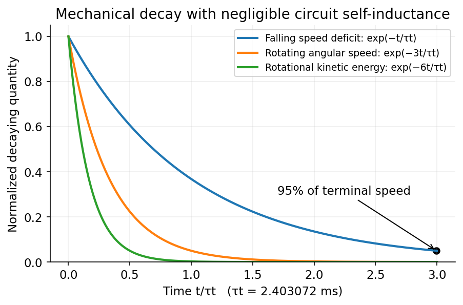

<h1 id="section-b/b3/solution">Solution</h1>

↑ **Parent:** [B3](../b3.md)

For a fixed contour, [Faraday's law of induction](../../../../../faraday-s-law-of-induction.md) is

$$
\oint_C\mathbf E\cdot d\mathbf l=-\frac{d}{dt}\int_\Sigma\mathbf B\cdot d\mathbf S,\qquad\nabla\times\mathbf E=-\frac{\partial\mathbf B}{\partial t}.
$$

The second equation is the differential Maxwell equation, related to the first by [Stokes theorem](../../../../../stokes-theorem.md). For a moving wire, the relevant [motional electromotive force](../../../../../motional-electromotive-force.md) is $\mathcal E=\oint(\mathbf E+\mathbf v_{\rm wire}\times\mathbf B)\cdot d\mathbf l=-d\Phi_B/dt$. Thus a static magnetic field can induce current in a moving circuit even when $\nabla\times\mathbf E=0$.

For [translational magnetic damping of a square wire loop](../../../../../translational-magnetic-damping-of-a-square-wire-loop.md), while the upper horizontal leg remains in the field, a downward speed $v$ reduces the flux at rate $Bav$. Hence $|\mathcal E|=Bav$, $|I|=Bav/R$, and the upward [magnetic braking](../../../../../magnetic-braking.md) force is $B^2a^2v/R$. With negligible electrical self-inductance,

$$
m\dot v=mg-\frac{B^2a^2}{R}v,\qquad\boxed{v_t=\frac{mgR}{B^2a^2},\quad v(t)=v_t(1-e^{-t/\tau_t}),\quad\tau_t=\frac{mR}{B^2a^2}.}
$$

Let the wire cross-sectional area be $S$, mass [density](../../../../../density.md) $\rho_m$, and resistivity $\rho_e$. Since $m=4aS\rho_m$ and $R=4a\rho_e/S$,

$$
\boxed{\tau_t=\frac{16\rho_m\rho_e}{B^2}=2.403072\,\mathrm{ms},\qquad t_{95}=\tau_t\log20=7.20\,\mathrm{ms}.}
$$

These use the printed copper values and $B=1\,\mathrm T$. The wire dimensions cancel. The terminal-speed approximation is restricted to the interval before the upper leg leaves the field, as assumed in the question.

For [rotational magnetic damping of a square wire loop](../../../../../rotational-magnetic-damping-of-a-square-wire-loop.md), consider rotation about the central $x$ axis in a uniform field, the flux is $Ba^2\cos\theta$. The induced current produces torque $-B^2a^4\dot\theta\sin^2\theta/R$. A thin square loop has [moment of inertia](../../../../../moment-of-inertia.md) $\mathcal I_x=ma^2/6$: the two legs parallel to $x$ contribute $ma^2/8$, and the other two $ma^2/24$. Averaging $\sin^2\theta$ over a rotation gives

$$
\mathcal I_x\dot\omega=-\frac{B^2a^4}{2R}\omega,\qquad\boxed{\tau_{\rm rot,\omega}=\frac{2\mathcal I_xR}{B^2a^4}=\frac{\tau_t}{3}=0.801024\,\mathrm{ms}.}
$$

If “decay time” means rotational [kinetic energy](../../../../../kinetic-energy.md) rather than angular speed, $K\propto\omega^2$ gives $\tau_{\rm rot,K}=\tau_t/6=0.400512\,\mathrm{ms}$. This distinction, and the assumed separation between rotation period and slow decay, are essential. The [electrical and mechanical time scales in magnetic braking](../../../../../electrical-and-mechanical-time-scales-in-magnetic-braking.md) must be separated: electrical self-inductance is neglected in both calculations.

**[Figure 2](#section-b/b3/image-the-falling-loop-speed-deficit-decays-three-times-more-slowly-than-the-rotating-loop-angular-speed). The falling-loop speed deficit decays three times more slowly than the rotating-loop angular speed**. [Source](paper-1-loop-damping.py).

## ↑ Ancestors (13)

1. [B3](../b3.md)
2. [Section B](../../section-b.md)
3. [Paper 1](../../../paper-1-split.md)
4. [2016](../../../split.md)
5. [Past exam of the physics course of the year 4 of the natural sciences course of the University of Cambridge](../../../../split.md)
6. [Physics course of the year 4 of the natural sciences course of the University of Cambridge](../../../../../physics-course-of-the-year-4-of-the-natural-sciences-course-of-the-university-of-cambridge.md)
7. [Year 4 of the natural sciences course of the University of Cambridge](../../../../../year-4-of-the-natural-sciences-course-of-the-university-of-cambridge.md)
8. [Year of the natural sciences course of the University of Cambridge](../../../../../year-of-the-natural-sciences-course-of-the-university-of-cambridge.md)
9. [Natural sciences course of the University of Cambridge](../../../../../natural-sciences-course-of-the-university-of-cambridge.md)
10. [Course of the University of Cambridge](../../../../../course-of-the-university-of-cambridge.md)
11. [University of Cambridge](../../../../../university-of-cambridge-split.md)
12. [List of universities](../../../../../list-of-universities.md)
13. [Codex Wiki](../../../../../split.md)
