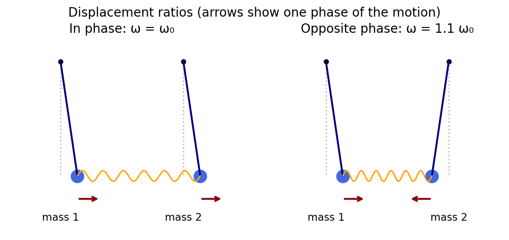
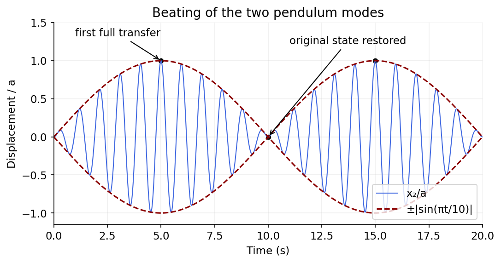

<h1 id="section-b/b4/solution">Solution</h1>

↑ **Parent:** [B4](../b4.md)

For the [normal modes of two spring-coupled equal pendulums](../../../../../normal-modes-of-two-spring-coupled-equal-pendulums.md), a [normal mode](../../../../../normal-mode.md) has every coordinate oscillating at the same frequency with a fixed displacement ratio. The linearized equations here are

$$
m\ddot x_1=-m\omega_0^2x_1-k(x_1-x_2),\qquad m\ddot x_2=-m\omega_0^2x_2-k(x_2-x_1).
$$

Their normalized displacement patterns and angular frequencies are

$$
\boxed{\mathbf e_+=\frac{(1,1)}{\sqrt2},\quad\omega_+=\omega_0;\qquad\mathbf e_-=\frac{(1,-1)}{\sqrt2},\quad\omega_-=\sqrt{\omega_0^2+2k/m}=1.1\omega_0.}
$$

The spring is unstretched in the in-phase mode, and stretched or compressed in the opposite-phase mode. The numerical ratio follows from $k/m=(21/200)\omega_0^2$.

**[Figure 3](#section-b/b4/image-in-phase-and-opposite-phase-displacement-patterns-of-the-two-coupled-pendulums). In-phase and opposite-phase displacement patterns of the two coupled pendulums**. [Source](paper-1-pendulum-modes.py).

The initial displacement is the equal sum of the two mode patterns, and the initial velocities vanish. Therefore

$$
x_1(t)=\frac a2[\cos\omega_0t+\cos(1.1\omega_0t)],\qquad\boxed{x_2(t)=\frac a2[\cos\omega_0t-\cos(1.1\omega_0t)]=a\sin(1.05\omega_0t)\sin(0.05\omega_0t).}
$$

With the printed $\omega_0=2\pi\,\mathrm{rad\,s^{-1}}$ this is $x_2/a=\sin(2.1\pi t)\sin(0.1\pi t)$, with $t$ in seconds. The fast oscillation has frequency $1.05\,\mathrm{Hz}$ and the amplitude is bounded by $a|\sin(\pi t/10)|$. The first complete displacement transfer is at $t=5\,\mathrm s$, when $x_1=0$, $x_2=a$ and both velocities vanish; the original state returns at $10\,\mathrm s$. Distinguishing [absolute and signed beat envelopes](../../../../../absolute-and-signed-beat-envelopes.md), the absolute beat envelope repeats every $10\,\mathrm s$, although its signed sine factor has period $20\,\mathrm s$.

**[Figure 4](#section-b/b4/image-the-second-pendulum-oscillates-inside-a-ten-second-beat-envelope-and-first-receives-the-full-displacement-at-five-seconds). The second pendulum oscillates inside a ten-second beat envelope and first receives the full displacement at five seconds**. [Source](paper-1-pendulum-beats.py).

## ↑ Ancestors (13)

1. [B4](../b4.md)
2. [Section B](../../section-b.md)
3. [Paper 1](../../../paper-1-split.md)
4. [2016](../../../split.md)
5. [Past exam of the physics course of the year 4 of the natural sciences course of the University of Cambridge](../../../../split.md)
6. [Physics course of the year 4 of the natural sciences course of the University of Cambridge](../../../../../physics-course-of-the-year-4-of-the-natural-sciences-course-of-the-university-of-cambridge.md)
7. [Year 4 of the natural sciences course of the University of Cambridge](../../../../../year-4-of-the-natural-sciences-course-of-the-university-of-cambridge.md)
8. [Year of the natural sciences course of the University of Cambridge](../../../../../year-of-the-natural-sciences-course-of-the-university-of-cambridge.md)
9. [Natural sciences course of the University of Cambridge](../../../../../natural-sciences-course-of-the-university-of-cambridge.md)
10. [Course of the University of Cambridge](../../../../../course-of-the-university-of-cambridge.md)
11. [University of Cambridge](../../../../../university-of-cambridge-split.md)
12. [List of universities](../../../../../list-of-universities.md)
13. [Codex Wiki](../../../../../split.md)
