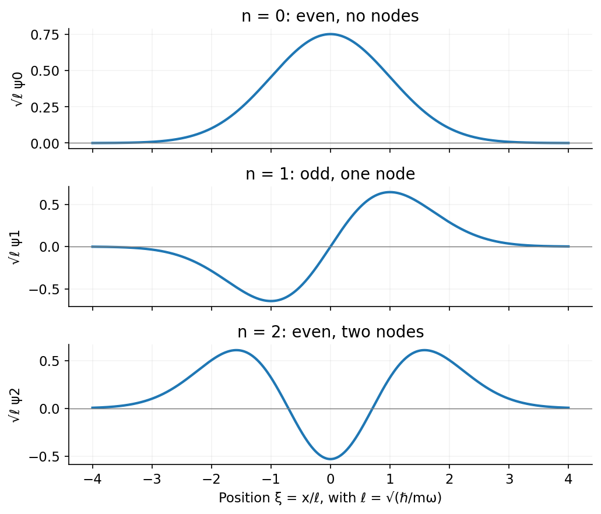

<h1 id="section-b/b7/solution">Solution</h1>

↑ **Parent:** [B7](../b7.md)

The classical minimum is **$E_{\rm cl}=0$**, attained at $x=p=0$. The quantum oscillator has **$E_0=\hbar\omega/2$**, its [zero-point energy](../../../../../zero-point-energy.md); simultaneous zero position and [momentum](../../../../../momentum-split.md) uncertainties are forbidden.

Let $\ell=\sqrt{\hbar/(m\omega)}$ and $\xi=x/\ell$. The first three normalized [harmonic oscillator eigenfunctions](../../../../../harmonic-oscillator-eigenfunction.md) are

$$
\psi_0=\frac{e^{-\xi^2/2}}{\pi^{1/4}\sqrt\ell},\qquad\psi_1=\sqrt2\xi\psi_0,\qquad\psi_2=\frac{2\xi^2-1}{\sqrt2}\psi_0.
$$

They have respectively zero, one and two nodes, with even, odd and even [parity](../../../../../parity.md). Their phases may be reversed without changing the state.[Chapter 2: the harmonic oscillator](../../../../../quantum-mechanics-by-david-tong.md)

**[Figure 6](#section-b/b7/image-the-first-three-harmonic-oscillator-wavefunctions-have-increasing-node-count-and-alternating-parity). The first three harmonic oscillator wavefunctions have increasing node count and alternating parity**. [Source](paper-1-oscillator-states.py).

## ↑ Ancestors (13)

1. [B7](../b7.md)
2. [Section B](../../section-b.md)
3. [Paper 1](../../../paper-1-split.md)
4. [2016](../../../split.md)
5. [Past exam of the physics course of the year 4 of the natural sciences course of the University of Cambridge](../../../../split.md)
6. [Physics course of the year 4 of the natural sciences course of the University of Cambridge](../../../../../physics-course-of-the-year-4-of-the-natural-sciences-course-of-the-university-of-cambridge.md)
7. [Year 4 of the natural sciences course of the University of Cambridge](../../../../../year-4-of-the-natural-sciences-course-of-the-university-of-cambridge.md)
8. [Year of the natural sciences course of the University of Cambridge](../../../../../year-of-the-natural-sciences-course-of-the-university-of-cambridge.md)
9. [Natural sciences course of the University of Cambridge](../../../../../natural-sciences-course-of-the-university-of-cambridge.md)
10. [Course of the University of Cambridge](../../../../../course-of-the-university-of-cambridge.md)
11. [University of Cambridge](../../../../../university-of-cambridge-split.md)
12. [List of universities](../../../../../list-of-universities.md)
13. [Codex Wiki](../../../../../split.md)
