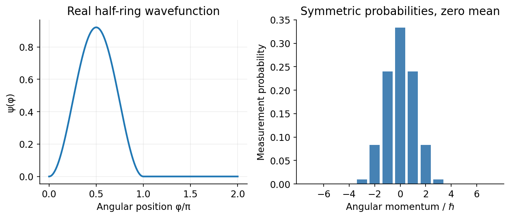

<h1 id="section-b/b8/solution">Solution</h1>

↑ **Parent:** [B8](../b8.md)

In the position representation, the [momentum operators](../../../../../momentum-operator.md) are $\hat p_x=-i\hbar\partial_x$ and $\hat p_y=-i\hbar\partial_y$. Therefore

$$
\hat L_z=\hat x\hat p_y-\hat y\hat p_x=-i\hbar(x\partial_y-y\partial_x)=\boxed{-i\hbar\partial_\phi},
$$

since $\partial_\phi=-y\partial_x+x\partial_y$ at fixed radius. Solving the eigenvalue equation on the circle and imposing $2\pi$ periodicity gives

$$
\boxed{u_m(\phi)=\frac{e^{im\phi}}{\sqrt{2\pi}},\qquad L_z=\hbar m,\quad m\in\mathbb Z.}
$$

Their normalization uses the angular measure $d\phi$ on $[0,2\pi)$.

For the [half-ring sine-squared angular state](../../../../../half-ring-sine-squared-angular-state.md), write $C=\sqrt{8/(3\pi)}$. The stated [wavefunction](../../../../../wave-function-split.md) is normalized because $C^2\int_0^\pi\sin^4\phi\,d\phi=1$. It and its first derivative match continuously to zero at the boundaries, so the integrations by parts have no boundary contributions. The [angular momentum expectation](../../../../../angular-momentum-expectation.md) and second moment are

$$
\langle L_z\rangle=-i\hbar\int\psi\psi'\,d\phi=0,\qquad\langle L_z^2\rangle=\hbar^2\int|\psi'|^2d\phi=C^2\hbar^2\int_0^\pi\sin^2(2\phi)\,d\phi=\frac43\hbar^2.
$$

Hence **$\operatorname{Var}(L_z)=4\hbar^2/3$**. The jumps in the second derivative do not invalidate this result: the periodic [wavefunction](../../../../../wave-function-split.md) has a square-integrable second derivative and a continuous first derivative.

The probability of $L_z=\hbar$ is the squared projection onto $u_1$:

$$
c_1=\frac C{\sqrt{2\pi}}\int_0^\pi\sin^2\phi\,e^{-i\phi}d\phi=\frac2{\sqrt3\pi}\left(-\frac{4i}3\right)=-\frac{8i}{3\sqrt3\pi},\qquad\boxed{P(L_z=\hbar)=\frac{64}{27\pi^2}\simeq0.2402.}
$$

The odd sine term gives the imaginary overlap; a real [wavefunction](../../../../../wave-function-split.md) need not have zero probability of nonzero angular [momentum](../../../../../momentum-split.md). Its positive and negative angular-[momentum](../../../../../momentum-split.md) probabilities are equal.[Chapters 3–4: operator expectation values, angular momentum and eigenstate projections](../../../../../quantum-mechanics-by-david-tong.md)

**[Figure 7](#section-b/b8/image-a-real-state-confined-to-half-a-ring-has-zero-mean-angular-momentum-and-symmetric-nonzero-measurement-probabilities). A real state confined to half a ring has zero mean angular momentum and symmetric nonzero measurement probabilities**. [Source](paper-1-ring-momentum.py).

## ↑ Ancestors (13)

1. [B8](../b8.md)
2. [Section B](../../section-b.md)
3. [Paper 1](../../../paper-1-split.md)
4. [2016](../../../split.md)
5. [Past exam of the physics course of the year 4 of the natural sciences course of the University of Cambridge](../../../../split.md)
6. [Physics course of the year 4 of the natural sciences course of the University of Cambridge](../../../../../physics-course-of-the-year-4-of-the-natural-sciences-course-of-the-university-of-cambridge.md)
7. [Year 4 of the natural sciences course of the University of Cambridge](../../../../../year-4-of-the-natural-sciences-course-of-the-university-of-cambridge.md)
8. [Year of the natural sciences course of the University of Cambridge](../../../../../year-of-the-natural-sciences-course-of-the-university-of-cambridge.md)
9. [Natural sciences course of the University of Cambridge](../../../../../natural-sciences-course-of-the-university-of-cambridge.md)
10. [Course of the University of Cambridge](../../../../../course-of-the-university-of-cambridge.md)
11. [University of Cambridge](../../../../../university-of-cambridge-split.md)
12. [List of universities](../../../../../list-of-universities.md)
13. [Codex Wiki](../../../../../split.md)
