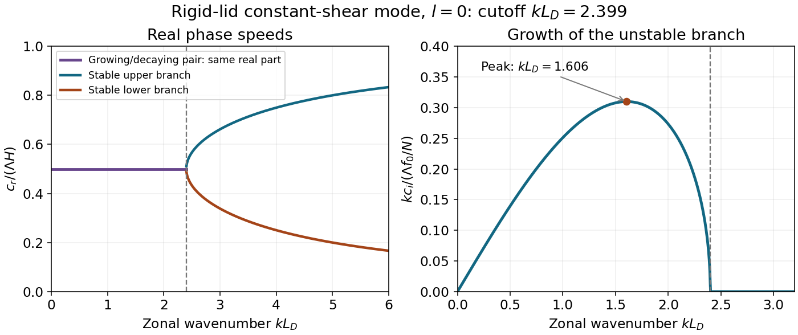

<h1 id="1/b/solution">Solution</h1>

↑ **Parent:** [B](../b.md)

For $l=0$ put $L_D=NH/f_0$, $\eta=kL_D$ with $k>0$, and write the discriminant as

$$
D(\eta)=\left(\frac\eta2-\coth\frac\eta2\right)\left(\frac\eta2-\tanh\frac\eta2\right)
=1+\frac{\eta^2}{4}-\eta\coth\eta.
$$

The second factor is positive for every $\eta>0$, since $x>\tanh x$. The first changes sign at the positive solution of $x=\coth x$, $x=\eta/2$. Numerically $x_c=1.19968$, so $\eta_c=2.39936$. The growing branch exists for $0<kL_D<\eta_c$, giving

$$
\boxed{\lambda>\lambda_{\min}=\frac{2\pi}{\eta_c}L_D=2.619L_D}.
$$

Equality is neutral, so this is an infimum [wavelength](../../../../wavelength.md), rather than an attained shortest growing mode.

In the unstable interval,

$$
\boxed{c_r=\frac{\Lambda H}{2},\qquad
\sigma\equiv kc_i=\frac{\Lambda f_0}{N}\sqrt{-D(\eta)}}.
$$

Both phase-speed branches have the same [real part](../../../../real-part.md) there; the imaginary parts have opposite signs. At and beyond the short-wave cutoff the growth rate is zero and the two real speeds are

$$
\frac{c_\pm}{\Lambda H}=\frac12\pm\frac{\sqrt{D(\eta)}}\eta.
$$

They split continuously from $1/2$ and approach the boundary-flow speeds zero and $\Lambda H$ at large $\eta$. As $\eta\to0$, $D=-\eta^2/12+O(\eta^4)$, so $\sigma\to0$ linearly with $k$, despite a finite limiting $c_i=\Lambda H/\sqrt{12}$. A zonally uniform disturbance has no exponential growth from this mechanism.

The maximum growth minimizes $D$. Its derivative is

$$
D'(\eta)=\frac\eta2-\coth\eta+\eta\,\operatorname{csch}^2\eta.
$$

The positive interior minimum is at $\eta_m\simeq1.606$, yielding

$$
\boxed{\lambda_m=\frac{2\pi}{\eta_m}L_D\simeq3.91L_D,\qquad
\sigma_{\max}=0.310\frac{\Lambda f_0}{N}}.
$$

The supplied phase-speed formula therefore predicts fastest growth at a [wavelength](../../../../wavelength.md) of order four deformation lengths, not at the short-wave cutoff.

**[Figure 1](#1/b/image-phase-speeds-and-growth-rate-of-the-rigid-lid-constant-shear-baroclinic-mode-cutoff-and-fastest-growing-wavelengths-follow-from-the-supplied-discriminant). Phase speeds and growth rate of the rigid-lid constant-shear baroclinic mode; cutoff and fastest-growing wavelengths follow from the supplied discriminant**.

## ↑ Ancestors (12)

1. [B](../b.md)
2. [1](../../1.md)
3. [2015](../../../2015-split.md)
4. [Past exam of the physics of atmospheres and oceans course of the University of Oxford](../../../split.md)
5. [Physics of atmospheres and oceans course of the University of Oxford](../../../../physics-of-atmospheres-and-oceans-course-of-the-university-of-oxford.md)
6. [Year 4 of the physics course of the University of Oxford](../../../../year-4-of-the-physics-course-of-the-university-of-oxford.md)
7. [Physics course of the University of Oxford](../../../../physics-course-of-the-university-of-oxford.md)
8. [Undergraduate course of the University of Oxford](../../../../undergraduate-course-of-the-university-of-oxford.md)
9. [Course of the University of Oxford](../../../../course-of-the-university-of-oxford.md)
10. [University of Oxford](../../../../university-of-oxford-split.md)
11. [List of universities](../../../../list-of-universities.md)
12. [Codex Wiki](../../../../split.md)
