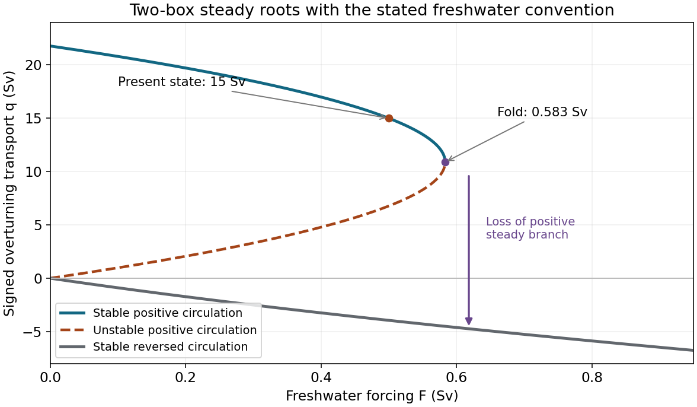

<h1 id="2/c/solution">Solution</h1>

↑ **Parent:** [C](../c.md)

Use all coefficients exactly as printed and use Sv consistently for transports. The present salt contrast and density-driven [friction](../../../../friction.md) coefficient are

$$
\Delta S=\frac{0.5\times35}{15}=1.1667\ \mathrm{g\,kg^{-1}},\qquad
k=\frac{15}{(2\times10^{-7})(15)-(8\times10^{-7})(1.1667)}.
$$

Thus

$$
\boxed{k=7.26\times10^6\ \mathrm{Sv}=7.26\times10^{12}\ \mathrm{m^3\,s^{-1}},\quad
A=21.774\ \mathrm{Sv},\quad B=203.226\ \mathrm{Sv}}.
$$

The large numerical value of $k$ reflects division by a small dimensionless [density](../../../../density.md) contrast, about $2.07\times10^{-6}$ with the supplied effective expansion coefficients. It is not the actual overturning transport, which remains $15$ Sv.

For $q>0$, the steady equation is a quadratic with roots

$$
\boxed{q_\pm=\frac{A\pm\sqrt{A^2-4BF}}2},\qquad 0\le F\le F_c=\frac{A^2}{4B}.
$$

The [critical freshwater forcing in a two-box overturning model](../../../../critical-freshwater-forcing-in-a-two-box-overturning-model.md) occurs where the two roots coalesce:

$$
\boxed{F_c=0.58324\ \mathrm{Sv},\qquad q_c=A/2=10.887\ \mathrm{Sv}}.
$$

There is also a negative-flow branch for every $F>0$:

$$
\boxed{q_{\rm rev}=\frac{A-\sqrt{A^2+4BF}}2<0}.
$$

At the present forcing, the three roots are $15.000$, $6.774$ and $-3.950$ Sv. The prescribed present state is therefore the upper positive branch, not an arbitrary choice among the roots.

Stability needs a [salinity](../../../../salinity.md) evolution law, not just the algebraic steady equation. For fixed [temperature](../../../../temperature-split.md) contrast and reference [salinity](../../../../salinity.md), the standard salt-contrast dynamics can be written

$$
\dot{\Delta S}=\frac{FS_1-|q|\Delta S}{V_{\rm eff}},\qquad
\dot q=-\frac{q|q|-A|q|+BF}{V_{\rm eff}},
$$

where $V_{\rm eff}>0$ summarizes the reservoir volumes. The linear slope at a positive root is $(A-2q)/V_{\rm eff}$: the upper branch is stable and the lower branch unstable. At a negative root it is $(2q-A)/V_{\rm eff}<0$, so the reversed branch is stable. The two stable states below the fold have different attraction basins, demonstrating [bistability](../../../../bistability.md). Their stability is conditional on this fixed-temperature, fixed-reference-salinity closure.

As forcing increases quasistatically from $0.5$ Sv, the normal branch weakens and reaches a [saddle-node bifurcation](../../../../saddle-node-bifurcation.md) at $F_c$. Beyond it no positive steady circulation remains, so the reduced dynamics move toward the stable reversed branch. The reversal is [salinity](../../../../salinity.md) dominated: the fresh cold reservoir is no longer the denser one. Recovery under a later forcing change can depend on the system's state and feedback history.

**[Figure 2](#2/c/image-steady-transports-and-their-stability-in-the-explicitly-stated-freshwater-convention-present-state-and-critical-freshwater-forcing-are-marked). Steady transports and their stability in the explicitly stated freshwater convention; present state and critical freshwater forcing are marked**.

## ↑ Ancestors (12)

1. [C](../c.md)
2. [2](../../2.md)
3. [2015](../../../2015-split.md)
4. [Past exam of the physics of atmospheres and oceans course of the University of Oxford](../../../split.md)
5. [Physics of atmospheres and oceans course of the University of Oxford](../../../../physics-of-atmospheres-and-oceans-course-of-the-university-of-oxford.md)
6. [Year 4 of the physics course of the University of Oxford](../../../../year-4-of-the-physics-course-of-the-university-of-oxford.md)
7. [Physics course of the University of Oxford](../../../../physics-course-of-the-university-of-oxford.md)
8. [Undergraduate course of the University of Oxford](../../../../undergraduate-course-of-the-university-of-oxford.md)
9. [Course of the University of Oxford](../../../../course-of-the-university-of-oxford.md)
10. [University of Oxford](../../../../university-of-oxford-split.md)
11. [List of universities](../../../../list-of-universities.md)
12. [Codex Wiki](../../../../split.md)
