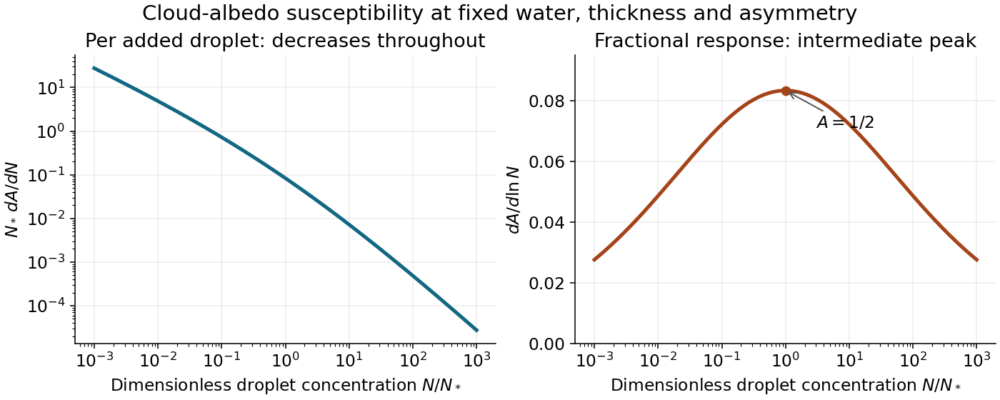
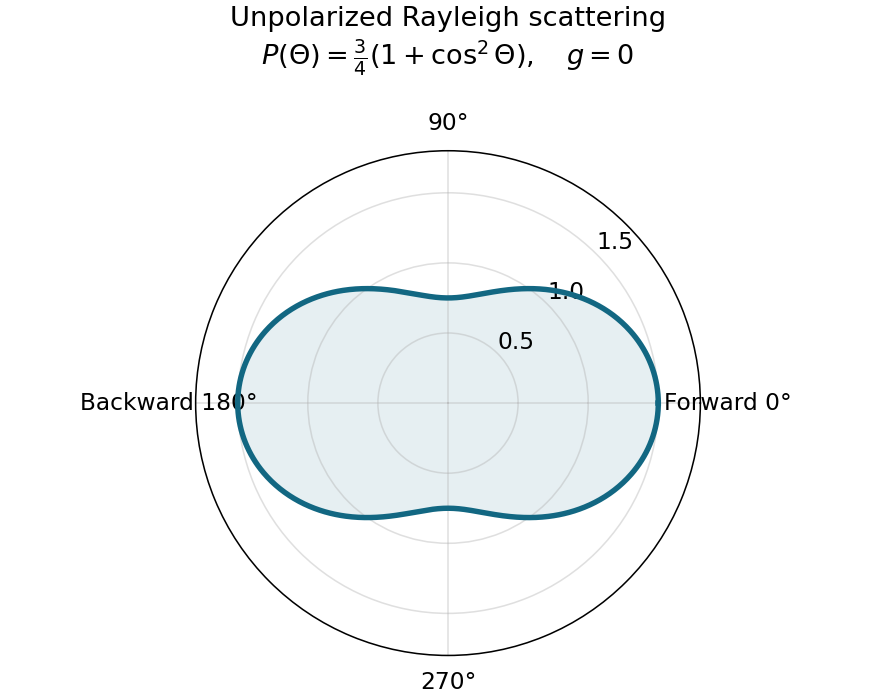
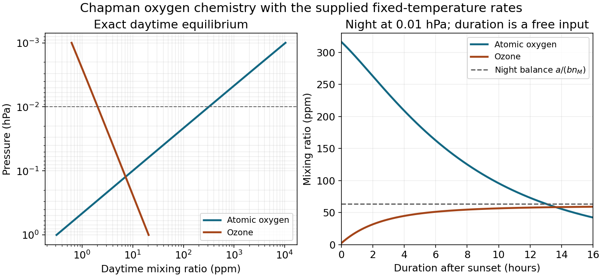
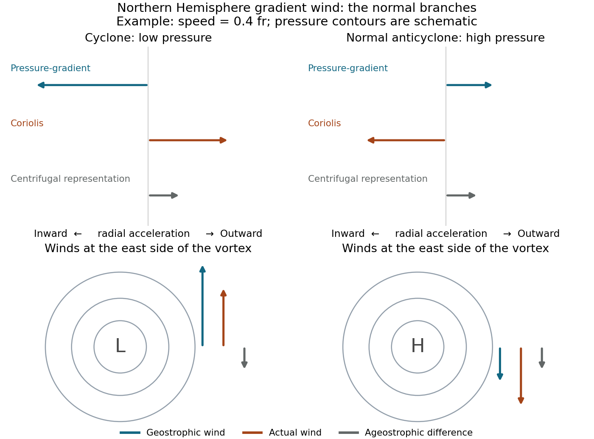
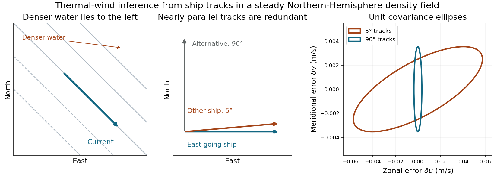

# 2016

↑ **Parent:** [Past exam of the physics of atmospheres and oceans course of the University of Oxford](../past-exam-of-the-physics-of-atmospheres-and-oceans-course-of-the-university-of-oxford.md)

Source paper: [https://www.whatdotheyknow.com/request/physics_past_exam_papers_2015_16/response/973997/attach/3/Cowell%20Attachment.zip?cookie_passthrough=1.](https://www.whatdotheyknow.com/request/physics_past_exam_papers_2015_16/response/973997/attach/3/Cowell%20Attachment.zip?cookie_passthrough=1.) The dated cover identifies the Part C sitting of 14 June 2016. All eight options are treated below, using the native [radiometer](../radiometry.md#radiometer) plot for the graphical estimates.

**Table of contents**

- [1](#1)
  - [Solution](#1/solution)
- [2](#2)
  - [Solution](#2/solution)
- [3](#3)
  - [Solution](#3/solution)
- [4](#4)
  - [Solution](#4/solution)
- [5](#5)
  - [Solution](#5/solution)
- [6](#6)
  - [Solution](#6/solution)
- [7](#7)
  - [Solution](#7/solution)
- [8](#8)
  - [Solution](#8/solution)

## 1

↑ **Parent:** [2016](2016.md)

<h3 id="1/solution">Solution</h3>

↑ **Parent:** [1](#1)

**Optical response at fixed [cloud](../geophysics.md#cloud) structure.** Put $b=1-g$ and write the two-stream [cloud albedo](../geophysics.md#cloud-albedo) as $A=b\tau/(2+b\tau)$. At fixed [scattering asymmetry parameter](../astrophysics.md#scattering-asymmetry-parameter),

$$
\frac{dA}{d\tau}=\frac{2b}{(2+b\tau)^2},\qquad A(1-A)=\frac{2b\tau}{(2+b\tau)^2},\qquad
\boxed{\frac{dA}{d\tau}=\frac{A(1-A)}\tau}.
$$

At zero [optical depth](../astrophysics.md#optical-depth) the last quotient is understood by its finite limiting value. [Optical depth](../astrophysics.md#optical-depth) counts extinction along a ray. For an approximately homogeneous, monodisperse [cloud](../geophysics.md#cloud),

$$
\tau=\int_0^hN\sigma_{\rm ext}\,dz=NQ_{\rm ext}\pi r^2h\simeq2\pi Nr^2h.
$$

This uses spherical droplets, independent extinction, representative constant $N,r$, and the [geometric optics](../geometrical-optics.md) limit in which the droplet radius greatly exceeds the relevant visible wavelength and $Q_{\rm ext}\simeq2$. [Diffraction](../quantum-scattering.md#diffraction) supplies part of the extinction cross-section; it is not legitimate to obtain the factor two from geometric interception alone. A size distribution requires its second moment rather than an arbitrary mean radius.

With liquid-water density $\rho_w$ and [cloud](../geophysics.md#cloud) [liquid-water content](../geophysics.md#liquid-water-content) $L$, the volume constraint gives $r^3=3L/(4\pi\rho_wN)$. Consequently

$$
\tau=2\pi h\left(\frac{3L}{4\pi\rho_w}\right)^{2/3}N^{1/3},\qquad
\frac{d\ln\tau}{d\ln N}=\frac13+\frac23\frac{d\ln L}{d\ln N}+\frac{d\ln h}{d\ln N}.
$$

This proves

$$
\boxed{\frac{d\tau}{dN}=\frac\tau{3N}\left(1+2\frac{d\ln L}{d\ln N}+3\frac{d\ln h}{d\ln N}\right)}.
$$

Keeping $L,h,\rho_w,g$ fixed isolates the [Twomey effect](../chemistry.md#twomey-effect):

$$
\boxed{\frac{dA}{dN}=\frac{A(1-A)}{3N}}.
$$

It is a partial response, not a claim that [cloud](../geophysics.md#cloud) water and [cloud](../geophysics.md#cloud) geometry stay unchanged under every real [aerosol](../chemistry.md#aerosol) perturbation.

**Absolute and fractional susceptibility.** Choose $N_*$ so that $A=1/2$ there, and put $n=N/N_*$. Then

$$
A=\frac{n^{1/3}}{1+n^{1/3}},\qquad
N_*\frac{dA}{dN}=\frac{n^{-2/3}}{3(1+n^{1/3})^2}.
$$

The [cloud albedo susceptibility](../chemistry.md#cloud-albedo-susceptibility) per added droplet decreases monotonically. Its small-$n$ asymptote is proportional to $n^{-2/3}$, while its large-$n$ asymptote is proportional to $n^{-4/3}$. Thus a fixed absolute droplet-number addition has much more leverage in a clean [cloud](../geophysics.md#cloud) than in an already droplet-rich [cloud](../geophysics.md#cloud). The formal divergence as $N\to0$ is not a physical infinite response: fixed water content would require indefinitely large drops, eventually invalidating the optical and [cloud](../geophysics.md#cloud) assumptions.

For a fixed _fractional_ number addition the response is instead $dA/d\ln N=A(1-A)/3$, maximal at $A=1/2$ and small at either very low or nearly saturated albedo. This distinction is essential when comparing interventions specified by an absolute particle addition with those specified by a percentage increase.

**[Figure 1](#1/image-absolute-and-fractional-cloud-albedo-responses-under-fixed-liquid-water-and-thickness-assumptions). Absolute and fractional cloud-albedo responses under fixed liquid-water and thickness assumptions**.

**Brightening and net radiation.** [Marine cloud brightening](../chemistry.md#marine-cloud-brightening) would increase the population of suitable [cloud condensation nuclei](../chemistry.md#cloud-condensation-nucleus), for example by producing sea-salt [aerosol](../chemistry.md#aerosol) from seawater and allowing transport into susceptible marine boundary-layer [clouds](../geophysics.md#cloud). Activation depends on particle size, hygroscopicity and the [cloud](../geophysics.md#cloud)'s attained supersaturation; adding particles does not guarantee a one-for-one increase of droplets. At fixed [cloud](../geophysics.md#cloud) water, more activated droplets mean smaller radii, larger total extinction area, larger shortwave [optical depth](../astrophysics.md#optical-depth) and more reflected sunlight.

Promising physical conditions combine relatively clean, persistent low [clouds](../geophysics.md#cloud), appreciable incident sunlight and a dark underlying ocean. The extensive marine stratocumulus regions over the eastern subtropical oceans are examples of this combination. An already polluted, optically saturated [cloud](../geophysics.md#cloud) has little remaining shortwave leverage. Bright [clouds](../geophysics.md#cloud) over snow or ice also add relatively little contrast with the surface. Low [clouds](../geophysics.md#cloud) have temperatures closer to the surface than high [clouds](../geophysics.md#cloud), so their extra longwave greenhouse effect is generally less able to offset the shortwave cooling. Sunlit seasons and latitudes matter; no shortwave benefit occurs at night.

Schematically, the fixed-cloud shortwave perturbation is $\delta F_{\rm SW}\sim-\mathcal S f_c\delta A$, where $\mathcal S$ is the local incident solar flux and $f_c$ the affected [cloud](../geophysics.md#cloud) fraction. Changes in [cloud](../geophysics.md#cloud) fraction, precipitation, [entrainment](../fluid-mechanics.md#fluid-entrainment), liquid water and longwave emission must also be evaluated before equating the positive derivative above with a guaranteed net cooling. The derivative identifies susceptibility, not a complete climate-response calculation.

## 2

↑ **Parent:** [2016](2016.md)

<h3 id="2/solution">Solution</h3>

↑ **Parent:** [2](#2)

**[Potential temperature](../geophysics.md#potential-temperature) and a parcel.** For a dry [ideal gas](../ideal-gas.md) of fixed composition, the [first law of thermodynamics](../first-law-of-thermodynamics.md) per unit mass is

$$
\delta q=c_p\,dT-\frac{dp}{\rho}=c_p\,dT-R_dT\frac{dp}p.
$$

A reversible [adiabatic process](../first-law-of-thermodynamics.md#adiabatic-process) has $\delta q=0$. Taking $c_p,R_d$ constant gives $d\ln T=\kappa\,d\ln p$, where $\kappa=R_d/c_p$. Integrating to a fixed reference pressure $p_0$ defines the [potential temperature](../geophysics.md#potential-temperature)

$$
\boxed{\Theta=T(p_0/p)^\kappa,\qquad D\Theta/Dt=0\quad\text{for dry adiabatic motion}}.
$$

It is the temperature a parcel would have after reversible dry [adiabatic process](../first-law-of-thermodynamics.md#adiabatic-process) taking it to $p_0$. Equivalently $ds=c_p\,d\ln\Theta$ under these assumptions, making [potential temperature](../geophysics.md#potential-temperature) a [thermodynamic entropy](../entropy.md) label useful for diagnosing stratification and air-mass motion. Latent heating, radiation, mixing and variable composition require modifying the conservation statement.

An [air parcel](../geophysics.md#air-parcel) is a small material volume followed with the flow. The parcel model treats it as internally approximately uniform, large compared with molecular scales and small compared with environmental variation scales. Rapid [acoustic wave](../fluid-mechanics.md#acoustic-wave) adjustment makes its pressure approximately equal to the surrounding pressure, while slower heat and mass exchange can be neglected during an idealized displacement. It is not a rigid container or an isolated molecule.

At the parcel's height, environmental hydrostatic pressure supplies an upward pressure force $\rho_e g$ per unit volume. Dividing by parcel density gives the upward acceleration

$$
B=g\left(\frac{\rho_e}{\rho_p}-1\right)=g\left(\frac{T_p}{T_e}-1\right)
=\boxed{g\frac{\Theta_p-\Theta_e}{\Theta_e}}.
$$

The last steps use equal pressure, equal gas constants and the same reference pressure. Moisture-dependent density requires virtual temperature or its potential-temperature counterpart. Nonhydrostatic pressure perturbations and [entrainment](../fluid-mechanics.md#fluid-entrainment) are excluded from this elementary [buoyancy](../fluid-mechanics.md#buoyancy) expression.

The [convective available potential energy](../fluid-mechanics.md#convective-available-potential-energy) is the positive [buoyancy](../fluid-mechanics.md#buoyancy) work per unit mass between the level of free convection and the equilibrium level:

$$
\boxed{\mathrm{CAPE}=\int_{z_{\rm LFC}}^{z_{\rm EL}}B(z)\,dz
=g\int_{z_{\rm LFC}}^{z_{\rm EL}}\frac{\Theta_p-\Theta_e}{\Theta_e}\,dz}.
$$

One sums positive-buoyancy layers when there is more than one. Negative work below free convection contributes convective inhibition rather than positive [CAPE](../fluid-mechanics.md#convective-available-potential-energy). In a lossless parcel estimate, conversion of [CAPE](../fluid-mechanics.md#convective-available-potential-energy) to vertical [kinetic energy](../energy.md#kinetic-energy) gives $w_{\max}\simeq\sqrt{2\,\mathrm{CAPE}}$; pressure work beyond this model, mixing and precipitation can change that speed.

**[Linear stability](../dynamical-systems.md#linear-stability).** Let $\xi$ denote displacement from a neutrally buoyant reference altitude. Dry motion through an [adiabatic process](../first-law-of-thermodynamics.md#adiabatic-process) retains $\Theta_p=\Theta_e(0)$, while $\Theta_e(\xi)=\Theta_e(0)+\xi\Theta_e'(0)+O(\xi^2)$. The linear vertical momentum equation is therefore

$$
\boxed{\ddot\xi+N_0^2\xi=0,\qquad N_0^2=\frac g{\Theta_e}\frac{d\Theta_e}{dz}}.
$$

For $N_0^2>0$, $\xi=C\cos N_0t+D\sin N_0t$: stable [buoyancy](../fluid-mechanics.md#buoyancy) oscillations with period $2\pi/N_0$. For $N_0^2=0$, $\xi=C+Dt$: neutral stratification with no restoring force. For $N_0^2<0$, growing and decaying exponentials occur, indicating convective instability. The growing solution is generic unless the initial data select only the decaying branch. These are local small-displacement results with an approximately constant environmental gradient.

**Lapse-rate estimate.** Define $\Gamma=-dT/dz$. [Hydrostatic balance](../fluid-mechanics.md#hydrostatic-balance) and the [ideal gas law](../ideal-gas.md#ideal-gas-law) imply $p'/p=-g/(R_dT)$, so

$$
\boxed{\frac1\Theta\frac{d\Theta}{dz}=\frac1T\frac{dT}{dz}-\kappa\frac1p\frac{dp}{dz}
=\frac{\Gamma_d-\Gamma}{T},\qquad \Gamma_d=g/c_p}.
$$

In the free-parcel-oscillator interpretation, identifying the ridge encounter interval with the [buoyancy](../fluid-mechanics.md#buoyancy) period gives $P=10^4/20=500\ \mathrm s$ and $N_0=2\pi/P=0.01257\ \mathrm{s^{-1}}$. With $T=293.15\ \mathrm K$, $g=9.81\ \mathrm{m\,s^{-2}}$ and $c_p\simeq1004\ \mathrm{J\,kg^{-1}\,K^{-1}}$,

$$
\boxed{\Gamma=\Gamma_d-\frac{TN_0^2}{g}\simeq5.1\ \mathrm{K\,km^{-1}}}.
$$

The frequency identification is an extra modeling assumption. A stationary mountain [gravity wave](../gravity-wave.md) generally obeys $\widehat\omega^2=N_0^2k_h^2/(k_h^2+m_z^2)$ without rotation, with $\widehat\omega=Uk_h$. Ridge spacing fixes $\widehat\omega$, not the vertical [wavenumber](../wave-equation.md#wavenumber) $m_z$. For example, $m_z=k_h$ allows the same spacing and wind with $N_0=\sqrt2\widehat\omega$, and a [lapse rate](../exoplanet.md#lapse-rate-atmosphere) about $0.3\ \mathrm{K\,km^{-1}}$. Thus $5.1$ is the requested parcel-period estimate, not a uniquely identifiable [lapse rate](../exoplanet.md#lapse-rate-atmosphere) for every possible mountain-wave field; a resolved wave field needs its vertical structure as well.

## 3

↑ **Parent:** [2016](2016.md)

<h3 id="3/solution">Solution</h3>

↑ **Parent:** [3](#3)

**Normalization and angular pattern.** A [scattering phase function](../astrophysics.md#scattering-phase-function) describes the distribution of single-scattered power over outgoing [solid angle](../euclidean-geometry.md#solid-angle), for a specified incident direction, wavelength and [polarization](../wave.md#polarization-waves) convention. Use the common normalization

$$
\frac1{4\pi}\int_{4\pi}P(\Theta)\,d\Omega=1,\qquad
\boxed{g=\frac1{4\pi}\int_{4\pi}P(\Theta)\cos\Theta\,d\Omega}.
$$

The [scattering asymmetry parameter](../astrophysics.md#scattering-asymmetry-parameter) is the mean cosine of the [scattering angle](../quantum-scattering.md#scattering-angle): forward scattering has positive $g$, backward scattering negative $g$, and a forward–backward symmetric pattern has $g=0$.

Let $C=E_0(2\pi/\lambda)^4[(n^2-1)/(n^2+2)]^2r^6$. The given small-sphere angular intensity is $I=C(1+\mu^2)/2$, where $\mu=\cos\Theta$. Its total scattered power is

$$
\int I\,d\Omega=2\pi C\int_{-1}^1\frac{1+\mu^2}{2}\,d\mu=\frac{8\pi C}3.
$$

Normalizing gives

$$
\boxed{P(\Theta)=\frac{4\pi I}{\int I\,d\Omega}=\frac34(1+\cos^2\Theta)}.
$$

Dimensionally the supplied $I$ is [radiant intensity](../radiometry.md#radiant-intensity), power per [solid angle](../euclidean-geometry.md#solid-angle). If interpreted as detector [irradiance](../radiometry.md#irradiance) at a distance, the appropriate inverse-square distance factor is also needed; it cancels out of the normalized angular pattern.

The polar plot has equal forward and backward lobes, each with radius $3/2$, and lateral values $3/4$. A small nonabsorbing particle behaves as an induced [electric dipole](../electrostatics.md#electric-dipole). Radiation transverse to the dipole and the average over two orthogonal incident [polarizations](../wave.md#polarization-waves) produce the $1+\cos^2\Theta$ form. Its odd angular moment vanishes:

$$
\boxed{g=\frac38\int_{-1}^1\mu(1+\mu^2)\,d\mu=0}.
$$

As the size parameter $2\pi r/\lambda$ grows, [Rayleigh scattering](../electromagnetic-radiation.md#rayleigh-scattering) in the electric-dipole approximation no longer suffices. Higher multipoles and interference produce structure in the angular pattern, and large particles generally develop a strong narrow forward [diffraction](../quantum-scattering.md#diffraction) peak. Their $g$ is normally positive, although detailed values and angular features depend on [refractive index](../electromagnetic-wave.md#refractive-index), size distribution and shape; they are not fixed by radius alone. Large spheres may show rainbows and backscattering structure, while nonspherical ice introduces further angular features.

**[Figure 2](#3/image-normalized-rayleigh-phase-function-for-an-unpolarized-incident-beam). Normalized Rayleigh phase function for an unpolarized incident beam**.

**Optically thick transmission.** In a nonabsorbing two-stream or transport approximation, it is the transport [optical depth](../astrophysics.md#optical-depth) $(1-g)\tau$ that controls the loss of forward directional memory. Using the same idealized albedo closure as in option 1 gives total forward-hemisphere transmittance

$$
T\simeq1-A=\frac2{2+(1-g)\tau}.
$$

For the same large but finite extinction [optical depth](../astrophysics.md#optical-depth),

$$
\boxed{T_{\rm water}>T_{\rm ice}>T_{\rm small\ smoke}}.
$$

The respective transport-depth factors are $0.15$, $0.30$ and $1$. The water [cloud](../geophysics.md#cloud) scatters most strongly forward and returns the least light backward. All transmittances tend to zero in the infinite-depth limit. The strictly unscattered direct-beam transmittance is instead $e^{-\tau}$, identical in the three cases: the ranking concerns total transmitted radiation, including forward-scattered light, not that direct component alone. Full [radiative transfer](../astrophysics.md#radiative-transfer) can also depend on higher angular moments beyond $g$.

## 4

↑ **Parent:** [2016](2016.md)

<h3 id="4/solution">Solution</h3>

↑ **Parent:** [4](#4)

**Third body and steady partition.** The third molecule removes excess association energy and momentum, stabilizing newly formed [ozone](../chemical-substance.md#ozone) rather than being consumed in the net reaction. Its decreasing abundance with altitude suppresses three-body [ozone](../chemical-substance.md#ozone) formation strongly. Write $x=[\mathrm O]$, $y=[\mathrm O_3]$, $a=k_1n_2n_M$, $j=J_3$ and $b=k_3$, with $n_2,n_M$ held as reservoirs. The kinetic equations are

$$
\dot x=2J_2n_2-ax+jy-bxy,\qquad
\dot y=ax-jy-bxy,\qquad
\frac{d(x+y)}{dt}=2J_2n_2-2bxy.
$$

The fast association/photolysis subsystem conserves [odd oxygen](../chemistry.md#odd-oxygen), $x+y$, and has [eigenvalues](../linear-operator-theory.md#eigenvalue) $0,-(a+j)$. Its partition-adjustment time is therefore

$$
\boxed{\tau_F\simeq\frac1{a+j}=\frac1{k_1n_2n_M+J_3}}.
$$

This neglects the slower production and mutual-destruction terms while finding that fast mode. On its equilibrium partition, $ax\simeq jy$, and total odd-oxygen equilibrium gives $bxy=J_2n_2$. Hence

$$
x\simeq\left(\frac{J_2j}{bk_1n_M}\right)^{1/2},\qquad
 y\simeq n_2\left(\frac{J_2k_1n_M}{bj}\right)^{1/2},\qquad \frac xy\simeq\frac j{k_1n_2n_M}.
$$

With fixed oxygen mole fraction and temperature, the atomic-oxygen mixing ratio scales as $x/n_M\propto n_M^{-3/2}$ in this approximation, and thus increases upward as pressure decreases.

**Lifetime versus relaxation.** The distinction is formalized by [Chapman family lifetime versus relaxation time](../chemistry.md#chapman-family-lifetime-versus-relaxation-time). In the ozone-dominated regime $y\gg x$, the family abundance is approximately $y$, and its gross chemical lifetime is

$$
\tau_{O_x}\simeq\frac{y}{2bxy}=\frac1{2bx}
=\boxed{\frac12\left(\frac{k_1n_M}{J_2J_3k_3}\right)^{1/2}}.
$$

This recovers the printed $\tau_S$ as a family turnover time under its additional partition assumption. It is not generally an e-folding relaxation time. With rapid partitioning, the family equation is $\dot X=P-kX^2$. Linearizing about equilibrium gives relaxation rate $2kX_e$ but turnover rate $kX_e$, a factor of two difference. More generally the approximate family lifetime is $(x+y)/(2bxy)$, and its relaxation time is half that quantity. Neither can be replaced by $1/(2bx)$ when [atomic oxygen](../chemical-substance.md#atomic-oxygen) dominates.

For a direct check using the complete two-species equations, the equilibrium [Jacobian matrix](../multivariable-calculus.md#jacobian-matrix) is

$$
\mathsf J=\begin{pmatrix}-a-by&j-bx\\a-by&-j-bx\end{pmatrix}.
$$

The numerical high-altitude example below gives eigenmode times about $321\ \mathrm s$ and $4.0\times10^5\ \mathrm s$, whereas the printed $\tau_S$ is only $5.15\times10^3\ \mathrm s$. Thus interpreting both printed expressions as universal eigenmode time constants would be false, even though the fast partition and the ozone-dominated turnover approximations are useful.

Setting $x=y$ in the fast-partition approximation gives $a=j$, hence

$$
n_M\simeq\sqrt{\frac{J_3}{0.2k_1}},\qquad
\boxed{p\simeq k_BT\sqrt{\frac{J_3}{0.2k_1}}=12.3\ \mathrm{Pa}=0.123\ \mathrm{hPa}}.
$$

Retaining mutual destruction gives $a=j+bx$ and changes this estimate by less than one percent. The formal high-altitude limit of $\tau_F$ is $1/J_3\simeq333\ \mathrm s$: [ozone](../chemical-substance.md#ozone) photolysis, unlike three-body association, does not slow merely because collider density decreases. This is a partition timescale, not the lifetime of all [odd oxygen](../chemistry.md#odd-oxygen). Extrapolating the fixed-reservoir approximation indefinitely upward would eventually cease to be self-consistent.

**Day and night.** At $p=0.01\ \mathrm{hPa}=1\ \mathrm{Pa}$ and $230\ \mathrm K$, $n_M=p/(k_BT)=3.15\times10^{20}\ \mathrm{m^{-3}}$ and $n_2=0.2n_M$. The exact equilibrium is conveniently obtained from

$$
k_1n_Mx^2-J_2x-\frac{J_2J_3}{k_3}=0,\qquad y=\frac{J_2n_2}{k_3x}.
$$

The physical root gives

$$
\boxed{x=9.97\times10^{16}\ \mathrm{m^{-3}},\quad y=6.38\times10^{14}\ \mathrm{m^{-3}},\quad
\chi_O=3.17\times10^{-4},\quad\chi_{O_3}=2.03\times10^{-6}}.
$$

Their ratio is $156$, consistent with the requested approximate factor $150$; the simpler fast-partition estimate gives approximately $151$. The printed fast time is $331\ \mathrm s$ at this pressure.

For [nighttime Chapman ozone](../chemistry.md#nighttime-chapman-ozone), after sunset set both photolysis rates to zero. [Ozone](../chemical-substance.md#ozone) initially grows by converting [atomic oxygen](../chemical-substance.md#atomic-oxygen), but simply putting every initial oxygen atom into one [ozone](../chemical-substance.md#ozone) molecule neglects the simultaneous $\mathrm O+\mathrm O_3$ sink. The night equations are

$$
\dot x=-x(a+by),\qquad \dot y=x(a-by).
$$

While sufficient [atomic oxygen](../chemical-substance.md#atomic-oxygen) remains, the [ozone](../chemical-substance.md#ozone) balance tends toward

$$
\boxed{y\sim a/b,\qquad \chi_{O_3}\sim\frac{k_1n_2}{k_3}=6.36\times10^{-5}}.
$$

This is a useful long-night sunrise estimate, roughly thirty times the sunset [ozone](../chemical-substance.md#ozone) abundance, not an exact result for an unspecified night duration. The precise phase-plane relation is

$$
x-x_0=y-y_0+\frac{2a}b\ln\left(\frac{a-by}{a-by_0}\right)\qquad(y<a/b).
$$

Together with the night equations it supplies $y(t_{\rm night})$ for any supplied duration. For illustration only, a twelve-hour dark interval gives $\chi_{O_3}\simeq5.8\times10^{-5}$; no twelve-hour duration is stated by the paper. Even the infinite-dark-time endpoint is slightly below $a/b$, because the finite initial atomic reservoir is consumed. This conditional estimate avoids inventing a unique sunset-to-sunrise duration.

**[Figure 3](#4/image-daytime-chapman-partition-and-the-duration-dependent-nocturnal-ozone-increase-for-the-supplied-rates). Daytime Chapman partition and the duration-dependent nocturnal ozone increase for the supplied rates**.

## 5

↑ **Parent:** [2016](2016.md)

<h3 id="5/solution">Solution</h3>

↑ **Parent:** [5](#5)

**Detector noise and graphical reading.** [Noise-equivalent power](../optical-instrument.md#noise-equivalent-power) specifies the incident optical power producing signal-to-noise ratio one, with the electrical bandwidth and averaging convention stated. A spectral NEP has units $\mathrm{W\,Hz^{-1/2}}$; a band-integrated NEP has units W. [Specific detectivity](../particle-detection.md#specific-detectivity) normalizes the latter by detector area and noise bandwidth:

$$
\boxed{D_* =\frac{\sqrt{A_d\Delta f}}{\mathrm{NEP}_{\Delta f}}=\frac{\sqrt{A_d}}{\mathrm{NEP}_{\rm spectral}}}.
$$

Its usual unit, the Jones, is $\mathrm{cm\,Hz^{1/2}\,W^{-1}}$. Removing the expected square-root area and bandwidth dependence helps compare different detector sizes and readout bandwidths, provided noise conditions and spectral response are comparable. This does not normalize away every background, temperature or implementation difference.

Reading the native embedded voltage plot gives approximate means $V_C\simeq0.331\ \mathrm V$, $V_S\simeq0.406\ \mathrm V$ and $V_H\simeq0.493\ \mathrm V$. The one-second [root mean square](../analysis.md#root-mean-square) scatter is about $0.006\ \mathrm V$; the plotted peak-to-peak excursions are larger and must not be substituted for an [root mean square](../analysis.md#root-mean-square) noise. Independent graphical digitization of the blue trace gives means near $0.331,0.406,0.493$ V and scatters about $0.006$–$0.007$ V, consistent with this estimate. These are readings from a drawing, not exact original data.

The supplied Planck approximation gives $B_C\simeq0.08590$ and $B_H\simeq0.12836$ in $\mathrm{W\,m^{-2}\,sr^{-1}\,(cm^{-1})^{-1}}$. Thus the [noise-equivalent radiance](../optical-instrument.md#noise-equivalent-radiance) of one one-second sample is

$$
\boxed{\mathrm{NER}\simeq\frac{B_H-B_C}{V_H-V_C}\sigma_V\simeq1.6\times10^{-3}\ \mathrm{W\,m^{-2}\,sr^{-1}\,(cm^{-1})^{-1}}}.
$$

Here the calibrating means are used to determine the response slope; their own uncertainty is included explicitly in the final scene estimate below.

**Optical throughput and detectivity.** A paraxial $f/F$ cone has half-angle approximately $1/(2F)$ and projected [solid angle](../euclidean-geometry.md#solid-angle) approximately $\pi/(4F^2)$. With $F=2$ and $A_d=10^{-6}\ \mathrm{m^2}$,

$$
\boxed{A_d\Omega\simeq\frac{\pi A_d}{16}=1.96\times10^{-7}\ \mathrm{m^2\,sr}\simeq1.9\times10^{-7}\ \mathrm{m^2\,sr}}.
$$

Using the exact cone angle $\tan\theta=1/(2F)$ gives projected etendue $A_d\pi\sin^2\theta=1.85\times10^{-7}\ \mathrm{m^2\,sr}$, within the intended approximation. The [radiance](../radiometry.md#radiance) noise corresponds to detector power noise

$$
\sigma_P\simeq\eta\,A_d\Omega\,\Delta\widetilde\nu\,\mathrm{NER}
\simeq0.6(1.9\times10^{-7})(1)(1.6\times10^{-3})\simeq1.8\times10^{-10}\ \mathrm W.
$$

The [wavenumber](../wave-equation.md#wavenumber) bandwidth is $1\ \mathrm{cm^{-1}}$ and must match the [radiance](../radiometry.md#radiance)'s per-wavenumber unit; it is not an electrical noise bandwidth. For the common order-of-magnitude assignment $\Delta f\sim1\ \mathrm{Hz}$ to a one-second sample,

$$
\boxed{\mathrm{NEP}\sim1.8\times10^{-10}\ \mathrm{W\,Hz^{-1/2}},\qquad D_*\sim5.6\times10^8\ \mathrm{Jones}}.
$$

Area in the last expression is $1\ \mathrm{mm^2}=0.01\ \mathrm{cm^2}$. For a specified one-second boxcar with [white noise](../time-series.md#white-noise), the one-sided equivalent noise bandwidth is instead $1/(2t)=0.5\ \mathrm{Hz}$. That convention gives spectral NEP $\simeq2.5\times10^{-10}\ \mathrm{W\,Hz^{-1/2}}$ and $D_*\simeq3.9\times10^8$ Jones. The source does not specify the electrical filter, so the two conventions should not be mixed or assigned spurious precision.

**Two-point retrieval and its uncertainty.** Assume linear, stable response for the three views. The [radiometer two-point calibration](../radiometry.md#radiometer-two-point-calibration) is

$$
B_S=B_C+(B_H-B_C)\frac{V_S-V_C}{V_H-V_C}.
$$

With target [radiances](../radiometry.md#radiance) treated as known, differentiating gives

$$
\boxed{\delta B_S=a\,\delta V_S+b\,\delta V_H-(a+b)\,\delta V_C},\qquad
\boxed{a=\frac{B_H-B_C}{V_H-V_C},\quad b=-\frac{(B_H-B_C)(V_S-V_C)}{(V_H-V_C)^2}}.
$$

Notice $b<0$ for an intermediate scene: raising the hot voltage while keeping the scene voltage fixed reduces the inferred scene [radiance](../radiometry.md#radiance). Numerically $a\simeq0.2621$, $b\simeq-0.1214$ in [radiance](../radiometry.md#radiance) units per volt.

The scene interpolation fraction is about $0.463$, giving $B_S\simeq0.1056$ and

$$
\boxed{T_{b,S}=\frac{1200}{\ln(1+6.88/B_S)}\simeq286.2\ \mathrm K}.
$$

For independent [white noise](../time-series.md#white-noise) in each view, each hundred-sample mean has [standard error](../statistical-inference.md#standard-error) $\sigma_{\bar V}=0.006/10=0.0006\ \mathrm V$. The [radiance](../radiometry.md#radiance) error is

$$
\sigma_{B_S}=\sigma_{\bar V}\sqrt{a^2+b^2+(a+b)^2}\simeq1.93\times10^{-4}\ \mathrm{W\,m^{-2}\,sr^{-1}\,(cm^{-1})^{-1}}.
$$

Using the given temperature sensitivity,

$$
\boxed{\sigma_{T_b}\simeq630\sigma_{B_S}\simeq0.12\ \mathrm K}.
$$

A scatter estimate closer to $0.007$ V changes this to roughly $0.14$ K. These are random [standard errors](../statistical-inference.md#standard-error) under the averaging assumptions. Target-temperature/emissivity uncertainty, response drift and atmospheric or surface-emissivity corrections are separate: the retrieved quantity is a [brightness temperature](../exoplanet.md#brightness-temperature), not automatically the true sea-surface temperature.

## 6

↑ **Parent:** [2016](2016.md)

<h3 id="6/solution">Solution</h3>

↑ **Parent:** [6](#6)

**Potential-vorticity dynamics.** The [quasi-geostrophic potential-vorticity equation](../geophysical-fluid-dynamics.md#quasi-geostrophic-potential-vorticity-equation) expresses material conservation of a balanced [potential vorticity](../geophysical-fluid-dynamics.md#potential-vorticity) by a horizontally nondivergent [geostrophic flow](../geophysical-fluid-dynamics.md#geostrophic-flow). Its terms represent relative vorticity, planetary vorticity and the layer-thickness/free-surface contribution. The [Rossby deformation radius](../mathematical-physics.md#rossby-deformation-radius) $L_d$ measures the scale at which that thickness contribution competes with the horizontal-vorticity term. The [quasi-geostrophic approximation](../geophysical-fluid-dynamics.md#quasi-geostrophic-approximation) filters fast [acoustic waves](../fluid-mechanics.md#acoustic-wave) and [gravity waves](../gravity-wave.md), making the slower balanced evolution accessible to early digital forecasts. The 1950 barotropic-vorticity forecasting study demonstrated practical twenty-four-hour forecasts from observed mid-tropospheric fields, while identifying [discretization](../numerical-analysis.md#discretization) and omitted [baroclinicity](../mathematical-physics.md#baroclinity) as error sources.[Abstract and introductory development: filtered geostrophic description; four 24-hour forecasts at 500 mb; forecast-error discussion](https://maths.ucd.ie/~plynch/eniac/CFvN-1950.pdf)

Near the north pole put $\delta=\pi/2-\theta$ and $r\simeq a\delta$. Then

$$
f=2\Omega\sin\theta=2\Omega\cos\delta\simeq2\Omega-\Omega\delta^2
=\boxed{2\Omega-\frac{\gamma r^2}2},\qquad \gamma=2\Omega/a^2.
$$

Using projected rather than arc distance gives the same leading polar expansion. It is a north-polar expression; the sign structure is changed consistently at the opposite pole.

In cylindrical coordinates, horizontal advection is $u_r\partial_rQ+(u_\phi/r)\partial_\phi Q$. Substituting the specified [streamfunction](../fluid-mechanics.md#stream-function) gives

$$
\boxed{\partial_tQ+J(\psi,Q)=0,\qquad
J(\psi,Q)=\frac1r(\psi_rQ_\phi-\psi_\phi Q_r)}.
$$

The factors of $1/r$ are required by cylindrical geometry.

**An exact traveling eigenfunction.** This is a [polar gamma-plane Rossby wave](../geophysical-fluid-dynamics.md#polar-gamma-plane-rossby-wave). The radial equation implies $\nabla_h^2\psi-\psi/L_d^2=-\alpha^2\psi$, so $Q=f-\alpha^2\psi$. Since $J(\psi,\psi)=0$, its nonlinear self-advection vanishes exactly, regardless of amplitude. Also $f_r=-\gamma r$, giving $J(\psi,f)=\gamma\psi_\phi$. Hence

$$
-\alpha^2\psi_t+\gamma\psi_\phi=0.
$$

For $\psi=F(r)\cos(\omega t-n\phi)$, this yields

$$
\boxed{\omega=-\frac{n\gamma}{\alpha^2}}.
$$

The wave is retrograde relative to the balanced mean flow, since $\omega/n<0$ in this convention.

Multiplying the radial equation by $r^2$ gives

$$
r^2F''+rF'+[(\alpha^2-L_d^{-2})r^2-n^2]F=0.
$$

For $K^2=\alpha^2-L_d^{-2}>0$, setting $y=Kr$ gives the standard [Bessel equation](../bessel-function.md#bessel-differential-equation) with derivatives with respect to $y$. Thus

$$
\boxed{F(r)=C_1J_n(Kr)+C_2Y_n(Kr),\qquad K=\sqrt{\alpha^2-L_d^{-2}}}.
$$

Regularity at the pole excludes $Y_n$ for the usual nonnegative integers. If $K^2<0$, the corresponding general solutions are [modified Bessel functions](../bessel-function.md#modified-bessel-function); at $K=0$ they are $r^{\pm n}$, with a constant and $\ln r$ for $n=0$. The printed Bessel hint mixes its independent-variable labels; using $y=Kr$ and derivatives in $y$ resolves that notation.

**What the hexagon fixes.** With the north-polar approximation and the supplied rotation period,

$$
\Omega=\frac{2\pi}{37980\ \mathrm s}=1.654\times10^{-4}\ \mathrm{s^{-1}},\quad
r_0\simeq a\frac{14\pi}{180}=1.417\times10^7\ \mathrm m,\quad
\gamma=9.84\times10^{-20}\ \mathrm{m^{-2}\,s^{-1}}.
$$

The intrinsic phase speed at that radius is $c_\phi=r_0\omega/n=-\gamma r_0/\alpha^2$. Therefore the measured $-4\ \mathrm{m\,s^{-1}}$ fixes

$$
\boxed{\alpha^2=\frac{\gamma r_0}{4}=3.48\times10^{-13}\ \mathrm{m^{-2}},\qquad
L_d=(\alpha^2-K^2)^{-1/2}}.
$$

The [polar-wave deformation-radius identifiability](../geophysical-fluid-dynamics.md#polar-wave-deformation-radius-identifiability) issue is that a unique $L_d$ additionally requires a radial [wavenumber](../wave-equation.md#wavenumber) or boundary condition. The quoted peak-to-peak meander is an amplitude, not a radial wavelength: multiplying the exact eigenfunction by a constant changes its amplitude without changing $K,\alpha$ or $\omega$. Thus it cannot be silently converted into $K=2\pi/\Delta r$.

A transparent order-of-magnitude closure is a slowly varying radial envelope near $r_0$, so $F''+F'/r$ is small relative to $n^2F/r_0^2$. Then $K^2\simeq n^2/r_0^2$ and

$$
\boxed{L_d\simeq\left(\alpha^2-\frac{36}{r_0^2}\right)^{-1/2}\simeq2.4\times10^6\ \mathrm m}.
$$

This is a conditional estimate, not a uniquely determined observation. The general real-$K$ bound is $L_d\ge\alpha^{-1}\simeq1.7\times10^6$ m. Different radial structures give different values: for example $K=3.0\times10^{-7}$ and $5.0\times10^{-7}\ \mathrm{m^{-1}}$ yield about $2.0\times10^6$ and $3.2\times10^6$ m, respectively, at the same measured phase speed. Their amplitudes remain free. The given $5^\circ$ meander corresponds to a radial half-amplitude about $2.5\times10^6$ m and helps characterize the pattern's size, but alone removes none of this eigenvalue ambiguity.

## 7

↑ **Parent:** [2016](2016.md)

<h3 id="7/solution">Solution</h3>

↑ **Parent:** [7](#7)

**Signed radial balance.** Let $r$ increase outward from the vortex centre and $U$ be signed azimuthal velocity, positive anticlockwise. At $45^\circ$N, $f=2\Omega_\oplus\sin45^\circ>0$. The positive speed is $V=|U|$, $f$ is the [Coriolis parameter](../geophysical-fluid-dynamics.md#coriolis-parameter), the [density](../fluid-mechanics.md#density) is $\rho$, and $p_r=\partial p/\partial r$. In circular motion the inward centripetal acceleration is $-U^2/r$, while the outward radial acceleration from the [Coriolis force](../mathematical-physics.md#coriolis-force) is $fU$. The [pressure gradient](../fluid-mechanics.md#pressure-gradient) acceleration is $-p_r/\rho$. Hence

$$
\boxed{\frac{U^2}r+fU=\frac1\rho p_r}.
$$

The term $U^2/r$ is an acceleration, not an additional physical force in the rotating-frame momentum equation. It can be moved to the force-balance side and depicted as outward [centrifugal force](../mathematical-physics.md#centrifugal-force) in a frame following the circular parcel.

For a cyclone, $U=+V$ and $p_r/\rho=V^2/r+fV>0$: pressure increases outward and the centre is a low. Its inward pressure force balances the outward Coriolis and centrifugal terms. For a conventional anticyclone, $U=-V$ and $G=-p_r/\rho>0$; the balance is

$$
fV=G+V^2/r.
$$

The inward [Coriolis force](../mathematical-physics.md#coriolis-force) balances the outward pressure and centrifugal terms, and pressure has a maximum at the centre.

**Anticyclonic branches and near-centre regularity.** The [anticyclonic gradient-wind branches](../mathematical-physics.md#anticyclonic-gradient-wind-branches) follow from the quadratic balance. Solving gives

$$
\boxed{V_\pm=\frac{fr}2\left[1\pm\sqrt{1-\frac{4G}{f^2r}}\right]
=\frac{fr}2\left[1\pm\sqrt{1-\frac{4V_g}{fr}}\right]},\qquad V_g=G/f.
$$

The minus root is the normal branch connected continuously to [geostrophic flow](../geophysical-fluid-dynamics.md#geostrophic-flow) for small forcing. The plus root is an anomalous high-speed branch and must not be discarded algebraically, even though it often fails the stability conditions relevant to large-scale anticyclones. Reality requires

$$
\boxed{G\le\frac{f^2r}4,\qquad V_g\le\frac{fr}4}.
$$

A finite smooth central pressure therefore has zero radial gradient at the origin, with $-p_r/\rho$ no larger than order $r$. For $p=p_c-\rho C r^2/2+\cdots$, the limiting curvature obeys $C\le f^2/4$. A pressure maximum with a finite nonzero limiting outward pressure force cannot support the required circular anticyclonic balance arbitrarily close to its centre.

For positive $\mathrm{Ro}=V/(fr)$ and geostrophic _magnitudes_,

$$
\boxed{\frac{V_g}{V}=1+\mathrm{Ro}\quad\text{(cyclone)},\qquad
\frac{V_g}{V}=1-\mathrm{Ro}\quad\text{(conventional anticyclone)}}.
$$

The cyclonic [gradient wind](../mathematical-physics.md#gradient-wind) is subgeostrophic and the normal anticyclonic wind supergeostrophic. On the latter branch $0\le\mathrm{Ro}\le1/2$. At a point on the eastern side of a cyclone, geostrophic and actual winds point north but the actual arrow is shorter; the ageostrophic difference points south. On the eastern side of a normal anticyclone both geostrophic and actual winds point south, with the actual arrow longer and its ageostrophic addition also south.

**[Figure 4](#7/image-normal-cyclonic-and-anticyclonic-gradient-wind-forces-pressure-contours-and-ageostrophic-differences-in-the-northern-hemisphere). Normal cyclonic and anticyclonic gradient-wind forces, pressure contours and ageostrophic differences in the Northern Hemisphere**.

At lower latitude, the same $V$ and radius give a larger [Rossby number](../geophysical-fluid-dynamics.md#rossby-number) and larger differences from [geostrophic wind](../mathematical-physics.md#geostrophic-wind). The contour topology remains a central low or a conventional central high, but for fixed $V,r$ the required radial [pressure gradients](../fluid-mechanics.md#pressure-gradient) change with $f$: the cyclonic gradient is $\rho(V^2/r+fV)$ and the anticyclonic outward pressure force is $fV-V^2/r$. The latter conventional branch cannot be maintained once the reduced Coriolis contribution is too weak. Actual spatial gradients, rather than an arbitrary spacing of contour values, determine how tightly drawn contours should be.

The high-centre conclusion is conditional on the conventional anticyclonic branch. Gradient balance alone also allows a sufficiently rapid clockwise circulation about a _low_: if $V>fr$, then $p_r/\rho=V^2/r-fV>0$. For example, $V=2fr$ gives $p_r/\rho=2f^2r>0$. Such a configuration is outside the usual geostrophic anticyclone regime. Tornado-scale vortices have very large [Rossby number](../geophysical-fluid-dynamics.md#rossby-number), so the dominant balance is nearly cyclostrophic, $p_r/\rho\simeq V^2/r>0$. Their centres are low pressure irrespective of the sign of rotation; low pressure supplies the inward acceleration needed to bend the fast flow.

## 8

↑ **Parent:** [2016](2016.md)

<h3 id="8/solution">Solution</h3>

↑ **Parent:** [8](#8)

**Balances and density gradients.** The first two relations describe horizontal [geostrophic balance](../mathematical-physics.md#geostrophic-balance) between [pressure gradient](../fluid-mechanics.md#pressure-gradient) and [Coriolis force](../mathematical-physics.md#coriolis-force) accelerations. The vertical relation is [hydrostatic balance](../fluid-mechanics.md#hydrostatic-balance) between the vertical pressure force and gravity. They describe a slowly varying large-scale interior circulation, excluding the frictional surface/bottom layers and large ageostrophic accelerations.

Differentiate the horizontal balances vertically and use $p_z=-\rho g$, treating $f,\rho_0$ as vertically constant:

$$
\boxed{u_z=\frac{g}{f\rho_0}\rho_y,\qquad v_z=-\frac{g}{f\rho_0}\rho_x}.
$$

These are the oceanic [thermal wind](../geophysical-fluid-dynamics.md#thermal-wind) relations. With no motion at $z=-H$, the exact surface relations involve the depth-integrated density gradients. If the measured density is representative of the vertical mean, or if those gradients are approximately uniform with depth,

$$
u_g\simeq\frac{gH}{f\rho_0}\rho_y,\qquad
v_g\simeq-\frac{gH}{f\rho_0}\rho_x.
$$

Equivalently these hold exactly for the horizontal gradients of $\bar\rho=H^{-1}\int_{-H}^0\rho\,dz$ in this fixed-depth reference model. A single arbitrary surface-density gradient does not otherwise determine a vertical integral. In the Northern Hemisphere the inferred surface current runs along horizontal [isopycnals](../fluid-mechanics.md#isopycnal) with denser water on its left when the no-motion reference and this vertical-gradient approximation apply.

For a steady density pattern and a ship whose actual track velocity is $v_s(\cos\theta,\sin\theta)$,

$$
\frac{d\rho}{dt}=v_s(\rho_x\cos\theta+\rho_y\sin\theta)
=\boxed{\frac{f\rho_0v_s}{gH}(u_g\sin\theta-v_g\cos\theta)}.
$$

If the field changes during the survey an Eulerian time derivative must also be included. Here $H=\Delta z>0$ is the upward separation from reference depth to surface, so its sign must not be reversed.

**Inversion and velocity estimate.** Let $C=f\rho_0v_s/(gH)$ and denote the two ship measurements by $y_\theta,y_0$, with the east-going ship assigned the subscript zero. The observation system and its inverse are

$$
\mathbf y=C\begin{pmatrix}\sin\theta&-\cos\theta\\0&-1\end{pmatrix}\begin{pmatrix}u_g\\v_g\end{pmatrix},\qquad
\boxed{v_g=-\frac{y_0}C,\qquad u_g=\frac{y_\theta-y_0\cos\theta}{C\sin\theta}}.
$$

It is invertible for $\sin\theta\ne0$. For two measurements and two unknowns this inverse is also the stated least-squares estimate; the nearly parallel-track geometry explains its poor conditioning at small angle.

The supplied parameters give $C=5.654\times10^{-5}$ in units converting velocity to the measured density tendency. With $y_\theta=1.9\times10^{-5}$ and $y_0=1.8\times10^{-5}\ \mathrm{kg\,m^{-3}\,s^{-1}}$,

$$
\boxed{u_g=+0.217\ \mathrm{m\,s^{-1}},\qquad v_g=-0.318\ \mathrm{m\,s^{-1}}}.
$$

The current therefore has eastward and southward components. Signs follow from the positive-upward, east–north coordinate convention and the specified no-motion reference.

**Uncertainty and track design.** The [two-track thermal-wind covariance](../geophysical-fluid-dynamics.md#two-track-thermal-wind-covariance) exposes the geometrical limitation. The stated error already applies to the difference of successive density observations. Dividing by the sampling interval, rather than adding an extra factor of $\sqrt2$, gives $\sigma_y=7.2\times10^{-4}/3600=2.0\times10^{-7}\ \mathrm{kg\,m^{-3}\,s^{-1}}$. Assume independent errors of that size for the two ships, as in the supplied [covariance](../variance.md#covariance) model. Then

$$
\boxed{\mathsf S_{uv}=\frac{\sigma_y^2}{C^2}
\begin{pmatrix}(1+\cos^2\theta)/\sin^2\theta&\cot\theta\\\cot\theta&1\end{pmatrix}}.
$$

At $5^\circ$,

$$
\boxed{\sigma_u=0.0573\ \mathrm{m\,s^{-1}},\quad\sigma_v=0.00354\ \mathrm{m\,s^{-1}},\quad
\operatorname{Cov}(u,v)=1.43\times10^{-4}\ \mathrm{m^2\,s^{-2}}}.
$$

The [correlation](../variance.md#pearson-correlation-coefficient) is positive,

$$
\boxed{\operatorname{Corr}(u,v)=\frac{\cos\theta}{\sqrt{1+\cos^2\theta}}=0.706\quad\text{at }5^\circ}.
$$

Both estimates depend on the east-going ship; its positive measurement error lowers $v_g$ and also lowers $u_g$, explaining the sign of the [covariance](../variance.md#covariance). If the other ship goes north instead, $\theta=90^\circ$ gives orthogonal observations: $u_g=y_{90}/C$ and $v_g=-y_0/C$. Both [standard errors](../statistical-inference.md#standard-error) become $0.00354\ \mathrm{m\,s^{-1}}$ and their [covariance](../variance.md#covariance) vanishes. The north-going track improves the poorly constrained zonal component by about a factor of sixteen, while leaving the meridional precision unchanged under the same noise assumptions.

**[Figure 5](#8/image-density-gradients-geostrophic-current-direction-and-the-uncertainty-caused-by-nearly-parallel-ship-tracks). Density gradients, geostrophic current direction and the uncertainty caused by nearly parallel ship tracks**.

## ↑ Ancestors (9)

1. [Past exam of the physics of atmospheres and oceans course of the University of Oxford](../past-exam-of-the-physics-of-atmospheres-and-oceans-course-of-the-university-of-oxford.md)
2. [Physics of atmospheres and oceans course of the University of Oxford](../university-of-oxford.md#physics-of-atmospheres-and-oceans-course-of-the-university-of-oxford)
3. [Year 4 of the physics course of the University of Oxford](../university-of-oxford.md#year-4-of-the-physics-course-of-the-university-of-oxford)
4. [Physics course of the University of Oxford](../university-of-oxford.md#physics-course-of-the-university-of-oxford)
5. [Undergraduate course of the University of Oxford](../university-of-oxford.md#undergraduate-course-of-the-university-of-oxford)
6. [Course of the University of Oxford](../university-of-oxford.md#course-of-the-university-of-oxford)
7. [University of Oxford](../university-of-oxford.md)
8. [List of universities](../README.md#list-of-universities)
9. [Codex Wiki](../README.md)
