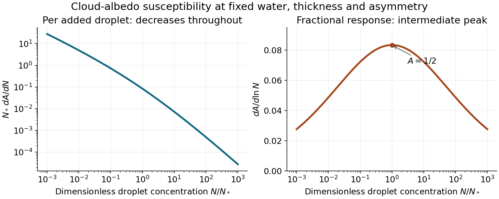

<h1 id="1/solution">Solution</h1>

↑ **Parent:** [1](../1.md)

**Optical response at fixed [cloud](../../../cloud.md) structure.** Put $b=1-g$ and write the two-stream [cloud albedo](../../../cloud-albedo.md) as $A=b\tau/(2+b\tau)$. At fixed [scattering asymmetry parameter](../../../scattering-asymmetry-parameter.md),

$$
\frac{dA}{d\tau}=\frac{2b}{(2+b\tau)^2},\qquad A(1-A)=\frac{2b\tau}{(2+b\tau)^2},\qquad
\boxed{\frac{dA}{d\tau}=\frac{A(1-A)}\tau}.
$$

At zero [optical depth](../../../optical-depth.md) the last quotient is understood by its finite limiting value. [Optical depth](../../../optical-depth.md) counts extinction along a ray. For an approximately homogeneous, monodisperse [cloud](../../../cloud.md),

$$
\tau=\int_0^hN\sigma_{\rm ext}\,dz=NQ_{\rm ext}\pi r^2h\simeq2\pi Nr^2h.
$$

This uses spherical droplets, independent extinction, representative constant $N,r$, and the [geometric optics](../../../geometrical-optics-split.md) limit in which the droplet radius greatly exceeds the relevant visible wavelength and $Q_{\rm ext}\simeq2$. [Diffraction](../../../diffraction.md) supplies part of the extinction cross-section; it is not legitimate to obtain the factor two from geometric interception alone. A size distribution requires its second moment rather than an arbitrary mean radius.

With liquid-water density $\rho_w$ and [cloud](../../../cloud.md) [liquid-water content](../../../liquid-water-content.md) $L$, the volume constraint gives $r^3=3L/(4\pi\rho_wN)$. Consequently

$$
\tau=2\pi h\left(\frac{3L}{4\pi\rho_w}\right)^{2/3}N^{1/3},\qquad
\frac{d\ln\tau}{d\ln N}=\frac13+\frac23\frac{d\ln L}{d\ln N}+\frac{d\ln h}{d\ln N}.
$$

This proves

$$
\boxed{\frac{d\tau}{dN}=\frac\tau{3N}\left(1+2\frac{d\ln L}{d\ln N}+3\frac{d\ln h}{d\ln N}\right)}.
$$

Keeping $L,h,\rho_w,g$ fixed isolates the [Twomey effect](../../../twomey-effect.md):

$$
\boxed{\frac{dA}{dN}=\frac{A(1-A)}{3N}}.
$$

It is a partial response, not a claim that [cloud](../../../cloud.md) water and [cloud](../../../cloud.md) geometry stay unchanged under every real [aerosol](../../../aerosol.md) perturbation.

**Absolute and fractional susceptibility.** Choose $N_*$ so that $A=1/2$ there, and put $n=N/N_*$. Then

$$
A=\frac{n^{1/3}}{1+n^{1/3}},\qquad
N_*\frac{dA}{dN}=\frac{n^{-2/3}}{3(1+n^{1/3})^2}.
$$

The [cloud albedo susceptibility](../../../cloud-albedo-susceptibility.md) per added droplet decreases monotonically. Its small-$n$ asymptote is proportional to $n^{-2/3}$, while its large-$n$ asymptote is proportional to $n^{-4/3}$. Thus a fixed absolute droplet-number addition has much more leverage in a clean [cloud](../../../cloud.md) than in an already droplet-rich [cloud](../../../cloud.md). The formal divergence as $N\to0$ is not a physical infinite response: fixed water content would require indefinitely large drops, eventually invalidating the optical and [cloud](../../../cloud.md) assumptions.

For a fixed _fractional_ number addition the response is instead $dA/d\ln N=A(1-A)/3$, maximal at $A=1/2$ and small at either very low or nearly saturated albedo. This distinction is essential when comparing interventions specified by an absolute particle addition with those specified by a percentage increase.

**[Figure 1](#1/image-absolute-and-fractional-cloud-albedo-responses-under-fixed-liquid-water-and-thickness-assumptions). Absolute and fractional cloud-albedo responses under fixed liquid-water and thickness assumptions**.

**Brightening and net radiation.** [Marine cloud brightening](../../../marine-cloud-brightening.md) would increase the population of suitable [cloud condensation nuclei](../../../cloud-condensation-nucleus.md), for example by producing sea-salt [aerosol](../../../aerosol.md) from seawater and allowing transport into susceptible marine boundary-layer [clouds](../../../cloud.md). Activation depends on particle size, hygroscopicity and the [cloud](../../../cloud.md)'s attained supersaturation; adding particles does not guarantee a one-for-one increase of droplets. At fixed [cloud](../../../cloud.md) water, more activated droplets mean smaller radii, larger total extinction area, larger shortwave [optical depth](../../../optical-depth.md) and more reflected sunlight.

Promising physical conditions combine relatively clean, persistent low [clouds](../../../cloud.md), appreciable incident sunlight and a dark underlying ocean. The extensive marine stratocumulus regions over the eastern subtropical oceans are examples of this combination. An already polluted, optically saturated [cloud](../../../cloud.md) has little remaining shortwave leverage. Bright [clouds](../../../cloud.md) over snow or ice also add relatively little contrast with the surface. Low [clouds](../../../cloud.md) have temperatures closer to the surface than high [clouds](../../../cloud.md), so their extra longwave greenhouse effect is generally less able to offset the shortwave cooling. Sunlit seasons and latitudes matter; no shortwave benefit occurs at night.

Schematically, the fixed-cloud shortwave perturbation is $\delta F_{\rm SW}\sim-\mathcal S f_c\delta A$, where $\mathcal S$ is the local incident solar flux and $f_c$ the affected [cloud](../../../cloud.md) fraction. Changes in [cloud](../../../cloud.md) fraction, precipitation, [entrainment](../../../fluid-entrainment.md), liquid water and longwave emission must also be evaluated before equating the positive derivative above with a guaranteed net cooling. The derivative identifies susceptibility, not a complete climate-response calculation.

## ↑ Ancestors (11)

1. [1](../1.md)
2. [2016](../../2016-split.md)
3. [Past exam of the physics of atmospheres and oceans course of the University of Oxford](../../split.md)
4. [Physics of atmospheres and oceans course of the University of Oxford](../../../physics-of-atmospheres-and-oceans-course-of-the-university-of-oxford.md)
5. [Year 4 of the physics course of the University of Oxford](../../../year-4-of-the-physics-course-of-the-university-of-oxford.md)
6. [Physics course of the University of Oxford](../../../physics-course-of-the-university-of-oxford.md)
7. [Undergraduate course of the University of Oxford](../../../undergraduate-course-of-the-university-of-oxford.md)
8. [Course of the University of Oxford](../../../course-of-the-university-of-oxford.md)
9. [University of Oxford](../../../university-of-oxford-split.md)
10. [List of universities](../../../list-of-universities.md)
11. [Codex Wiki](../../../split.md)
