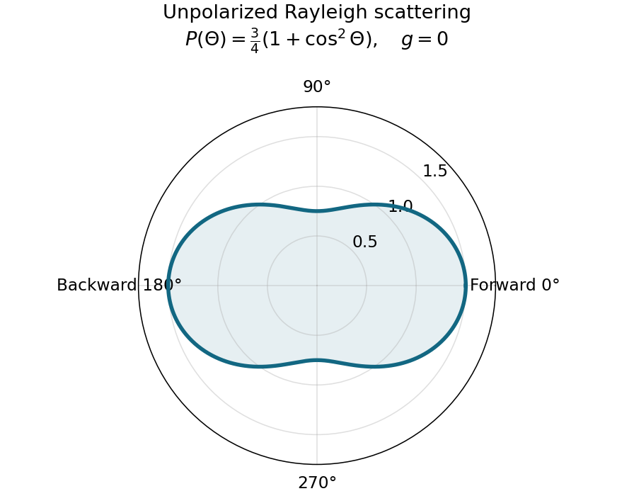

<h1 id="3/solution">Solution</h1>

↑ **Parent:** [3](../3.md)

**Normalization and angular pattern.** A [scattering phase function](../../../scattering-phase-function.md) describes the distribution of single-scattered power over outgoing [solid angle](../../../solid-angle.md), for a specified incident direction, wavelength and [polarization](../../../polarization-waves.md) convention. Use the common normalization

$$
\frac1{4\pi}\int_{4\pi}P(\Theta)\,d\Omega=1,\qquad
\boxed{g=\frac1{4\pi}\int_{4\pi}P(\Theta)\cos\Theta\,d\Omega}.
$$

The [scattering asymmetry parameter](../../../scattering-asymmetry-parameter.md) is the mean cosine of the [scattering angle](../../../scattering-angle.md): forward scattering has positive $g$, backward scattering negative $g$, and a forward–backward symmetric pattern has $g=0$.

Let $C=E_0(2\pi/\lambda)^4[(n^2-1)/(n^2+2)]^2r^6$. The given small-sphere angular intensity is $I=C(1+\mu^2)/2$, where $\mu=\cos\Theta$. Its total scattered power is

$$
\int I\,d\Omega=2\pi C\int_{-1}^1\frac{1+\mu^2}{2}\,d\mu=\frac{8\pi C}3.
$$

Normalizing gives

$$
\boxed{P(\Theta)=\frac{4\pi I}{\int I\,d\Omega}=\frac34(1+\cos^2\Theta)}.
$$

Dimensionally the supplied $I$ is [radiant intensity](../../../radiant-intensity.md), power per [solid angle](../../../solid-angle.md). If interpreted as detector [irradiance](../../../irradiance.md) at a distance, the appropriate inverse-square distance factor is also needed; it cancels out of the normalized angular pattern.

The polar plot has equal forward and backward lobes, each with radius $3/2$, and lateral values $3/4$. A small nonabsorbing particle behaves as an induced [electric dipole](../../../electric-dipole.md). Radiation transverse to the dipole and the average over two orthogonal incident [polarizations](../../../polarization-waves.md) produce the $1+\cos^2\Theta$ form. Its odd angular moment vanishes:

$$
\boxed{g=\frac38\int_{-1}^1\mu(1+\mu^2)\,d\mu=0}.
$$

As the size parameter $2\pi r/\lambda$ grows, [Rayleigh scattering](../../../rayleigh-scattering.md) in the electric-dipole approximation no longer suffices. Higher multipoles and interference produce structure in the angular pattern, and large particles generally develop a strong narrow forward [diffraction](../../../diffraction.md) peak. Their $g$ is normally positive, although detailed values and angular features depend on [refractive index](../../../refractive-index.md), size distribution and shape; they are not fixed by radius alone. Large spheres may show rainbows and backscattering structure, while nonspherical ice introduces further angular features.

**[Figure 2](#3/image-normalized-rayleigh-phase-function-for-an-unpolarized-incident-beam). Normalized Rayleigh phase function for an unpolarized incident beam**.

**Optically thick transmission.** In a nonabsorbing two-stream or transport approximation, it is the transport [optical depth](../../../optical-depth.md) $(1-g)\tau$ that controls the loss of forward directional memory. Using the same idealized albedo closure as in option 1 gives total forward-hemisphere transmittance

$$
T\simeq1-A=\frac2{2+(1-g)\tau}.
$$

For the same large but finite extinction [optical depth](../../../optical-depth.md),

$$
\boxed{T_{\rm water}>T_{\rm ice}>T_{\rm small\ smoke}}.
$$

The respective transport-depth factors are $0.15$, $0.30$ and $1$. The water [cloud](../../../cloud.md) scatters most strongly forward and returns the least light backward. All transmittances tend to zero in the infinite-depth limit. The strictly unscattered direct-beam transmittance is instead $e^{-\tau}$, identical in the three cases: the ranking concerns total transmitted radiation, including forward-scattered light, not that direct component alone. Full [radiative transfer](../../../radiative-transfer.md) can also depend on higher angular moments beyond $g$.

## ↑ Ancestors (11)

1. [3](../3.md)
2. [2016](../../2016-split.md)
3. [Past exam of the physics of atmospheres and oceans course of the University of Oxford](../../split.md)
4. [Physics of atmospheres and oceans course of the University of Oxford](../../../physics-of-atmospheres-and-oceans-course-of-the-university-of-oxford.md)
5. [Year 4 of the physics course of the University of Oxford](../../../year-4-of-the-physics-course-of-the-university-of-oxford.md)
6. [Physics course of the University of Oxford](../../../physics-course-of-the-university-of-oxford.md)
7. [Undergraduate course of the University of Oxford](../../../undergraduate-course-of-the-university-of-oxford.md)
8. [Course of the University of Oxford](../../../course-of-the-university-of-oxford.md)
9. [University of Oxford](../../../university-of-oxford-split.md)
10. [List of universities](../../../list-of-universities.md)
11. [Codex Wiki](../../../split.md)
