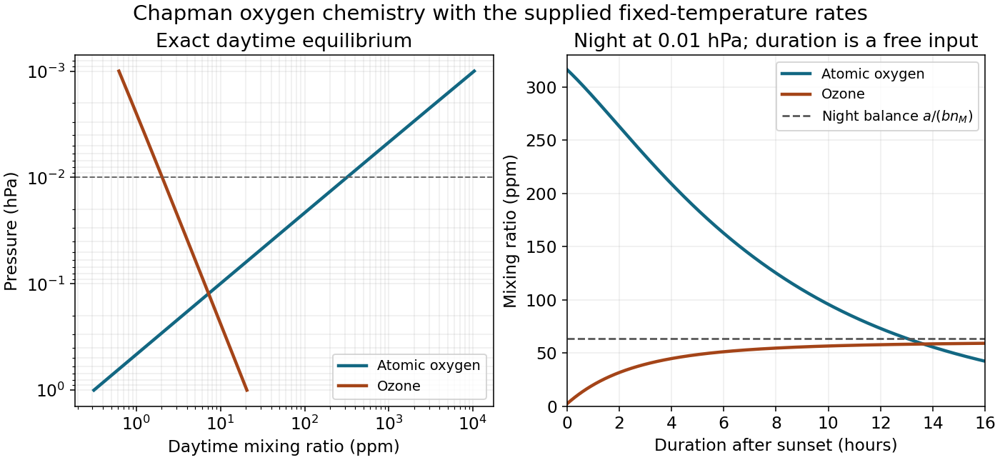

<h1 id="4/solution">Solution</h1>

↑ **Parent:** [4](../4.md)

**Third body and steady partition.** The third molecule removes excess association energy and momentum, stabilizing newly formed [ozone](../../../ozone.md) rather than being consumed in the net reaction. Its decreasing abundance with altitude suppresses three-body [ozone](../../../ozone.md) formation strongly. Write $x=[\mathrm O]$, $y=[\mathrm O_3]$, $a=k_1n_2n_M$, $j=J_3$ and $b=k_3$, with $n_2,n_M$ held as reservoirs. The kinetic equations are

$$
\dot x=2J_2n_2-ax+jy-bxy,\qquad
\dot y=ax-jy-bxy,\qquad
\frac{d(x+y)}{dt}=2J_2n_2-2bxy.
$$

The fast association/photolysis subsystem conserves [odd oxygen](../../../odd-oxygen.md), $x+y$, and has [eigenvalues](../../../eigenvalue.md) $0,-(a+j)$. Its partition-adjustment time is therefore

$$
\boxed{\tau_F\simeq\frac1{a+j}=\frac1{k_1n_2n_M+J_3}}.
$$

This neglects the slower production and mutual-destruction terms while finding that fast mode. On its equilibrium partition, $ax\simeq jy$, and total odd-oxygen equilibrium gives $bxy=J_2n_2$. Hence

$$
x\simeq\left(\frac{J_2j}{bk_1n_M}\right)^{1/2},\qquad
 y\simeq n_2\left(\frac{J_2k_1n_M}{bj}\right)^{1/2},\qquad \frac xy\simeq\frac j{k_1n_2n_M}.
$$

With fixed oxygen mole fraction and temperature, the atomic-oxygen mixing ratio scales as $x/n_M\propto n_M^{-3/2}$ in this approximation, and thus increases upward as pressure decreases.

**Lifetime versus relaxation.** The distinction is formalized by [Chapman family lifetime versus relaxation time](../../../chapman-family-lifetime-versus-relaxation-time.md). In the ozone-dominated regime $y\gg x$, the family abundance is approximately $y$, and its gross chemical lifetime is

$$
\tau_{O_x}\simeq\frac{y}{2bxy}=\frac1{2bx}
=\boxed{\frac12\left(\frac{k_1n_M}{J_2J_3k_3}\right)^{1/2}}.
$$

This recovers the printed $\tau_S$ as a family turnover time under its additional partition assumption. It is not generally an e-folding relaxation time. With rapid partitioning, the family equation is $\dot X=P-kX^2$. Linearizing about equilibrium gives relaxation rate $2kX_e$ but turnover rate $kX_e$, a factor of two difference. More generally the approximate family lifetime is $(x+y)/(2bxy)$, and its relaxation time is half that quantity. Neither can be replaced by $1/(2bx)$ when [atomic oxygen](../../../atomic-oxygen.md) dominates.

For a direct check using the complete two-species equations, the equilibrium [Jacobian matrix](../../../jacobian-matrix.md) is

$$
\mathsf J=\begin{pmatrix}-a-by&j-bx\\a-by&-j-bx\end{pmatrix}.
$$

The numerical high-altitude example below gives eigenmode times about $321\ \mathrm s$ and $4.0\times10^5\ \mathrm s$, whereas the printed $\tau_S$ is only $5.15\times10^3\ \mathrm s$. Thus interpreting both printed expressions as universal eigenmode time constants would be false, even though the fast partition and the ozone-dominated turnover approximations are useful.

Setting $x=y$ in the fast-partition approximation gives $a=j$, hence

$$
n_M\simeq\sqrt{\frac{J_3}{0.2k_1}},\qquad
\boxed{p\simeq k_BT\sqrt{\frac{J_3}{0.2k_1}}=12.3\ \mathrm{Pa}=0.123\ \mathrm{hPa}}.
$$

Retaining mutual destruction gives $a=j+bx$ and changes this estimate by less than one percent. The formal high-altitude limit of $\tau_F$ is $1/J_3\simeq333\ \mathrm s$: [ozone](../../../ozone.md) photolysis, unlike three-body association, does not slow merely because collider density decreases. This is a partition timescale, not the lifetime of all [odd oxygen](../../../odd-oxygen.md). Extrapolating the fixed-reservoir approximation indefinitely upward would eventually cease to be self-consistent.

**Day and night.** At $p=0.01\ \mathrm{hPa}=1\ \mathrm{Pa}$ and $230\ \mathrm K$, $n_M=p/(k_BT)=3.15\times10^{20}\ \mathrm{m^{-3}}$ and $n_2=0.2n_M$. The exact equilibrium is conveniently obtained from

$$
k_1n_Mx^2-J_2x-\frac{J_2J_3}{k_3}=0,\qquad y=\frac{J_2n_2}{k_3x}.
$$

The physical root gives

$$
\boxed{x=9.97\times10^{16}\ \mathrm{m^{-3}},\quad y=6.38\times10^{14}\ \mathrm{m^{-3}},\quad
\chi_O=3.17\times10^{-4},\quad\chi_{O_3}=2.03\times10^{-6}}.
$$

Their ratio is $156$, consistent with the requested approximate factor $150$; the simpler fast-partition estimate gives approximately $151$. The printed fast time is $331\ \mathrm s$ at this pressure.

For [nighttime Chapman ozone](../../../nighttime-chapman-ozone.md), after sunset set both photolysis rates to zero. [Ozone](../../../ozone.md) initially grows by converting [atomic oxygen](../../../atomic-oxygen.md), but simply putting every initial oxygen atom into one [ozone](../../../ozone.md) molecule neglects the simultaneous $\mathrm O+\mathrm O_3$ sink. The night equations are

$$
\dot x=-x(a+by),\qquad \dot y=x(a-by).
$$

While sufficient [atomic oxygen](../../../atomic-oxygen.md) remains, the [ozone](../../../ozone.md) balance tends toward

$$
\boxed{y\sim a/b,\qquad \chi_{O_3}\sim\frac{k_1n_2}{k_3}=6.36\times10^{-5}}.
$$

This is a useful long-night sunrise estimate, roughly thirty times the sunset [ozone](../../../ozone.md) abundance, not an exact result for an unspecified night duration. The precise phase-plane relation is

$$
x-x_0=y-y_0+\frac{2a}b\ln\left(\frac{a-by}{a-by_0}\right)\qquad(y<a/b).
$$

Together with the night equations it supplies $y(t_{\rm night})$ for any supplied duration. For illustration only, a twelve-hour dark interval gives $\chi_{O_3}\simeq5.8\times10^{-5}$; no twelve-hour duration is stated by the paper. Even the infinite-dark-time endpoint is slightly below $a/b$, because the finite initial atomic reservoir is consumed. This conditional estimate avoids inventing a unique sunset-to-sunrise duration.

**[Figure 3](#4/image-daytime-chapman-partition-and-the-duration-dependent-nocturnal-ozone-increase-for-the-supplied-rates). Daytime Chapman partition and the duration-dependent nocturnal ozone increase for the supplied rates**.

## ↑ Ancestors (11)

1. [4](../4.md)
2. [2016](../../2016-split.md)
3. [Past exam of the physics of atmospheres and oceans course of the University of Oxford](../../split.md)
4. [Physics of atmospheres and oceans course of the University of Oxford](../../../physics-of-atmospheres-and-oceans-course-of-the-university-of-oxford.md)
5. [Year 4 of the physics course of the University of Oxford](../../../year-4-of-the-physics-course-of-the-university-of-oxford.md)
6. [Physics course of the University of Oxford](../../../physics-course-of-the-university-of-oxford.md)
7. [Undergraduate course of the University of Oxford](../../../undergraduate-course-of-the-university-of-oxford.md)
8. [Course of the University of Oxford](../../../course-of-the-university-of-oxford.md)
9. [University of Oxford](../../../university-of-oxford-split.md)
10. [List of universities](../../../list-of-universities.md)
11. [Codex Wiki](../../../split.md)
