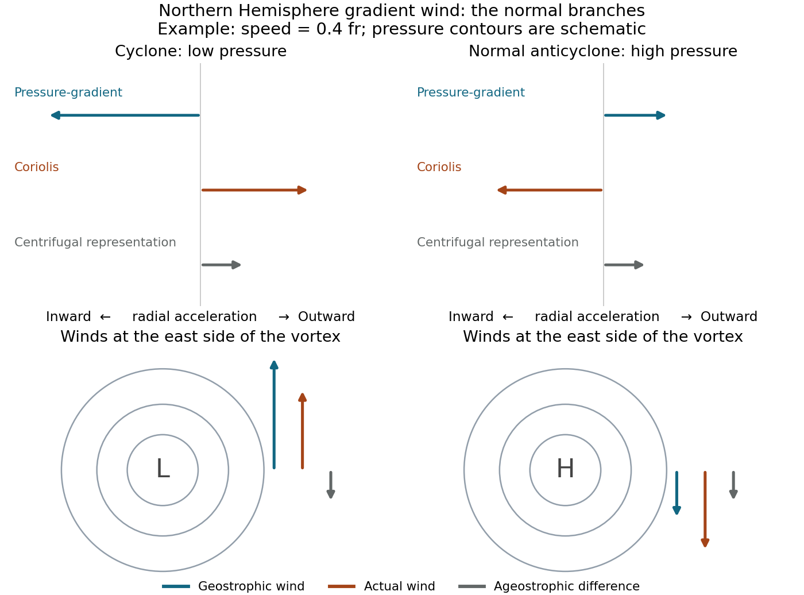

<h1 id="7/solution">Solution</h1>

↑ **Parent:** [7](../7.md)

**Signed radial balance.** Let $r$ increase outward from the vortex centre and $U$ be signed azimuthal velocity, positive anticlockwise. At $45^\circ$N, $f=2\Omega_\oplus\sin45^\circ>0$. The positive speed is $V=|U|$, $f$ is the [Coriolis parameter](../../../coriolis-parameter.md), the [density](../../../density.md) is $\rho$, and $p_r=\partial p/\partial r$. In circular motion the inward centripetal acceleration is $-U^2/r$, while the outward radial acceleration from the [Coriolis force](../../../coriolis-force.md) is $fU$. The [pressure gradient](../../../pressure-gradient.md) acceleration is $-p_r/\rho$. Hence

$$
\boxed{\frac{U^2}r+fU=\frac1\rho p_r}.
$$

The term $U^2/r$ is an acceleration, not an additional physical force in the rotating-frame momentum equation. It can be moved to the force-balance side and depicted as outward [centrifugal force](../../../centrifugal-force.md) in a frame following the circular parcel.

For a cyclone, $U=+V$ and $p_r/\rho=V^2/r+fV>0$: pressure increases outward and the centre is a low. Its inward pressure force balances the outward Coriolis and centrifugal terms. For a conventional anticyclone, $U=-V$ and $G=-p_r/\rho>0$; the balance is

$$
fV=G+V^2/r.
$$

The inward [Coriolis force](../../../coriolis-force.md) balances the outward pressure and centrifugal terms, and pressure has a maximum at the centre.

**Anticyclonic branches and near-centre regularity.** The [anticyclonic gradient-wind branches](../../../anticyclonic-gradient-wind-branches.md) follow from the quadratic balance. Solving gives

$$
\boxed{V_\pm=\frac{fr}2\left[1\pm\sqrt{1-\frac{4G}{f^2r}}\right]
=\frac{fr}2\left[1\pm\sqrt{1-\frac{4V_g}{fr}}\right]},\qquad V_g=G/f.
$$

The minus root is the normal branch connected continuously to [geostrophic flow](../../../geostrophic-flow.md) for small forcing. The plus root is an anomalous high-speed branch and must not be discarded algebraically, even though it often fails the stability conditions relevant to large-scale anticyclones. Reality requires

$$
\boxed{G\le\frac{f^2r}4,\qquad V_g\le\frac{fr}4}.
$$

A finite smooth central pressure therefore has zero radial gradient at the origin, with $-p_r/\rho$ no larger than order $r$. For $p=p_c-\rho C r^2/2+\cdots$, the limiting curvature obeys $C\le f^2/4$. A pressure maximum with a finite nonzero limiting outward pressure force cannot support the required circular anticyclonic balance arbitrarily close to its centre.

For positive $\mathrm{Ro}=V/(fr)$ and geostrophic _magnitudes_,

$$
\boxed{\frac{V_g}{V}=1+\mathrm{Ro}\quad\text{(cyclone)},\qquad
\frac{V_g}{V}=1-\mathrm{Ro}\quad\text{(conventional anticyclone)}}.
$$

The cyclonic [gradient wind](../../../gradient-wind.md) is subgeostrophic and the normal anticyclonic wind supergeostrophic. On the latter branch $0\le\mathrm{Ro}\le1/2$. At a point on the eastern side of a cyclone, geostrophic and actual winds point north but the actual arrow is shorter; the ageostrophic difference points south. On the eastern side of a normal anticyclone both geostrophic and actual winds point south, with the actual arrow longer and its ageostrophic addition also south.

**[Figure 4](#7/image-normal-cyclonic-and-anticyclonic-gradient-wind-forces-pressure-contours-and-ageostrophic-differences-in-the-northern-hemisphere). Normal cyclonic and anticyclonic gradient-wind forces, pressure contours and ageostrophic differences in the Northern Hemisphere**.

At lower latitude, the same $V$ and radius give a larger [Rossby number](../../../rossby-number.md) and larger differences from [geostrophic wind](../../../geostrophic-wind.md). The contour topology remains a central low or a conventional central high, but for fixed $V,r$ the required radial [pressure gradients](../../../pressure-gradient.md) change with $f$: the cyclonic gradient is $\rho(V^2/r+fV)$ and the anticyclonic outward pressure force is $fV-V^2/r$. The latter conventional branch cannot be maintained once the reduced Coriolis contribution is too weak. Actual spatial gradients, rather than an arbitrary spacing of contour values, determine how tightly drawn contours should be.

The high-centre conclusion is conditional on the conventional anticyclonic branch. Gradient balance alone also allows a sufficiently rapid clockwise circulation about a _low_: if $V>fr$, then $p_r/\rho=V^2/r-fV>0$. For example, $V=2fr$ gives $p_r/\rho=2f^2r>0$. Such a configuration is outside the usual geostrophic anticyclone regime. Tornado-scale vortices have very large [Rossby number](../../../rossby-number.md), so the dominant balance is nearly cyclostrophic, $p_r/\rho\simeq V^2/r>0$. Their centres are low pressure irrespective of the sign of rotation; low pressure supplies the inward acceleration needed to bend the fast flow.

## ↑ Ancestors (11)

1. [7](../7.md)
2. [2016](../../2016-split.md)
3. [Past exam of the physics of atmospheres and oceans course of the University of Oxford](../../split.md)
4. [Physics of atmospheres and oceans course of the University of Oxford](../../../physics-of-atmospheres-and-oceans-course-of-the-university-of-oxford.md)
5. [Year 4 of the physics course of the University of Oxford](../../../year-4-of-the-physics-course-of-the-university-of-oxford.md)
6. [Physics course of the University of Oxford](../../../physics-course-of-the-university-of-oxford.md)
7. [Undergraduate course of the University of Oxford](../../../undergraduate-course-of-the-university-of-oxford.md)
8. [Course of the University of Oxford](../../../course-of-the-university-of-oxford.md)
9. [University of Oxford](../../../university-of-oxford-split.md)
10. [List of universities](../../../list-of-universities.md)
11. [Codex Wiki](../../../split.md)
