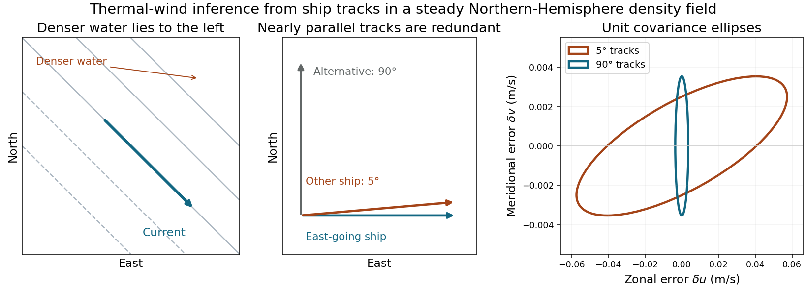

<h1 id="8/solution">Solution</h1>

↑ **Parent:** [8](../8.md)

**Balances and density gradients.** The first two relations describe horizontal [geostrophic balance](../../../geostrophic-balance.md) between [pressure gradient](../../../pressure-gradient.md) and [Coriolis force](../../../coriolis-force.md) accelerations. The vertical relation is [hydrostatic balance](../../../hydrostatic-balance.md) between the vertical pressure force and gravity. They describe a slowly varying large-scale interior circulation, excluding the frictional surface/bottom layers and large ageostrophic accelerations.

Differentiate the horizontal balances vertically and use $p_z=-\rho g$, treating $f,\rho_0$ as vertically constant:

$$
\boxed{u_z=\frac{g}{f\rho_0}\rho_y,\qquad v_z=-\frac{g}{f\rho_0}\rho_x}.
$$

These are the oceanic [thermal wind](../../../thermal-wind.md) relations. With no motion at $z=-H$, the exact surface relations involve the depth-integrated density gradients. If the measured density is representative of the vertical mean, or if those gradients are approximately uniform with depth,

$$
u_g\simeq\frac{gH}{f\rho_0}\rho_y,\qquad
v_g\simeq-\frac{gH}{f\rho_0}\rho_x.
$$

Equivalently these hold exactly for the horizontal gradients of $\bar\rho=H^{-1}\int_{-H}^0\rho\,dz$ in this fixed-depth reference model. A single arbitrary surface-density gradient does not otherwise determine a vertical integral. In the Northern Hemisphere the inferred surface current runs along horizontal [isopycnals](../../../isopycnal.md) with denser water on its left when the no-motion reference and this vertical-gradient approximation apply.

For a steady density pattern and a ship whose actual track velocity is $v_s(\cos\theta,\sin\theta)$,

$$
\frac{d\rho}{dt}=v_s(\rho_x\cos\theta+\rho_y\sin\theta)
=\boxed{\frac{f\rho_0v_s}{gH}(u_g\sin\theta-v_g\cos\theta)}.
$$

If the field changes during the survey an Eulerian time derivative must also be included. Here $H=\Delta z>0$ is the upward separation from reference depth to surface, so its sign must not be reversed.

**Inversion and velocity estimate.** Let $C=f\rho_0v_s/(gH)$ and denote the two ship measurements by $y_\theta,y_0$, with the east-going ship assigned the subscript zero. The observation system and its inverse are

$$
\mathbf y=C\begin{pmatrix}\sin\theta&-\cos\theta\\0&-1\end{pmatrix}\begin{pmatrix}u_g\\v_g\end{pmatrix},\qquad
\boxed{v_g=-\frac{y_0}C,\qquad u_g=\frac{y_\theta-y_0\cos\theta}{C\sin\theta}}.
$$

It is invertible for $\sin\theta\ne0$. For two measurements and two unknowns this inverse is also the stated least-squares estimate; the nearly parallel-track geometry explains its poor conditioning at small angle.

The supplied parameters give $C=5.654\times10^{-5}$ in units converting velocity to the measured density tendency. With $y_\theta=1.9\times10^{-5}$ and $y_0=1.8\times10^{-5}\ \mathrm{kg\,m^{-3}\,s^{-1}}$,

$$
\boxed{u_g=+0.217\ \mathrm{m\,s^{-1}},\qquad v_g=-0.318\ \mathrm{m\,s^{-1}}}.
$$

The current therefore has eastward and southward components. Signs follow from the positive-upward, east–north coordinate convention and the specified no-motion reference.

**Uncertainty and track design.** The [two-track thermal-wind covariance](../../../two-track-thermal-wind-covariance.md) exposes the geometrical limitation. The stated error already applies to the difference of successive density observations. Dividing by the sampling interval, rather than adding an extra factor of $\sqrt2$, gives $\sigma_y=7.2\times10^{-4}/3600=2.0\times10^{-7}\ \mathrm{kg\,m^{-3}\,s^{-1}}$. Assume independent errors of that size for the two ships, as in the supplied [covariance](../../../covariance.md) model. Then

$$
\boxed{\mathsf S_{uv}=\frac{\sigma_y^2}{C^2}
\begin{pmatrix}(1+\cos^2\theta)/\sin^2\theta&\cot\theta\\\cot\theta&1\end{pmatrix}}.
$$

At $5^\circ$,

$$
\boxed{\sigma_u=0.0573\ \mathrm{m\,s^{-1}},\quad\sigma_v=0.00354\ \mathrm{m\,s^{-1}},\quad
\operatorname{Cov}(u,v)=1.43\times10^{-4}\ \mathrm{m^2\,s^{-2}}}.
$$

The [correlation](../../../pearson-correlation-coefficient.md) is positive,

$$
\boxed{\operatorname{Corr}(u,v)=\frac{\cos\theta}{\sqrt{1+\cos^2\theta}}=0.706\quad\text{at }5^\circ}.
$$

Both estimates depend on the east-going ship; its positive measurement error lowers $v_g$ and also lowers $u_g$, explaining the sign of the [covariance](../../../covariance.md). If the other ship goes north instead, $\theta=90^\circ$ gives orthogonal observations: $u_g=y_{90}/C$ and $v_g=-y_0/C$. Both [standard errors](../../../standard-error.md) become $0.00354\ \mathrm{m\,s^{-1}}$ and their [covariance](../../../covariance.md) vanishes. The north-going track improves the poorly constrained zonal component by about a factor of sixteen, while leaving the meridional precision unchanged under the same noise assumptions.

**[Figure 5](#8/image-density-gradients-geostrophic-current-direction-and-the-uncertainty-caused-by-nearly-parallel-ship-tracks). Density gradients, geostrophic current direction and the uncertainty caused by nearly parallel ship tracks**.

## ↑ Ancestors (11)

1. [8](../8.md)
2. [2016](../../2016-split.md)
3. [Past exam of the physics of atmospheres and oceans course of the University of Oxford](../../split.md)
4. [Physics of atmospheres and oceans course of the University of Oxford](../../../physics-of-atmospheres-and-oceans-course-of-the-university-of-oxford.md)
5. [Year 4 of the physics course of the University of Oxford](../../../year-4-of-the-physics-course-of-the-university-of-oxford.md)
6. [Physics course of the University of Oxford](../../../physics-course-of-the-university-of-oxford.md)
7. [Undergraduate course of the University of Oxford](../../../undergraduate-course-of-the-university-of-oxford.md)
8. [Course of the University of Oxford](../../../course-of-the-university-of-oxford.md)
9. [University of Oxford](../../../university-of-oxford-split.md)
10. [List of universities](../../../list-of-universities.md)
11. [Codex Wiki](../../../split.md)
