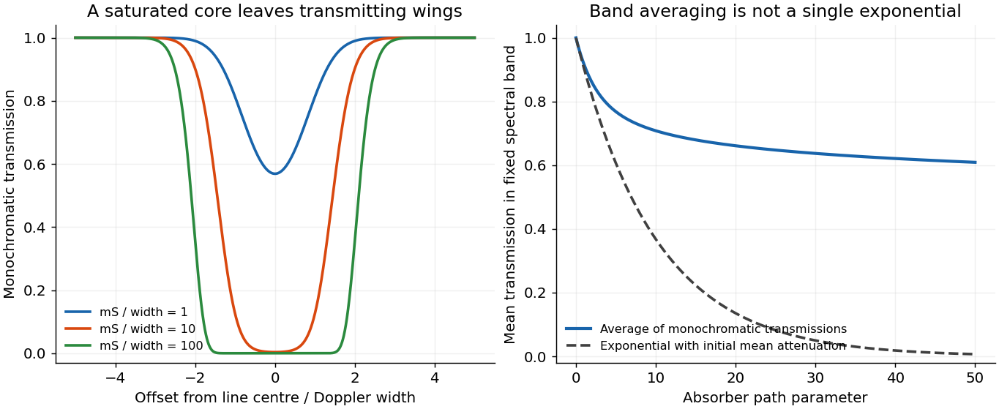
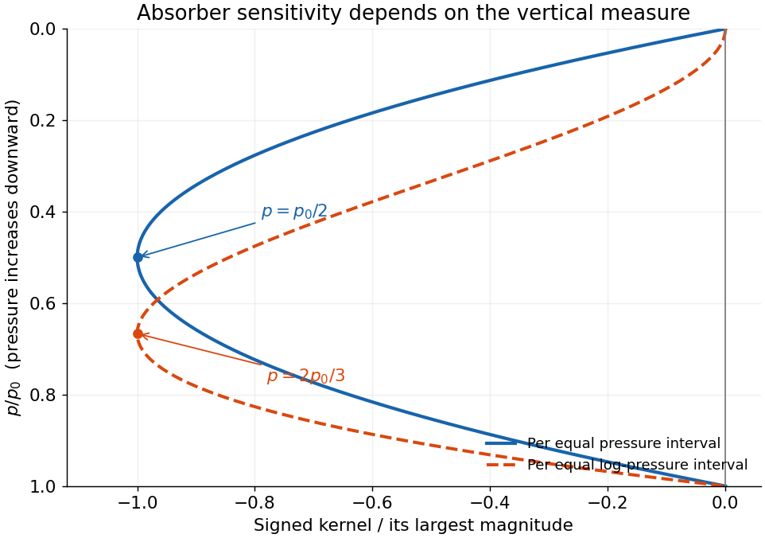
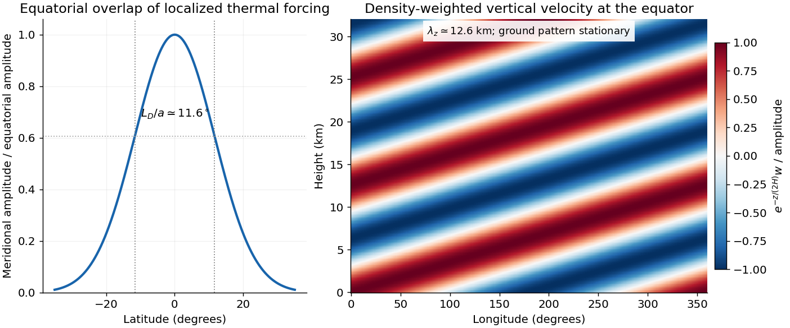

# 2017

↑ **Parent:** [Past exam of the physics of atmospheres and oceans course of the University of Oxford](../past-exam-of-the-physics-of-atmospheres-and-oceans-course-of-the-university-of-oxford.md)

Source paper: [https://www.whatdotheyknow.com/request/oxford_physics_past_papers_2/response/2340696/attach/5/Physics%20Papers%202016.pdf?cookie_passthrough=1](https://www.whatdotheyknow.com/request/oxford_physics_past_papers_2/response/2340696/attach/5/Physics%20Papers%202016.pdf?cookie_passthrough=1)

**Table of contents**

- [1](#1)
  - [a](#1/a)
    - [Solution](#1/a/solution)
  - [b](#1/b)
    - [Solution](#1/b/solution)
  - [c](#1/c)
    - [Solution](#1/c/solution)
  - [d](#1/d)
    - [Solution](#1/d/solution)
- [2](#2)
  - [a](#2/a)
    - [Solution](#2/a/solution)
  - [b](#2/b)
    - [Solution](#2/b/solution)
  - [c](#2/c)
    - [Solution](#2/c/solution)
  - [d](#2/d)
    - [Solution](#2/d/solution)
  - [e](#2/e)
    - [Solution](#2/e/solution)
- [3](#3)
  - [a](#3/a)
    - [Solution](#3/a/solution)
  - [b](#3/b)
    - [Solution](#3/b/solution)
  - [c](#3/c)
    - [Solution](#3/c/solution)
  - [d](#3/d)
    - [Solution](#3/d/solution)
  - [e](#3/e)
    - [Solution](#3/e/solution)
- [4](#4)
  - [a](#4/a)
    - [Solution](#4/a/solution)
  - [b](#4/b)
    - [Solution](#4/b/solution)
  - [c](#4/c)
    - [Solution](#4/c/solution)
- [5](#5)
  - [a](#5/a)
    - [Solution](#5/a/solution)
  - [b](#5/b)
    - [Solution](#5/b/solution)
  - [c](#5/c)
    - [Solution](#5/c/solution)
  - [d](#5/d)
    - [Solution](#5/d/solution)
- [6](#6)
  - [a](#6/a)
    - [Solution](#6/a/solution)
  - [b](#6/b)
    - [Solution](#6/b/solution)
  - [c](#6/c)
    - [Solution](#6/c/solution)
  - [d](#6/d)
    - [Solution](#6/d/solution)
  - [e](#6/e)
    - [Solution](#6/e/solution)

## 1

↑ **Parent:** [2017](2017.md)

<h3 id="1/a">a</h3>

↑ **Parent:** [1](#1)

<h4 id="1/a/solution">Solution</h4>

↑ **Parent:** [A](#1/a)

Use $u$ as a spectroscopic [wavenumber](../wave-equation.md#wavenumber), in the same units throughout. Write the mass [absorption coefficient](../astrophysics.md#absorption-coefficient) of the absorbing species as

$$
\boxed{\kappa_\nu=S\phi(\nu-\nu_0),\qquad
\int_{-\infty}^{\infty}\phi(\delta\nu)\,d\delta\nu=1,\qquad
S=\int\kappa_\nu\,d\nu.}
$$

Here $S$ is the [spectral line strength](../atomic-physics.md#spectral-line-strength), the integrated mass [absorption coefficient](../astrophysics.md#absorption-coefficient); it is not the line-centre coefficient. If $\kappa_\nu$ has units $\mathrm{m^2\,kg^{-1}}$ and $\nu$ is in $\mathrm{cm^{-1}}$, then $S$ has units $\mathrm{m^2\,kg^{-1}\,cm^{-1}}$. For absorber [mass density](../fluid-mechanics.md#density) $\rho_a$, the volume coefficient in [Beer-Lambert law](../physical-chemistry.md#beer-lambert-law) is $\rho_a\kappa_\nu$.

**[Lifetime broadening](../stellar-astrophysics.md#lifetime-broadening).** Finite lifetimes of the upper and lower states destroy optical coherence, even for an isolated molecule. Exponential coherence decay gives a [Lorentzian line shape](../stellar-astrophysics.md#lorentzian-line-shape). For population decay rates $\Gamma_u,\Gamma_l$ and no extra dephasing, its [wavenumber](../wave-equation.md#wavenumber) half-width is $(\Gamma_u+\Gamma_l)/(4\pi c)$, with $c$ expressed in the length unit reciprocal to $\nu$. This sets a natural linewidth and can matter at extremely low collision rates; it is generally much smaller than atmospheric collisional or thermal widths.

**[Thermal Doppler broadening](../quantum-ideal-gas-statistics.md#thermal-doppler-broadening).** A [Maxwell-Boltzmann distribution](../quantum-ideal-gas-statistics.md#maxwell-boltzmann-distribution) of molecular line-of-sight velocities gives

$$
\phi_D(\delta\nu)=\frac{e^{-(\delta\nu/\Delta_D)^2}}{\sqrt\pi\Delta_D},\qquad
\Delta_D=\frac{\nu_0}{c}\sqrt{\frac{2k_BT}{m_a}}.
$$

This [Gaussian distribution](../probability-distribution.md#normal-distribution) has a $1/e$ half-width $\Delta_D$, determined by absorber [molecular mass](../molecule.md#molecular-mass) $m_a$ and [temperature](../temperature.md). It is especially relevant in the rarefied upper atmosphere, where collisions are infrequent.

**[Pressure broadening](../stellar-astrophysics.md#pressure-broadening).** Collisions perturb transition [frequencies](../wave.md#frequency) and phases. In the impact regime, exponential phase decorrelation gives

$$
\phi_L(\delta\nu)=\frac1\pi\frac{\Delta_L}{\delta\nu^2+\Delta_L^2}.
$$

Here $\Delta_L$ is the half-width at half maximum, proportional to the coherence-destroying collision rate. It depends on perturber [density](../fluid-mechanics.md#density), molecular collision properties, and [temperature](../temperature.md); it is often parameterized by $\Delta_L\propto p(T_*/T)^{n_T}$ for a specified broadener. It dominates much of the dense lower atmosphere. The [Lorentzian line shape](../stellar-astrophysics.md#lorentzian-line-shape) has algebraic $\delta\nu^{-2}$ wings, whereas the [Doppler profile](../quantum-ideal-gas-statistics.md#thermal-doppler-broadening) has rapidly decreasing [Gaussian](../probability-distribution.md#normal-distribution) wings. Where both mechanisms matter, their convolution is a [Voigt profile](../stellar-astrophysics.md#voigt-profile). A pure pressure-broadened profile should not be extrapolated to arbitrarily low [pressure](../pressure.md) while discarding the finite Doppler core.

<h3 id="1/b">b</h3>

↑ **Parent:** [1](#1)

<h4 id="1/b/solution">Solution</h4>

↑ **Parent:** [B](#1/b)

Let $m$ be the absorber [mass path](../planetary-science.md#mass-path) along a ray. If the [spectral line profile](../atomic-physics.md#spectral-line-profile) is independent of position, [Beer-Lambert law](../physical-chemistry.md#beer-lambert-law) gives $\mathfrak T_\nu(m)=e^{-m\kappa_\nu}$. A finite-band mean and the line's [equivalent width](../astrophysics.md#equivalent-width) are respectively

$$
\boxed{\overline{\mathfrak T}_{\mathcal B}(m)=\frac1{\Delta\nu_{\mathcal B}}\int_{\mathcal B}e^{-mS\phi(\nu)}\,d\nu,
\qquad E(m)=\int_{-\infty}^{\infty}[1-e^{-mS\phi(\nu)}],d\nu.}
$$

When the band contains all significant [absorption](../radiometry.md#absorption-electromagnetic-radiation), $\int_{\mathcal B}\mathfrak T_\nu d\nu\simeq\Delta\nu_{\mathcal B}-E$. An unqualified integral of [transmission](../radiometry.md#transmittance) over the entire infinite line domain diverges because [transmission](../radiometry.md#transmittance) tends to one far from [line centre](../stellar-astrophysics.md#spectral-line); $E$ is the finite and physically useful line deficit.

This is [nonexponential band transmission](../physical-chemistry.md#nonexponential-band-transmission): each monochromatic [transmission](../radiometry.md#transmittance) is exponential, but their average generally is not. Differentiating with respect to [mass path](../planetary-science.md#mass-path) gives

$$
\overline{\mathfrak T}'=-\langle\kappa e^{-m\kappa}\rangle_{\mathcal B}<0,
\qquad\overline{\mathfrak T}''=\langle\kappa^2e^{-m\kappa}\rangle_{\mathcal B}>0.
$$

More decisively, define the [absorption coefficient](../astrophysics.md#absorption-coefficient) averaged over the transmitted spectrum by

$$
a_{\rm eff}(m)=-\frac{d\log\overline{\mathfrak T}}{dm}
=\frac{\langle\kappa e^{-m\kappa}\rangle}{\langle e^{-m\kappa}\rangle}.
$$

Then $\boxed{a_{\rm eff}'(m)=-\operatorname{Var}_{m}(\kappa)\le0}$. The core saturates first and the surviving radiation increasingly samples weakly absorbing wings. The effective attenuation per additional mass therefore decreases. [Jensen's inequality](../real-analysis.md#jensen-s-inequality) also gives $\overline{\mathfrak T}\ge e^{-m\langle\kappa\rangle}$, with equality for a spectrally constant coefficient. Thus the band [transmission](../radiometry.md#transmittance) decays more slowly than the exponential with its initial mean attenuation.

The corresponding [curve of growth](../astrophysics.md#curve-of-growth) has $E(m)\simeq mS$ for an optically weak line, and sublinear growth after saturation. For the [Gaussian profile](../quantum-ideal-gas-statistics.md#thermal-doppler-broadening), with $\tau_0=mS/(\sqrt\pi\Delta_D)\gg1$, [absorption](../radiometry.md#absorption-electromagnetic-radiation) extends to $|\delta\nu|\simeq\Delta_D\sqrt{\log\tau_0}$, so $E\sim2\Delta_D\sqrt{\log\tau_0}$. For a strongly saturated pure [Lorentz profile](../stellar-astrophysics.md#lorentzian-line-shape) the wings instead give $E\sim2\sqrt{mS\Delta_L}$. These asymptotes apply while the line remains isolated and its important wings remain within the range where the assumed profile and nearly constant [Planck function](../astrophysics.md#planck-function) are appropriate. The integrated [absorption](../radiometry.md#absorption-electromagnetic-radiation) is not an exponential either: $E'>0$ and $E''\le0$.

**[Figure 1](#1/b/image-line-saturation-produces-nonexponential-band-transmission). Line saturation produces nonexponential band transmission**. An original fixed Gaussian line example shows its opaque core expanding with absorber path. The mean transmission across a fixed band remains above the single exponential determined by its initial mean attenuation.

<h3 id="1/c">c</h3>

↑ **Parent:** [1](#1)

<h4 id="1/c/solution">Solution</h4>

↑ **Parent:** [C](#1/c)

For the [single-line greenhouse deficit](../exoplanet.md#single-line-greenhouse-deficit), use [hydrostatic balance](../fluid-mechanics.md#hydrostatic-balance), fixed [surface pressure](../pressure.md) $p_s$, constant [gravity](../physics.md#gravity) $g$, and the [dry adiabat](../first-law-of-thermodynamics.md#dry-adiabat)

$$
T(p)=T_s(p/p_s)^\kappa,\qquad \kappa=R_b/c_{p,b}>0.
$$

The gas constant and [specific heat](../heat.md#specific-heat-capacity) refer to the background gas. Let $\mu_d=\cos\tilde\theta>0$ be the supplied effective ray cosine. The vertical [optical depth](../astrophysics.md#optical-depth) and slant [transmittance](../radiometry.md#transmittance) from level $p$ to space are

$$
\tau_\nu(p)=\frac qg\int_0^p\kappa_\nu(p',T(p'))\,dp',\qquad
\mathfrak T_\nu(p)=\exp[-\tau_\nu(p)/\mu_d].
$$

This permits pressure-dependent [line widths](../stellar-astrophysics.md#spectral-line-broadening). With [local thermodynamic equilibrium](../astrophysics.md#local-thermodynamic-equilibrium), negligible infrared [scattering](../physics.md#scattering), a black thermal surface, and no incident [thermal radiation](../electromagnetic-radiation.md#thermal-radiation) from space, the formal [radiative transfer](../astrophysics.md#radiative-transfer) solution is

$$
I_\nu(0)=B_\nu(T_s)\mathfrak T_\nu(p_s)+
\int_0^{p_s}B_\nu(T(p))[-\partial_p\mathfrak T_\nu(p)]\,dp.
$$

The weights add to one. Subtract the transparent-surface [radiance](../radiometry.md#radiance) and put $B(p)=B_{\nu_0}(T(p))$, using the narrow-line approximation only in the line deficit. Define its pressure-dependent [equivalent width](../astrophysics.md#equivalent-width)

$$
E(p,q)=\int[1-\mathfrak T_\nu(p)]\,d\nu,\qquad
\partial_pE=\int\frac{q\kappa_\nu(p)}{g\mu_d}\mathfrak T_\nu(p)\,d\nu\ge0.
$$

Approximating each hemispheric flux by $\pi$ times the effective-ray [radiance](../radiometry.md#radiance) preserves the black-surface flux. The outgoing longwave flux is therefore

$$
F_{\rm out}=\sigma_{\rm SB}T_s^4-D(T_s,q),\qquad
\boxed{D=\pi\int_0^{p_s}[B(p_s)-B(p)]\,\partial_pE(p,q)\,dp.}
$$

Integration by parts gives the particularly transparent form

$$
\boxed{D=\pi\int_0^{p_s}E(p,q)\frac{dB(p)}{dp}\,dp\ge0.}
$$

Both boundary terms vanish: $E(0,q)=0$ and $B(p_s)-B(p_s)=0$. The [dry adiabat](../first-law-of-thermodynamics.md#dry-adiabat) and monotonic [Planck function](../astrophysics.md#planck-function) give $dB/dp>0$. Atmospheric emission replaces part of the warm surface radiation by emission from cooler levels, reducing emission to space for a specified $T_s$. The inequality is strict when [opacity](../stellar-structure.md#opacity) occurs over a nonzero range with [temperature](../temperature.md) contrast; an [isothermal](../second-law-of-thermodynamics.md#isothermal-process) absorbing layer at the surface [temperature](../temperature.md) would not produce such a contrast.

For a spherical [planet](../planetary-science.md#planet) the mean absorbed instellation is $F_*=(1-\alpha)L_{\circledast}/4$. The required global [energy balance](../mathematical-physics.md#energy-balance) is

$$
\boxed{\sigma_{\rm SB}T_s^4=\frac{(1-\alpha)L_{\circledast}}4+D(T_s,q).}
$$

Consequently every equilibrium of this model has $T_s\ge T_{\rm bare}=[(1-\alpha)L_{\circledast}/(4\sigma_{\rm SB})]^{1/4}$, with strict warming when $D>0$. At fixed [temperature profile](../temperature.md), increasing $q$ increases $E$ and hence $D$. This argument does not assume that the greenhouse gas changes the stellar-band [albedo](../geophysics.md#albedo), [surface pressure](../pressure.md), or background thermodynamics; those are held fixed. For sufficiently broad or overlapping saturated wings the full frequency-dependent [Planck function](../astrophysics.md#planck-function) must replace the narrow-line approximation.

<h3 id="1/d">d</h3>

↑ **Parent:** [1](#1)

<h4 id="1/d/solution">Solution</h4>

↑ **Parent:** [D](#1/d)

Take a weak line in the radiative sense: the integrated slant [optical depth](../astrophysics.md#optical-depth) is small wherever [absorption](../radiometry.md#absorption-electromagnetic-radiation) materially contributes, not merely a small greenhouse-gas [mass mixing ratio](../mixture.md#mass-mixing-ratio). Normalize every local [spectral line profile](../atomic-physics.md#spectral-line-profile) so that $\int\kappa_\nu(p)\,d\nu=S$, with the [line strength](../atomic-physics.md#spectral-line-strength) independent of [pressure](../pressure.md) and, as stipulated, [temperature](../temperature.md). Keep a finite Doppler or natural core, or a [Voigt profile](../stellar-astrophysics.md#voigt-profile), so that a pressure-only zero-width core at the top does not invalidate a uniform optical-depth expansion. The line must also be narrow enough to use $B_{\nu_0}$ across it.

To first order,

$$
E(p,q)\simeq\frac q{g\mu_d}\int_0^p\int\kappa_\nu(p')\,d\nu\,dp'
=\frac{qSp}{g\mu_d}.
$$

Thus the detailed normalized [line shape](../atomic-physics.md#spectral-line-profile) drops out, even if its width varies with [pressure](../pressure.md). Substituting in the deficit in [c](#1/c) gives

$$
\boxed{\sigma_{\rm SB}T_s^4\simeq F_*+
\frac{\pi qSp_s}{g\mu_d}\left[B_{\nu_0}(T_s)-
\int_0^1B_{\nu_0}(T_s r^\kappa)\,dr\right].}
$$

The neglected term is second order when the relevant squared optical depths are integrable and uniformly small. A very narrow saturated line need not be weak simply because $q\ll1$. More generally the displayed first-order integrated limit follows from the finite integrated [opacity](../stellar-structure.md#opacity) even if an idealized [line centre](../stellar-astrophysics.md#spectral-line) makes a pointwise expansion nonuniform; a finite physical core is the straightforward sufficient assumption.

For an explicitly perturbative [temperature](../temperature.md) estimate, evaluate the bracket at $T_{\rm bare}$:

$$
\boxed{T_s-T_{\rm bare}\simeq\frac{\pi qSp_s}{4g\mu_d\sigma_{\rm SB}T_{\rm bare}^3}
\left[B_{\nu_0}(T_{\rm bare})-\int_0^1B_{\nu_0}(T_{\rm bare}r^\kappa)\,dr\right]>0.}
$$

At fixed $p_s,g,q,S$ and radiative conditions, increasing $\kappa=R_b/c_{p,b}$ makes every level $0<r<1$ cooler relative to the surface, enlarging the bracket and the warming. Increasing $c_{p,b}$ at fixed $R_b$ has the opposite effect. The limit $\kappa\to0$ is [isothermal](../second-law-of-thermodynamics.md#isothermal-process) and gives zero line-induced deficit. A change of background [molecular mass](../molecule.md#molecular-mass) alone need not change this leading result: for [ideal gases](../ideal-gas.md) with the same active [degrees of freedom](../classical-mechanics.md#degree-of-freedom), $R_b$ and $c_{p,b}$ scale together and their ratio is unchanged. Comparing only the height-coordinate lapse rate $g/c_{p,b}$ would miss that the absorber column is naturally a pressure-coordinate quantity.

## 2

↑ **Parent:** [2017](2017.md)

<h3 id="2/a">a</h3>

↑ **Parent:** [2](#2)

<h4 id="2/a/solution">Solution</h4>

↑ **Parent:** [A](#2/a)

Below [cloud base](../geophysics.md#lifting-condensation-level), an initially unsaturated closed parcel expands as ambient [pressure](../pressure.md) falls. In the absence of heat exchange its [temperature](../temperature.md) falls approximately at the [dry adiabatic lapse rate](../exoplanet.md#dry-adiabatic-lapse-rate) $g/c_{p,d}$. Its vapour mixing ratio is conserved, but its saturation mixing ratio decreases strongly as it cools. Hence [relative humidity](../physiology.md#relative-humidity) rises until the [lifting condensation level](../geophysics.md#lifting-condensation-level) is reached. The [density](../fluid-mechanics.md#density) normally decreases through expansion; the environmental profile determines the parcel's [buoyancy](../fluid-mechanics.md#buoyancy) and thus whether ascent can continue.

Near saturation, slight [atmospheric supersaturation](../critical-phenomenon.md#atmospheric-supersaturation) permits suitable [cloud condensation nuclei](../chemistry.md#cloud-condensation-nucleus) to activate. [Köhler theory](../chemistry.md#kohler-theory) describes the competition between curvature, which raises equilibrium [vapour pressure](../thermodynamic-potential.md#vapor-pressure), and dissolved solute, which lowers it. Cooling generates [supersaturation](../critical-phenomenon.md#atmospheric-supersaturation), while [condensation](../critical-phenomenon.md#condensation) onto the new [droplets](../geophysics.md#cloud-droplet) consumes it. Their balance normally keeps in-cloud [relative humidity](../physiology.md#relative-humidity) close to, but not identically at, saturation. The activated [droplet number](../statistical-physics.md#number-density) depends on the [aerosol](../chemistry.md#aerosol) population and the maximum [supersaturation](../critical-phenomenon.md#atmospheric-supersaturation) produced by the ascent.

Above [cloud base](../geophysics.md#lifting-condensation-level), [condensation](../critical-phenomenon.md#condensation) lowers the vapour content and raises the [liquid-water content](../geophysics.md#liquid-water-content). The [latent heat](../thermodynamic-potential.md#latent-heat) released partly offsets expansion cooling, so the [moist adiabat](../first-law-of-thermodynamics.md#moist-adiabat) has a smaller lapse-rate magnitude than the dry one. In a dilute approximation,

$$
\Gamma_m\simeq\frac g{c_{p,d}}
\frac{1+L_vq_s/(R_dT)}{1+L_v^2q_s/(c_{p,d}R_vT^2)}.
$$

A closed adiabatic parcel conserves total water $q_t=q_v+q_l$ and approximately its [moist entropy](../entropy.md); retaining condensate makes this a reversible-cloud idealization, rather than a precipitating pseudoadiabat. In a shallow [cloud](../geophysics.md#cloud), the saturation-mixing-ratio decrease and slow [density](../fluid-mechanics.md#density) variation yield nearly constant [condensation](../critical-phenomenon.md#condensation) per height, so [liquid-water content](../geophysics.md#liquid-water-content) is approximately linear above base. Once [activation](../chemistry.md#cloud-droplet-activation) is complete, assuming nearly fixed [droplet number](../statistical-physics.md#number-density) per volume gives increasing [droplet](../geophysics.md#cloud-droplet) size as condensate accumulates. [Entrainment](../fluid-mechanics.md#fluid-entrainment), continued [activation](../chemistry.md#cloud-droplet-activation), [collision-coalescence](../geophysics.md#collision-coalescence) and [atmospheric precipitation](../geophysics.md#atmospheric-precipitation) can all violate that simplified description; they are excluded from the stated retrieval model.

<h3 id="2/b">b</h3>

↑ **Parent:** [2](#2)

<h4 id="2/b/solution">Solution</h4>

↑ **Parent:** [B](#2/b)

Using the [adiabatic cloud droplet moments](../geophysics.md#adiabatic-cloud-droplet-moments), define $N=\int n(r)\,dr$ and the [mean volume radius](../geophysics.md#adiabatic-cloud-droplet-moments) by $r_v^3=N^{-1}\int r^3n(r)\,dr$. Summing the liquid mass of spherical [droplets](../geophysics.md#cloud-droplet) gives

$$
w=\frac{4\pi\rho_w}{3}\int r^3n(r)\,dr
=\frac{4\pi\rho_w}{3}Nr_v^3.
$$

Therefore, with the shallow-cloud [liquid-water content](../geophysics.md#liquid-water-content) $w=c_wh$,

$$
\boxed{r_v(h)=\left(\frac{3c_wh}{4\pi\rho_wN}\right)^{1/3}.}
$$

The growth is $h^{1/3}$ at fixed [number concentration](../statistical-physics.md#number-density), and the radius scales as $N^{-1/3}$ at fixed [water content](../geophysics.md#liquid-water-content). The dimensions are consistent: $c_w$ has units $\mathrm{kg\,m^{-4}}$, so $c_wh/(\rho_wN)$ has units $\mathrm{m^3}$. The formula is a third-moment radius; a monodisperse distribution is not required. Fixed $N$ per volume is the shallow-cloud approximation, not exact conservation of number per parcel volume during an arbitrarily deep expansion.

<h3 id="2/c">c</h3>

↑ **Parent:** [2](#2)

<h4 id="2/c/solution">Solution</h4>

↑ **Parent:** [C](#2/c)

Let $r_s^2=N^{-1}\int r^2n(r)\,dr$. The [effective droplet radius](../geophysics.md#cloud-droplet-effective-radius) and [shape factor](../geophysics.md#adiabatic-cloud-droplet-moments) give $r_e=r_v^3/r_s^2$ and $k^{1/3}=r_v/r_e$, so $r_s^2=k^{1/3}r_v^2$. If the [extinction](../optics.md#particle-extinction-coefficient) efficiency is approximately independent of [droplet](../geophysics.md#cloud-droplet) size over the distribution,

$$
\sigma_{\rm ext}=\pi Q_{\rm ext}Nr_s^2
=\pi Q_{\rm ext}k^{1/3}\left(\frac{3c_w}{4\pi\rho_w}\right)^{2/3}N^{1/3}h^{2/3}.
$$

For visible [wavelengths](../wave-equation.md#wavelength) and [droplets](../geophysics.md#cloud-droplet) large compared with the [wavelength](../wave-equation.md#wavelength), [geometrical optics](../geometrical-optics.md) makes $Q_{\rm ext}\simeq2$ a useful approximation. Retaining it as the specified constant, and taking $N,k,c_w$ constant over the [cloud](../geophysics.md#cloud),

$$
\boxed{\tau_c=\int_0^H\sigma_{\rm ext}\,dh
=\frac35\pi Q_{\rm ext}k^{1/3}
\left(\frac{3c_w}{4\pi\rho_w}\right)^{2/3}N^{1/3}H^{5/3}.}
$$

The $3/5$ comes from integrating $h^{2/3}$; replacing the whole [cloud](../geophysics.md#cloud) by its cloud-top [extinction](../optics.md#particle-extinction-coefficient) would incorrectly omit it. The effective-radius relation treats the distribution shape through $k$, without assuming all [droplets](../geophysics.md#cloud-droplet) have the same size. Liquid phase, negligible vertical variation in that [shape factor](../geophysics.md#adiabatic-cloud-droplet-moments), and negligible departures from the adiabatic water profile are essential assumptions.

<h3 id="2/d">d</h3>

↑ **Parent:** [2](#2)

<h4 id="2/d/solution">Solution</h4>

↑ **Parent:** [D](#2/d)

In the [adiabatic cloud droplet number retrieval](../geophysics.md#adiabatic-cloud-droplet-number-retrieval), the independently retrieved [liquid-water path](../geophysics.md#liquid-water-path) fixes the geometrical thickness in the adiabatic model:

$$
W=\int_0^Hw(h)\,dh=\tfrac12c_wH^2,
\qquad \boxed{H=(2W/c_w)^{1/2}.}
$$

Define $C_c=(3/5)\pi Q_{\rm ext}k^{1/3}[3c_w/(4\pi\rho_w)]^{2/3}$. Since $\tau_c=C_cN^{1/3}H^{5/3}$, eliminating $H$ gives

$$
\boxed{N=\left(\frac{\tau_c}{C_c}\right)^3
\left(\frac{c_w}{2W}\right)^{5/2}
=\frac{250\sqrt2}{243\pi Q_{\rm ext}^3k}\,
\rho_w^2c_w^{1/2}\frac{\tau_c^3}{W^{5/2}}.}
$$

Use SI units to obtain $N$ in $\mathrm{m^{-3}}$, then divide by $10^6$ for $\mathrm{cm^{-3}}$. The sensitivity is substantial: $d\log N=3d\log\tau_c-(5/2)d\log W+(1/2)d\log c_w-d\log k-3d\log Q_{\rm ext}$. Thus a numerical retrieval additionally needs the adiabatic [condensation](../critical-phenomenon.md#condensation) coefficient, [shape factor](../geophysics.md#adiabatic-cloud-droplet-moments) and [extinction](../optics.md#particle-extinction-coefficient) efficiency. A nonadiabatic water profile, mixed phase, horizontal inhomogeneity or a biased water-path retrieval can produce a large number-concentration bias.

<h3 id="2/e">e</h3>

↑ **Parent:** [2](#2)

<h4 id="2/e/solution">Solution</h4>

↑ **Parent:** [E](#2/e)

Denote [aerosol optical depth](../chemistry.md#aerosol-optical-depth) by $\tau_a$ to distinguish it from [cloud optical depth](../astrophysics.md#optical-depth). Retrieve $N$ as in [d](#2/d), collocate it with $\tau_a$, and estimate an [aerosol-to-droplet susceptibility](../chemistry.md#aerosol-cloud-interaction)

$$
s_a=\left.\frac{d\log N}{d\log\tau_a}\right|_{\text{matched meteorology and cloud-water conditions}}.
$$

A [regression](../statistical-modelling.md#regression-analysis) should control for [water content](../geophysics.md#liquid-water-content), updraught and [cloud](../geophysics.md#cloud) regime; [aerosol optical depth](../chemistry.md#aerosol-optical-depth) is not itself a direct measurement of activated nuclei. For an approximately constant $s_a$ over a factor two in [aerosol](../chemistry.md#aerosol), $N_2/N_1=2^{s_a}$.

Integrate the supplied [cloud albedo susceptibility](../chemistry.md#cloud-albedo-susceptibility) rather than treating a finite doubling as infinitesimal:

$$
d\log\frac A{1-A}=\tfrac13d\log N,
\qquad
\boxed{A_2=\frac{2^{s_a/3}A_1}{1-A_1+2^{s_a/3}A_1}.}
$$

For a small response, $\Delta A\simeq A_1(1-A_1)s_a\log2/3$. If $F_{\rm sw}$ is the appropriate mean incoming shortwave flux and $f_c$ the fraction of the scene occupied by these [clouds](../geophysics.md#cloud), the leading top-of-atmosphere perturbation, positive downward, is

$$
\boxed{\Delta F_{\rm TOA}\simeq-f_cF_{\rm sw}\,\mathcal T_{\rm above}^{\downarrow}\mathcal T_{\rm above}^{\uparrow}\,(A_2-A_1).}
$$

The two [transmissions](../radiometry.md#transmittance) account approximately for the atmosphere above the [cloud](../geophysics.md#cloud) and may be absorbed into an effective illuminating flux. In the simplest global transparent-overburden estimate $F_{\rm sw}=L_{\circledast}/4$. Positive $s_a$ gives increased reflection and negative [shortwave forcing](../geophysics.md#radiative-forcing), the [Twomey effect](../chemistry.md#twomey-effect). Numerical forcing cannot be determined from the given susceptibility alone: it needs baseline [albedo](../geophysics.md#albedo), [cloud](../geophysics.md#cloud) fraction, illumination and an empirically constrained $s_a$. Humidity swelling, [cloud](../geophysics.md#cloud) contamination of [aerosol](../chemistry.md#aerosol) retrievals and common meteorological influences can create spurious correlations. Changes in [cloud](../geophysics.md#cloud) amount, [water path](../geophysics.md#liquid-water-path) or lifetime are additional adjustments, not the fixed-water Twomey term derived here.

## 3

↑ **Parent:** [2017](2017.md)

<h3 id="3/a">a</h3>

↑ **Parent:** [3](#3)

<h4 id="3/a/solution">Solution</h4>

↑ **Parent:** [A](#3/a)

Put the rigid lid at $z=0$, the interface at $z=-h(x,y,t)$ and $\rho_1=\rho_0-\Delta\rho$. Assume [hydrostatic vertical balance](../statistical-physics.md#hydrostatic-equilibrium) and a resting deep layer. Its [pressure](../pressure.md) is $p_2=C-\rho_0gz$, with horizontally uniform $C$. [Pressure](../pressure.md) continuity at the interface then fixes the upper-layer [pressure](../pressure.md):

$$
p_1=C+\rho_0gh-\rho_1g(z+h)
=C-\rho_1gz+\Delta\rho\,gh.
$$

Hence its [horizontal pressure gradient](../multivariable-calculus.md#gradient) at fixed $z$ is $\nabla_hp_1=\Delta\rho\,g\nabla_hh$, independent of depth. Taking the horizontal momentum equation and a vertically uniform upper-layer velocity gives

$$
\boxed{\frac{D\mathbf u}{Dt}+f\mathbf k\times\mathbf u+g'\nabla_hh=0,
\qquad g'=g\frac{\Delta\rho}{\rho_1}\simeq g\frac{\Delta\rho}{\rho_0}.}
$$

The exact [density](../fluid-mechanics.md#density) denominator for upper-layer acceleration is $\rho_1$; the familiar $\rho_0$ denominator is the small-density-contrast [Boussinesq approximation](../geophysical-fluid-dynamics.md#boussinesq-approximation). The restoring [pressure](../pressure.md) is weaker than for a free surface because only the [density](../fluid-mechanics.md#density) difference contributes.

The horizontal shallow-layer equations use the vertical component of planetary rotation: $f=2\Omega\sin\varphi$. Thus the source's [vector](../vector-space.md#vector) notation is interpreted as the projected [vector](../vector-space.md#vector) $f\mathbf k$ after the [traditional approximation](../geophysical-fluid-dynamics.md#traditional-approximation-geophysical-fluid-dynamics). Taking the full magnitude $2\Omega$ as a midlatitude [Coriolis parameter](../geophysical-fluid-dynamics.md#coriolis-parameter) would discard the [latitude](../astrophysics.md#geographical-latitude) dependence. Together with [layer-volume conservation](../mathematical-physics.md#volume-conservation), the model has $\partial_th+\nabla_h\cdot(h\mathbf u)=0$.

<h3 id="3/b">b</h3>

↑ **Parent:** [3](#3)

<h4 id="3/b/solution">Solution</h4>

↑ **Parent:** [B](#3/b)

Both descriptions are depth-averaged [hydrostatic](../statistical-physics.md#hydrostatic-equilibrium) shallow-layer models. In a one-layer free-surface [shallow water equations](../mathematical-physics.md#shallow-water-equations), a homogeneous layer overlies a rigid bottom and its upper surface moves. Surface elevation changes give a restoring acceleration based on full gravity $g$, with external-wave speed $\sqrt{gH_0}$. [Barotropic](../geophysical-fluid-dynamics.md#barotropic-mode) coastal storm surges, long surface [gravity waves](../gravity-wave.md) or a basin seiche are examples.

In the rigid-lid [reduced gravity](../reduced-gravity.md) model, the movable boundary is a [density](../fluid-mechanics.md#density) interface beneath the active upper layer, while the much deeper lower layer remains at rest. The internal interface mode instead has speed $\sqrt{g'h_0}$ and represents, for example, thermocline displacements and an upper-ocean [baroclinic eddy](../geophysical-fluid-dynamics.md#baroclinic-mode). The mathematical shallow-water form is retained with $g$ replaced by $g'$ and with the appropriate interface-depth convention. A freely moving two-layer surface would support both external and internal modes; the rigid lid filters out the fast external mode, and the resting abyss removes its independent dynamics.

<h3 id="3/c">c</h3>

↑ **Parent:** [3](#3)

<h4 id="3/c/solution">Solution</h4>

↑ **Parent:** [C](#3/c)

Write $h=h_0+\eta$, with small interface displacement $\eta$ and horizontal variation scale $L$. The geostrophic pressure-Coriolis balance gives

$$
fU\sim g'\eta/L,\qquad U\sim\frac{g'\eta}{|f|L}.
$$

Subtracting the uniform reference state and the mass-conserving linear potential-energy term, the perturbation [energy](../energy.md) densities per unit horizontal area are

$$
\mathrm{KE}\simeq\tfrac12\rho_1h_0U^2,\qquad
\mathrm{PE}\simeq\tfrac12\rho_1g'\eta^2.
$$

Therefore

$$
\boxed{\frac{\mathrm{KE}}{\mathrm{PE}}\sim
\frac{g'h_0}{f^2L^2}=\left(\frac{L_R}{L}\right)^2,
\qquad L_R=\frac{\sqrt{g'h_0}}{|f|}.}
$$

The internal [deformation radius](../geophysical-fluid-dynamics.md#deformation-radius) $L_R$ is the distance an internal [gravity wave](../gravity-wave.md) travels in an inverse-Coriolis time. Balanced broad disturbances $L\gg L_R$ mainly store available [potential energy](../energy.md#potential-energy); balanced fine structures $L\ll L_R$ require relatively large [kinetic energy](../energy.md#kinetic-energy). This scale result presupposes small [Rossby number](../geophysical-fluid-dynamics.md#rossby-number) $U/(|f|L)$; reducing the length at fixed displacement eventually violates [geostrophy](../geophysical-fluid-dynamics.md#geostrophic-flow). It does not say an initially resting small-scale height perturbation already has that large [kinetic energy](../energy.md#kinetic-energy): such a perturbation undergoes [geostrophic adjustment](../geophysical-fluid-dynamics.md#geostrophic-adjustment).

<h3 id="3/d">d</h3>

↑ **Parent:** [3](#3)

<h4 id="3/d/solution">Solution</h4>

↑ **Parent:** [D](#3/d)

Let $K=(k^2+l^2)^{1/2}$ and $c=\sqrt{g'h_0}$. The three branches are

$$
\boxed{\omega=0,\qquad \omega_\pm=\pm\sqrt{f^2+c^2K^2}.}
$$

For nonzero $K$ and $f$, the zero-frequency mode is stationary [geostrophic flow](../geophysical-fluid-dynamics.md#geostrophic-flow), with $f\mathbf k\times\mathbf u=-g'\nabla\eta$ and zero horizontal divergence. It carries the linear potential-vorticity disturbance. There is no Rossby-wave propagation on a constant-$f$ plane; a varying [Coriolis parameter](../geophysical-fluid-dynamics.md#coriolis-parameter) would be needed for that.

The other two branches are oppositely phased [inertia-gravity waves](../geophysical-fluid-dynamics.md#inertia-gravity-wave). Their phase-speed magnitude and radial [group velocity](../dispersion-relation.md#group-velocity) are $|\omega|/K=\sqrt{c^2+f^2/K^2}$ and $|\partial\omega/\partial K|=c^2K/\sqrt{f^2+c^2K^2}$. When $KL_R\gg1$, gravity dominates: $|\omega|\simeq cK$ and the waves are approximately nondispersive, with both speeds approaching $c$. When $KL_R\ll1$, rotation dominates: $|\omega|\simeq|f|+c^2K^2/(2|f|)$, the [frequency](../wave.md#frequency) approaches the [inertial frequency](../geophysical-fluid-dynamics.md#coriolis-parameter) and the [group velocity](../dispersion-relation.md#group-velocity) tends to zero. The large long-wave [phase speed](../dispersion-relation.md#phase-velocity) is not a large signal speed.

Without rotation the propagating branches become nondispersive [gravity waves](../gravity-wave.md), $\omega=\pm cK$, and the stationary branch is a nondivergent vortical velocity disturbance rather than a finite-pressure [geostrophic balance](../mathematical-physics.md#geostrophic-balance). At $K=0$, the modes reduce to constant interface height and spatially uniform [inertial oscillations](../geophysical-fluid-dynamics.md#inertial-oscillation). The wave branches have zero linear potential-vorticity perturbation; it is the stationary branch that retains the initial [potential vorticity](../geophysical-fluid-dynamics.md#potential-vorticity).

<h3 id="3/e">e</h3>

↑ **Parent:** [3](#3)

<h4 id="3/e/solution">Solution</h4>

↑ **Parent:** [E](#3/e)

A numerical scale estimate requires a reference ocean [density](../fluid-mechanics.md#density) and [latitude](../astrophysics.md#geographical-latitude) not specified exactly. Taking $\rho_0\simeq1025\,\mathrm{kg\,m^{-3}}$, $g\simeq9.81\,\mathrm{m\,s^{-2}}$ and a representative midlatitude $|f|\simeq10^{-4}\,\mathrm{s^{-1}}$ gives

$$
g'\simeq9.6\times10^{-3}\,\mathrm{m\,s^{-2}},\qquad
c=\sqrt{g'h_0}\simeq2.2\,\mathrm{m\,s^{-1}},\qquad
\boxed{L_R\simeq22\,\mathrm{km}.}
$$

For a small-amplitude interface displacement of scale $L=1\,\mathrm{km}\ll L_R$, gravity drives rapid horizontal acceleration and radiates most of the displacement in [inertia-gravity waves](../geophysical-fluid-dynamics.md#inertia-gravity-wave). The gravity adjustment time is $L/c\sim8$ minutes, much shorter than $1/|f|\sim2.8$ hours. A weak balanced remnant remains in an unbounded inviscid adjustment problem; [energy](../energy.md) is carried away by waves, not dissipated merely by [geostrophic adjustment](../geophysical-fluid-dynamics.md#geostrophic-adjustment).

For $L=100\,\mathrm{km}\gg L_R$, rotational adjustment produces a largely retained interface displacement with a [geostrophic current](../geophysical-fluid-dynamics.md#geostrophic-flow). Wave emission and [inertial oscillations](../geophysical-fluid-dynamics.md#inertial-oscillation) accompany the adjustment, but the balanced structure is much more important. To quantify that distinction under an initially resting, linear single-Fourier-component assumption, potential-vorticity conservation gives

$$
\frac{\eta_{\rm balanced}}{\eta_{\rm initial}}
=\frac{1}{1+(KL_R)^2},\qquad K\sim1/L.
$$

This is about $0.002$ for the kilometre scale and $0.95$ for the hundred-kilometre scale. These fractions use $L$ as an inverse [wavenumber](../wave-equation.md#wavenumber) scale, not a full [wavelength](../wave-equation.md#wavelength), and are illustrative rather than unique predictions for an unspecified disturbance or bounded basin.

## 4

↑ **Parent:** [2017](2017.md)

<h3 id="4/a">a</h3>

↑ **Parent:** [4](#4)

<h4 id="4/a/solution">Solution</h4>

↑ **Parent:** [A](#4/a)

For a unit mass of [ideal gas](../ideal-gas.md), the [first law of thermodynamics](../first-law-of-thermodynamics.md) in enthalpy form is $\delta Q=c_p\,dT-v\,dp$. A reversible adiabatic displacement has $\delta Q=0$, and the [ideal gas law](../ideal-gas.md#ideal-gas-law) gives $v=RT/p$. Thus

$$
\frac{dT}{T}=\frac R{c_p}\frac{dp}{p},\qquad
\boxed{T(p)=T_0(p/p_0)^\gamma,\quad \gamma=R/c_p.}
$$

The atmospheric profile approaches this [dry adiabat](../first-law-of-thermodynamics.md#dry-adiabat) when [convection](../convection.md) efficiently mixes potential [temperature](../temperature.md) and there is no [condensation](../critical-phenomenon.md#condensation) or other strong diabatic source. The first law by itself determines a parcel path, not every possible environmental [temperature profile](../temperature.md); the [convective mixing](../convection.md) assumption is needed. [Hydrostatic balance](../statistical-physics.md#hydrostatic-equilibrium) gives the corresponding height lapse rate $dT/dz=-g/c_p$.

For rigid linear molecules with translation and rotation active but vibration frozen, the molecular [heat capacities](../heat.md#heat-capacity) are $C_V=(5/2)R_u$ and $C_P=(7/2)R_u$, hence $R/c_p=2/7$. [Earth](../planetary-science.md#earth) is dominated by the diatomic gases nitrogen and oxygen. [Mars](../astrophysics.md#mars) is dominated by carbon dioxide, which is triatomic but linear and has the same two [rotational degrees of freedom](../canonical-ensemble.md#equipartition-theorem). In the rigid-molecule approximation it therefore has the same ratio. The value is not exact for carbon dioxide when its bending vibrations contribute appreciably to [heat capacity](../heat.md#heat-capacity), and variable [heat capacities](../heat.md#heat-capacity) give a nonconstant dry-adiabatic exponent. Here $\gamma$ denotes $R/c_p$, not the distinct adiabatic index $c_p/c_v$.

<h3 id="4/b">b</h3>

↑ **Parent:** [4](#4)

<h4 id="4/b/solution">Solution</h4>

↑ **Parent:** [B](#4/b)

Assume a plane-parallel atmosphere in [local thermodynamic equilibrium](../astrophysics.md#local-thermodynamic-equilibrium), negligible infrared [scattering](../physics.md#scattering), a [black surface](../astrophysics.md#blackbody), and surface [temperature](../temperature.md) equal to the adjacent air [temperature](../temperature.md). For a specified ray, let $\mathfrak T$ be its [transmittance](../radiometry.md#transmittance) from a level to space, increasing from $\mathfrak T_0$ at the surface to one at the top. The formal [radiative transfer](../astrophysics.md#radiative-transfer) solution is

$$
L=B_0\mathfrak T_0+\int_{\mathfrak T_0}^{1}B\,d\mathfrak T.
$$

Using $\mathfrak T_0+\int_{\mathfrak T_0}^1d\mathfrak T=1$ yields

$$
\boxed{L=B_0+\int_{\mathfrak T_0}^1(B-B_0)\,d\mathfrak T.}
$$

This expresses [absorption](../radiometry.md#absorption-electromagnetic-radiation) and re-emission together: [opacity](../stellar-structure.md#opacity) does not simply remove surface radiation without adding atmospheric radiation. An absorber close to a thermally coupled surface has nearly the same [Planck function](../astrophysics.md#planck-function) as that surface, so $B-B_0$ is small. Its emission nearly compensates the surface radiation it absorbs, giving weak [radiance](../radiometry.md#radiance) sensitivity to near-surface concentration. In an exactly [isothermal atmosphere](../planetary-science.md#atmosphere) at surface [temperature](../temperature.md), $L=B_0$ for every [optical depth](../astrophysics.md#optical-depth), a concrete example of complete concentration ambiguity in this thermal measurement. Finite surface emissivity, reflection, [scattering](../physics.md#scattering) or a surface-air [temperature](../temperature.md) discontinuity would require additional terms.

<h3 id="4/c">c</h3>

↑ **Parent:** [4](#4)

<h4 id="4/c/solution">Solution</h4>

↑ **Parent:** [C](#4/c)

A [hydrostatic](../statistical-physics.md#hydrostatic-equilibrium) [pressure](../pressure.md) interval contains $dp/(gM)$ moles of background gas per area. Its absorbing column is $x(p)\,dp/(gM)$, so for a nadir ray

$$
d\tau=\frac{k_0x(p)}{p_0gM}\,p\,dp,
\qquad \mathfrak T(p)=e^{-\tau(p)}.
$$

The assumed Planck-temperature power and [dry adiabat](../first-law-of-thermodynamics.md#dry-adiabat) give $B(p)/B_0=[T(p)/T_0]^{3.5}=p/p_0$. To first order in [optical depth](../astrophysics.md#optical-depth), $-d\mathfrak T\simeq d\tau$, and the [radiance](../radiometry.md#radiance) solution becomes

$$
\boxed{L\simeq B_0+\frac{k_0B_0}{p_0gM}\int_0^{p_0}
 x(p)\left(\frac p{p_0}-1\right)p\,dp.}
$$

For a uniform mixing ratio this also evaluates to $L\simeq B_0[1-k_0xp_0/(6gM)]$. Its total [optical depth](../astrophysics.md#optical-depth) is $\tau_0=k_0xp_0/(2gM)$, so the deficit is $B_0\tau_0/3$.

A pressure-resolved perturbation defines the [infrared absorber sensitivity kernel](../astrophysics.md#infrared-absorber-sensitivity-kernel) by $\delta L=\int K_p(p)\delta x(p)\,dp$, with

$$
\boxed{K_p(p)=\frac{k_0B_0}{p_0gM}p\left(\frac p{p_0}-1\right).}
$$

It is zero at the top, negative in the interior, and zero again at the surface. The magnitude is largest where $dK_p/dp=0$, namely

$$
\boxed{p_{\rm strongest}=p_0/2,\qquad K_p(p_0/2)=-\frac{k_0B_0}{4gM}.}
$$

**Sign and coordinate qualification.** Literally the maximum of the signed kernel is zero at the endpoints; $p_0/2$ is its minimum and the maximum of its absolute value. The derivative with respect to a single vertically uniform $x$ is the integrated constant $-k_0B_0p_0/(6gM)$ and has no [pressure](../pressure.md) location. For equal-width logarithmic [pressure](../pressure.md) perturbations the kernel is instead $K_{\log p}=pK_p$ and its magnitude peaks at $2p_0/3$. The stated pressure-interval convention is therefore essential.

**[Figure 2](#4/c/image-signed-infrared-absorber-sensitivity-per-pressure-interval-and-per-logarithmic-pressure-interval). Signed infrared absorber sensitivity per pressure interval and per logarithmic pressure interval**. Original normalized kernels vanish at the top and surface. The pressure-interval kernel reaches its most negative value at half the surface pressure; logarithmic-pressure weighting moves the largest-magnitude sensitivity to two thirds of the surface pressure.

The low top-of-atmosphere sensitivity reflects the small pressure-broadened [absorption coefficient](../astrophysics.md#absorption-coefficient) and small molecular column per $dp$ there; the low surface sensitivity reflects small thermal contrast. The printed phrase that [temperature](../temperature.md) decreases with [pressure](../pressure.md) reverses the actual stipulated relation: with positive exponent, [temperature](../temperature.md) decreases as [pressure](../pressure.md) decreases upward. The derivation uses the explicit adiabatic formula.

## 5

↑ **Parent:** [2017](2017.md)

<h3 id="5/a">a</h3>

↑ **Parent:** [5](#5)

<h4 id="5/a/solution">Solution</h4>

↑ **Parent:** [A](#5/a)

Take an [isothermal](../second-law-of-thermodynamics.md#isothermal-process) [hydrostatic](../statistical-physics.md#hydrostatic-equilibrium) reference atmosphere, $\rho_0(z)=\rho_s e^{-z/H}$, and [linearize](../algebra.md#linearization) about rest. The horizontal acceleration and pressure-gradient force retain the equatorial [Coriolis parameter](../geophysical-fluid-dynamics.md#coriolis-parameter) $f\simeq\beta y$, with $\beta=2\Omega/a$. The [traditional approximation](../geophysical-fluid-dynamics.md#traditional-approximation-geophysical-fluid-dynamics) retains only its vertical component. Quadratic perturbation advection is neglected. The vertical acceleration is balanced by perturbation [buoyancy](../fluid-mechanics.md#buoyancy) and [pressure gradient](../multivariable-calculus.md#gradient) after removing the reference [hydrostatic balance](../statistical-physics.md#hydrostatic-equilibrium).

The continuity constraint is the [anelastic approximation](../fluid-mechanics.md#anelastic-approximation), $\nabla\cdot(\rho_0\mathbf u)=0$, giving $u_x+v_y+w_z-w/H=0$. It retains stratification-driven expansion while filtering acoustic [density](../fluid-mechanics.md#density) fluctuations. It is therefore not the full compressible continuity equation. Adiabatic displacement in a stably stratified background gives $b_t+N^2w=0$, with $N$ the [Brunt–Väisälä frequency](../gravity-wave.md#buoyancy-frequency); upward displacement develops restoring negative [buoyancy](../fluid-mechanics.md#buoyancy).

**[Pressure](../pressure.md) convention matters.** With the entropy-buoyancy equation just described, a consistent reduced-pressure form writes the [pressure](../pressure.md) acceleration as $-\nabla\Phi$, where $\Phi=p'/\rho_0$. Its vertical term is $-\partial_z(p'/\rho_0)$, not simply $-\rho_0^{-1}p'_z$. The original source explicitly specifies variable $\rho_0(z)$ but prints the latter. Those differ by $p'/(\rho_0H)$, so the two cannot silently be equated. Parts [b](#5/b) and [c](#5/c) display the consequence and then solve the explicitly corrected reduced-pressure model that yields the requested wave equation. This is a mathematical inconsistency in the printed set, not missing source material.

<h3 id="5/b">b</h3>

↑ **Parent:** [5](#5)

<h4 id="5/b/solution">Solution</h4>

↑ **Parent:** [B](#5/b)

First check the printed equations literally. Set $v=0$ and use $\rho_0'/\rho_0=-1/H$. Differentiating continuity in time and using horizontal momentum gives

$$
p_{xx}=\rho_0(w_{zt}-w_t/H).
$$

Vertical momentum and [buoyancy](../fluid-mechanics.md#buoyancy) give $w_{tt}+N^2w=-p_{zt}/\rho_0$. Combining them therefore yields

$$
\boxed{\partial_t^2\left(w_{xx}+w_{zz}-\frac2H w_z+\frac1{H^2}w\right)+N^2w_{xx}=0,}
$$

which differs from the requested equation. The factor two arises when differentiating both $\rho_0$ and $w_z-w/H$. Keeping variable [density](../fluid-mechanics.md#density) in continuity while treating it as constant during that differentiation would be inconsistent.

For the intended [anelastic reduced-pressure Kelvin wave](../geophysical-fluid-dynamics.md#anelastic-reduced-pressure-kelvin-wave), make the explicit correction $w_t-b+\Phi_z=0$, while $u_t+\Phi_x=0$ and $\Phi=p'/\rho_0$. Continuity then gives $\Phi_{xx}=w_{zt}-w_t/H$, and vertical momentum gives $w_{tt}+N^2w=-\Phi_{zt}$. Cross differentiation now produces

$$
\boxed{\partial_t^2\left(w_{xx}+w_{zz}-\frac1H w_z\right)+N^2w_{xx}=0.}
$$

This proves the advertised equation for the corrected model, without claiming it follows from the incompatible printed set.

A concrete counterexample makes the distinction testable. In nondimensional units $H=N=k=1$, take $m=0$, $\omega=2/\sqrt5$ and $w=e^{z/2}e^{i(x-\omega t)}$, multiplied by its [Gaussian meridional envelope](../geophysical-fluid-dynamics.md#equatorial-kelvin-wave). This satisfies the last boxed wave equation, but substitution into the literal printed-system wave operator gives $-2w/5\ne0$. No choice of accompanying [pressure](../pressure.md) and horizontal velocity can then make it a solution of all five printed equations. Conversely, the literal operator has vertical factors $e^{z/H+imz}$ and dispersion $\omega^2=N^2k^2/(k^2+m^2)$; its scaling is different from the requested half-scale-height factor.

<h3 id="5/c">c</h3>

↑ **Parent:** [5](#5)

<h4 id="5/c/solution">Solution</h4>

↑ **Parent:** [C](#5/c)

Work with the explicitly corrected reduced-pressure system in [b](#5/b). Write $d=1/(2H)$ and use the complex wave amplitude, taking real parts at the end. The vertical factor satisfies $(\partial_z^2-H^{-1}\partial_z)w=-(m^2+d^2)w$, so the wave equation gives

$$
\boxed{\omega^2=\frac{N^2k^2}{k^2+m^2+d^2},\qquad
c=\frac\omega k=\frac{N}{\sqrt{k^2+m^2+d^2}}>0.}
$$

For a [Kelvin wave](../geophysical-fluid-dynamics.md#equatorial-kelvin-wave), continuity, zonal momentum and the [buoyancy](../fluid-mechanics.md#buoyancy) equation then determine all polarizations:

$$
\boxed{u=-\frac{m+id}{k}\,w,\qquad
\Phi=\frac\omega k u=-\frac{\omega(m+id)}{k^2}w,
\qquad p'=\rho_0\Phi,\qquad b=-i\frac{N^2}{\omega}w,\qquad v=0.}
$$

In particular $u,w,b,\Phi$ have amplitude proportional to $e^{z/(2H)}$, whereas [pressure](../pressure.md) $p'$ has amplitude proportional to $e^{-z/(2H)}$. Directly substituting these expressions into vertical momentum gives $\Phi_z=-i\omega(m^2+d^2)w/k^2=i(\omega-N^2/\omega)w$, verifying both the sign and the [dispersion relation](../dispersion-relation.md).

Meridional momentum is $\beta yu+\Phi_y=0$. Since $\Phi=cu$, it integrates to a [Gaussian](../probability-distribution.md#normal-distribution) $\exp[-\beta y^2/(2c)]$. Thus

$$
\boxed{L_D^2=\frac c\beta=\frac{N}{\beta\sqrt{k^2+m^2+1/(4H^2)}}.}
$$

The eastward intrinsic branch $c>0$ is selected by decay away from the equator; choosing $c<0$ would make the meridional amplitude grow without bound. Although the squared [dispersion relation](../dispersion-relation.md) has both [frequency](../wave.md#frequency) signs, a meridionally trapped [Kelvin wave](../geophysical-fluid-dynamics.md#equatorial-kelvin-wave) has this one [phase-propagation](../dispersion-relation.md#phase-velocity) direction.

For **short vertical [wavelengths](../wave-equation.md#wavelength)**, $m^2\gg k^2+d^2$, so $\omega^2\simeq N^2k^2/m^2$, $c\simeq N/|m|$ and $L_D^2\simeq N/(\beta|m|)$. The wave is a slowly oscillating, [hydrostatic](../statistical-physics.md#hydrostatic-equilibrium) internal [gravity wave](../gravity-wave.md) with strong vertical variation and relatively narrow trapping. Here $u\simeq-(m/k)w$ and $p'/\rho_0\simeq-(\omega m/k^2)w$; the [buoyancy](../fluid-mechanics.md#buoyancy) expression above remains valid.

For **long vertical [wavelengths](../wave-equation.md#wavelength)**, $|m|\ll\sqrt{k^2+d^2}$, the exact limiting speed is $c=N/\sqrt{k^2+d^2}$. To obtain the stated height-controlled limit also requires long horizontal [wavelength](../wave-equation.md#wavelength), $|k|H\ll1$. With both $|m|H\ll1$ and $|k|H\ll1$,

$$
\boxed{\omega\simeq2NHk,\qquad L_D^2\simeq\frac{2NH}{\beta}.}
$$

The finite [density scale height](../statistical-physics.md#scale-height) prevents the [hydrostatic](../statistical-physics.md#hydrostatic-equilibrium) $1/|m|$ [phase speed](../dispersion-relation.md#phase-velocity) from diverging as $m\to0$. The polarizations tend to $u\simeq-iw/(2Hk)$, $\Phi\simeq-iNw/k$ and $b\simeq-iNw/(2Hk)$. Long vertical [wavelength](../wave-equation.md#wavelength) alone at fixed large $kH$ would not justify $c=2NH$. In the opposite horizontally short limit the [frequency](../wave.md#frequency) approaches $N$ instead. The growth $e^{z/(2H)}$ compensates decreasing reference [density](../fluid-mechanics.md#density) in wave-energy [density](../fluid-mechanics.md#density); a radiating wave train is a local modal description, not a finite-total-energy eigenfunction over an infinite vertical domain.

<h3 id="5/d">d</h3>

↑ **Parent:** [5](#5)

<h4 id="5/d/solution">Solution</h4>

↑ **Parent:** [D](#5/d)

Apply the intended, corrected [dispersion relation](../dispersion-relation.md) in [c](#5/c). A uniform mean zonal wind gives $\omega_{\rm ground}=\widehat\omega+kU$. Stationarity with $U=-20\,\mathrm{m\,s^{-1}}$ therefore requires eastward intrinsic [phase speed](../dispersion-relation.md#phase-velocity) $\widehat\omega/k=-U=20\,\mathrm{m\,s^{-1}}$. With $k=1/a$,

$$
|m|=\left[\frac{N^2}{20^2}-\frac1{a^2}-\frac1{4H^2}\right]^{1/2}
\simeq4.975\times10^{-4}\,\mathrm{m^{-1}},
\qquad\boxed{\lambda_z=\frac{2\pi}{|m|}\simeq12.6\,\mathrm{km}.}
$$

The period determines $\Omega=2\pi/(24.4\times3600\,\mathrm s)$ and $\beta=2\Omega/a\simeq4.21\times10^{-11}\,\mathrm{m^{-1}\,s^{-1}}$. Hence

$$
\boxed{L_D=\sqrt{20/\beta}\simeq6.89\times10^5\,\mathrm m,\qquad
L_D/a\simeq0.203\,\mathrm{rad}\simeq11.6^\circ.}
$$

**[Figure 3](#5/d/image-equatorial-trapping-and-vertical-phase-of-the-stationary-martian-kelvin-wave-example). Equatorial trapping and vertical phase of the stationary Martian Kelvin-wave example**. The original calculation uses an eastward intrinsic speed of 20 metres per second. The Gaussian amplitude has a latitude scale of 11.6 degrees; the density-weighted vertical velocity has a vertical wavelength of 12.6 kilometres. The plotted negative vertical wavenumber corresponds to upward intrinsic energy propagation.

A storm within roughly $12^\circ$ of the equator has substantial projection on the [Gaussian](../probability-distribution.md#normal-distribution) mode. There is no sharp [latitude](../astrophysics.md#geographical-latitude) cutoff: $|y|=L_D$ gives amplitude $e^{-1/2}$ and the $1/e$ amplitude [latitude](../astrophysics.md#geographical-latitude) is about $16.4^\circ$. Forcing outside that core has progressively weaker overlap.

The intrinsic wave is eastward even though its observed ground pattern is stationary; westward advection cancels its [phase propagation](../dispersion-relation.md#phase-velocity). Its intrinsic period is about $12.4$ [Earth](../planetary-science.md#earth) days. The inferred $|m|\gg1/(2H)$ puts it in the short-vertical-wavelength branch, well below the long-wave speed $2NH=200\,\mathrm{m\,s^{-1}}$. For upward [energy](../energy.md) radiation, $\partial\widehat\omega/\partial m$ must be positive, which selects $m<0$ for positive $k,\widehat\omega$: vertical [phase propagation](../dispersion-relation.md#phase-velocity) is then downward. Dust [absorption](../radiometry.md#absorption-electromagnetic-radiation) supplies [thermal forcing](../first-law-of-thermodynamics.md#diabatic-heating) with a zonally asymmetric component; the response does not imply that dust itself moves eastward at the intrinsic [phase speed](../dispersion-relation.md#phase-velocity).

Southern spring to summer, the warmer perihelion-side dust season, is a reasonable climatological window for such a regional storm. This seasonal inference uses observed dust climatology, not the [dispersion relation](../dispersion-relation.md): the specified wind and wave parameters alone do not determine a unique season, and individual regional storms can occur outside that window.[2016 report, discussion of the warmer southern spring and summer, perihelion near the end of southern spring, and the observed regional-storm sequence](../physics-bibliography.md#nasa-mars-orbiters-reveal-seasonal-dust-storm-pattern)

## 6

↑ **Parent:** [2017](2017.md)

<h3 id="6/a">a</h3>

↑ **Parent:** [6](#6)

<h4 id="6/a/solution">Solution</h4>

↑ **Parent:** [A](#6/a)

Weather-forecast errors arise from uncertainty in the initial atmospheric state, including [measurement noise](../probability-and-statistics.md#measurement-error), incomplete spatial coverage and imperfect [data assimilation](../geophysics.md#data-assimilation); from model error, including unresolved [clouds](../geophysics.md#cloud), [convection](../convection.md) and turbulence, approximate physical parameterizations and imperfect boundary forcing; and from [discretization](../numerical-analysis.md#discretization), [time stepping](../numerical-integration.md) and [roundoff](../numerical-analysis.md#round-off-error). [Sensitive dependence on initial conditions](../dynamical-systems.md#butterfly-effect) amplifies suitable small errors through nonlinear dynamics, limiting deterministic predictability even with a good model. It is an amplification mechanism rather than a separate observational noise source. [Ensemble forecasts](../geophysics.md#ensemble-forecasting) sample some initial-state and model uncertainty, but their spread need not represent every systematic error.

<h3 id="6/b">b</h3>

↑ **Parent:** [6](#6)

<h4 id="6/b/solution">Solution</h4>

↑ **Parent:** [B](#6/b)

Expand the [vector field](../multivariable-calculus.md#vector-field) about the reference trajectory:

$$
\dot{\delta\mathbf x}=\mathbf f(\mathbf x+\delta\mathbf x)-\mathbf f(\mathbf x)
=J(t)\delta\mathbf x+O(\|\delta\mathbf x\|^2),\qquad
J_{ij}=\frac{\partial f_i}{\partial x_j}.
$$

Over a sufficiently short interval, the [tangent-linear](../algebra.md#linearization) [propagator](../differential-equation.md#fundamental-matrix-of-a-linear-differential-equation) is

$$
\boxed{\delta\mathbf x(t+\delta t)=A\delta\mathbf x(t),\qquad
A=I+J\delta t+O(\delta t^2).}
$$

Consequently

$$
A^TA=I+(J+J^T)\delta t+O(\delta t^2).
$$

If $S=J+J^T$ has $S\mathbf e=\lambda\mathbf e$ and the perturbation is initially parallel to $\mathbf e$, its squared [Euclidean norm](../normed-vector-space.md#euclidean-norm) obeys

$$
\boxed{\|\delta\mathbf x(t+\delta t)\|^2
=(1+\lambda\delta t)\|\delta\mathbf x(t)\|^2+O(\delta t^2\|\delta\mathbf x(t)\|^2).}
$$

Positive $\lambda$ means instantaneous norm-squared growth, negative $\lambda$ decay, and zero $\lambda$ no first-order change. The corresponding [norm](../normed-vector-space.md#norm) growth rate is $\lambda/2$, not $\lambda$. These are [eigenvalues](../linear-operator-theory.md#eigenvalue) of the [symmetric part](../linear-algebra.md#symmetric-matrix) governing the chosen error metric, not generally the [eigenvalues](../linear-operator-theory.md#eigenvalue) of the nonsymmetric [Jacobian matrix](../multivariable-calculus.md#jacobian-matrix) or the long-time [Lyapunov exponents](../dynamical-systems.md#lyapunov-exponent). The direction and the reference [Jacobian matrix](../multivariable-calculus.md#jacobian-matrix) evolve during a finite forecast.

<h3 id="6/c">c</h3>

↑ **Parent:** [6](#6)

<h4 id="6/c/solution">Solution</h4>

↑ **Parent:** [C](#6/c)

For the [instantaneous Lorenz error growth at a zero-y crossing](../dynamical-systems.md#instantaneous-lorenz-error-growth-at-a-zero-y-crossing), direct differentiation of the [Lorenz system](../dynamical-systems.md#lorenz-system) gives

$$
J=\begin{pmatrix}-\sigma&\sigma&0\\r-z&-1&-x\\y&x&-b\end{pmatrix}.
$$

At a crossing of $y=0$ its [symmetric part](../linear-algebra.md#symmetric-matrix) is particularly simple:

$$
\boxed{S=J+J^T=\begin{pmatrix}-2\sigma&\sigma+r-z&0\\
\sigma+r-z&-2&0\\0&0&-2b\end{pmatrix}.}
$$

Thus a perturbation initially in the $z$ direction has norm-squared rate $-2b$ and initially decays in [norm](../normed-vector-space.md#norm) at rate $b$. The $x$-dependent couplings between $y$ and $z$ are [skew-symmetric](../linear-algebra.md#skew-symmetric-matrix) at the crossing and do not contribute to the instantaneous total [norm](../normed-vector-space.md#norm) derivative. They can rotate the perturbation later: a pure $\delta z$ immediately induces $\dot{\delta y}=-x\delta z$. It is therefore incorrect to claim that such an error remains an independently decaying $z$ mode along the complete trajectory.

For the $(x,y)$ block, the [trace](../linear-algebra.md#matrix-trace) is $-2(\sigma+1)<0$ and the [determinant](../multilinear-algebra.md#determinant) is $4\sigma-(\sigma+r-z)^2$. A negative [determinant](../multilinear-algebra.md#determinant) gives one positive and one negative [eigenvalue](../linear-operator-theory.md#eigenvalue). Equivalently,

$$
\lambda_\pm=-(\sigma+1)\pm\sqrt{(\sigma-1)^2+(\sigma+r-z)^2},
\qquad \lambda_+>0\iff|\sigma+r-z|>2\sqrt\sigma.
$$

In particular the requested sufficient lower-height condition is

$$
\boxed{z<F(\sigma,r),\qquad F(\sigma,r)=\sigma+r-2\sqrt\sigma.}
$$

There is also a second growth range $z>\sigma+r+2\sqrt\sigma$; it must not be lost by removing the absolute value. At either endpoint the largest rate is zero. Between them both block [eigenvalues](../linear-operator-theory.md#eigenvalue) are negative. At a crossing in either growing range, some planar error directions have positive instantaneous exponential rate. This statement is local in time: a single instantaneous positive [eigenvalue](../linear-operator-theory.md#eigenvalue) of $S$ does not prove sustained exponential error growth over an evolving Lorenz trajectory.

<h3 id="6/d">d</h3>

↑ **Parent:** [6](#6)

<h4 id="6/d/solution">Solution</h4>

↑ **Parent:** [D](#6/d)

At the specified state, the [symmetric matrix](../linear-algebra.md#symmetric-matrix) is

$$
S=\begin{pmatrix}-20&12&0\\12&-2&0\\0&0&-6\end{pmatrix}.
$$

The planar characteristic equation is $\lambda^2+22\lambda-104=0$, giving $4$ and $-26$, while the third [eigenvalue](../linear-operator-theory.md#eigenvalue) is $-6$. An orthonormal set of [eigenvectors](../linear-operator-theory.md#eigenvector) is

$$
\boxed{\lambda_1=4,\quad\mathbf e_1=\frac{(1,2,0)^T}{\sqrt5};\qquad
\lambda_2=-26,\quad\mathbf e_2=\frac{(-2,1,0)^T}{\sqrt5};\qquad
\lambda_3=-6,\quad\mathbf e_3=(0,0,1)^T.}
$$

With comparable prior uncertainty in these dimensionless coordinates and equally accurate scalar observations, prioritize the growing combination

$$
\boxed{y_{\rm obs}\propto x+2y.}
$$

An observation of this projection removes error in the direction that grows most strongly over a sufficiently short forecast; its [norm](../normed-vector-space.md#norm) initially grows at rate $2$ in Lorenz time units. The strongly contracting direction is a lower priority under those assumptions. This is not an observation of the absolute state amplitude alone: the relevant error projection is $(\delta x+2\delta y)/\sqrt5$. Anisotropic [prior covariance](../variance.md#covariance-matrix), observation noise or a different forecast [norm](../normed-vector-space.md#norm) would modify the optimal choice; for a finite forecast the leading [right singular vector](../linear-algebra.md#right-singular-vector) of the actual [propagator](../differential-equation.md#fundamental-matrix-of-a-linear-differential-equation) replaces this instantaneous direction.

<h3 id="6/e">e</h3>

↑ **Parent:** [6](#6)

<h4 id="6/e/solution">Solution</h4>

↑ **Parent:** [E](#6/e)

If one retains the [Euler approximation](../numerical-analysis.md#euler-method) $A=I+J\delta t$, its exact [norm](../normed-vector-space.md#norm) [matrix](../vector-space.md#matrix) is

$$
A^TA=I+(J+J^T)\delta t+J^TJ\delta t^2.
$$

The additional term can mix the instantaneous [symmetric-part](../linear-algebra.md#symmetric-matrix) [eigenvectors](../linear-operator-theory.md#eigenvector), so they no longer generally diagonalize finite-time error amplification. However, when $\delta t^2$ is material, a reliable physical [propagator](../differential-equation.md#fundamental-matrix-of-a-linear-differential-equation) must itself be calculated beyond first-order Euler: a large [Euler-step](../numerical-analysis.md#euler-method) amplification can be a numerical artifact. For constant $J$, the exact map is $\Phi=e^{J\Delta t}$; for a changing reference trajectory it solves $\dot\Phi=J(t)\Phi$, $\Phi(0)=I$.

Use its [singular value decomposition](../linear-algebra.md#singular-value-decomposition), $\Phi=U\Sigma V^T$. The initial orthonormal [right singular vectors](../linear-algebra.md#right-singular-vector) $\mathbf v_i$ diagonalize $\Phi^T\Phi$ and satisfy

$$
\boxed{\Phi\mathbf v_i=s_i\mathbf u_i,\qquad
\frac{\|\Phi\mathbf v_i\|^2}{\|\mathbf v_i\|^2}=s_i^2.}
$$

A [singular value](../linear-algebra.md#singular-value) $s_i>1$ gives finite-time [norm](../normed-vector-space.md#norm) growth, $s_i<1$ decay, and the leading [right singular vector](../linear-algebra.md#right-singular-vector) is the initial perturbation with greatest amplification in the stated [norm](../normed-vector-space.md#norm). The [left singular vector](../linear-algebra.md#left-singular-vector) describes the resulting final error pattern. [Non-normal](../linear-operator-theory.md#non-normal-matrix) dynamics can give transient growth even if every [Jacobian matrix](../multivariable-calculus.md#jacobian-matrix) [eigenvalue](../linear-operator-theory.md#eigenvalue) has negative real part, so selecting observations from those [eigenvalues](../linear-operator-theory.md#eigenvalue) alone is insufficient. Over a genuinely short interval, $s_i^2=1+\lambda_i\delta t+O(\delta t^2)$, recovering the [symmetric-part](../linear-algebra.md#symmetric-matrix) result. Initial observations should target the relevant growing right singular projections, with [prior covariance](../variance.md#covariance-matrix) and observational precision included when they are not isotropic.

## ↑ Ancestors (9)

1. [Past exam of the physics of atmospheres and oceans course of the University of Oxford](../past-exam-of-the-physics-of-atmospheres-and-oceans-course-of-the-university-of-oxford.md)
2. [Physics of atmospheres and oceans course of the University of Oxford](../university-of-oxford.md#physics-of-atmospheres-and-oceans-course-of-the-university-of-oxford)
3. [Year 4 of the physics course of the University of Oxford](../university-of-oxford.md#year-4-of-the-physics-course-of-the-university-of-oxford)
4. [Physics course of the University of Oxford](../university-of-oxford.md#physics-course-of-the-university-of-oxford)
5. [Undergraduate course of the University of Oxford](../university-of-oxford.md#undergraduate-course-of-the-university-of-oxford)
6. [Course of the University of Oxford](../university-of-oxford.md#course-of-the-university-of-oxford)
7. [University of Oxford](../university-of-oxford.md)
8. [List of universities](../README.md#list-of-universities)
9. [Codex Wiki](../README.md)
