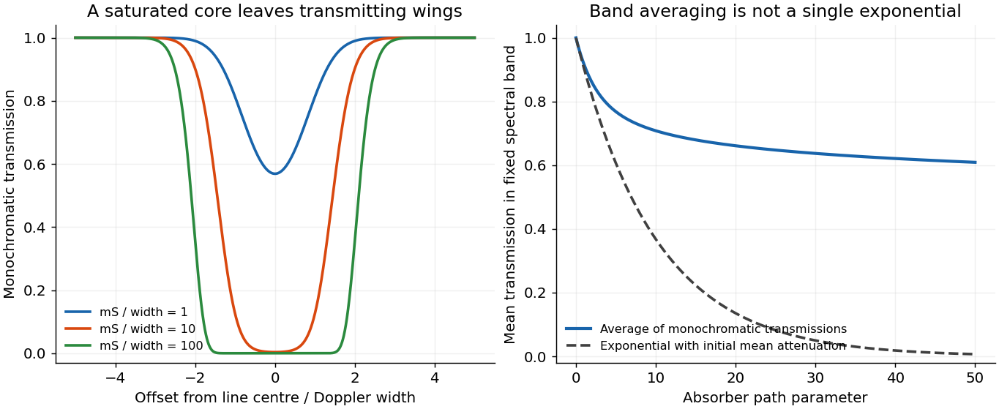

<h1 id="1/b/solution">Solution</h1>

↑ **Parent:** [B](../b.md)

Let $m$ be the absorber [mass path](../../../../mass-path.md) along a ray. If the [spectral line profile](../../../../spectral-line-profile.md) is independent of position, [Beer-Lambert law](../../../../beer-lambert-law.md) gives $\mathfrak T_\nu(m)=e^{-m\kappa_\nu}$. A finite-band mean and the line's [equivalent width](../../../../equivalent-width.md) are respectively

$$
\boxed{\overline{\mathfrak T}_{\mathcal B}(m)=\frac1{\Delta\nu_{\mathcal B}}\int_{\mathcal B}e^{-mS\phi(\nu)}\,d\nu,
\qquad E(m)=\int_{-\infty}^{\infty}[1-e^{-mS\phi(\nu)}],d\nu.}
$$

When the band contains all significant [absorption](../../../../absorption-electromagnetic-radiation.md), $\int_{\mathcal B}\mathfrak T_\nu d\nu\simeq\Delta\nu_{\mathcal B}-E$. An unqualified integral of [transmission](../../../../transmittance.md) over the entire infinite line domain diverges because [transmission](../../../../transmittance.md) tends to one far from [line centre](../../../../spectral-line.md); $E$ is the finite and physically useful line deficit.

This is [nonexponential band transmission](../../../../nonexponential-band-transmission.md): each monochromatic [transmission](../../../../transmittance.md) is exponential, but their average generally is not. Differentiating with respect to [mass path](../../../../mass-path.md) gives

$$
\overline{\mathfrak T}'=-\langle\kappa e^{-m\kappa}\rangle_{\mathcal B}<0,
\qquad\overline{\mathfrak T}''=\langle\kappa^2e^{-m\kappa}\rangle_{\mathcal B}>0.
$$

More decisively, define the [absorption coefficient](../../../../absorption-coefficient.md) averaged over the transmitted spectrum by

$$
a_{\rm eff}(m)=-\frac{d\log\overline{\mathfrak T}}{dm}
=\frac{\langle\kappa e^{-m\kappa}\rangle}{\langle e^{-m\kappa}\rangle}.
$$

Then $\boxed{a_{\rm eff}'(m)=-\operatorname{Var}_{m}(\kappa)\le0}$. The core saturates first and the surviving radiation increasingly samples weakly absorbing wings. The effective attenuation per additional mass therefore decreases. [Jensen's inequality](../../../../jensen-s-inequality.md) also gives $\overline{\mathfrak T}\ge e^{-m\langle\kappa\rangle}$, with equality for a spectrally constant coefficient. Thus the band [transmission](../../../../transmittance.md) decays more slowly than the exponential with its initial mean attenuation.

The corresponding [curve of growth](../../../../curve-of-growth.md) has $E(m)\simeq mS$ for an optically weak line, and sublinear growth after saturation. For the [Gaussian profile](../../../../thermal-doppler-broadening.md), with $\tau_0=mS/(\sqrt\pi\Delta_D)\gg1$, [absorption](../../../../absorption-electromagnetic-radiation.md) extends to $|\delta\nu|\simeq\Delta_D\sqrt{\log\tau_0}$, so $E\sim2\Delta_D\sqrt{\log\tau_0}$. For a strongly saturated pure [Lorentz profile](../../../../lorentzian-line-shape.md) the wings instead give $E\sim2\sqrt{mS\Delta_L}$. These asymptotes apply while the line remains isolated and its important wings remain within the range where the assumed profile and nearly constant [Planck function](../../../../planck-function.md) are appropriate. The integrated [absorption](../../../../absorption-electromagnetic-radiation.md) is not an exponential either: $E'>0$ and $E''\le0$.

**[Figure 1](#1/b/image-line-saturation-produces-nonexponential-band-transmission). Line saturation produces nonexponential band transmission**. An original fixed Gaussian line example shows its opaque core expanding with absorber path. The mean transmission across a fixed band remains above the single exponential determined by its initial mean attenuation.

## ↑ Ancestors (12)

1. [B](../b.md)
2. [1](../../1.md)
3. [2017](../../../2017-split.md)
4. [Past exam of the physics of atmospheres and oceans course of the University of Oxford](../../../split.md)
5. [Physics of atmospheres and oceans course of the University of Oxford](../../../../physics-of-atmospheres-and-oceans-course-of-the-university-of-oxford.md)
6. [Year 4 of the physics course of the University of Oxford](../../../../year-4-of-the-physics-course-of-the-university-of-oxford.md)
7. [Physics course of the University of Oxford](../../../../physics-course-of-the-university-of-oxford.md)
8. [Undergraduate course of the University of Oxford](../../../../undergraduate-course-of-the-university-of-oxford.md)
9. [Course of the University of Oxford](../../../../course-of-the-university-of-oxford.md)
10. [University of Oxford](../../../../university-of-oxford-split.md)
11. [List of universities](../../../../list-of-universities.md)
12. [Codex Wiki](../../../../split.md)
