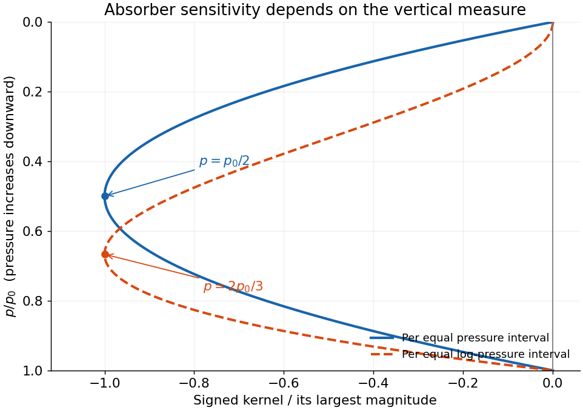

<h1 id="4/c/solution">Solution</h1>

↑ **Parent:** [C](../c.md)

A [hydrostatic](../../../../hydrostatic-equilibrium.md) [pressure](../../../../pressure-split.md) interval contains $dp/(gM)$ moles of background gas per area. Its absorbing column is $x(p)\,dp/(gM)$, so for a nadir ray

$$
d\tau=\frac{k_0x(p)}{p_0gM}\,p\,dp,
\qquad \mathfrak T(p)=e^{-\tau(p)}.
$$

The assumed Planck-temperature power and [dry adiabat](../../../../dry-adiabat.md) give $B(p)/B_0=[T(p)/T_0]^{3.5}=p/p_0$. To first order in [optical depth](../../../../optical-depth.md), $-d\mathfrak T\simeq d\tau$, and the [radiance](../../../../radiance.md) solution becomes

$$
\boxed{L\simeq B_0+\frac{k_0B_0}{p_0gM}\int_0^{p_0}
 x(p)\left(\frac p{p_0}-1\right)p\,dp.}
$$

For a uniform mixing ratio this also evaluates to $L\simeq B_0[1-k_0xp_0/(6gM)]$. Its total [optical depth](../../../../optical-depth.md) is $\tau_0=k_0xp_0/(2gM)$, so the deficit is $B_0\tau_0/3$.

A pressure-resolved perturbation defines the [infrared absorber sensitivity kernel](../../../../infrared-absorber-sensitivity-kernel.md) by $\delta L=\int K_p(p)\delta x(p)\,dp$, with

$$
\boxed{K_p(p)=\frac{k_0B_0}{p_0gM}p\left(\frac p{p_0}-1\right).}
$$

It is zero at the top, negative in the interior, and zero again at the surface. The magnitude is largest where $dK_p/dp=0$, namely

$$
\boxed{p_{\rm strongest}=p_0/2,\qquad K_p(p_0/2)=-\frac{k_0B_0}{4gM}.}
$$

**Sign and coordinate qualification.** Literally the maximum of the signed kernel is zero at the endpoints; $p_0/2$ is its minimum and the maximum of its absolute value. The derivative with respect to a single vertically uniform $x$ is the integrated constant $-k_0B_0p_0/(6gM)$ and has no [pressure](../../../../pressure-split.md) location. For equal-width logarithmic [pressure](../../../../pressure-split.md) perturbations the kernel is instead $K_{\log p}=pK_p$ and its magnitude peaks at $2p_0/3$. The stated pressure-interval convention is therefore essential.

**[Figure 2](#4/c/image-signed-infrared-absorber-sensitivity-per-pressure-interval-and-per-logarithmic-pressure-interval). Signed infrared absorber sensitivity per pressure interval and per logarithmic pressure interval**. Original normalized kernels vanish at the top and surface. The pressure-interval kernel reaches its most negative value at half the surface pressure; logarithmic-pressure weighting moves the largest-magnitude sensitivity to two thirds of the surface pressure.

The low top-of-atmosphere sensitivity reflects the small pressure-broadened [absorption coefficient](../../../../absorption-coefficient.md) and small molecular column per $dp$ there; the low surface sensitivity reflects small thermal contrast. The printed phrase that [temperature](../../../../temperature-split.md) decreases with [pressure](../../../../pressure-split.md) reverses the actual stipulated relation: with positive exponent, [temperature](../../../../temperature-split.md) decreases as [pressure](../../../../pressure-split.md) decreases upward. The derivation uses the explicit adiabatic formula.

## ↑ Ancestors (12)

1. [C](../c.md)
2. [4](../../4.md)
3. [2017](../../../2017-split.md)
4. [Past exam of the physics of atmospheres and oceans course of the University of Oxford](../../../split.md)
5. [Physics of atmospheres and oceans course of the University of Oxford](../../../../physics-of-atmospheres-and-oceans-course-of-the-university-of-oxford.md)
6. [Year 4 of the physics course of the University of Oxford](../../../../year-4-of-the-physics-course-of-the-university-of-oxford.md)
7. [Physics course of the University of Oxford](../../../../physics-course-of-the-university-of-oxford.md)
8. [Undergraduate course of the University of Oxford](../../../../undergraduate-course-of-the-university-of-oxford.md)
9. [Course of the University of Oxford](../../../../course-of-the-university-of-oxford.md)
10. [University of Oxford](../../../../university-of-oxford-split.md)
11. [List of universities](../../../../list-of-universities.md)
12. [Codex Wiki](../../../../split.md)
