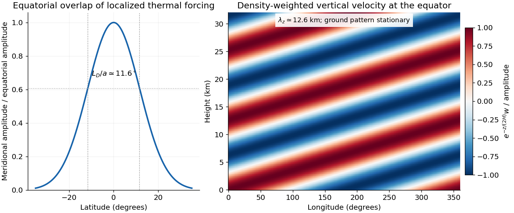

<h1 id="5/d/solution">Solution</h1>

↑ **Parent:** [D](../d.md)

Apply the intended, corrected [dispersion relation](../../../../dispersion-relation-split.md) in [c](../c.md). A uniform mean zonal wind gives $\omega_{\rm ground}=\widehat\omega+kU$. Stationarity with $U=-20\,\mathrm{m\,s^{-1}}$ therefore requires eastward intrinsic [phase speed](../../../../phase-velocity.md) $\widehat\omega/k=-U=20\,\mathrm{m\,s^{-1}}$. With $k=1/a$,

$$
|m|=\left[\frac{N^2}{20^2}-\frac1{a^2}-\frac1{4H^2}\right]^{1/2}
\simeq4.975\times10^{-4}\,\mathrm{m^{-1}},
\qquad\boxed{\lambda_z=\frac{2\pi}{|m|}\simeq12.6\,\mathrm{km}.}
$$

The period determines $\Omega=2\pi/(24.4\times3600\,\mathrm s)$ and $\beta=2\Omega/a\simeq4.21\times10^{-11}\,\mathrm{m^{-1}\,s^{-1}}$. Hence

$$
\boxed{L_D=\sqrt{20/\beta}\simeq6.89\times10^5\,\mathrm m,\qquad
L_D/a\simeq0.203\,\mathrm{rad}\simeq11.6^\circ.}
$$

**[Figure 3](#5/d/image-equatorial-trapping-and-vertical-phase-of-the-stationary-martian-kelvin-wave-example). Equatorial trapping and vertical phase of the stationary Martian Kelvin-wave example**. The original calculation uses an eastward intrinsic speed of 20 metres per second. The Gaussian amplitude has a latitude scale of 11.6 degrees; the density-weighted vertical velocity has a vertical wavelength of 12.6 kilometres. The plotted negative vertical wavenumber corresponds to upward intrinsic energy propagation.

A storm within roughly $12^\circ$ of the equator has substantial projection on the [Gaussian](../../../../normal-distribution.md) mode. There is no sharp [latitude](../../../../geographical-latitude.md) cutoff: $|y|=L_D$ gives amplitude $e^{-1/2}$ and the $1/e$ amplitude [latitude](../../../../geographical-latitude.md) is about $16.4^\circ$. Forcing outside that core has progressively weaker overlap.

The intrinsic wave is eastward even though its observed ground pattern is stationary; westward advection cancels its [phase propagation](../../../../phase-velocity.md). Its intrinsic period is about $12.4$ [Earth](../../../../earth.md) days. The inferred $|m|\gg1/(2H)$ puts it in the short-vertical-wavelength branch, well below the long-wave speed $2NH=200\,\mathrm{m\,s^{-1}}$. For upward [energy](../../../../energy-split.md) radiation, $\partial\widehat\omega/\partial m$ must be positive, which selects $m<0$ for positive $k,\widehat\omega$: vertical [phase propagation](../../../../phase-velocity.md) is then downward. Dust [absorption](../../../../absorption-electromagnetic-radiation.md) supplies [thermal forcing](../../../../diabatic-heating.md) with a zonally asymmetric component; the response does not imply that dust itself moves eastward at the intrinsic [phase speed](../../../../phase-velocity.md).

Southern spring to summer, the warmer perihelion-side dust season, is a reasonable climatological window for such a regional storm. This seasonal inference uses observed dust climatology, not the [dispersion relation](../../../../dispersion-relation-split.md): the specified wind and wave parameters alone do not determine a unique season, and individual regional storms can occur outside that window.[2016 report, discussion of the warmer southern spring and summer, perihelion near the end of southern spring, and the observed regional-storm sequence](../../../../nasa-mars-orbiters-reveal-seasonal-dust-storm-pattern.md)

## ↑ Ancestors (12)

1. [D](../d.md)
2. [5](../../5.md)
3. [2017](../../../2017-split.md)
4. [Past exam of the physics of atmospheres and oceans course of the University of Oxford](../../../split.md)
5. [Physics of atmospheres and oceans course of the University of Oxford](../../../../physics-of-atmospheres-and-oceans-course-of-the-university-of-oxford.md)
6. [Year 4 of the physics course of the University of Oxford](../../../../year-4-of-the-physics-course-of-the-university-of-oxford.md)
7. [Physics course of the University of Oxford](../../../../physics-course-of-the-university-of-oxford.md)
8. [Undergraduate course of the University of Oxford](../../../../undergraduate-course-of-the-university-of-oxford.md)
9. [Course of the University of Oxford](../../../../course-of-the-university-of-oxford.md)
10. [University of Oxford](../../../../university-of-oxford-split.md)
11. [List of universities](../../../../list-of-universities.md)
12. [Codex Wiki](../../../../split.md)
