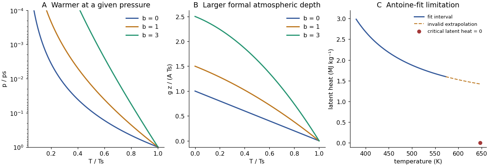
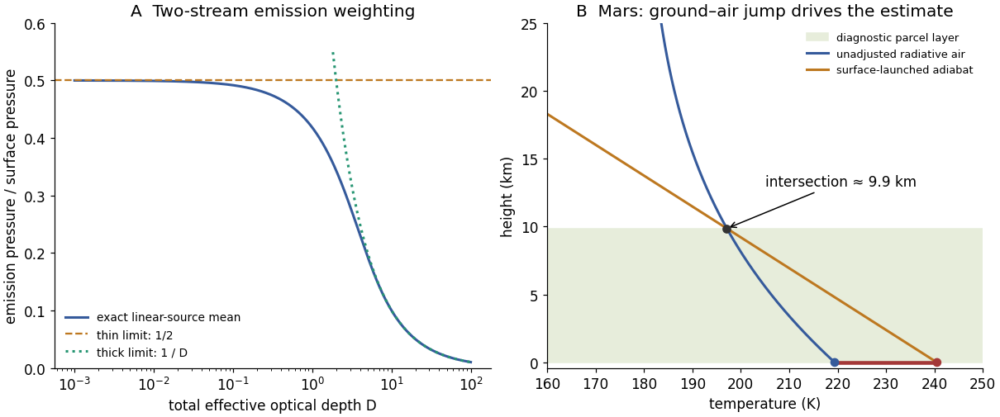
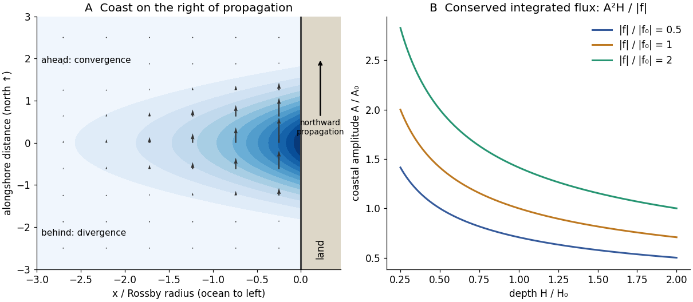
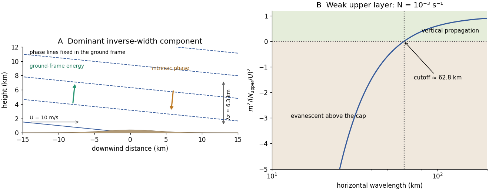

# 2018

↑ **Parent:** [Past exam of the physics of atmospheres and oceans course of the University of Oxford](../past-exam-of-the-physics-of-atmospheres-and-oceans-course-of-the-university-of-oxford.md)

Source paper: [https://www.whatdotheyknow.com/request/oxford_physics_past_papers_2/response/2340696/attach/6/Physics%20Papers%202017.pdf?cookie_passthrough=1#page=52](https://www.whatdotheyknow.com/request/oxford_physics_past_papers_2/response/2340696/attach/6/Physics%20Papers%202017.pdf?cookie_passthrough=1#page=52)

The original cover identifies 13 June 2018 despite the bundle filename. All six questions and both inline branches are treated. Optical-depth, phase-[velocity](../classical-mechanics.md#velocity) and growth-model conventions are stated where they affect the result.

**Table of contents**

- [1](#1)
  - [a](#1/a)
    - [Solution](#1/a/solution)
  - [b](#1/b)
    - [Solution](#1/b/solution)
  - [c](#1/c)
    - [Solution](#1/c/solution)
- [2](#2)
  - [a](#2/a)
    - [Solution](#2/a/solution)
  - [b](#2/b)
    - [Solution](#2/b/solution)
  - [c](#2/c)
    - [Solution](#2/c/solution)
  - [d](#2/d)
    - [Solution](#2/d/solution)
- [3](#3)
  - [a](#3/a)
    - [Solution](#3/a/solution)
  - [b](#3/b)
    - [Solution](#3/b/solution)
  - [c](#3/c)
    - [Solution](#3/c/solution)
  - [d](#3/d)
    - [Solution](#3/d/solution)
- [4](#4)
  - [a](#4/a)
    - [Solution](#4/a/solution)
  - [b](#4/b)
    - [Solution](#4/b/solution)
  - [c](#4/c)
    - [Solution](#4/c/solution)
  - [d](#4/d)
    - [Solution](#4/d/solution)
- [5](#5)
  - [a](#5/a)
    - [Solution](#5/a/solution)
  - [b](#5/b)
    - [Solution](#5/b/solution)
  - [c](#5/c)
    - [Solution](#5/c/solution)
  - [d](#5/d)
    - [Solution](#5/d/solution)
  - [e](#5/e)
    - [i](#5/e/i)
      - [Solution](#5/e/i/solution)
    - [ii](#5/e/ii)
      - [Solution](#5/e/ii/solution)
- [6](#6)
  - [a](#6/a)
    - [Solution](#6/a/solution)
  - [b](#6/b)
    - [Solution](#6/b/solution)
  - [c](#6/c)
    - [Solution](#6/c/solution)
  - [d](#6/d)
    - [Solution](#6/d/solution)

## 1

↑ **Parent:** [2018](2018.md)

<h3 id="1/a">a</h3>

↑ **Parent:** [1](#1)

<h4 id="1/a/solution">Solution</h4>

↑ **Parent:** [A](#1/a)

For an [ideal gas](../ideal-gas.md) of fixed molecular composition, translational [energy](../energy.md) is supplemented by rotational, vibrational and eventually [electronic excitations](../atomic-physics.md#electronic-excitation) as their level spacings become thermally accessible. Activating more internal degrees of freedom generally increases the [heat capacity](../heat.md#heat-capacity). In a harmonic vibrational mode the contribution rises from nearly zero when $k_BT\ll\hbar\omega$ to its [classical limit](../quantum-mechanics.md#classical-limit) when $k_BT\gg\hbar\omega$; summing modes with different frequencies gives a smooth increase over an intermediate [temperature](../temperature.md) range.

A [monatomic gas](../ideal-gas.md#monatomic-gas) has no [molecular rotations](../molecule.md#molecular-rotation) or vibrations, so its [mass](../classical-mechanics.md#mass)-specific $c_p$ is nearly constant until [electronic excitation](../atomic-physics.md#electronic-excitation) or [ionization](../atomic-physics.md#ionization) becomes important: $B$ is then small. A simple [diatomic gas](../ideal-gas.md#diatomic-gas) can also have a small slope when its rotations are already active but its vibrational modes remain frozen. Large flexible polyatomic molecules have many internal modes, often with relatively low excitation energies, and can give a larger slope over their activation range.

The linear law is a local approximation, not an asymptotic result. A finite set of modes approaches finite classical heat-capacity contributions, whereas $A+BT$ grows without bound. At still higher [temperatures](../temperature.md) dissociation and [ionization](../atomic-physics.md#ionization) change the composition and gas constant, invalidating the fixed-molecule ideal-gas model as well. The constants have units $[A]=\mathrm{J\,kg^{-1}\,K^{-1}}$ and $[B]=\mathrm{J\,kg^{-1}\,K^{-2}}$.

<h3 id="1/b">b</h3>

↑ **Parent:** [1](#1)

<h4 id="1/b/solution">Solution</h4>

↑ **Parent:** [B](#1/b)

Take the [convection](../convection.md) to maintain a dry, nearly reversible [adiabat](../first-law-of-thermodynamics.md#adiabat), with [specific gas constant](../ideal-gas.md#specific-gas-constant) $R$. [Hydrostatic equilibrium](../statistical-physics.md#hydrostatic-equilibrium) and an ideal-gas [equation of state](../pressure.md#equation-of-state) will be used separately to convert [pressure](../pressure.md) to height. For an adiabatic displacement, the [first law of thermodynamics](../first-law-of-thermodynamics.md) in [enthalpy](../enthalpy.md) form gives

$$
c_p(T)\,dT-\frac{dp}{\rho}=0,\qquad
\frac{A+BT}{T}\,dT=R\frac{dp}{p}.
$$

The [adiabat with linear heat capacity](../first-law-of-thermodynamics.md#adiabat-with-linear-heat-capacity) follows by integrating from the surface: this gives the monotone implicit [temperature](../temperature.md)–[pressure](../pressure.md) relation

$$
\boxed{A\ln\frac{T}{T_s}+B(T-T_s)=R\ln\frac p{p_s}.}
$$

An explicit form, using the positive real Lambert W branch, is

$$
\boxed{T(p)=\frac AB W_0\left[\frac{BT_s}{A}e^{BT_s/A}
\left(\frac p{p_s}\right)^{R/A}\right]\quad(B>0).}
$$

As $B\to0$, $T=T_s(p/p_s)^{R/A}$. At fixed $p<p_s$,

$$
\left.\frac{\partial T}{\partial B}\right|_p
=\frac{T_s-T}{A/T+B}>0.
$$

Larger [heat capacity](../heat.md#heat-capacity) therefore keeps the upper atmosphere warmer at the same [pressure](../pressure.md). Equivalently $d\ln T/d\ln p=R/(A+BT)$ becomes smaller. The original normalized sketch below shows the resulting family of profiles; no particular gas constants or surface [temperature](../temperature.md) are assumed there.

The height equations are

$$
\boxed{\frac{dp}{dz}=-\rho g=-\frac{pg}{RT},\qquad
\frac{dT}{dz}=-\frac g{A+BT}.}
$$

Integrating the latter gives

$$
gz=A(T_s-T)+\frac B2(T_s^2-T^2),\qquad
T(z)=\frac{\sqrt{(A+BT_s)^2-2Bgz}-A}{B}.
$$

The physically selected root starts at $T_s$ and decreases. Its formal upper boundary is

$$
\boxed{z_* =\frac{AT_s+BT_s^2/2}{g}.}
$$

At that height $T\to0$ and $p=p_s(T/T_s)^{A/R}e^{B(T-T_s)/R}\to0$. The $B=0$ limit is $z_*=AT_s/g$. This finite-height zero is a property of the assumed polytropic-like model, not a claim that a real atmosphere reaches [absolute zero](../temperature.md#absolute-zero): molecular heat capacities, composition, transport and the continuum ideal-gas description cease to support that extrapolation.

**[Figure 1](#1/b/image-adiabats-with-increasing-heat-capacity-and-the-limited-temperature-latent-heat-inferred-from-an-antoine-fit). Adiabats with increasing heat capacity and the limited-temperature latent heat inferred from an Antoine fit**. Original calculations. Adiabats use dimensionless parameters $R/A=2/7$ and $b=BT_s/A$; the latent-heat plot distinguishes the stated fit range from an invalid extrapolation toward the known critical point.

<h3 id="1/c">c</h3>

↑ **Parent:** [1](#1)

<h4 id="1/c/solution">Solution</h4>

↑ **Parent:** [C](#1/c)

Rename the [Antoine equation](../thermodynamic-potential.md#antoine-equation) coefficients $A_A,B_A,C_A$ to distinguish them from the heat-capacity constants. The logarithmic slope is independent of the [pressure](../pressure.md) unit:

$$
\frac{d\ln p_{\rm sat}}{dT}=\ln(10)\frac{B_A}{(T+C_A)^2}.
$$

Using an ideal vapour and neglecting liquid specific volume, Clausius–Clapeyron gives $d\ln p_{\rm sat}/dT=L_v/(R_vT^2)$. Therefore the positive magnitude of the [latent heat](../thermodynamic-potential.md#latent-heat) released on [condensation](../critical-phenomenon.md#condensation) is

$$
\boxed{L_v(T)=R_v\ln(10)B_A\left(\frac{T}{T+C_A}\right)^2.}
$$

For $C_A=-198.043\,\mathrm K$, $d\ln L_v/dT=2C_A/[T(T+C_A)]<0$ over the quoted range. With $R_v\simeq461.5\,\mathrm{J\,kg^{-1}\,K^{-1}}$, this fit implies approximately $2.984\,\mathrm{MJ\,kg^{-1}}$ at $380\,\mathrm K$ and $1.598\,\mathrm{MJ\,kg^{-1}}$ at $573\,\mathrm K$. The required ratio does not depend on $R_v$:

$$
\boxed{\frac{L_v(573)}{L_v(380)}=
\left[\frac{573(380-198.043)}{380(573-198.043)}\right]^2\simeq0.5354.}
$$

The decreasing trend is qualitatively consistent with the liquid and vapour phases becoming less distinct towards the [liquid-gas critical point](../critical-phenomenon.md#liquid-gas-critical-point). However, the full Clapeyron relation is $L_v=T(v_v-v_l)\,dp_{\rm sat}/dT$: at criticality the two specific volumes merge and the [latent heat](../thermodynamic-potential.md#latent-heat) vanishes. Neglecting $v_l$ and treating the vapour as ideal then fail. The Antoine coefficients are not licensed for extrapolation beyond $573\,\mathrm K$, and [derivatives](../calculus.md#derivative) of an approximate [pressure](../pressure.md) fit can be less accurate than the fitted [pressures](../pressure.md) themselves.

A concrete check exposes the extrapolation failure: at the supplied $647\,\mathrm K$ critical [temperature](../temperature.md) the formula would still give $L_v\simeq1.42\,\mathrm{MJ\,kg^{-1}}$, rather than zero, and $p_{\rm sat}\simeq134\,\mathrm{bar}$ rather than $221\,\mathrm{bar}$. Above the true [liquid-gas critical point](../critical-phenomenon.md#liquid-gas-critical-point) there is no liquid–vapour coexistence curve or [condensation](../critical-phenomenon.md#condensation) [latent heat](../thermodynamic-potential.md#latent-heat) in the same sense. The last panel of the original figure in [solution](#1/b/solution) makes this limitation visible.

## 2

↑ **Parent:** [2018](2018.md)

<h3 id="2/a">a</h3>

↑ **Parent:** [2](#2)

<h4 id="2/a/solution">Solution</h4>

↑ **Parent:** [A](#2/a)

Use downward [optical depth](../astrophysics.md#optical-depth) $t$ measured from the top, with total $D=\tau_\infty$. This is the effective optical-depth/[two-stream](../astrophysics.md#two-stream-approximation) convention that gives an attenuation factor $e^{-t}$. Constant absorption per unit [mass](../classical-mechanics.md#mass) and constant gravity give $t=Dp/p_s$. Write the locally emitted flux source as $S(t)=\pi B(t)=S_0+bt$.

The atmospheric contribution to upward outgoing longwave flux is

$$
F_{\rm atm}=\int_0^D S(t)e^{-t}\,dt
=S_0(1-e^{-D})+b[1-(D+1)e^{-D}].
$$

Because the source is linear, the [effective emission pressure](../astrophysics.md#effective-emission-pressure) makes this exactly $(1-e^{-D})S(t_{\rm eff})$, where

$$
\boxed{t_{\rm eff}=\frac{1-(D+1)e^{-D}}{1-e^{-D}}
=1-\frac{D}{e^D-1},\qquad
p_{\rm rad}=\frac{p_s}{D}t_{\rm eff}.}
$$

Thus for $D\gg1$, $t_{\rm eff}\to1$ and $p_{\rm rad}\simeq p_s/D$. For $D\ll1$, expansion gives $t_{\rm eff}=D/2-D^2/12+O(D^4)$, so $p_{\rm rad}\simeq p_s/2$. In the thin limit $F_{\rm atm}\simeq D\,\pi B(p_s/2)$: it is the small atmospheric contribution, not the whole outgoing flux, which this level characterizes. Surface radiation transmitted through the column must be added separately.

**Angular convention:** these numerical coefficients use an effective [optical depth](../astrophysics.md#optical-depth). If $t$ instead means literal vertical monochromatic [optical depth](../astrophysics.md#optical-depth) and the angular [integral](../integral.md) is retained exactly, the flux weight is $2E_2(t)$, not $e^{-t}$. Its thick-limit mean depth is $2/3$, giving $p_{\rm rad}\simeq2p_s/(3D)$ for a linear source. The coefficient one in the requested expression therefore specifies a [two-stream/diffusivity](../astrophysics.md#two-stream-approximation) convention; it is not an angle-independent identity. The thin-limit half-column result survives to leading order.

<h3 id="2/b">b</h3>

↑ **Parent:** [2](#2)

<h4 id="2/b/solution">Solution</h4>

↑ **Parent:** [B](#2/b)

The incident stellar power is intercepted over a disk and distributed over the spherical surface. With a black shortwave surface, no [clouds](../geophysics.md#cloud) and no shortwave atmospheric absorption, the global mean absorbed flux is $F_*=L_{\circledast}/4$. Define $T_e=(F_*/\sigma)^{1/4}$.

To relate a radiating-level [temperature](../temperature.md) to the ground, assume the intervening well-mixed gas follows a [dry adiabat](../first-law-of-thermodynamics.md#adiabatic-process) with constant $R_g,c_{pg}$:

$$
T(p)=T_s\left(\frac p{p_s}\right)^{\kappa_g},\qquad\kappa_g=\frac{R_g}{c_{pg}}.
$$

Emission from $p_{\rm rad}$ balances absorbed sunlight when $\sigma T(p_{\rm rad})^4=F_*$. Hence

$$
\boxed{T_s=\left(\frac{L_{\circledast}}{4\sigma}\right)^{1/4}
\left(\frac{p_s}{p_{\rm rad}}\right)^{R_g/c_{pg}}
\simeq T_e\tau_\infty^{R_g/c_{pg}}.}
$$

The final form uses the optically thick result in part (a). Since $p_{\rm rad}<p_s$, the surface is warmer than the effective emission [temperature](../temperature.md). Efficient horizontal redistribution alone does not mathematically fix the vertical lapse rate: the adiabatic/convective assumption is needed to obtain the requested dependence on $R_g/c_{pg}$. A different imposed vertical profile would give a different relation.

<h3 id="2/c">c</h3>

↑ **Parent:** [2](#2)

<h4 id="2/c/solution">Solution</h4>

↑ **Parent:** [C](#2/c)

Assume the added gas mixes throughout the convective column and retain constant [mass absorption coefficient](../astrophysics.md#mass-absorption-coefficient) for the original gas. The original absorber column [mass](../classical-mechanics.md#mass) is unchanged, so its total effective [optical depth](../astrophysics.md#optical-depth) $D=\tau_\infty$ is unchanged. Under [transparent-gas addition at fixed absorber mass](../astrophysics.md#transparent-gas-addition-at-fixed-absorber-mass), the absorber [mass](../classical-mechanics.md#mass) fraction becomes $q=p_s/p_a$, and consequently $t=Dp/p_a$. The new radiating [pressure](../pressure.md) is $p_{{\rm rad},a}\simeq p_a/D$, even though the ratio of surface to radiating [pressure](../pressure.md) stays $D$.

The mixture's [mass](../classical-mechanics.md#mass)-specific constants are

$$
R_a=\frac{p_sR_g+(p_a-p_s)R_t}{p_a},\qquad
c_{pa}=\frac{p_sc_{pg}+(p_a-p_s)c_{pt}}{p_a}.
$$

These [pressure](../pressure.md) weights represent column [mass](../classical-mechanics.md#mass) fractions, not mole fractions. Repeating the adiabatic argument gives

$$
\boxed{T_{s,a}=T_eD^{R_a/c_{pa}}\simeq T_eD^{R_t/c_{pt}}\quad(p_a\gg p_s).}
$$

At fixed $D>1$, this is warmer than the original surface precisely if

$$
\boxed{\frac{R_a}{c_{pa}}>\frac{R_g}{c_{pg}}
\quad\Longleftrightarrow\quad\frac{R_t}{c_{pt}}>\frac{R_g}{c_{pg}}.}
$$

The equivalence follows by cross multiplication of the positive heat capacities; it holds for any positive added [mass](../classical-mechanics.md#mass). If the two ratios agree, adding a transparent gas leaves this model's surface [temperature](../temperature.md) unchanged. Increased total [pressure](../pressure.md) alone is not a new opacity in a model that fixes absorber [mass](../classical-mechanics.md#mass) and [mass absorption coefficient](../astrophysics.md#mass-absorption-coefficient). [Pressure broadening](../stellar-astrophysics.md#pressure-broadening) or [collision-induced absorption](../astrophysics.md#collision-induced-absorption-and-emission) could change the answer in a more realistic atmosphere, but neither is part of the stated constant-opacity model.

<h3 id="2/d">d</h3>

↑ **Parent:** [2](#2)

<h4 id="2/d/solution">Solution</h4>

↑ **Parent:** [D](#2/d)

Let $D\ll1$ be the remaining absorber [optical depth](../astrophysics.md#optical-depth), and retain the mixture's convective exponent $\kappa_a=R_a/c_{pa}$. The outgoing surface contribution is $\sigma T_s^4e^{-D}\simeq\sigma T_s^4(1-D)$. To first order, atmospheric emission is the column-mean source times $D$. If $4\kappa_a\simeq1$, the [adiabat](../first-law-of-thermodynamics.md#adiabat) gives $T(p)^4\simeq T_s^4p/p_a$, a source linear in mass/optical depth. Therefore its mean is $T_s^4/2$, or equivalently it is evaluated at $p_a/2$:

$$
F_{\rm out}\simeq\sigma T_s^4(1-D)+D\sigma T_s^4/2
=\sigma T_s^4(1-D/2).
$$

Setting this equal to $L_{\circledast}/4$ gives

$$
\boxed{T_s\simeq\left[\frac{L_{\circledast}}{2\sigma(2-\tau_\infty)}\right]^{1/4}.}
$$

The zero-opacity limit correctly gives $T_e$, while a small positive opacity raises the surface [temperature](../temperature.md) slightly. The expression is a first-order thin-column result, not a formula to extend to its apparent pole at $\tau_\infty=2$. More generally, direct thin-column averaging gives $F_{\rm atm}\simeq D\sigma T_s^4/(1+4\kappa_a)$; the half-column value is exact at this order when $4\kappa_a=1$. The assumed convective thermal structure remains a modelling condition even when the gas becomes radiatively thin.

## 3

↑ **Parent:** [2018](2018.md)

<h3 id="3/a">a</h3>

↑ **Parent:** [3](#3)

<h4 id="3/a/solution">Solution</h4>

↑ **Parent:** [A](#3/a)

$I_+$ and $I_-$ are the positive upward and downward hemispherically integrated infrared fluxes, in $\mathrm{W\,m^{-2}}$, rather than directional specific intensities. The source is the [blackbody](../astrophysics.md#blackbody) hemispheric flux $\sigma T^4$. Absorption removes a fraction proportional to the flux along a ray, and thermal emission replaces it according to Kirchhoff's law. [Local thermodynamic equilibrium](../astrophysics.md#local-thermodynamic-equilibrium) sets that emission source to the local [Planck function](../astrophysics.md#planck-function).

A plane-parallel, non-scattering, [gray atmosphere](../astrophysics.md#grey-atmosphere) with a [two-stream/angular closure](../astrophysics.md#two-stream-approximation) reduces the angle- and frequency-dependent transfer equation to these two flux equations. The angular path factors are absorbed into the _effective_ [optical depth](../astrophysics.md#optical-depth). Since the supplied coordinate increases upwards, the upward flux loses $I_+\,d\tau$ while gaining $\sigma T^4d\tau$ in moving upward; the downward ray traverses the coordinate in the opposite direction, reversing the differential signs in its equation. The equations therefore encode emission as well as absorption and are consistent with an isothermal source approaching [thermal radiation](../electromagnetic-radiation.md#thermal-radiation) in an optically thick medium. The source's use of “[radiance](../radiometry.md#radiance)” for these integrated quantities should not introduce an extra factor of $\pi$.

<h3 id="3/b">b</h3>

↑ **Parent:** [3](#3)

<h4 id="3/b/solution">Solution</h4>

↑ **Parent:** [B](#3/b)

Assume the atmosphere is transparent to incoming shortwave radiation, as required for the stated infrared-only radiative-equilibrium model. Global [energy](../energy.md) balance gives

$$
\boxed{L_\infty=\frac{(1-\alpha)L_{\circledast}}4.}
$$

Put $D=\tau_\infty$ and $F=I_+-I_-$. [Radiative equilibrium](../heat.md#radiative-equilibrium) requires $dF/d\tau=0$, hence the two equations imply $I_++I_-=2\sigma T^4$. Substitution gives $dI_+/d\tau=dI_-/d\tau=-F/2$. At the top there is no incident infrared flux, $I_-(D)=0$, and $I_+(D)=F=L_\infty$. Therefore

$$
\boxed{I_+(\tau)=L_\infty\left[1+\frac{D-\tau}{2}\right],\qquad
I_-(\tau)=\frac{L_\infty}{2}(D-\tau).}
$$

The black ground supplies $I_+(0)=\sigma T_g^4$. Thus

$$
\boxed{L_\infty=\frac{2\sigma T_g^4}{2+\tau_\infty}.}
$$

The ground also satisfies $\sigma T_g^4=L_\infty+I_-(0)$, showing explicitly that its outgoing flux balances absorbed sunlight plus downward atmospheric radiation. In pure [radiative equilibrium](../heat.md#radiative-equilibrium) the air just above the ground need not have the ground's [temperature](../temperature.md): $\sigma T(0)^4=L_\infty(1+D)/2$, whereas $\sigma T_g^4=L_\infty(2+D)/2$. That discontinuity is relevant to surface-driven [convection](../convection.md) in part (d).

<h3 id="3/c">c</h3>

↑ **Parent:** [3](#3)

<h4 id="3/c/solution">Solution</h4>

↑ **Parent:** [C](#3/c)

Adding the two flux solutions gives

$$
\sigma T(\tau)^4=\frac{L_\infty}{2}(1+D-\tau).
$$

The supplied [pressure](../pressure.md)–optical-depth law gives $D-\tau=Dp/p_0$. With the exponential [pressure](../pressure.md) model $p=p_0e^{-z/H}$,

$$
\boxed{T(z)=T_\infty\left(1+ae^{-z/H}\right)^{1/4},\quad
T_\infty=\left(\frac{L_\infty}{2\sigma}\right)^{1/4},\quad a=\tau_\infty.}
$$

It approaches the finite atmospheric top [temperature](../temperature.md) $T_\infty$ and has the lowermost-air value $T(0)=T_\infty(1+D)^{1/4}$. Its lapse rate is

$$
-\frac{dT}{dz}=\frac{T(z)}{4H}\frac{De^{-z/H}}{1+De^{-z/H}}.
$$

The stated approximate sign is appropriate physically: a nonisothermal [ideal gas](../ideal-gas.md) does not have an exactly constant hydrostatic [scale height](../statistical-physics.md#scale-height) $R T/g$. Treating $H$ as a representative constant is an additional vertical-coordinate approximation. Algebraically the displayed profile is exact for the prescribed exponential [pressure](../pressure.md) and [two-stream](../astrophysics.md#two-stream-approximation) equations.

<h3 id="3/d">d</h3>

↑ **Parent:** [3](#3)

<h4 id="3/d/solution">Solution</h4>

↑ **Parent:** [D](#3/d)

The global mean absorbed solar flux is $L_\infty=0.8\times584/4=116.8\,\mathrm{W\,m^{-2}}$. Using $\sigma=5.6704\times10^{-8}\,\mathrm{W\,m^{-2}\,K^{-4}}$ gives

$$
\boxed{T_g\simeq240.5\,\mathrm K,\qquad T(0)\simeq219.4\,\mathrm K,\qquad T_\infty\simeq179.1\,\mathrm K.}
$$

For the requested graphical parcel estimate, start a [dry adiabat](../first-law-of-thermodynamics.md#adiabatic-process) at the warm ground, $T_{\rm ad}(z)=240.5-4.4z$ with $z$ in km, and intersect it with the radiative atmospheric profile $179.1[1+1.25e^{-z/10}]^{1/4}$. Solving gives

$$
\boxed{z_{\rm mix}\simeq9.9\,\mathrm{km},\qquad T(z_{\rm mix})\simeq197.1\,\mathrm K.}
$$

The original diagram below shows the intersection and the initial ground–air [temperature](../temperature.md) discontinuity. A parcel heated towards the ground [temperature](../temperature.md) remains buoyant until nearly one [scale height](../statistical-physics.md#scale-height) in this model.

The atmospheric radiative lapse rate itself is only about $3.05\,\mathrm{K\,km^{-1}}$ at the bottom and decreases with height, smaller than the stated adiabatic $4.4\,\mathrm{K\,km^{-1}}$. Thus the interior radiative atmosphere is statically stable; the driver of this particular estimate is the hotter ground and discontinuity at the lower boundary, not a radiative lapse rate everywhere steeper than adiabatic. [Convection](../convection.md) would smooth that discontinuity and redistribute [energy](../energy.md).

This is a diagnostic depth using the _unadjusted_ radiative ground and atmospheric [temperatures](../temperature.md), not a fully [energy](../energy.md)-conserving radiative–convective equilibrium after adjustment. A self-consistent adjustment changes the surface [temperature](../temperature.md), infrared fluxes and boundary height. [Mars](../astrophysics.md#mars) also has spectral CO$_2$ absorption, dust, day–night variation, seasonal changes and geographically uneven heating; a [gray](../astrophysics.md#grey-atmosphere), horizontally averaged, constant-scale-height column with fixed lapse rate captures none of those details. The calculation indicates the possible importance of a deep surface-driven mixed layer under the stated assumptions, not a universal Martian boundary-layer measurement.

**[Figure 2](#3/d/image-emission-weighting-and-a-diagnostic-surface-driven-mixed-layer-depth-in-the-gray-mars-model). Emission weighting and a diagnostic surface-driven mixed-layer depth in the gray Mars model**. Original calculations. The emission pressure is normalized by surface pressure; the Mars panel compares the unadjusted radiative atmosphere with the adiabat launched at its radiative ground temperature.

## 4

↑ **Parent:** [2018](2018.md)

<h3 id="4/a">a</h3>

↑ **Parent:** [4](#4)

<h4 id="4/a/solution">Solution</h4>

↑ **Parent:** [A](#4/a)

$S=e/e_s^l$ is the ambient [saturation ratio](../critical-phenomenon.md#saturation-ratio) over a flat liquid-[water](../chemical-substance.md#water) surface; $S-1$ is the liquid [atmospheric supersaturation](../critical-phenomenon.md#atmospheric-supersaturation). Curvature increases the surface equilibrium vapour [pressure](../pressure.md), producing the [Kelvin penalty](../thermodynamic-potential.md#kelvin-equation) $A/r$, while dissolved solute lowers it and gives the opposing [Raoult contribution](../mixture.md#raoult-s-law) $B/r^3$. Thus the dilute Köhler equilibrium curve is $S_{\rm eq}-1=A/r-B/r^3$, and the numerator is the [atmospheric supersaturation](../critical-phenomenon.md#atmospheric-supersaturation) available to drive growth beyond surface equilibrium.

$F_d^l$ describes the resistance of vapour [diffusion](../thermodynamics.md#diffusion) through the surrounding air. $F_k^l$ describes the [thermal-conduction](../heat.md#thermal-conduction) resistance to removing [latent heat](../thermodynamic-potential.md#latent-heat) released by [condensation](../critical-phenomenon.md#condensation): a warmed droplet surface has a higher equilibrium vapour [pressure](../pressure.md) and hence a weaker [mass](../classical-mechanics.md#mass)-transfer drive. Common [continuum approximations](../continuum-mechanics.md#continuum-approximation) are $F_d^l\simeq R_vT/(D_ve_s^l)$ and $F_k^l\simeq L_v[k_{\rm air}T]^{-1}[L_v/(R_vT)-1]$, showing the roles of [diffusivity](../brownian-motion.md#diffusion-coefficient), conductivity, [saturation pressure](../thermodynamic-potential.md#vapor-pressure) and [latent heat](../thermodynamic-potential.md#latent-heat). Both resistances have the supplied units $\mathrm{s\,m\,kg^{-1}}$ and add for this coupled transport problem.

For a spherical droplet of constant [density](../fluid-mechanics.md#density), $m=4\pi\rho r^3/3$. Multiplying the [radius](../topology.md#radius) equation by $4\pi\rho r$ gives

$$
\frac{dm}{dt}=\frac{4\pi r}{F_k^l+F_d^l}
\left[(S-1)-\frac Ar+\frac B{r^3}\right].
$$

At sufficiently large [radius](../topology.md#radius), curvature and solute corrections are negligible, so

$$
\boxed{\frac{dm}{dt}\simeq4\pi r\frac{S-1}{F_k^l+F_d^l}.}
$$

This limit also requires sustained positive [atmospheric supersaturation](../critical-phenomenon.md#atmospheric-supersaturation). It need not describe the earliest submicrometre stage or an unactivated haze particle.

<h3 id="4/b">b</h3>

↑ **Parent:** [4](#4)

<h4 id="4/b/solution">Solution</h4>

↑ **Parent:** [B](#4/b)

Use the large-[radius](../topology.md#radius) condensational-growth approximation from part (a), with fixed ambient [atmospheric supersaturation](../critical-phenomenon.md#atmospheric-supersaturation) and transport resistances. It gives

$$
\frac{d(r^2)}{dt}=\frac{2(S-1)}{\rho(F_k^l+F_d^l)},\qquad
\boxed{t=\frac{\rho(F_k^l+F_d^l)(r^2-r_0^2)}{2(S-1)}.}
$$

Taking $\rho=10^3\,\mathrm{kg\,m^{-3}}$, $S-1=0.01$, and negligible initial $r_0^2$ gives

$$
\boxed{t_a\simeq202.5\,\mathrm s\simeq3.4\,\mathrm{min},\qquad
 t_b\simeq9.0\times10^5\,\mathrm s\simeq10.4\,\mathrm{days}.}
$$

The squared-[radius](../topology.md#radius) law makes [condensation](../critical-phenomenon.md#condensation) relatively fast for reaching [cloud](../geophysics.md#cloud)-droplet sizes but far too slow for producing millimetre rain within a typical evolving [cloud](../geophysics.md#cloud). Collision–coalescence, or ice growth followed by aggregation/riming and melting, bypasses this bottleneck. In reality [atmospheric supersaturation](../critical-phenomenon.md#atmospheric-supersaturation) is shared by many particles and changes with ascent and vapour depletion, so even the constant-$1\%$ estimate is idealized.

These are growth times _after activation_, with negligible activation delay. The statement $r_0\ll1\,\mu\mathrm m$ alone does not ensure that a seed grows: for pure [water](../chemical-substance.md#water) with $B=0$, a seed with $r_0<A/(S-1)$ has a negative growth rate and shrinks. For soluble seeds the Köhler barrier depends on $A,B$ and the environmental [atmospheric supersaturation](../critical-phenomenon.md#atmospheric-supersaturation). The literal full-model time is

$$
t=\rho(F_k^l+F_d^l)\int_{r_0}^{r}\frac{r'\,dr'}{(S-1)-A/r'+B/r'^3},
$$

which cannot be assigned a unique initial-stage numerical value without those microphysical parameters. The two boxed estimates are the intended continuum [condensation](../critical-phenomenon.md#condensation) scales for activated droplets, rather than a claim that every arbitrarily small seed reaches those sizes.

<h3 id="4/c">c</h3>

↑ **Parent:** [4](#4)

<h4 id="4/c/solution">Solution</h4>

↑ **Parent:** [C](#4/c)

In the quasisteady [diffusion](../thermodynamics.md#diffusion) approximation, the vapour-[density](../fluid-mechanics.md#density) disturbance outside a small stationary particle satisfies [Laplace's equation](../partial-differential-equation.md#laplace-equation), with a specified equilibrium value on its surface and a uniform far-field value. This has the same mathematical boundary-value problem as the electrostatic potential outside a conductor held at fixed potential. The integrated normal gradient is proportional to the conductor's geometrical [capacitance](../critical-phenomenon.md#diffusion-capacitance-analogy).

Here $C$ is a _length_: a sphere of [radius](../topology.md#radius) $r$ has $C=r$. The corresponding electrical [capacitance](../electromagnetism.md#capacitance) in SI units would be $4\pi\epsilon_0C$, not $C$ farads. Replacing the spherical diffusive conductance $4\pi r$ by $4\pi C$ accounts for the crystal's non-spherical geometry. Coupling the analogous heat-conduction problem to vapour [diffusion](../thermodynamics.md#diffusion) supplies the ice-specific thermal and diffusional resistances.

The approximation assumes continuum [diffusion](../thermodynamics.md#diffusion), equilibration of the surface vapour concentration, an approximately isothermal particle, a slowly changing shape, weak perturbations and a far field sufficiently distant relative to the crystal size. It neglects ventilation by falling motion, interactions with neighbouring particles and facet-dependent attachment kinetics. Shape affects diffusive growth through [capacitance](../critical-phenomenon.md#diffusion-capacitance-analogy), not merely through projected collecting area as in a collision calculation.

<h3 id="4/d">d</h3>

↑ **Parent:** [4](#4)

<h4 id="4/d/solution">Solution</h4>

↑ **Parent:** [D](#4/d)

The target liquid-[water](../chemical-substance.md#water) [mass](../classical-mechanics.md#mass) is

$$
m_* =\frac{4\pi}{3}(10^3)(15\times10^{-6})^3
=1.414\times10^{-11}\,\mathrm{kg}.
$$

The [thin-plate ice-growth time](../critical-phenomenon.md#thin-plate-ice-growth-time) uses the prescribed ice [mass](../classical-mechanics.md#mass) law, which therefore requires $r_{i*}=(m_*/\alpha)^{1/3}=45.31\,\mu\mathrm m$, not the same [radius](../topology.md#radius) as the [water](../chemical-substance.md#water) droplet. With $C=2r_i/\pi$ and $F_i=F_k^i+F_d^i$,

$$
3\alpha r_i^2\frac{dr_i}{dt}=\frac{8r_i(S^i-1)}{F_i},\qquad
\frac{d(r_i^2)}{dt}=\frac{16(S^i-1)}{3\alpha F_i}.
$$

Hence, for negligible seed [mass](../classical-mechanics.md#mass) and constant conditions,

$$
\boxed{t_i=\frac{3\alpha F_i r_{i*}^2}{16(S^i-1)}
=\frac{3(152)(2.1\times10^7)(45.31\times10^{-6})^2}{16(0.05)}
\simeq24.6\,\mathrm s.}
$$

This is about $8.24$ times faster than the liquid estimate to the same [mass](../classical-mechanics.md#mass). Both laws have $dm/dt\propto m^{1/3}$ under the given shape assumptions. Ice benefits here from five times the [atmospheric supersaturation](../critical-phenomenon.md#atmospheric-supersaturation) and a larger geometrical [capacitance](../critical-phenomenon.md#diffusion-capacitance-analogy) for the same [mass](../classical-mechanics.md#mass), partly offset by its slightly greater transport resistance. The [mass](../classical-mechanics.md#mass) coefficient $\alpha$ encodes the assumed plate shape; replacing it by bulk ice [density](../fluid-mechanics.md#density) would change the supplied model.

In a mixed-phase [cloud](../geophysics.md#cloud), saturation vapour [pressure](../pressure.md) over ice is lower than over supercooled liquid [water](../chemical-substance.md#water). Air can therefore be subsaturated with respect to liquid yet supersaturated with respect to ice: droplets evaporate while ice crystals grow, transferring [water](../chemical-substance.md#water) through the vapour phase. This is the [Wegener–Bergeron–Findeisen mechanism](../geophysics.md#wegener-bergeron-findeisen-process). Subsequent aggregation, [riming](../geophysics.md#riming) and melting can produce [atmospheric precipitation](../geophysics.md#atmospheric-precipitation) much faster than [condensation](../critical-phenomenon.md#condensation) alone.

The large difference is not a universal fixed ice/liquid time ratio. [Atmospheric supersaturation](../critical-phenomenon.md#atmospheric-supersaturation) evolves, latent heating increases thermal resistance, crystal habits and [capacitance](../critical-phenomenon.md#diffusion-capacitance-analogy) change, and surface attachment or ventilation may matter. Ice nucleation and the availability of freezing nuclei also precede the calculated growth. The boxed time describes the specified already-present crystals under maintained conditions, not a complete prediction of the time until rain begins.

## 5

↑ **Parent:** [2018](2018.md)

<h3 id="5/a">a</h3>

↑ **Parent:** [5](#5)

<h4 id="5/a/solution">Solution</h4>

↑ **Parent:** [A](#5/a)

Place a straight coast at $x=0$, ocean at $x<0$, and impose no normal flow at the wall. A coastal Kelvin mode has $u=0$ throughout. The zonal momentum equation becomes $g\eta_x=f_0v$, while the remaining two equations are $v_t+g\eta_y=0$ and $\eta_t+Hv_y=0$. Eliminating $v$ gives

$$
\eta_{tt}=gH\eta_{yy}.
$$

For a northward disturbance $\eta=A(x)F(y-ct)$, the nontrivial solution has $c^2=gH$ and $v=(c/H)\eta$. In the northern hemisphere choose $c=+\sqrt{gH}$; then cross-shore [geostrophic balance](../mathematical-physics.md#geostrophic-balance) requires

$$
\frac{dA}{dx}=\frac{f_0}{c}A,\qquad
\boxed{A(x)=A_0e^{f_0x/c},\quad c=\sqrt{gH}.}
$$

It decays into this ocean half-plane because $x<0$ and $f_0>0$. The decay length is the external [Rossby deformation radius](../mathematical-physics.md#rossby-deformation-radius) $L_R=c/f_0$. A Fourier component has $\omega=ck$, so both phase and alongshore group speed are $c$, independent of [wavenumber](../wave-equation.md#wavenumber): the ideal shallow-[water](../chemical-substance.md#water) [Kelvin wave](../geophysical-fluid-dynamics.md#kelvin-wave) is nondispersive.

The signed choice is part of the [boundary condition](../differential-equation.md#boundary-condition). For ocean at $x>0$ in the same hemisphere, decay instead selects southward speed $-\sqrt{gH}$ and $A\propto e^{-f_0x/\sqrt{gH}}$. Without stating the ocean side, an exponential growth into the sea could be mistaken for a trapped coastal mode.

<h3 id="5/b">b</h3>

↑ **Parent:** [5](#5)

<h4 id="5/b/solution">Solution</h4>

↑ **Parent:** [B](#5/b)

In the northern hemisphere the coast is on the wave's right when looking in its direction of propagation. In the ocean-$x<0$ convention above it travels northward, with land east of the flow; for the opposite ocean side it travels southward. This follows from combining $g\eta_x=f_0v$ with a sea-level bulge that decreases offshore, rather than choosing propagation independently of trapping.

For a positive northward bulge, $v=(c/H)\eta$ is northward and strongest at its crest, and there is no cross-shore [velocity](../classical-mechanics.md#velocity) in the ideal mode. Ahead of the crest the current decreases northwards, so $v_y<0$: [horizontal flow convergence](../multivariable-calculus.md#horizontal-flow-convergence) increases sea level, $\eta_t=-Hv_y>0$. Behind the crest $v_y>0$: [divergence](../multivariable-calculus.md#divergence) lowers sea level. At the crest itself the alongshore [derivative](../calculus.md#derivative) and instantaneous [horizontal flow convergence](../multivariable-calculus.md#horizontal-flow-convergence) vanish. These signs reverse appropriately for a trough or the opposite coast, while the trapping rule remains the same.

The first panel below sketches a positive bulge, alongshore [velocity](../classical-mechanics.md#velocity) and the leading convergence/trailing [divergence](../multivariable-calculus.md#divergence) regions. Its cross-shore decay is the [pressure](../pressure.md)-gradient/Coriolis balance, not a current directed into the coast.

**[Figure 3](#5/b/image-coastal-kelvin-wave-trapping-convergence-and-amplitude-under-conserved-energy-transport). Coastal Kelvin-wave trapping, convergence and amplitude under conserved energy transport**. Original normalized model. The ocean lies left of the coast, the bulge travels north, and the amplitude curves assume slow changes with negligible dissipation and reflection.

<h3 id="5/c">c</h3>

↑ **Parent:** [5](#5)

<h4 id="5/c/solution">Solution</h4>

↑ **Parent:** [C](#5/c)

For an eastward tidal signal entering the English Channel from the Atlantic, the northern coast of France lies on the right of propagation, with land to the south. It is therefore the trapping coast of the corresponding northern-hemisphere Kelvin mode. The south coast of England is across the ocean from that boundary and receives a smaller amplitude through the offshore exponential decay. For a uniform channel of width $W$, this ideal mode would have $A_{\rm England}/A_{\rm France}=e^{-W/L_R}$.

Thus the mode assumption predicts the greater tidal range on the French side. It does not mean all local tides are a single [Kelvin wave](../geophysical-fluid-dynamics.md#kelvin-wave): channel depth and shape, friction, reflections, resonances and interference also influence the actual tidal range. The explanation concerns the stated eastward incoming tidal-mode idealization, not a universal comparison at every location or tidal constituent.

<h3 id="5/d">d</h3>

↑ **Parent:** [5](#5)

<h4 id="5/d/solution">Solution</h4>

↑ **Parent:** [D](#5/d)

Per unit horizontal area, the linear shallow-[water](../chemical-substance.md#water) kinetic and gravitational potential energies are

$$
\mathcal K=\tfrac12\rho H(u^2+v^2),\qquad
\mathcal P=\tfrac12\rho g\eta^2.
$$

For the Kelvin mode, $u=0$ and $v=(c/H)\eta$ with $c^2=gH$. Therefore $H v^2=g\eta^2$, and the two energies are actually equal pointwise at this order. For a harmonic wave $\eta=A_0e^{-r/L_R}\cos(ky-\omega t)$,

$$
\boxed{\overline{\mathcal K}=\overline{\mathcal P}
=\frac{\rho gA_0^2}{4}e^{-2r/L_R}.}
$$

The averaging supplies $\overline{\cos^2}=1/2$. These energies refer to the perturbation relative to the flat resting state; background ocean [potential energy](../energy.md#potential-energy) is not included.

<h3 id="5/e">e</h3>

↑ **Parent:** [5](#5)

<h4 id="5/e/i">i</h4>

↑ **Parent:** [E](#5/e)

<h5 id="5/e/i/solution">Solution</h5>

↑ **Parent:** [I](#5/e/i)

The [Kelvin-wave coastal amplitude scaling](../geophysical-fluid-dynamics.md#kelvin-wave-coastal-amplitude-scaling) follows from the flux. For a wave with peak coastal amplitude $A_0$, $\overline{v\eta}=(c/H)A_0^2e^{-2r/L_R}/2$. Integrating the supplied flux over the offshore coordinate gives its magnitude

$$
\mathcal F=\rho gH\frac cH\frac{A_0^2}{2}\frac{L_R}{2}
=\frac{\rho gc^2A_0^2}{4|f_0|}
=\boxed{\frac{\rho g^2H A_0^2}{4|f_0|}.}
$$

The direction is the alongshore propagation direction; the expression above is positive magnitude. For slowly varying depth, negligible dissipation/reflection and no other source or sink, the transported [energy](../energy.md) per time is conserved. At fixed latitude,

$$
\boxed{A_0\propto H^{-1/2},\qquad
\frac{A_{0,2}}{A_{0,1}}=\sqrt{\frac{H_1}{H_2}}.}
$$

The coastal amplitude increases on entering shallower [water](../chemical-substance.md#water). This is stronger than the familiar fixed-width $H^{-1/4}$ shoaling law because the Kelvin mode's offshore width also contracts, $L_R\propto\sqrt H$. The comparison is a slowly varying trapped-mode result; abrupt topography can scatter or reflect [energy](../energy.md) and invalidate simple flux conservation for one outgoing mode. The amplitude panel in [solution](#5/b/solution) illustrates the scaling.

<h4 id="5/e/ii">ii</h4>

↑ **Parent:** [E](#5/e)

<h5 id="5/e/ii/solution">Solution</h5>

↑ **Parent:** [Ii](#5/e/ii)

Retaining the integrated [energy flux](../mathematical-physics.md#energy-flux) from part (i), slow changes of depth and latitude obey

$$
\boxed{\frac{H A_0^2}{|f|}=\text{constant},\qquad
\frac{A_{0,2}}{A_{0,1}}=\sqrt{\frac{|f_2|H_1}{|f_1|H_2}}.}
$$

At fixed depth and higher absolute latitude in the same hemisphere, $|f|=2\Omega|\sin\varphi|$ increases, so $A_0\propto\sqrt{|f|}$ increases. The offshore trapping width $L_R=c/|f|$ narrows, concentrating the same transported [energy](../energy.md) closer to the coast.

This uses a local Kelvin-mode approximation on a slowly varying background, despite the original constant-$f$ derivation. The scale of variation must be long enough for the wave to adjust without substantial reflection, scattering or dissipation. It is not a rule to extrapolate through the equator, where the coastal trapping scale and hemisphere-dependent propagation rule change.

## 6

↑ **Parent:** [2018](2018.md)

<h3 id="6/a">a</h3>

↑ **Parent:** [6](#6)

<h4 id="6/a/solution">Solution</h4>

↑ **Parent:** [A](#6/a)

Linearize about a uniform horizontal flow $U$ and a hydrostatic, vertically stratified basic state. The basic-flow [material derivative](../continuum-mechanics.md#material-derivative) is $D_0=\partial_t+U\partial_x$. The first two equations are the horizontal and vertical perturbation momentum balances: [pressure](../pressure.md) gradients accelerate the disturbance, while the vertical equation retains the [buoyancy](../fluid-mechanics.md#buoyancy) force $-g\rho'/\rho_0$ after the basic [hydrostatic balance](../fluid-mechanics.md#hydrostatic-balance) is subtracted.

The [Boussinesq approximation](../geophysical-fluid-dynamics.md#boussinesq-approximation) neglects fractional [density](../fluid-mechanics.md#density) variations in [inertia](../classical-mechanics.md#inertia) and enforces [incompressibility](../fluid-mechanics.md#incompressible-flow), $u_x+w_z=0$, but retains them in [buoyancy](../fluid-mechanics.md#buoyancy). Advecting the stable background [density](../fluid-mechanics.md#density) gradient gives $D_0\rho'+w\,d\bar\rho/dz=0$. With $N^2=-(g/\rho_0)d\bar\rho/dz>0$, this is the fourth supplied equation. A displaced parcel then has a restoring [buoyancy](../fluid-mechanics.md#buoyancy) tendency.

Small amplitude allows products of perturbations to be discarded; two-dimensional motion removes $y$ dependence and transverse flow. Rotation, viscosity, [diffusion](../thermodynamics.md#diffusion), diabatic heating and mean shear are neglected. $\rho_0$ is the reference inertial [density](../fluid-mechanics.md#density), whereas the small background [density](../fluid-mechanics.md#density) gradient still sets $N$. In a compressible real atmosphere the appropriate stability measure involves [potential temperature](../geophysics.md#potential-temperature); this Boussinesq system is a local idealization that filters acoustic waves rather than a full compressible atmospheric model.

<h3 id="6/b">b</h3>

↑ **Parent:** [6](#6)

<h4 id="6/b/solution">Solution</h4>

↑ **Parent:** [B](#6/b)

Put $K=(k^2+m^2)^{1/2}$ and $P=p'/\rho_0$. Acting on the [Fourier mode](../fourier-analysis.md#fourier-mode), $D_0=-i(\hat\omega-Uk)=-i\omega$. Continuity and horizontal momentum give $u=-mw/k$ and $P=\omega u/k$. The [buoyancy](../fluid-mechanics.md#buoyancy) equation gives $g\rho'/\rho_0=iN^2w/\omega$. Substitution into vertical momentum yields

$$
\boxed{\omega^2=\frac{N^2k^2}{k^2+m^2},\qquad
\hat\omega=Uk\pm\frac{Nk}{K}.}
$$

The two signs describe the two frequency branches; when the [intrinsic frequency](../gravity-wave.md#intrinsic-frequency) is required positive, $\omega=N|k|/K$. For a stationary disturbance $\hat\omega=0$, so $\omega=-Uk>0$. With $U>0$ this requires $k<0$ and selects the minus sign, $\hat\omega=Uk-Nk/K$. The stationary dispersion condition is

$$
\boxed{K=\frac NU,\qquad m^2=\frac{N^2}{U^2}-k^2.}
$$

Differentiate the _unconstrained_ dispersion before imposing stationarity. The [stationary mountain-wave group velocity](../gravity-wave.md#stationary-mountain-wave-group-velocity) is obtained from the ground-frame dispersion; before imposing stationarity it is

$$
\hat c_{gx}=U-\frac{Nm^2}{K^3},\qquad
\hat c_{gz}=\frac{Nkm}{K^3}.
$$

On the stationary locus this becomes

$$
\boxed{\widehat{\mathbf c_g}=\frac{Uk}{K^2}(k,m),\qquad
\hat c_{gx}=\frac{Uk^2}{K^2},\quad
\hat c_{gz}=\frac{Ukm}{K^2}.}
$$

Differentiating after substituting $K=N/U$ as though all neighbouring modes were stationary would incorrectly erase the frequency gradients.

For upward [energy](../energy.md) propagation from the lower boundary, choose $m<0$, since $k<0$ and $\hat c_{gz}>0$. It requires real nonzero $m$, hence

$$
\boxed{0<|k|<N/U\quad\Longleftrightarrow\quad\lambda_x>2\pi U/N.}
$$

The downstream ray inclination above horizontal is

$$
\boxed{\theta=\tan^{-1}\frac{|m|}{|k|}
=\cos^{-1}\frac{U|k|}{N}=\cos^{-1}\frac\omega N.}
$$

It is fixed for a given monochromatic forcing, with the two signs of $m$ giving the upward/downward rays.

**Frame qualification for the requested phase angle:** the normal intrinsic [phase velocity](../dispersion-relation.md#phase-velocity) is $\mathbf c_p=\omega(k,m)/K^2$. Because $\omega=-Uk$, the boxed stationary [group velocity](../dispersion-relation.md#group-velocity) is exactly $-\mathbf c_p$: its angle to _intrinsic_ [phase propagation](../dispersion-relation.md#phase-velocity) is $\pi$, and it is perpendicular to the stationary phase lines. By contrast the intrinsic [group velocity](../dispersion-relation.md#group-velocity) $\mathbf c_g=\widehat{\mathbf c_g}-U\hat{\mathbf x}$ satisfies $\mathbf c_g\cdot(k,m)=0$, so its angle to intrinsic [phase propagation](../dispersion-relation.md#phase-velocity) is $\pi/2$. In the ground frame the [phase velocity](../dispersion-relation.md#phase-velocity) of a strictly stationary pattern is zero and has no nonzero propagation direction. For example $k=-0.6N/U$, $m=-0.8N/U$ gives $\widehat{\mathbf c_g}=(0.36U,0.48U)$ and $\mathbf c_p=(-0.36U,-0.48U)$. These distinctions prevent applying the usual zero-flow perpendicularity rule to two velocities expressed in different frames.

<h3 id="6/c">c</h3>

↑ **Parent:** [6](#6)

<h4 id="6/c/solution">Solution</h4>

↑ **Parent:** [C](#6/c)

A mountain width is not an exactly specified sinusoidal wavelength. Taking its characteristic horizontal inverse length as $|k|\sim1/a$ with $a=10\,\mathrm{km}$ gives $|k|\sim10^{-4}\,\mathrm{m^{-1}}$. Since $N/U=10^{-3}\,\mathrm{m^{-1}}$, the stationary vertical [wavenumber](../wave-equation.md#wavenumber) is

$$
m=-\sqrt{(N/U)^2-k^2}\simeq-9.95\times10^{-4}\,\mathrm{m^{-1}},\qquad
\boxed{\lambda_z=\frac{2\pi}{|m|}\simeq6.3\,\mathrm{km}.}
$$

This is close to the long-horizontal-scale/hydrostatic estimate $2\pi U/N=6.28\,\mathrm{km}$. If instead the quoted width is identified with a sinusoidal wavelength $\lambda_x=10\,\mathrm{km}$, then $|k|=2\pi/\lambda_x$ and $\lambda_z\simeq8.1\,\mathrm{km}$. Thus several kilometres, roughly $6$–$8\,\mathrm{km}$ under these two common width conventions, is the justified estimate; the terrain profile would fix its actual forcing spectrum.

For the inverse-width choice, both $k$ and $m$ are negative for upward [energy](../energy.md) radiation. The stationary phase lines $kx+mz=\text{constant}$ tilt upstream with increasing height, while [energy](../energy.md) propagates upward and slightly downstream. Numerically $\widehat{\mathbf c_g}\simeq(0.10,0.995)\,\mathrm{m\,s^{-1}}$, with ray inclination about $84.3^\circ$. Intrinsic [phase propagation](../dispersion-relation.md#phase-velocity) points upstream and downwards; the ground pattern itself remains fixed. The original sketch below uses this explicit convention.

A ground observer may see stationary lenticular or wave [clouds](../geophysics.md#cloud) where ascent cools sufficiently moist air, with continuing air flow through a [cloud](../geophysics.md#cloud) whose position remains almost fixed. Descending regions can clear or warm. An aircraft crossing the pattern encounters alternating updraughts and downdraughts; gliders can exploit the lift. Strong amplitudes, shear or rotors may cause [turbulence](../turbulence.md), but a linear [gravity wave](../gravity-wave.md) can also be smooth, and clear-air waves need not produce any visible [cloud](../geophysics.md#cloud). Mountain height, humidity and nonlinear stability are not supplied, so neither a vertical-wind amplitude nor a definite [atmospheric precipitation](../geophysics.md#atmospheric-precipitation) forecast follows.

**[Figure 4](#6/c/image-stationary-mountain-wave-phase-lines-intrinsic-phase-direction-energy-rays-and-an-upper-layer-propagation-cutoff). Stationary mountain-wave phase lines, intrinsic phase direction, energy rays and an upper-layer propagation cutoff**. Original schematic and dispersion calculation. The ridge height is illustrative; the phase sketch uses $|k|=1/(10\,\mathrm{km})$, while the upper-layer panel shows the cutoff for the reduced Brunt–Väisälä frequency. No cloud or turbulence amplitude is inferred.

<h3 id="6/d">d</h3>

↑ **Parent:** [6](#6)

<h4 id="6/d/solution">Solution</h4>

↑ **Parent:** [D](#6/d)

Assuming the mean wind remains $10\,\mathrm{m\,s^{-1}}$, the weakly stratified upper layer has

$$
m_{\rm upper}^2=\left(\frac{10^{-3}}{10}\right)^2-k^2
=10^{-8}\,\mathrm{m^{-2}}-k^2.
$$

For the inverse-width estimate $|k|\sim10^{-4}\,\mathrm{m^{-1}}$, it is near the turning threshold $m=0$, with negligible upward group-[velocity](../classical-mechanics.md#velocity) component. Components of larger $|k|$ are evanescent aloft and are substantially reflected; only horizontal wavelengths exceeding $2\pi U/N_{\rm upper}\simeq62.8\,\mathrm{km}$ can propagate vertically there. For the alternative $10\,\mathrm{km}$ sinusoidal wavelength, $m_{\rm upper}^2<0$ and the evanescent decay length is about $1.6\,\mathrm{km}$.

The sharp inversion and change of stability can therefore cap the upward-radiating disturbance. Reflection between the ground and cap may trap [energy](../energy.md) in the lower layer and allow downstream lee-wave trains or resonant guided modes, with permitted wavelengths depending on the interface and lower-layer structure. Reflection, leakage and possible resonance are distinct: a specified $5\,\mathrm{km}$ height does not by itself fix a unique mode amplitude or wavelength.

Wave [clouds](../geophysics.md#cloud) may become confined below the cap or organized into persistent lee bands if there is enough moisture. Inversion-limited vertical mixing can also retain low [cloud](../geophysics.md#cloud), haze or pollutants; sufficiently strong trapped motions can promote rotors or [turbulence](../turbulence.md). These are possible changes, not inevitable weather outcomes: humidity, wave amplitude, detailed stability and wind shear are unspecified. The new structure suppresses upward [energy](../energy.md) transmission for the dominant short horizontal scales even though the lower atmosphere can still support waves.

## ↑ Ancestors (9)

1. [Past exam of the physics of atmospheres and oceans course of the University of Oxford](../past-exam-of-the-physics-of-atmospheres-and-oceans-course-of-the-university-of-oxford.md)
2. [Physics of atmospheres and oceans course of the University of Oxford](../university-of-oxford.md#physics-of-atmospheres-and-oceans-course-of-the-university-of-oxford)
3. [Year 4 of the physics course of the University of Oxford](../university-of-oxford.md#year-4-of-the-physics-course-of-the-university-of-oxford)
4. [Physics course of the University of Oxford](../university-of-oxford.md#physics-course-of-the-university-of-oxford)
5. [Undergraduate course of the University of Oxford](../university-of-oxford.md#undergraduate-course-of-the-university-of-oxford)
6. [Course of the University of Oxford](../university-of-oxford.md#course-of-the-university-of-oxford)
7. [University of Oxford](../university-of-oxford.md)
8. [List of universities](../README.md#list-of-universities)
9. [Codex Wiki](../README.md)
