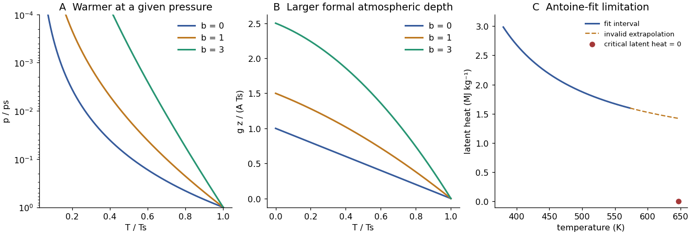

<h1 id="1/b/solution">Solution</h1>

↑ **Parent:** [B](../b.md)

Take the [convection](../../../../convection-split.md) to maintain a dry, nearly reversible [adiabat](../../../../adiabat.md), with [specific gas constant](../../../../specific-gas-constant.md) $R$. [Hydrostatic equilibrium](../../../../hydrostatic-equilibrium.md) and an ideal-gas [equation of state](../../../../equation-of-state.md) will be used separately to convert [pressure](../../../../pressure-split.md) to height. For an adiabatic displacement, the [first law of thermodynamics](../../../../first-law-of-thermodynamics-split.md) in [enthalpy](../../../../enthalpy-split.md) form gives

$$
c_p(T)\,dT-\frac{dp}{\rho}=0,\qquad
\frac{A+BT}{T}\,dT=R\frac{dp}{p}.
$$

The [adiabat with linear heat capacity](../../../../adiabat-with-linear-heat-capacity.md) follows by integrating from the surface: this gives the monotone implicit [temperature](../../../../temperature-split.md)–[pressure](../../../../pressure-split.md) relation

$$
\boxed{A\ln\frac{T}{T_s}+B(T-T_s)=R\ln\frac p{p_s}.}
$$

An explicit form, using the positive real Lambert W branch, is

$$
\boxed{T(p)=\frac AB W_0\left[\frac{BT_s}{A}e^{BT_s/A}
\left(\frac p{p_s}\right)^{R/A}\right]\quad(B>0).}
$$

As $B\to0$, $T=T_s(p/p_s)^{R/A}$. At fixed $p<p_s$,

$$
\left.\frac{\partial T}{\partial B}\right|_p
=\frac{T_s-T}{A/T+B}>0.
$$

Larger [heat capacity](../../../../heat-capacity.md) therefore keeps the upper atmosphere warmer at the same [pressure](../../../../pressure-split.md). Equivalently $d\ln T/d\ln p=R/(A+BT)$ becomes smaller. The original normalized sketch below shows the resulting family of profiles; no particular gas constants or surface [temperature](../../../../temperature-split.md) are assumed there.

The height equations are

$$
\boxed{\frac{dp}{dz}=-\rho g=-\frac{pg}{RT},\qquad
\frac{dT}{dz}=-\frac g{A+BT}.}
$$

Integrating the latter gives

$$
gz=A(T_s-T)+\frac B2(T_s^2-T^2),\qquad
T(z)=\frac{\sqrt{(A+BT_s)^2-2Bgz}-A}{B}.
$$

The physically selected root starts at $T_s$ and decreases. Its formal upper boundary is

$$
\boxed{z_* =\frac{AT_s+BT_s^2/2}{g}.}
$$

At that height $T\to0$ and $p=p_s(T/T_s)^{A/R}e^{B(T-T_s)/R}\to0$. The $B=0$ limit is $z_*=AT_s/g$. This finite-height zero is a property of the assumed polytropic-like model, not a claim that a real atmosphere reaches [absolute zero](../../../../absolute-zero.md): molecular heat capacities, composition, transport and the continuum ideal-gas description cease to support that extrapolation.

**[Figure 1](#1/b/image-adiabats-with-increasing-heat-capacity-and-the-limited-temperature-latent-heat-inferred-from-an-antoine-fit). Adiabats with increasing heat capacity and the limited-temperature latent heat inferred from an Antoine fit**. Original calculations. Adiabats use dimensionless parameters $R/A=2/7$ and $b=BT_s/A$; the latent-heat plot distinguishes the stated fit range from an invalid extrapolation toward the known critical point.

## ↑ Ancestors (12)

1. [B](../b.md)
2. [1](../../1.md)
3. [2018](../../../2018-split.md)
4. [Past exam of the physics of atmospheres and oceans course of the University of Oxford](../../../split.md)
5. [Physics of atmospheres and oceans course of the University of Oxford](../../../../physics-of-atmospheres-and-oceans-course-of-the-university-of-oxford.md)
6. [Year 4 of the physics course of the University of Oxford](../../../../year-4-of-the-physics-course-of-the-university-of-oxford.md)
7. [Physics course of the University of Oxford](../../../../physics-course-of-the-university-of-oxford.md)
8. [Undergraduate course of the University of Oxford](../../../../undergraduate-course-of-the-university-of-oxford.md)
9. [Course of the University of Oxford](../../../../course-of-the-university-of-oxford.md)
10. [University of Oxford](../../../../university-of-oxford-split.md)
11. [List of universities](../../../../list-of-universities.md)
12. [Codex Wiki](../../../../split.md)

## ← Incoming links (1)

- [Solution](../c/solution.md)
