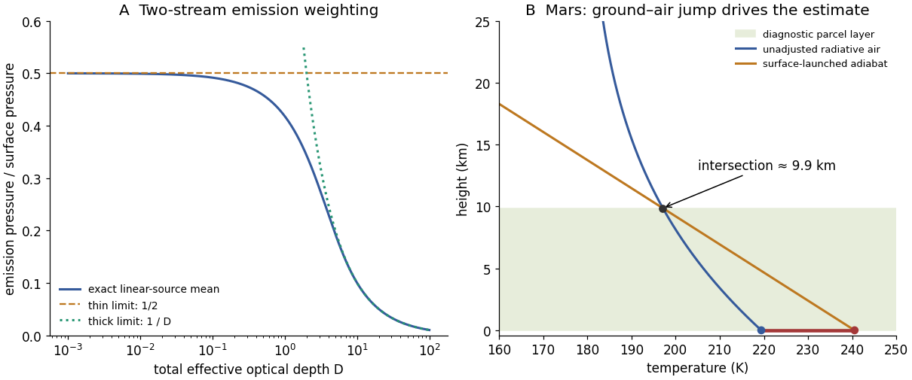

<h1 id="3/d/solution">Solution</h1>

↑ **Parent:** [D](../d.md)

The global mean absorbed solar flux is $L_\infty=0.8\times584/4=116.8\,\mathrm{W\,m^{-2}}$. Using $\sigma=5.6704\times10^{-8}\,\mathrm{W\,m^{-2}\,K^{-4}}$ gives

$$
\boxed{T_g\simeq240.5\,\mathrm K,\qquad T(0)\simeq219.4\,\mathrm K,\qquad T_\infty\simeq179.1\,\mathrm K.}
$$

For the requested graphical parcel estimate, start a [dry adiabat](../../../../adiabatic-process.md) at the warm ground, $T_{\rm ad}(z)=240.5-4.4z$ with $z$ in km, and intersect it with the radiative atmospheric profile $179.1[1+1.25e^{-z/10}]^{1/4}$. Solving gives

$$
\boxed{z_{\rm mix}\simeq9.9\,\mathrm{km},\qquad T(z_{\rm mix})\simeq197.1\,\mathrm K.}
$$

The original diagram below shows the intersection and the initial ground–air [temperature](../../../../temperature-split.md) discontinuity. A parcel heated towards the ground [temperature](../../../../temperature-split.md) remains buoyant until nearly one [scale height](../../../../scale-height.md) in this model.

The atmospheric radiative lapse rate itself is only about $3.05\,\mathrm{K\,km^{-1}}$ at the bottom and decreases with height, smaller than the stated adiabatic $4.4\,\mathrm{K\,km^{-1}}$. Thus the interior radiative atmosphere is statically stable; the driver of this particular estimate is the hotter ground and discontinuity at the lower boundary, not a radiative lapse rate everywhere steeper than adiabatic. [Convection](../../../../convection-split.md) would smooth that discontinuity and redistribute [energy](../../../../energy-split.md).

This is a diagnostic depth using the _unadjusted_ radiative ground and atmospheric [temperatures](../../../../temperature-split.md), not a fully [energy](../../../../energy-split.md)-conserving radiative–convective equilibrium after adjustment. A self-consistent adjustment changes the surface [temperature](../../../../temperature-split.md), infrared fluxes and boundary height. [Mars](../../../../mars.md) also has spectral CO$_2$ absorption, dust, day–night variation, seasonal changes and geographically uneven heating; a [gray](../../../../grey-atmosphere.md), horizontally averaged, constant-scale-height column with fixed lapse rate captures none of those details. The calculation indicates the possible importance of a deep surface-driven mixed layer under the stated assumptions, not a universal Martian boundary-layer measurement.

**[Figure 2](#3/d/image-emission-weighting-and-a-diagnostic-surface-driven-mixed-layer-depth-in-the-gray-mars-model). Emission weighting and a diagnostic surface-driven mixed-layer depth in the gray Mars model**. Original calculations. The emission pressure is normalized by surface pressure; the Mars panel compares the unadjusted radiative atmosphere with the adiabat launched at its radiative ground temperature.

## ↑ Ancestors (12)

1. [D](../d.md)
2. [3](../../3.md)
3. [2018](../../../2018-split.md)
4. [Past exam of the physics of atmospheres and oceans course of the University of Oxford](../../../split.md)
5. [Physics of atmospheres and oceans course of the University of Oxford](../../../../physics-of-atmospheres-and-oceans-course-of-the-university-of-oxford.md)
6. [Year 4 of the physics course of the University of Oxford](../../../../year-4-of-the-physics-course-of-the-university-of-oxford.md)
7. [Physics course of the University of Oxford](../../../../physics-course-of-the-university-of-oxford.md)
8. [Undergraduate course of the University of Oxford](../../../../undergraduate-course-of-the-university-of-oxford.md)
9. [Course of the University of Oxford](../../../../course-of-the-university-of-oxford.md)
10. [University of Oxford](../../../../university-of-oxford-split.md)
11. [List of universities](../../../../list-of-universities.md)
12. [Codex Wiki](../../../../split.md)
