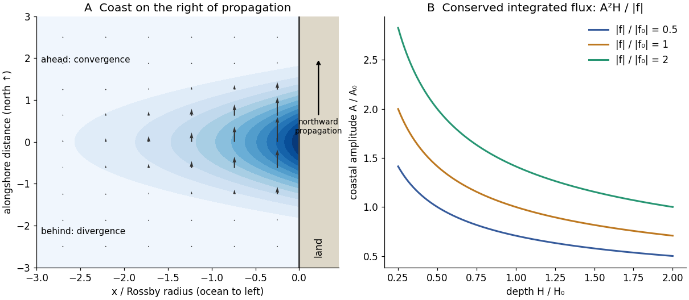

<h1 id="5/b/solution">Solution</h1>

↑ **Parent:** [B](../b.md)

In the northern hemisphere the coast is on the wave's right when looking in its direction of propagation. In the ocean-$x<0$ convention above it travels northward, with land east of the flow; for the opposite ocean side it travels southward. This follows from combining $g\eta_x=f_0v$ with a sea-level bulge that decreases offshore, rather than choosing propagation independently of trapping.

For a positive northward bulge, $v=(c/H)\eta$ is northward and strongest at its crest, and there is no cross-shore [velocity](../../../../velocity.md) in the ideal mode. Ahead of the crest the current decreases northwards, so $v_y<0$: [horizontal flow convergence](../../../../horizontal-flow-convergence.md) increases sea level, $\eta_t=-Hv_y>0$. Behind the crest $v_y>0$: [divergence](../../../../divergence.md) lowers sea level. At the crest itself the alongshore [derivative](../../../../derivative.md) and instantaneous [horizontal flow convergence](../../../../horizontal-flow-convergence.md) vanish. These signs reverse appropriately for a trough or the opposite coast, while the trapping rule remains the same.

The first panel below sketches a positive bulge, alongshore [velocity](../../../../velocity.md) and the leading convergence/trailing [divergence](../../../../divergence.md) regions. Its cross-shore decay is the [pressure](../../../../pressure-split.md)-gradient/Coriolis balance, not a current directed into the coast.

**[Figure 3](#5/b/image-coastal-kelvin-wave-trapping-convergence-and-amplitude-under-conserved-energy-transport). Coastal Kelvin-wave trapping, convergence and amplitude under conserved energy transport**. Original normalized model. The ocean lies left of the coast, the bulge travels north, and the amplitude curves assume slow changes with negligible dissipation and reflection.

## ↑ Ancestors (12)

1. [B](../b.md)
2. [5](../../5.md)
3. [2018](../../../2018-split.md)
4. [Past exam of the physics of atmospheres and oceans course of the University of Oxford](../../../split.md)
5. [Physics of atmospheres and oceans course of the University of Oxford](../../../../physics-of-atmospheres-and-oceans-course-of-the-university-of-oxford.md)
6. [Year 4 of the physics course of the University of Oxford](../../../../year-4-of-the-physics-course-of-the-university-of-oxford.md)
7. [Physics course of the University of Oxford](../../../../physics-course-of-the-university-of-oxford.md)
8. [Undergraduate course of the University of Oxford](../../../../undergraduate-course-of-the-university-of-oxford.md)
9. [Course of the University of Oxford](../../../../course-of-the-university-of-oxford.md)
10. [University of Oxford](../../../../university-of-oxford-split.md)
11. [List of universities](../../../../list-of-universities.md)
12. [Codex Wiki](../../../../split.md)

## ← Incoming links (1)

- [Solution](../e/i/solution.md)
