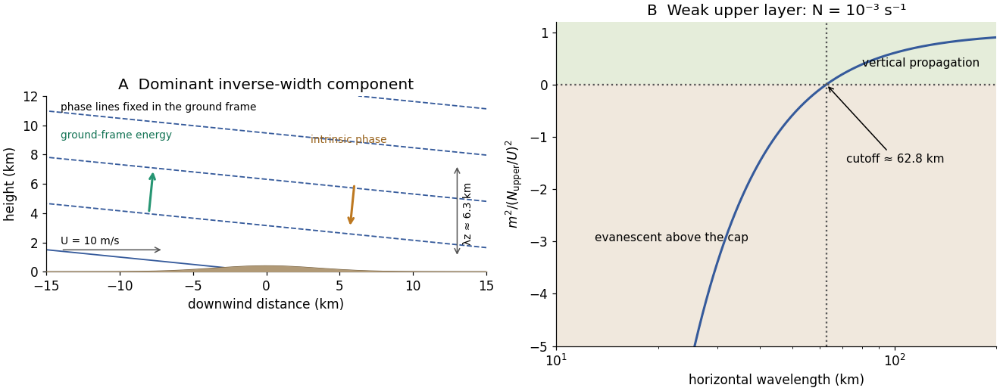

<h1 id="6/c/solution">Solution</h1>

↑ **Parent:** [C](../c.md)

A mountain width is not an exactly specified sinusoidal wavelength. Taking its characteristic horizontal inverse length as $|k|\sim1/a$ with $a=10\,\mathrm{km}$ gives $|k|\sim10^{-4}\,\mathrm{m^{-1}}$. Since $N/U=10^{-3}\,\mathrm{m^{-1}}$, the stationary vertical [wavenumber](../../../../wavenumber.md) is

$$
m=-\sqrt{(N/U)^2-k^2}\simeq-9.95\times10^{-4}\,\mathrm{m^{-1}},\qquad
\boxed{\lambda_z=\frac{2\pi}{|m|}\simeq6.3\,\mathrm{km}.}
$$

This is close to the long-horizontal-scale/hydrostatic estimate $2\pi U/N=6.28\,\mathrm{km}$. If instead the quoted width is identified with a sinusoidal wavelength $\lambda_x=10\,\mathrm{km}$, then $|k|=2\pi/\lambda_x$ and $\lambda_z\simeq8.1\,\mathrm{km}$. Thus several kilometres, roughly $6$–$8\,\mathrm{km}$ under these two common width conventions, is the justified estimate; the terrain profile would fix its actual forcing spectrum.

For the inverse-width choice, both $k$ and $m$ are negative for upward [energy](../../../../energy-split.md) radiation. The stationary phase lines $kx+mz=\text{constant}$ tilt upstream with increasing height, while [energy](../../../../energy-split.md) propagates upward and slightly downstream. Numerically $\widehat{\mathbf c_g}\simeq(0.10,0.995)\,\mathrm{m\,s^{-1}}$, with ray inclination about $84.3^\circ$. Intrinsic [phase propagation](../../../../phase-velocity.md) points upstream and downwards; the ground pattern itself remains fixed. The original sketch below uses this explicit convention.

A ground observer may see stationary lenticular or wave [clouds](../../../../cloud.md) where ascent cools sufficiently moist air, with continuing air flow through a [cloud](../../../../cloud.md) whose position remains almost fixed. Descending regions can clear or warm. An aircraft crossing the pattern encounters alternating updraughts and downdraughts; gliders can exploit the lift. Strong amplitudes, shear or rotors may cause [turbulence](../../../../turbulence-split.md), but a linear [gravity wave](../../../../gravity-wave-split.md) can also be smooth, and clear-air waves need not produce any visible [cloud](../../../../cloud.md). Mountain height, humidity and nonlinear stability are not supplied, so neither a vertical-wind amplitude nor a definite [atmospheric precipitation](../../../../atmospheric-precipitation.md) forecast follows.

**[Figure 4](#6/c/image-stationary-mountain-wave-phase-lines-intrinsic-phase-direction-energy-rays-and-an-upper-layer-propagation-cutoff). Stationary mountain-wave phase lines, intrinsic phase direction, energy rays and an upper-layer propagation cutoff**. Original schematic and dispersion calculation. The ridge height is illustrative; the phase sketch uses $|k|=1/(10\,\mathrm{km})$, while the upper-layer panel shows the cutoff for the reduced Brunt–Väisälä frequency. No cloud or turbulence amplitude is inferred.

## ↑ Ancestors (12)

1. [C](../c.md)
2. [6](../../6.md)
3. [2018](../../../2018-split.md)
4. [Past exam of the physics of atmospheres and oceans course of the University of Oxford](../../../split.md)
5. [Physics of atmospheres and oceans course of the University of Oxford](../../../../physics-of-atmospheres-and-oceans-course-of-the-university-of-oxford.md)
6. [Year 4 of the physics course of the University of Oxford](../../../../year-4-of-the-physics-course-of-the-university-of-oxford.md)
7. [Physics course of the University of Oxford](../../../../physics-course-of-the-university-of-oxford.md)
8. [Undergraduate course of the University of Oxford](../../../../undergraduate-course-of-the-university-of-oxford.md)
9. [Course of the University of Oxford](../../../../course-of-the-university-of-oxford.md)
10. [University of Oxford](../../../../university-of-oxford-split.md)
11. [List of universities](../../../../list-of-universities.md)
12. [Codex Wiki](../../../../split.md)
