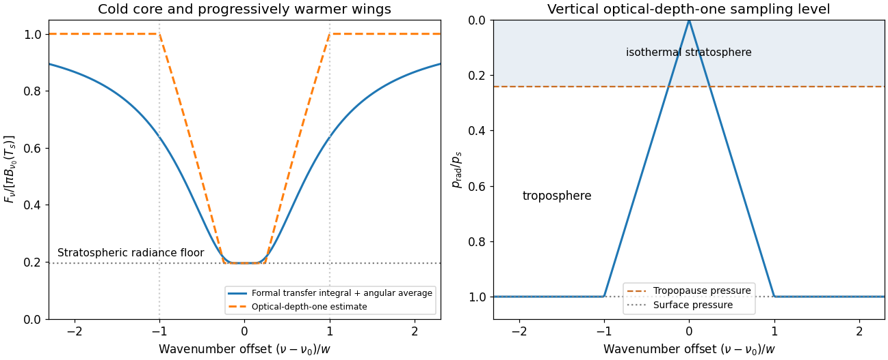

<h1 id="2/c/solution">Solution</h1>

↑ **Parent:** [C](../c.md)

For a vertical ray, the formal [Schwarzschild equation](../../../../schwarzschild-equation.md) solution is

$$
I_\nu(0)=B_\nu(T_s)e^{-\tau_{\nu,s}}+\int_0^{\tau_{\nu,s}}B_\nu[T(t)]e^{-t}\,dt.
$$

In the wing model $\tau\propto p^2$, the contribution per interval $d\ln p$ is proportional to $2\tau e^{-\tau}$ when the source varies slowly, and is concentrated near $\tau=1$. This motivates

$$
\boxed{p_{\rm rad}(\nu)\sim p_s\frac{|\nu-\nu_0|}{w},}
$$

limited to $p_s$ in transparent spectral regions. Rays contributing to the hemispheric [flux](../../../../flux.md) replace this by $p_s\sqrt\mu\,d/w$, an order-one angular refinement.

For $T_s>T_{\rm strat}$, put $p_t=p_s(T_{\rm strat}/T_s)^{1/x}$ and $d_t=w p_t/p_s$. With the vertical optical-depth-one estimate, the spectral [outgoing longwave radiation](../../../../outgoing-longwave-radiation.md) is approximately

$$
\boxed{F_\nu\sim\begin{cases}
\pi B_\nu(T_{\rm strat}),&d\lesssim d_t,\\
\pi B_\nu\!\left[T_s(d/w)^x\right],&d_t\lesssim d\lesssim w,\\
\pi B_\nu(T_s),&d\gtrsim w.
\end{cases}}
$$

The cold flat central portion comes from the isothermal stratosphere; intermediate wings sample progressively warmer, deeper tropospheric levels; far outside the line the warm surface is seen. The transitions are smooth in the exact transfer solution. If $T_s=T_{\rm strat}$, the entire column and ground are isothermal and there is no line contrast. If $T_s<T_{\rm strat}$, the given max-profile has no cooler troposphere: the atmosphere can instead produce an emission feature above the colder surface background. Assuming a narrow isolated line permits the local [Planck function](../../../../planck-function.md) background to be treated as nearly constant across its width. The original schematic below also compares the optical-depth-one estimate with angular and source-function integration for illustrative, explicitly chosen parameters.

**[Figure 1](#2/c/image-an-isolated-absorption-line-samples-an-isothermal-stratosphere-a-warmer-troposphere-and-the-surface). An isolated absorption line samples an isothermal stratosphere, a warmer troposphere and the surface**. Illustrative narrow-line model with $T_s=300\,\mathrm K$, $T_{\mathrm{strat}}=200\,\mathrm K$, $x=2/7$ and line centre $667\,\mathrm{cm^{-1}}$; horizontal offsets are normalized by $w$. No measured spectrum is reproduced.

## ↑ Ancestors (12)

1. [C](../c.md)
2. [2](../../2.md)
3. [2019](../../../2019-split.md)
4. [Past exam of the physics of atmospheres and oceans course of the University of Oxford](../../../split.md)
5. [Physics of atmospheres and oceans course of the University of Oxford](../../../../physics-of-atmospheres-and-oceans-course-of-the-university-of-oxford.md)
6. [Year 4 of the physics course of the University of Oxford](../../../../year-4-of-the-physics-course-of-the-university-of-oxford.md)
7. [Physics course of the University of Oxford](../../../../physics-course-of-the-university-of-oxford.md)
8. [Undergraduate course of the University of Oxford](../../../../undergraduate-course-of-the-university-of-oxford.md)
9. [Course of the University of Oxford](../../../../course-of-the-university-of-oxford.md)
10. [University of Oxford](../../../../university-of-oxford-split.md)
11. [List of universities](../../../../list-of-universities.md)
12. [Codex Wiki](../../../../split.md)
