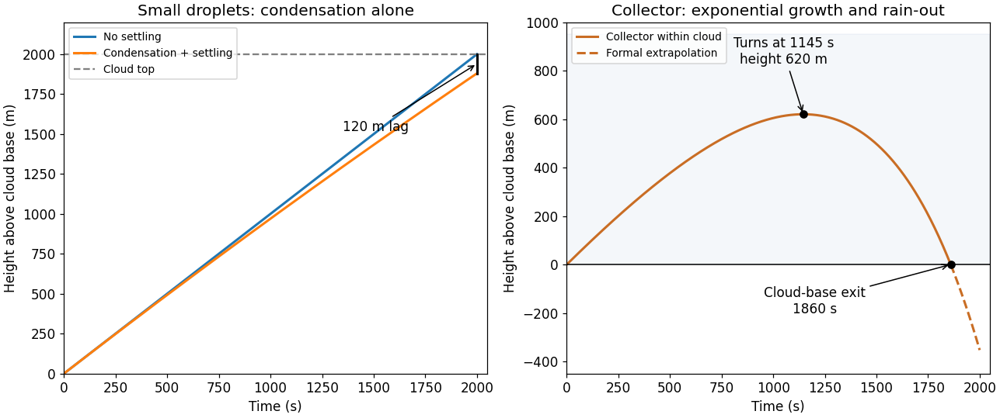

<h1 id="4/c/solution">Solution</h1>

↑ **Parent:** [C](../c.md)

Neglecting $r_0$, the no-settling trajectory is $h_r=Ut$, while the settling trajectory is a downward-curving parabola, $h_r=Ut-k_rDt^2$. For the given coefficients $k_rD=3.0\times10^{-5}\,\mathrm{m\,s^{-2}}$. At $2000\,\mathrm s$,

$$
\boxed{h_{\rm no\ fall}=2000\,\mathrm m,\qquad h_r=1880\,\mathrm m,\qquad\Delta h_r=120\,\mathrm m.}
$$

The radius is then $r=\sqrt{2Dt}=31.6\,\mu\mathrm m$, with terminal speed $0.12\,\mathrm{m\,s^{-1}}$, still much less than the updraft. Such droplets are carried almost to cloud top rather than falling as rain. Condensation alone would take about $2\times10^4\,\mathrm s$ to reach $100\,\mu\mathrm m$, much longer than the approximately $2000\,\mathrm s$ cloud transit time. It also reduces relative radius differences because $r^2$ grows at the same rate for every droplet, leaving inefficient differential gravitational collection. This is the warm-rain growth bottleneck, not a claim that condensation is absent.

**[Figure 2](#4/c/image-condensational-droplets-rise-through-the-cloud-while-rapidly-collecting-drops-can-turn-and-precipitate). Condensational droplets rise through the cloud while rapidly collecting drops can turn and precipitate**. Trajectories calculated from the two growth models in question 4; the collector curve is solid only while the drop remains within the cloud. The dashed extension below cloud base is a formal extrapolation.

## ↑ Ancestors (12)

1. [C](../c.md)
2. [4](../../4.md)
3. [2019](../../../2019-split.md)
4. [Past exam of the physics of atmospheres and oceans course of the University of Oxford](../../../split.md)
5. [Physics of atmospheres and oceans course of the University of Oxford](../../../../physics-of-atmospheres-and-oceans-course-of-the-university-of-oxford.md)
6. [Year 4 of the physics course of the University of Oxford](../../../../year-4-of-the-physics-course-of-the-university-of-oxford.md)
7. [Physics course of the University of Oxford](../../../../physics-course-of-the-university-of-oxford.md)
8. [Undergraduate course of the University of Oxford](../../../../undergraduate-course-of-the-university-of-oxford.md)
9. [Course of the University of Oxford](../../../../course-of-the-university-of-oxford.md)
10. [University of Oxford](../../../../university-of-oxford-split.md)
11. [List of universities](../../../../list-of-universities.md)
12. [Codex Wiki](../../../../split.md)
