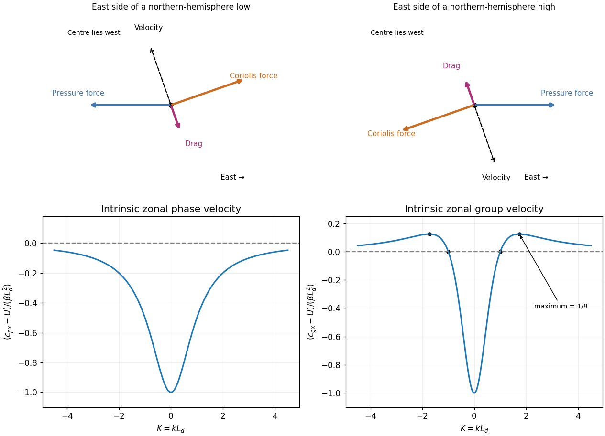

<h1 id="5/d/solution">Solution</h1>

↑ **Parent:** [D](../d.md)

Approximate the surface layer as locally steady with small horizontal advective acceleration. Write $J\mathbf u=\mathbf k\times\mathbf u$ and $\mathbf P=\rho^{-1}\nabla_hp$. Since $J^2=-I$, the drag-modified [force balance](../../../../force-balance.md) can be inverted exactly:

$$
(\alpha I+fJ)\mathbf u=-\mathbf P,\qquad
\boxed{\mathbf u=\frac{fJ\mathbf P-\alpha\mathbf P}{f^2+\alpha^2}.}
$$

The [geostrophic wind](../../../../geostrophic-wind.md) is $\mathbf u_g=J\mathbf P/f$, so the [ageostrophic flow](../../../../ageostrophic-flow.md) is

$$
\boxed{\mathbf u_a=-\frac{\alpha^2}{f^2+\alpha^2}\mathbf u_g+\frac{\alpha f}{f^2+\alpha^2}J\mathbf u_g
\simeq\frac\alpha fJ\mathbf u_g\quad(\alpha\ll|f|).}
$$

Its cross-isobar component is $-\alpha\nabla_hp/[\rho(f^2+\alpha^2)]$, always towards lower [pressure](../../../../pressure-split.md), in either hemisphere. Thus the surface wind spirals into a cyclone and out of an anticyclone. In the northern hemisphere, the nearly tangential circulation is counterclockwise around the low and clockwise around the high; those rotations reverse in the southern hemisphere. The original force diagrams below show pressure, drag and [Coriolis force](../../../../coriolis-force.md) closing to zero at the east side of each system.

Surface convergence into a low requires upward motion out of the friction layer by the [continuity equation](../../../../continuity-equation.md); divergence from a high requires subsidence. In unsaturated adiabatic motion the rising parcel expands and cools, while descending air compresses and warms. The relevant warming or cooling relative to its surroundings depends on the environmental [stratification](../../../../density-stratification.md), and latent heating can modify the ascending-air result.

For otherwise unsupported weather systems this is [quasi-geostrophic Ekman spin-down](../../../../quasi-geostrophic-ekman-spin-down.md): drag dissipates kinetic energy, convergence tends to fill a low and divergence tends to erode a high. In a simple column with upward velocity at its base and negligible vertical velocity aloft, cyclonic [vorticity](../../../../vorticity-split.md) decreases because $\partial_z w<0$; the opposite sign weakens anticyclonic vorticity. Cooling beneath a fixed upper-level pressure also tends to raise the surface pressure through the hydrostatic column, while warming tends to lower it. Real baroclinic development, upper-level mass transport and condensation can sustain or deepen a cyclone despite surface friction, so temperature changes alone do not prove a universal decay rate.

**[Figure 3](#5/d/image-surface-force-balances-and-intrinsic-phase-and-group-velocities-of-a-baroclinic-rossby-wave). Surface force balances and intrinsic phase and group velocities of a baroclinic Rossby wave**. Top panels show northern-hemisphere forces at the east side of a low and a high, with drag rate $0.35f$. Bottom panels use $K=kL_d$ and velocities normalized by $\beta L_d^2$ in the frame moving with the background flow.

## ↑ Ancestors (12)

1. [D](../d.md)
2. [5](../../5.md)
3. [2019](../../../2019-split.md)
4. [Past exam of the physics of atmospheres and oceans course of the University of Oxford](../../../split.md)
5. [Physics of atmospheres and oceans course of the University of Oxford](../../../../physics-of-atmospheres-and-oceans-course-of-the-university-of-oxford.md)
6. [Year 4 of the physics course of the University of Oxford](../../../../year-4-of-the-physics-course-of-the-university-of-oxford.md)
7. [Physics course of the University of Oxford](../../../../physics-course-of-the-university-of-oxford.md)
8. [Undergraduate course of the University of Oxford](../../../../undergraduate-course-of-the-university-of-oxford.md)
9. [Course of the University of Oxford](../../../../course-of-the-university-of-oxford.md)
10. [University of Oxford](../../../../university-of-oxford-split.md)
11. [List of universities](../../../../list-of-universities.md)
12. [Codex Wiki](../../../../split.md)
