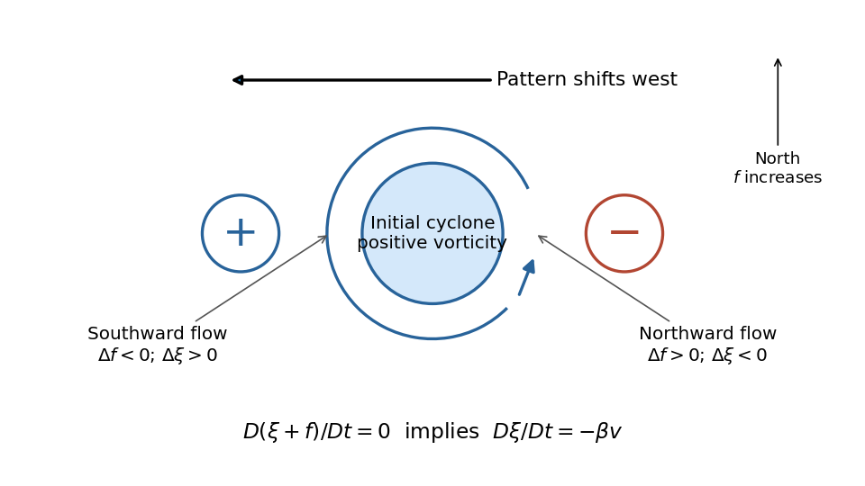
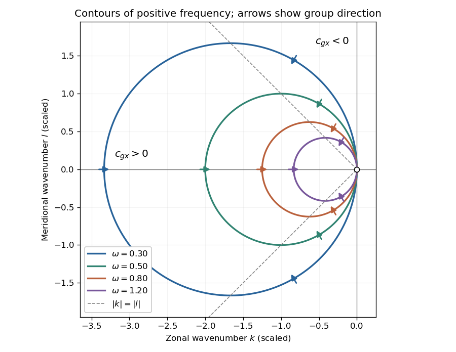
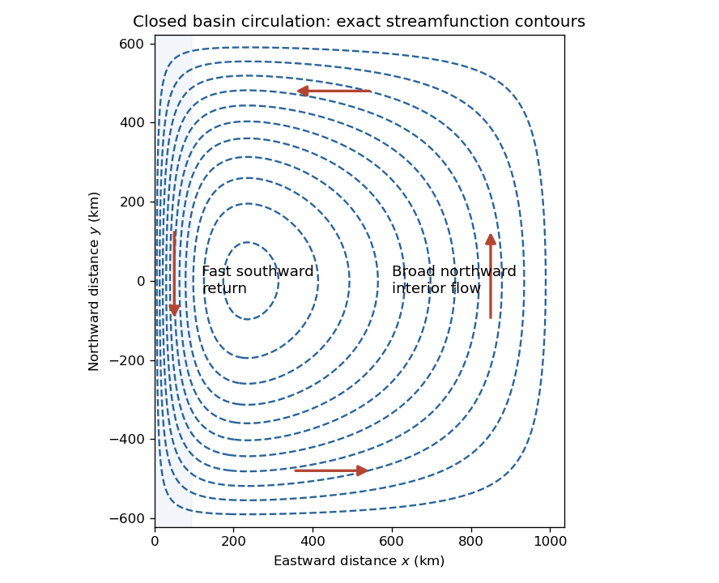
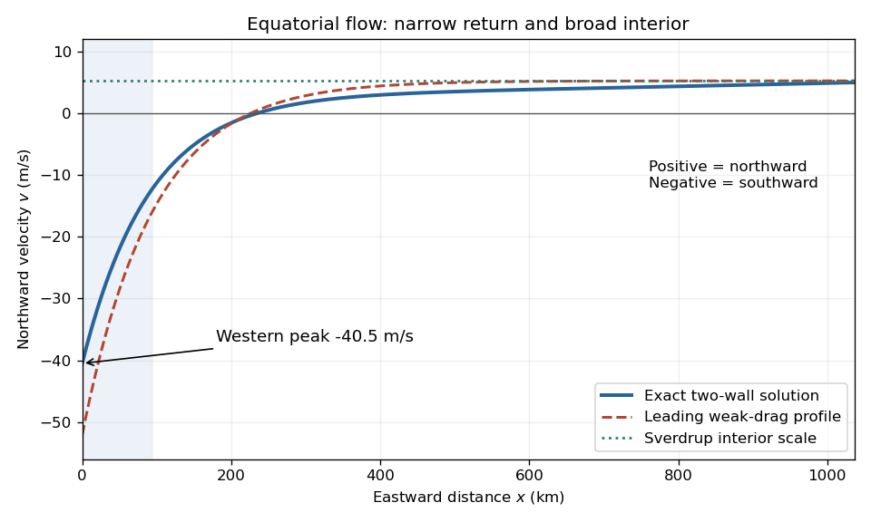

# 2021

↑ **Parent:** [Past exam of the physics of atmospheres and oceans course of the University of Oxford](../past-exam-of-the-physics-of-atmospheres-and-oceans-course-of-the-university-of-oxford.md)

Source paper: [https://www.whatdotheyknow.com/request/oxford_physics_past_papers_2/response/2340696/attach/9/Physics%20Papers%202020.pdf?cookie_passthrough=1](https://www.whatdotheyknow.com/request/oxford_physics_past_papers_2/response/2340696/attach/9/Physics%20Papers%202020.pdf?cookie_passthrough=1) (ordinary sitting, 8 June 2021; the public bundle's filename does not give this paper's examination year).

**Table of contents**

- [1](#1)
  - [a](#1/a)
    - [Solution](#1/a/solution)
  - [b](#1/b)
    - [Solution](#1/b/solution)
  - [c](#1/c)
    - [Solution](#1/c/solution)
- [2](#2)
  - [a](#2/a)
    - [Solution](#2/a/solution)
  - [b](#2/b)
    - [Solution](#2/b/solution)
  - [c](#2/c)
    - [Solution](#2/c/solution)
- [3](#3)
  - [a](#3/a)
    - [Solution](#3/a/solution)
  - [b](#3/b)
    - [Solution](#3/b/solution)
  - [c](#3/c)
    - [Solution](#3/c/solution)
  - [d](#3/d)
    - [Solution](#3/d/solution)
  - [e](#3/e)
    - [Solution](#3/e/solution)
- [4](#4)
  - [a](#4/a)
    - [Solution](#4/a/solution)
  - [b](#4/b)
    - [Solution](#4/b/solution)
  - [c](#4/c)
    - [Solution](#4/c/solution)
  - [d](#4/d)
    - [Solution](#4/d/solution)
  - [e](#4/e)
    - [Solution](#4/e/solution)
- [5](#5)
  - [a](#5/a)
    - [Solution](#5/a/solution)
  - [b](#5/b)
    - [Solution](#5/b/solution)
  - [c](#5/c)
    - [Solution](#5/c/solution)
  - [d](#5/d)
    - [Solution](#5/d/solution)
- [6](#6)
  - [a](#6/a)
    - [Solution](#6/a/solution)
  - [b](#6/b)
    - [Solution](#6/b/solution)
  - [c](#6/c)
    - [Solution](#6/c/solution)
    - [i](#6/c/i)
      - [Solution](#6/c/i/solution)
    - [ii](#6/c/ii)
      - [Solution](#6/c/ii/solution)
  - [d](#6/d)
    - [Solution](#6/d/solution)
    - [a](#6/d/a)
      - [Solution](#6/d/a/solution)
    - [b](#6/d/b)
      - [Solution](#6/d/b/solution)

## 1

↑ **Parent:** [2021](2021.md)

<h3 id="1/a">a</h3>

↑ **Parent:** [1](#1)

<h4 id="1/a/solution">Solution</h4>

↑ **Parent:** [A](#1/a)

**Notation.** The source uses $p_s$ for both the hypothetical dry surface [pressure](../pressure.md) and the actual surface [pressure](../pressure.md) after [evaporation](../critical-phenomenon.md#evaporation). Distinguish them as $P_d$ and $P$, respectively, and interpret the specified [pressure](../pressure.md) thickness $\Delta p$ as fixed. This conserves the original [hydrogen](../chemical-substance.md#hydrogen) inventory and permits $P$ to vary. Reading both occurrences as one fixed number would be inconsistent with adding [water vapor](../chemical-substance.md#water-vapor) to a closed [atmospheric column mass](../planetary-science.md#atmospheric-column-mass) budget.

Let $E(T)$ denote the [saturation pressure](../thermodynamic-potential.md#vapor-pressure) of [water](../chemical-substance.md#water), let $x$ be the [mole fraction](../mathematical-biology.md#mole-fraction) of [water vapor](../chemical-substance.md#water-vapor) in the mixed layer, and let $M_d,M_v$ be the [molar masses](../chemistry.md#molar-mass) of [hydrogen](../chemical-substance.md#hydrogen) and [water](../chemical-substance.md#water). Surface [phase equilibrium](../thermodynamics.md#phase-equilibrium) and the [ideal gas law](../ideal-gas.md#ideal-gas-law) give

$$
x=\frac{E(T_s)}P,\qquad p_v(p)=xp.
$$

Because the layer has constant [temperature](../temperature.md), its [relative humidity](../physiology.md#relative-humidity) is

$$
\boxed{\mathrm{RH}(p)=\frac{p_v(p)}{E(T_s)}=\frac pP},\qquad P-\Delta p\leq p\leq P.
$$

Thus every level strictly above the surface is subsaturated: [hydrostatic balance](../fluid-mechanics.md#hydrostatic-balance) makes $p<P$, whereas the [saturation pressure](../thermodynamic-potential.md#vapor-pressure) stays constant. The result does not require a dilute [water vapor](../chemical-substance.md#water-vapor) approximation.

The [Clausius-Clapeyron relation](../thermodynamic-potential.md#clausius-clapeyron-relation), neglecting the [specific volume](../thermodynamics.md#specific-volume) of [liquid water](../chemical-substance.md#liquid-water) and treating the [water vapor](../chemical-substance.md#water-vapor) as an [ideal gas](../ideal-gas.md), gives

$$
\frac{d\ln E}{dT}=\frac{L_v}{R_vT^2},\qquad
E(T)=E_t\exp\!\left[\frac{L_v}{R_v}\left(\frac1{T_t}-\frac1T\right)\right],\qquad R_v=\frac R{M_v}.
$$

Here $T_t,E_t$ are the [triple point](../thermodynamic-potential.md#triple-point) values, $L_v$ is the specific [latent heat](../thermodynamic-potential.md#latent-heat), and $R$ is the [molar gas constant](../ideal-gas.md#molar-gas-constant). All [temperatures](../temperature.md) in these expressions are absolute. As throughout the question, this is a constant-[latent heat](../thermodynamic-potential.md#latent-heat), [ideal gas](../ideal-gas.md) model, not an extrapolation valid through the real [critical point](../analysis.md#critical-point) of [water](../chemical-substance.md#water).

For a well-mixed [ideal gas](../ideal-gas.md) mixture, its mean [molar mass](../chemistry.md#molar-mass) and [water vapor](../chemical-substance.md#water-vapor) [mass fraction](../mixture.md#mass-fraction) are

$$
\overline M=M_d(1+ax),\qquad w_v=\frac{\epsilon x}{1+ax},\qquad
\epsilon=\frac{M_v}{M_d}\simeq9,\qquad a=\epsilon-1\simeq8.
$$

By [hydrostatic balance](../fluid-mechanics.md#hydrostatic-balance), the mixed layer has total [mass](../classical-mechanics.md#mass) per unit area $\Delta p/g$, of which $w_v\Delta p/g$ is [water vapor](../chemical-substance.md#water-vapor). The remaining [atmosphere](../planetary-science.md#atmosphere) contains no [water vapor](../chemical-substance.md#water-vapor). Consequently conservation of [hydrogen](../chemical-substance.md#hydrogen) [mass](../classical-mechanics.md#mass) gives

$$
\frac P g=\frac{P_d}g+\frac{\Delta p}g w_v,
\qquad
P=P_d+\Delta p\frac{\epsilon E(T_s)}{P+aE(T_s)}.
$$

Equivalently the requested [quadratic equation](../polynomial.md#quadratic-equation) is

$$
\boxed{(P-P_d)(P+aE)=\epsilon\Delta p\,E.}
$$

For each $T_s$, calculate $E$, take the positive [root](../semisimple-lie-algebra.md#root-of-a-root-system) of this [quadratic equation](../polynomial.md#quadratic-equation), and retain it only if $0\leq x<1$ and $P>\Delta p$. The last condition leaves a nonempty dry layer. In particular the dry constituent's surface [partial pressure](../ideal-gas.md#partial-pressure) is not generally $P_d$: $P_d$ measures its column weight, and the [hydrogen](../chemical-substance.md#hydrogen) and [water vapor](../chemical-substance.md#water-vapor) have different [molar masses](../chemistry.md#molar-mass).

<h3 id="1/b">b</h3>

↑ **Parent:** [1](#1)

<h4 id="1/b/solution">Solution</h4>

↑ **Parent:** [B](#1/b)

A convenient parameter is the [water vapor](../chemical-substance.md#water-vapor) [mole fraction](../mathematical-biology.md#mole-fraction) itself. The [mass conservation](../continuum-mechanics.md#mass-conservation) calculation yields

$$
P(x)=P_d+\frac{\epsilon\Delta p\,x}{1+ax},\qquad E(x)=xP(x).
$$

Both functions increase for $0\leq x\leq1$. At the endpoint,

$$
P(1)=E(1)=P_d+\Delta p.
$$

Therefore the physically admissible [hydrogen](../chemical-substance.md#hydrogen)–[water vapor](../chemical-substance.md#water-vapor) mixture requires

$$
\boxed{E(T_s)<P_d+\Delta p.}
$$

Beyond this bound, the formal positive [quadratic equation](../polynomial.md#quadratic-equation) [root](../semisimple-lie-algebra.md#root-of-a-root-system) requires $x>1$, equivalently a negative [hydrogen](../chemical-substance.md#hydrogen) [partial pressure](../ideal-gas.md#partial-pressure). It is the physical constraints, rather than loss of real [roots](../semisimple-lie-algebra.md#root-of-a-root-system), that end the solution branch. For a concrete example, put $P_d=\Delta p=1$ in consistent [pressure](../pressure.md) units, $\epsilon=9$, and $E=3$. The positive [root](../semisimple-lie-algebra.md#root-of-a-root-system) of $P^2+23P-51=0$ is about $2.037$, giving $x\simeq1.473$, which is impossible.

The limiting [temperature](../temperature.md) is obtained from $E(T_*)=P_d+\Delta p$:

$$
\frac1{T_*}=\frac1{T_t}-\frac{R_v}{L_v}\ln\!\frac{P_d+\Delta p}{E_t}.
$$

This finite limit exists above $T_t$ if $E_t<P_d+\Delta p<E_t\exp[L_v/(R_vT_t)]$. The upper qualification matters mathematically: the stipulated constant-[latent heat](../thermodynamic-potential.md#latent-heat) formula has a finite limiting [saturation pressure](../thermodynamic-potential.md#vapor-pressure) as $T\to\infty$, so for an arbitrarily large unspecified $P_d+\Delta p$ the printed assertion of a finite breakdown [temperature](../temperature.md) is not unconditional. For a concrete formal counterexample, choose $P_d+\Delta p=10^{15}\,\mathrm{Pa}$: with the usual triple-point constants the model has $E(\infty)\simeq2.5\times10^{11}\,\mathrm{Pa}$, so it never reaches the proposed inventory limit. This is a counterexample inside the stipulated equations, not a physically credible high-[pressure](../pressure.md) [ideal gas](../ideal-gas.md) ocean. Actual [liquid water](../chemical-substance.md#liquid-water) also ceases to exist above its [critical point](../analysis.md#critical-point), before such an extrapolation would make sense.

Physically, the imposed finite-[pressure](../pressure.md)-thickness layer can hold no more than $\Delta p/g$ of [water vapor](../chemical-substance.md#water-vapor) per unit area. As $x\to1$, it expels all its [hydrogen](../chemical-substance.md#hydrogen) into the dry upper layer. A still larger surface [saturation pressure](../thermodynamic-potential.md#vapor-pressure) cannot coexist with this geometry. The layer must deepen, the [temperature](../temperature.md) profile must change, or the assumed [phase equilibrium](../thermodynamics.md#phase-equilibrium) must fail. If $P_d<\Delta p$, the additional restriction $P>\Delta p$ can also exclude the low-[temperature](../temperature.md) end of the branch.

<h3 id="1/c">c</h3>

↑ **Parent:** [1](#1)

<h4 id="1/c/solution">Solution</h4>

↑ **Parent:** [C](#1/c)

At the interface the [pressure](../pressure.md) is continuous. Immediately below it the [temperature](../temperature.md) is $T_s$ and mean [molar mass](../chemistry.md#molar-mass) is $M_d(1+ax)$; immediately above it the dry [hydrogen](../chemical-substance.md#hydrogen) has [temperature](../temperature.md) $T_1$. The [ideal gas law](../ideal-gas.md#ideal-gas-law) therefore gives

$$
\rho_- =\frac{p_1M_d(1+ax)}{RT_s},\qquad
\rho_+=\frac{p_1M_d}{RT_1}.
$$

An infinitesimal interchange is unstable to [convection](../convection.md) when the lower fluid is less dense than the upper fluid. Hence

$$
\boxed{\frac{T_s}{T_1}>1+a\frac{E(T_s)}{P(T_s)}.}
$$

Equality gives neutral interfacial [buoyancy](../fluid-mechanics.md#buoyancy); reversing the inequality gives a stable [density](../fluid-mechanics.md#density) jump. This is an interfacial criterion, not a claim that the whole dry upper [atmosphere](../planetary-science.md#atmosphere) is stable. Its vertical [temperature](../temperature.md) profile has not been specified. Also, $\mathrm{RH}(p_1)=p_1/P<1$, so infinitesimal displacement at the interface initially involves no [condensation](../critical-phenomenon.md#condensation) or release of [latent heat](../thermodynamic-potential.md#latent-heat).

There are two competing effects. Increasing $T_s$ directly reduces the lower [density](../fluid-mechanics.md#density), favouring [convection](../convection.md). Increasing the [mole fraction](../mathematical-biology.md#mole-fraction) of heavy [water vapor](../chemical-substance.md#water-vapor) increases its mean [molar mass](../chemistry.md#molar-mass), opposing [convection](../convection.md). With $x\ll1$, the criterion is approximately $T_s>T_1$. With $x\to1$, it tends to $T_s>\epsilon T_1\simeq9T_1$: substantial surface heating need not overcome the compositional stabilization in [hydrogen](../chemical-substance.md#hydrogen).

For a specified $P_d,\Delta p,T_1$, solve $T_s/T_1-1-ax(T_s)=0$ on the admissible branch to locate the transitions. Its [derivative](../calculus.md#derivative) is $1/T_1-a x'(T_s)$, so there is no universal monotone trend: rapid growth of the [saturation pressure](../thermodynamic-potential.md#vapor-pressure) can suppress an instability that was present at lower $T_s$. Without numerical parameter values, neither the number of crossings nor a unique interval of unstable [temperatures](../temperature.md) can be asserted.

## 2

↑ **Parent:** [2021](2021.md)

<h3 id="2/a">a</h3>

↑ **Parent:** [2](#2)

<h4 id="2/a/solution">Solution</h4>

↑ **Parent:** [A](#2/a)

Write $\kappa=R_d/c_p$, where $R_d$ is the [specific gas constant](../ideal-gas.md#specific-gas-constant) and $c_p$ the [specific heat capacity at constant pressure](../heat.md#specific-heat-capacity-at-constant-pressure). Conservation of [potential temperature](../geophysics.md#potential-temperature) on a dry [adiabatic process](../first-law-of-thermodynamics.md#adiabatic-process) gives

$$
T(p)=T_g\left(\frac p{p_s}\right)^\kappa,\qquad T_c=qT_g,\qquad q=\left(\frac{p_c}{p_s}\right)^\kappa.
$$

Let $Q=(1-\alpha_c)S$ be the absorbed stellar [irradiance](../radiometry.md#irradiance), and let $T_0=(Q/\sigma)^{1/4}$, with $\sigma$ the [Stefan-Boltzmann constant](../heat.md#stefan-boltzmann-constant). The transparent gas contributes no [thermal radiation](../electromagnetic-radiation.md#thermal-radiation). For a [cloud](../geophysics.md#cloud) with [emissivity](../heat.md#emissivity) $e$, [Kirchhoff's law of thermal radiation](../astrophysics.md#kirchhoff-s-law-of-thermal-radiation) gives thermal absorptivity $e$; assume thermal transmissivity $1-e$ and negligible thermal reflection, as in the usual one-layer [grey body](../heat.md#grey-body) model. The outgoing [radiant flux](../radiometry.md#radiant-flux) is the transmitted surface emission plus upward [cloud](../geophysics.md#cloud) emission:

$$
Q=(1-e)\sigma T_g^4+e\sigma T_c^4.
$$

Thus

$$
\boxed{T_g=T_0\left[1-e+eq^4\right]^{-1/4},\qquad T_c=qT_g.}
$$

No factor of four is needed: $S$ is the incident [irradiance](../radiometry.md#irradiance) of the specified column, rather than a stellar-beam [irradiance](../radiometry.md#irradiance) that still needs a spherical average.

For fixed $\alpha_c,p_c,p_s$, increasing $e$ monotonically warms the ground when $0<q<1$. At $e=0$, $T_g=T_0$; at $e=1$, $T_c=T_0$ and $T_g=T_0/q$. A [cloud](../geophysics.md#cloud) at the surface, $q=1$, produces no such warming. Comparing with a genuinely cloud-free column also requires including its different [albedo](../geophysics.md#albedo): relative to $(S/\sigma)^{1/4}$, the ratio is $[(1-\alpha_c)/(1-e+eq^4)]^{1/4}$. Reflection can outweigh the [greenhouse effect](../exoplanet.md#greenhouse-effect).

The governing balance here is the whole-column [radiation budget](../geophysics.md#radiation-budget). Imposing an additional purely radiative surface balance would incorrectly remove the [convective heat transfer](../heat.md#convective-heat-transfer) that the prescribed dry [adiabatic process](../first-law-of-thermodynamics.md#adiabatic-process) may require.

<h3 id="2/b">b</h3>

↑ **Parent:** [2](#2)

<h4 id="2/b/solution">Solution</h4>

↑ **Parent:** [B](#2/b)

The [cloud](../geophysics.md#cloud) absorbs $e\sigma T_g^4$ from below and emits $e\sigma T_c^4$ from each face. It absorbs no stellar [radiation](../physics.md#radiation). Its net radiative heating per unit area is therefore

$$
\boxed{\mathcal R_c=e\sigma(T_g^4-2T_c^4)=e\sigma T_g^4(1-2q^4).}
$$

For $e>0$, a [cloud](../geophysics.md#cloud) with $q^4<1/2$ warms in the absence of other energy transfers; one with $q^4>1/2$ cools. For the thin [pressure](../pressure.md) thickness $\delta p$, its initial [temperature](../temperature.md) tendency is approximately $g\mathcal R_c/(c_p\delta p)$ if its sensible [heat capacity](../heat.md#heat-capacity) dominates. [Latent heat](../thermodynamic-potential.md#latent-heat) and changing condensate modify that conversion from heating to [temperature](../temperature.md) change, but not the sign of the radiative input.

With $T_g$ fixed, pure [radiative equilibrium](../heat.md#radiative-equilibrium) requires

$$
\boxed{T_{c,\mathrm{rad}}=2^{-1/4}T_g.}
$$

This equals the ambient dry-[adiabatic process](../first-law-of-thermodynamics.md#adiabatic-process) [temperature](../temperature.md) precisely when

$$
q^4=\frac12,\qquad \boxed{\frac{p_c}{p_s}=2^{-1/(4\kappa)}}.
$$

For ordinary dry air, $\kappa\simeq2/7$, so the ratio is about $0.545$. If $e=0$, the [cloud](../geophysics.md#cloud) exchanges no thermal [radiation](../physics.md#radiation) and its [radiation budget](../geophysics.md#radiation-budget) does not select any equilibrium [temperature](../temperature.md).

<h3 id="2/c">c</h3>

↑ **Parent:** [2](#2)

<h4 id="2/c/solution">Solution</h4>

↑ **Parent:** [C](#2/c)

At fixed ground [temperature](../temperature.md), warming the [cloud](../geophysics.md#cloud) increases its downward [radiant flux](../radiometry.md#radiant-flux) $e\sigma T_c^4$, giving a positive contribution to the ground's radiative heating. That is the immediate radiative effect. A self-consistent final answer must also remove the [convective heat transfer](../heat.md#convective-heat-transfer) used to pin the original [cloud](../geophysics.md#cloud) to the dry [adiabatic process](../first-law-of-thermodynamics.md#adiabatic-process).

For pure [radiative equilibrium](../heat.md#radiative-equilibrium) of both bodies, with no net nonradiative energy exchange, their two balances are

$$
\sigma T_g^4=Q+e\sigma T_c^4,\qquad
e\sigma T_g^4=2e\sigma T_c^4.
$$

For $e>0$ this gives

$$
\boxed{T_g=T_0(1-e/2)^{-1/4},\qquad T_c=T_0(2-e)^{-1/4}.}
$$

The $e\to0^+$ limit gives the selected limiting [cloud](../geophysics.md#cloud) [temperature](../temperature.md); at exactly $e=0$, only $T_g=T_0$ is fixed radiatively. The maximum [greenhouse effect](../exoplanet.md#greenhouse-effect) at fixed $Q$ occurs at $e=1$:

$$
\boxed{T_g=2^{1/4}T_0\simeq1.189T_0.}
$$

The pinned dry-[adiabatic process](../first-law-of-thermodynamics.md#adiabatic-process) case instead has maximum factor $1/q=(p_s/p_c)^\kappa$. It exceeds $2^{1/4}$ for a high, cold [cloud](../geophysics.md#cloud) with $q<2^{-1/4}$, equals it at the level found in part b, and is smaller for a low, warm [cloud](../geophysics.md#cloud).

In particular, for $q^4<1/2$ the final purely radiative ground is **cooler** than the pinned solution, even though a warmer [cloud](../geophysics.md#cloud) increases downward [radiation](../physics.md#radiation) at fixed $T_g$. To see why these statements are compatible, let $H$ be the net upward nonradiative energy transfer from the ground to the [cloud](../geophysics.md#cloud) in the pinned state. Its [conservation of energy](../mathematical-physics.md#conservation-of-energy) equation requires

$$
H=e\sigma(2T_c^4-T_g^4),\qquad
Q+e\sigma T_c^4-\sigma T_g^4=H.
$$

For the cold [cloud](../geophysics.md#cloud), $H<0$: maintaining it on the assumed dry [adiabatic process](../first-law-of-thermodynamics.md#adiabatic-process) requires removing its net radiative heating and returning energy elsewhere. Setting $H=0$ changes that energy redistribution. It is therefore incorrect to infer the final ground [temperature](../temperature.md) by changing only the downward [radiant flux](../radiometry.md#radiant-flux). Indeed the final [cloud](../geophysics.md#cloud) is warmer than the pinned one for $q^4<1/2$ and $0<e<1$, while the final ground is cooler. At $e=1$ the [cloud](../geophysics.md#cloud) [temperature](../temperature.md) is $T_0$ in both whole-column equilibria.

Fixed [cloud](../geophysics.md#cloud) properties are an artificial constraint. Warming a saturated [cloud](../geophysics.md#cloud) increases the [saturation pressure](../thermodynamic-potential.md#vapor-pressure), tending to evaporate its [cloud droplets](../geophysics.md#cloud-droplet); the released [water vapor](../chemical-substance.md#water-vapor), changing [latent heat](../thermodynamic-potential.md#latent-heat) budget and altered [buoyancy](../fluid-mechanics.md#buoyancy) can change its altitude and [emissivity](../heat.md#emissivity). Cooling favours [condensation](../critical-phenomenon.md#condensation) and potentially [atmospheric precipitation](../geophysics.md#atmospheric-precipitation). A warm perturbation that survives [evaporation](../critical-phenomenon.md#evaporation) can rise by [convection](../convection.md), but neither a unique vertical displacement nor survival of the [cloud](../geophysics.md#cloud) follows without moisture supply and an environmental [temperature](../temperature.md) profile. Finally, pure [radiative equilibrium](../heat.md#radiative-equilibrium) of the two bodies does not require the intervening transparent gas to remain on the original dry [adiabatic process](../first-law-of-thermodynamics.md#adiabatic-process); imposing that extra constraint is generally inconsistent except at the matching level in part b.

## 3

↑ **Parent:** [2021](2021.md)

<h3 id="3/a">a</h3>

↑ **Parent:** [3](#3)

<h4 id="3/a/solution">Solution</h4>

↑ **Parent:** [A](#3/a)

Before [condensation](../critical-phenomenon.md#condensation), assume a closed parcel with fixed [atmospheric mixing ratio](../chemistry.md#atmospheric-mixing-ratio), constant [specific heat capacities](../heat.md#specific-heat-capacity), and negligible irreversible heating. The [first law of thermodynamics](../first-law-of-thermodynamics.md) for a dry [adiabatic process](../first-law-of-thermodynamics.md#adiabatic-process) is

$$
c_p\,dT-\frac1\rho\,dp=0.
$$

The parcel remains in approximate [pressure equilibrium](../thermodynamics.md#pressure-equilibrium) with a hydrostatic environment. With the standard approximation that parcel and environmental [densities](../fluid-mechanics.md#density) are close, $dp/dz\simeq-\rho g$, hence

$$
\frac{dT}{dz}=-\frac g{c_p}=-\Gamma_d,\qquad
\boxed{T(z)=T_s-\Gamma_d z.}
$$

This is the [dry adiabatic lapse rate](../exoplanet.md#dry-adiabatic-lapse-rate), about $9.8\,\mathrm{K\,km^{-1}}$ for air. More precisely the environmental [hydrostatic balance](../fluid-mechanics.md#hydrostatic-balance) gives $dT/dz=-g\rho_{\rm env}/(c_p\rho_{\rm parcel})$; the familiar constant [dry adiabatic lapse rate](../exoplanet.md#dry-adiabatic-lapse-rate) uses their ratio close to one.

<h3 id="3/b">b</h3>

↑ **Parent:** [3](#3)

<h4 id="3/b/solution">Solution</h4>

↑ **Parent:** [B](#3/b)

Let $e_v$ be the parcel's [water vapor](../chemical-substance.md#water-vapor) [partial pressure](../ideal-gas.md#partial-pressure). Fixed [mole fraction](../mathematical-biology.md#mole-fraction) before [condensation](../critical-phenomenon.md#condensation) means $e_v/p$ is constant. Its [dew point](../geophysics.md#dew-point) $T_D$ is defined by $E(T_D)=e_v$, where $E$ is the [saturation pressure](../thermodynamic-potential.md#vapor-pressure). The [Clausius-Clapeyron relation](../thermodynamic-potential.md#clausius-clapeyron-relation) gives

$$
\frac{L_v}{R_vT_D^2}\frac{dT_D}{dz}=\frac{d\ln e_v}{dz}=\frac{d\ln p}{dz}
\simeq-\frac g{R_d T}.
$$

The last approximation uses [hydrostatic balance](../fluid-mechanics.md#hydrostatic-balance), the [ideal gas law](../ideal-gas.md#ideal-gas-law), and an environmental [temperature](../temperature.md) close to the parcel's. Rearrangement yields

$$
\frac{d\ln T_D}{dz}=-\frac{gR_v}{L_vR_d}\frac{T_D}{T}.
$$

For a modest initial [dew-point depression](../geophysics.md#dew-point-depression), $T_D/T\simeq1$ in absolute [temperature](../temperature.md), so

$$
\boxed{T_D(z)\simeq T_{D,s}e^{-z/H},\qquad H=\frac{L_vR_d}{gR_v}.}
$$

With $L_v\simeq2.5\times10^6\,\mathrm{J\,kg^{-1}}$, $R_d\simeq287\,\mathrm{J\,kg^{-1}\,K^{-1}}$, and $R_v\simeq461.5\,\mathrm{J\,kg^{-1}\,K^{-1}}$, $H\simeq1.58\times10^5\,\mathrm m$. This [dew point](../geophysics.md#dew-point) scale is much longer than the atmospheric [pressure scale height](../statistical-physics.md#pressure-scale-height).

The [exponential function](../calculus.md#exponential-function) is an approximation, not the exact consequence of a dry [adiabatic process](../first-law-of-thermodynamics.md#adiabatic-process). Retaining $T=T_s-\Gamma_d z$ gives $p/p_s=(T/T_s)^{c_p/R_d}$ and the useful comparison

$$
\frac1{T_D(z)}=\frac1{T_{D,s}}-\frac{R_v}{L_v}\frac{c_p}{R_d}\ln\!\frac{T(z)}{T_s}.
$$

It also shows explicitly that expansion lowers the [dew point](../geophysics.md#dew-point) even before any [water vapor](../chemical-substance.md#water-vapor) condenses.

<h3 id="3/c">c</h3>

↑ **Parent:** [3](#3)

<h4 id="3/c/solution">Solution</h4>

↑ **Parent:** [C](#3/c)

At the [lifting condensation level](../geophysics.md#lifting-condensation-level), the parcel [temperature](../temperature.md) first equals its [dew point](../geophysics.md#dew-point). For $z/H\ll1$, the first-order [Taylor expansion](../calculus.md#taylor-expansion) gives $T_D\simeq T_{D,s}(1-z/H)$. Equating this with the dry-[adiabatic process](../first-law-of-thermodynamics.md#adiabatic-process) result gives

$$
T_s-\Gamma_d z=T_{D,s}-\frac{T_{D,s}}H z,\qquad
\boxed{z_{\rm LCL}\simeq\frac{T_s-T_{D,s}}{\Gamma_d-T_{D,s}/H}.}
$$

Near terrestrial surface [temperatures](../temperature.md), $T_{D,s}/H\simeq1.7$–$1.9\,\mathrm{K\,km^{-1}}$, whereas $\Gamma_d\simeq9.8\,\mathrm{K\,km^{-1}}$. Consequently

$$
\boxed{z_{\rm LCL}\simeq125\,\mathrm{m\,K^{-1}}(T_s-T_{D,s}).}
$$

Use absolute [temperature](../temperature.md) for $T_{D,s}/H$. The [temperature](../temperature.md) difference can be evaluated in [kelvins](../temperature.md#kelvin) or degrees Celsius, whose increments agree. The coefficient is an approximate near-surface terrestrial value, not independent of composition or ambient conditions for all [atmospheres](../planetary-science.md#atmosphere).

<h3 id="3/d">d</h3>

↑ **Parent:** [3](#3)

<h4 id="3/d/solution">Solution</h4>

↑ **Parent:** [D](#3/d)

The [dew-point depression](../geophysics.md#dew-point-depression) is $6\,\mathrm K$, so

$$
\boxed{z_{\rm LCL}\simeq125\times6\,\mathrm m=750\,\mathrm m.}
$$

Keeping $T_{D,s}=276.15\,\mathrm K$, $H\simeq158.5\,\mathrm{km}$ and $c_p=1004\,\mathrm{J\,kg^{-1}\,K^{-1}}$ gives approximately $747\,\mathrm m$, consistent with the rounded estimate.

The real [cloud](../geophysics.md#cloud) base can differ because [entrainment](../fluid-mechanics.md#fluid-entrainment) changes the parcel's [atmospheric mixing ratio](../chemistry.md#atmospheric-mixing-ratio) and [temperature](../temperature.md), surface [humidity](../physiology.md#humidity) varies, and the environmental [pressure](../pressure.md) profile need not match the assumed parcel profile. Finite [cloud-droplet activation](../chemistry.md#cloud-droplet-activation) requires some [atmospheric supersaturation](../critical-phenomenon.md#atmospheric-supersaturation), so the first visible [cloud droplets](../geophysics.md#cloud-droplet) need not occur exactly at the thermodynamic [lifting condensation level](../geophysics.md#lifting-condensation-level). A parcel must also actually be lifted that far; environmental [static stability](../hydrodynamic-stability.md#static-stability) can prevent this. The constant-[latent heat](../thermodynamic-potential.md#latent-heat) and first-order [Taylor expansion](../calculus.md#taylor-expansion) approximations produce smaller numerical differences.

<h3 id="3/e">e</h3>

↑ **Parent:** [3](#3)

<h4 id="3/e/solution">Solution</h4>

↑ **Parent:** [E](#3/e)

A rising parcel cools, lowering the [saturation pressure](../thermodynamic-potential.md#vapor-pressure). Once its [water vapor](../chemical-substance.md#water-vapor) supply exceeds that value, [atmospheric supersaturation](../critical-phenomenon.md#atmospheric-supersaturation) develops. [Homogeneous nucleation](../critical-phenomenon.md#homogeneous-nucleation) of pure [water](../chemical-substance.md#water) is strongly inhibited at the small [atmospheric supersaturations](../critical-phenomenon.md#atmospheric-supersaturation) typical of [clouds](../geophysics.md#cloud); existing [aerosol](../chemistry.md#aerosol) particles provide [cloud condensation nuclei](../chemistry.md#cloud-condensation-nucleus). Their dry sizes and composition, together with the parcel's ascent rate, determine how many [cloud droplets](../geophysics.md#cloud-droplet) activate.

[Köhler theory](../chemistry.md#kohler-theory) combines the [Kelvin equation](../thermodynamic-potential.md#kelvin-equation), which raises equilibrium [vapor pressure](../thermodynamic-potential.md#vapor-pressure) over a curved surface, with [Raoult's law](../mixture.md#raoult-s-law), which lowers it for a [chemical solution](../mixture.md#solution-chemistry). In a dilute diameter convention, with dry diameter $D_d$ and wet diameter $D$,

$$
s_{\rm eq}(D)\simeq\frac{A_K}D-\frac{\kappa_hD_d^3}{D^3},\qquad
A_K=\frac{4\sigma_wM_w}{RT\rho_w},\qquad
s_c(D_d,\kappa_h)=\left(\frac{4A_K^3}{27\kappa_hD_d^3}\right)^{1/2}.
$$

Here $s=e_v/E(T)-1$ is [atmospheric supersaturation](../critical-phenomenon.md#atmospheric-supersaturation), $\sigma_w$ is [surface tension](../surface-tension.md), and $\kappa_h$ measures [aerosol hygroscopicity](../chemistry.md#aerosol-hygroscopicity), not the dry-[adiabatic process](../first-law-of-thermodynamics.md#adiabatic-process) exponent. The maximum of the [Köhler curve](../chemistry.md#kohler-curve) is the [critical supersaturation](../chemistry.md#critical-supersaturation). Larger or more hygroscopic particles generally have lower thresholds. [Cloud-droplet activation](../chemistry.md#cloud-droplet-activation) requires overcoming that maximum; total [aerosol](../chemistry.md#aerosol) number is not the activated number.

Given an observed [aerosol](../chemistry.md#aerosol) [number size distribution](../chemistry.md#number-size-distribution) $n_j(D_d)=dN_j/d\ln D_d$ for composition classes $j$, first assign each class a hygroscopicity and compute its [critical supersaturation](../chemistry.md#critical-supersaturation). If the parcel reaches maximum [atmospheric supersaturation](../critical-phenomenon.md#atmospheric-supersaturation) $s_{\max}$, the equilibrium-threshold estimate is

$$
D_{d,\min,j}=\left(\frac{4A_K^3}{27\kappa_{h,j}s_{\max}^2}\right)^{1/3},\qquad
\boxed{N_{\rm act}=\sum_j\int_{D_{d,\min,j}}^\infty n_j(D_d)\,d\ln D_d.}
$$

For each fitted [lognormal distribution](../probability-distribution.md#log-normal-distribution), this is its upper-tail [integral](../integral.md); it can be evaluated analytically with an [error function](../integral.md#error-function) or numerically from measured bins.

The value $s_{\max}$ must be calculated, not guessed from the [aerosol](../chemistry.md#aerosol) distribution alone. Prescribe parcel upward [velocity](../classical-mechanics.md#velocity) $w$, initial [pressure](../pressure.md), [temperature](../temperature.md) and [humidity](../physiology.md#humidity), then integrate expansion cooling, [latent heat](../thermodynamic-potential.md#latent-heat) release, conservation of total [water](../chemical-substance.md#water), and diffusional [cloud droplet](../geophysics.md#cloud-droplet) growth. Schematically,

$$
\frac{ds}{dt}=a_s w-b_s\frac{dq_l}{dt},\qquad
\frac{d r_i^2}{dt}=2G\,[s-s_{{\rm eq},i}(r_i)],
$$

where $a_s,b_s>0$, $G$ includes [water vapor](../chemical-substance.md#water-vapor) [diffusion](../thermodynamics.md#diffusion) and [thermal conduction](../heat.md#thermal-conduction), and $q_l$ is liquid [mass fraction](../mixture.md#mass-fraction). Rising motion produces [atmospheric supersaturation](../critical-phenomenon.md#atmospheric-supersaturation); growing particles consume it. Their competition selects the peak and which particles cross their activation barriers. Assume a well-mixed closed parcel, liquid [water](../chemical-substance.md#water), soluble spherical particles, specified mixing state, and negligible [collision-coalescence](../geophysics.md#collision-coalescence) and fallout during activation. Slow kinetic growth, weakly soluble particles or [entrainment](../fluid-mechanics.md#fluid-entrainment) require a more detailed treatment than the threshold [integral](../integral.md).

## 4

↑ **Parent:** [2021](2021.md)

<h3 id="4/a">a</h3>

↑ **Parent:** [4](#4)

<h4 id="4/a/solution">Solution</h4>

↑ **Parent:** [A](#4/a)

The [optical telescope](../optical-instrument.md#optical-telescope) supplies collecting area and spatial selection, the spectral selector supplies a passband, and the [photodetector](../optical-instrument.md#photodetector) converts received [radiant flux](../radiometry.md#radiant-flux) into a measured signal. For an extended source, a useful schematic photon count is

$$
N_s\simeq\eta\tau A\Omega\int_{\rm band}\frac{L_\lambda\lambda}{hc}\,d\lambda,
$$

where $A\Omega$ is the [etendue](../geometrical-optics.md#etendue), $\tau$ the integration time, $\eta$ the net transmission and [quantum efficiency](../optical-instrument.md#quantum-efficiency), and $L_\lambda$ the [spectral radiance](../radiometry.md#spectral-radiance). An illustrative independent-noise model gives

$$
\mathrm{SNR}\simeq\frac{N_s}{\sqrt{N_s+N_b+N_d+\sigma_{\rm read}^2}}.
$$

Here $N_b$ and $N_d$ denote background and dark counts, and $\sigma_{\rm read}$ is readout [standard deviation](../variance.md#standard-deviation). This makes the roles of the three components explicit.

A larger [optical telescope](../optical-instrument.md#optical-telescope) collects more photons at fixed angular pixel size and improves the [diffraction-limited resolution](../point-spread-function.md#diffraction-limited-resolution). Its limits include [optical aberrations](../geometrical-optics.md#optical-aberration), alignment, launch size, [stray light](../optical-instrument.md#stray-light) and pointing. Conservation of [etendue](../geometrical-optics.md#etendue) constrains simultaneous collecting area and angular acceptance. Increasing spatial resolution by narrowing a pixel's [solid angle](../euclidean-geometry.md#solid-angle) reduces its photons.

A narrower spectral passband or higher [spectral resolving power](../optical-instrument.md#spectral-resolving-power) separates diagnostic features and rejects unwanted background, but usually reduces photons per channel and hence [signal-to-noise ratio](../electrical-engineering.md#signal-to-noise-ratio). Selector transmission, leakage, slit width, detector format and the required time cadence limit the trade. A wider band helps only insofar as it adds useful signal rather than mostly background.

The [photodetector](../optical-instrument.md#photodetector)'s [quantum efficiency](../optical-instrument.md#quantum-efficiency), dark current, read noise, dynamic range and response time determine conversion losses and added noise. Cooling can suppress thermal background and dark current, but cannot remove [photon shot noise](../optical-instrument.md#photon-shot-noise). Longer integration improves a stationary signal's [signal-to-noise ratio](../electrical-engineering.md#signal-to-noise-ratio) until motion, saturation, drift or required cadence becomes limiting.

<h3 id="4/b">b</h3>

↑ **Parent:** [4](#4)

<h4 id="4/b/solution">Solution</h4>

↑ **Parent:** [B](#4/b)

A [geostationary orbit](../celestial-mechanics.md#geostationary-orbit) provides continuous viewing of approximately the same terrestrial region, favouring fast [cloud](../geophysics.md#cloud) evolution, storm tracking and the diurnal cycle. The large range makes fine spatial resolution demanding, high latitudes have poor viewing geometry, and a single platform has no global coverage. A [polar orbit](../celestial-mechanics.md#polar-orbit) gives much smaller range and broad latitude coverage as [Earth](../planetary-science.md#earth) rotates beneath it, favouring detailed global mapping; any one location is sampled intermittently. A [Sun-synchronous orbit](../celestial-mechanics.md#sun-synchronous-orbit) can hold approximately fixed local solar time for comparing observations, but that sampling can miss much of the diurnal evolution. The science therefore sets a trade between spatial coverage, spatial resolution and temporal sampling.

The [Moon](../planetary-science.md#moon)'s very slow, tidally locked rotation makes a lunar stationary [orbit](../dynamical-systems.md#orbit-dynamical-system) fundamentally problematic. Let its [orbital angular velocity](../celestial-mechanics.md#orbital-angular-velocity) around [Earth](../planetary-science.md#earth) be $n$, approximately also its spin rate. For lunar [mass](../classical-mechanics.md#mass) $m$, terrestrial [mass](../classical-mechanics.md#mass) $M$, and separation $a$, the two-body estimates give

$$
n^2\simeq\frac{GM}{a^3},\qquad r_{\rm sync}=\left(\frac{Gm}{n^2}\right)^{1/3}\simeq a\left(\frac mM\right)^{1/3},\qquad
r_H\simeq a\left(\frac m{3M}\right)^{1/3}.
$$

Thus $r_{\rm sync}\simeq3^{1/3}r_H$ lies outside the lunar [Hill sphere](../celestial-mechanics.md#hill-sphere). Earth's tidal perturbations prevent the desired simple stable, lunar-centred stationary [orbit](../dynamical-systems.md#orbit-dynamical-system). This is stronger than merely saying that the required [orbit](../dynamical-systems.md#orbit-dynamical-system) is high; specially maintained [three-body orbits](../celestial-mechanics.md#three-body-orbit) are a different construction.

<h3 id="4/c">c</h3>

↑ **Parent:** [4](#4)

<h4 id="4/c/solution">Solution</h4>

↑ **Parent:** [C](#4/c)

For a prograde equatorial [synchronous circular orbit](../celestial-mechanics.md#synchronous-circular-orbit), equate [gravitational acceleration](../newton-s-law-of-universal-gravitation.md#gravitational-acceleration) and centripetal [acceleration](../classical-mechanics.md#acceleration). With planetary radius $R_M$, $GM=g_sR_M^2$, and rotation period $P$,

$$
\frac{GM}{r_o^2}=\left(\frac{2\pi}P\right)^2r_o,\qquad
r_o=\left[\frac{g_sR_M^2P^2}{4\pi^2}\right]^{1/3}.
$$

The tabulated $g_s$ is a [gravitational acceleration](../newton-s-law-of-universal-gravitation.md#gravitational-acceleration); its printed unit must be read as $\mathrm{m\,s^{-2}}$, rather than $\mathrm{m\,s^{-1}}$. Using $P=88642\,\mathrm s$ gives

$$
r_o\simeq20398.7\,\mathrm{km},\qquad
\boxed{h=r_o-R_M\simeq17008.7\,\mathrm{km}.}
$$

The [orbital altitude](../celestial-mechanics.md#orbital-altitude) is measured from the surface, rather than the centre.

At the visible horizon, the line of sight is tangent to the spherical surface. The limiting central angle $\theta_h$ satisfies $\cos\theta_h=R_M/r_o$. The visible [spherical cap](../euclidean-geometry.md#spherical-cap) has area $2\pi R_M^2(1-\cos\theta_h)$, giving

$$
\boxed{\frac{A_{\rm vis}}{4\pi R_M^2}=\frac12\left(1-\frac{R_M}{r_o}\right)\simeq0.4169.}
$$

About $41.7\%$ of the whole surface is geometrically visible, with $\theta_h\simeq80.4^\circ$. This is a surface-area fraction, not an apparent-disc area ratio. Useful imaging near the horizon is further limited by foreshortening and the long atmospheric path.

<h3 id="4/d">d</h3>

↑ **Parent:** [4](#4)

<h4 id="4/d/solution">Solution</h4>

↑ **Parent:** [D](#4/d)

Interpret the stated detector width $d=20\,\mathrm{\mu m}$ as one square spatial sample. At the point directly below the spacecraft, the [small-angle approximation](../geometry-and-topology.md#small-angle-approximation) gives pixel angular width $d/f\simeq\Delta x/h$. Thus

$$
\boxed{f=\frac{dh}{\Delta x}=\frac{(20\times10^{-6})(1.70087\times10^7)}{500}\,\mathrm m\simeq0.680\,\mathrm m.}
$$

There is a definition error in the source: the usual [focal ratio](../optical-instrument.md#focal-ratio), or f-number, divides [focal length](../geometrical-optics.md#focal-length) by the entrance-aperture diameter $D$, whereas the printed parenthesis divides by detector width $d$. Reporting both avoids silently changing the question:

$$
\boxed{\left(\frac f d\right)_{\rm printed}\simeq3.40\times10^4,\qquad
\left(\frac f D\right)_{\rm conventional}\simeq\frac{0.680}{0.50}=1.36.}
$$

The actual optical design is therefore approximately f/1.36, a fast [optical telescope](../optical-instrument.md#optical-telescope), not an optically slow f/34000 instrument. Such a focal ratio is demanding but possible in principle: [optical aberrations](../geometrical-optics.md#optical-aberration), obscuration, field coverage, [stray light](../optical-instrument.md#stray-light) and alignment need careful design. The single-sample angular width is $2.94\times10^{-5}\,\mathrm{rad}$. Spatial sampling alone does not guarantee true resolving power; [diffraction](../quantum-scattering.md#diffraction), pointing and [signal-to-noise ratio](../electrical-engineering.md#signal-to-noise-ratio) also matter. At large viewing angles, the same angular pixel covers a larger, distorted surface footprint. If the detector is literally one element, scanning is additionally needed to form a map.

<h3 id="4/e">e</h3>

↑ **Parent:** [4](#4)

<h4 id="4/e/solution">Solution</h4>

↑ **Parent:** [E](#4/e)

A calibrated multispectral filter [radiometer](../radiometry.md#radiometer) is a natural choice for rapid thermal mapping: a few selected bands provide higher photon throughput and faster imaging than spreading the light over many [spectrometer](../optical-instrument.md#spectrometer) channels. Several bands can help separate [temperature](../temperature.md), dust [emissivity](../heat.md#emissivity) and atmospheric effects. A [spectrometer](../optical-instrument.md#spectrometer) would be justified if identifying composition or resolving spectral structure were a central additional objective; one broadband [radiance](../radiometry.md#radiance) alone cannot generally determine both [temperature](../temperature.md) and unknown [emissivity](../heat.md#emissivity).

Thermal [infrared](../optics.md#infrared) radiation is preferable to reflected visible light for measuring [temperature](../temperature.md). The [Rayleigh criterion](../point-spread-function.md#rayleigh-criterion) sets

$$
1.22\frac\lambda D\lesssim\frac{500}{h},\qquad
\boxed{\lambda\lesssim12.0\,\mathrm{\mu m}.}
$$

A band near $10\,\mathrm{\mu m}$ is therefore a reasonable compromise between useful planetary thermal emission and the required [diffraction-limited resolution](../point-spread-function.md#diffraction-limited-resolution). At that [wavelength](../wave-equation.md#wavelength), the nominal surface [Rayleigh criterion](../point-spread-function.md#rayleigh-criterion) separation is about $415\,\mathrm m$; at $15\,\mathrm{\mu m}$ it is about $623\,\mathrm m$ and fails the target. The exact bands must avoid or model strong atmospheric absorption and account for the dust spectrum. The $500\,\mathrm m$ sampling pitch is still not a guarantee of faithful reconstruction of arbitrary $500\,\mathrm m$ features: detector sampling and the [point spread function](../point-spread-function.md) must be considered together.

## 5

↑ **Parent:** [2021](2021.md)

<h3 id="5/a">a</h3>

↑ **Parent:** [5](#5)

<h4 id="5/a/solution">Solution</h4>

↑ **Parent:** [A](#5/a)

Take a Northern-Hemisphere cyclonic [vortex](../critical-phenomenon.md#phase-vortex), with positive [relative vorticity](../vorticity.md#relative-vorticity). For a fixed-depth incompressible layer, conservation of [absolute vorticity](../vorticity.md#absolute-vorticity) gives

$$
\frac D{Dt}(\xi+f)=0,\qquad \frac{D\xi}{Dt}=-\beta v.
$$

The anticlockwise flow on the east side moves parcels northward, increasing their [planetary vorticity](../vorticity.md#planetary-vorticity) and creating negative [relative vorticity](../vorticity.md#relative-vorticity) anomalies. On the west side it moves parcels southward and creates positive [relative vorticity](../vorticity.md#relative-vorticity) anomalies. Initially,

$$
\partial_t\xi\simeq-\beta v,
$$

so the positive anomaly grows on the western flank while the eastern flank loses positive [vorticity](../vorticity.md). The cyclonic pattern consequently shifts westward. The induced anomalies themselves drive meridional flow and further [relative vorticity](../vorticity.md#relative-vorticity) anomalies, transmitting a [Rossby wave](../geophysical-fluid-dynamics.md#rossby-wave) pattern through the surrounding fluid. The restoring process is this exchange between [planetary vorticity](../vorticity.md#planetary-vorticity) and [relative vorticity](../vorticity.md#relative-vorticity), rather than a parcel executing a permanently westward translation.

**[Figure 1](#5/a/image-relative-vorticity-generated-by-a-northern-hemisphere-cyclonic-vortex-on-a-beta-plane). Relative vorticity generated by a Northern-Hemisphere cyclonic vortex on a beta plane**.

The sketch shows the initial tendency, with the generated signs separated from the initial positive core. An isolated disturbance contains many [wavevectors](../elasticity-physics.md#wavevector) and disperses; westward [phase velocity](../dispersion-relation.md#phase-velocity) does not imply that all its [wave energy](../wave-equation.md#wave-energy) travels westward. A Southern-Hemisphere cyclonic [vortex](../critical-phenomenon.md#phase-vortex) reverses the signs of the initial and generated [relative vorticities](../vorticity.md#relative-vorticity), while the same [beta plane](../geophysical-fluid-dynamics.md#beta-plane) mechanism remains.

<h3 id="5/b">b</h3>

↑ **Parent:** [5](#5)

<h4 id="5/b/solution">Solution</h4>

↑ **Parent:** [B](#5/b)

Write $u=U+u'$, $v=v'$, and $\xi=\xi'$, with $U=\bar u$ constant. Discarding products of perturbations in the [vorticity equation](../mathematical-physics.md#vorticity-equation) gives

$$
(\partial_t+U\partial_x)\xi'+\beta v'=0.
$$

Introduce the [streamfunction](../fluid-mechanics.md#stream-function) convention

$$
u'=-\partial_y\psi',\qquad v'=\partial_x\psi',\qquad \xi'=\nabla_h^2\psi'.
$$

It enforces [incompressibility](../fluid-mechanics.md#incompressible-flow) identically. The linear [partial differential equation](../partial-differential-equation.md) is

$$
(\partial_t+U\partial_x)\nabla_h^2\psi'+\beta\partial_x\psi'=0.
$$

For the [plane wave](../wave-function.md#plane-wave) $\psi'=\operatorname{Re}\{\widehat\psi\exp[i(kx+ly-\omega t)]\}$, put $K^2=k^2+l^2>0$. Substitution yields

$$
i(\omega-Uk)K^2\widehat\psi+i\beta k\widehat\psi=0,\qquad
\boxed{\omega=Uk-\frac{\beta k}{k^2+l^2}.}
$$

The first term is the [Doppler shift](../wave.md#doppler-effect) by the background flow; the second is the intrinsic [Rossby wave](../geophysical-fluid-dynamics.md#rossby-wave) [frequency](../wave.md#frequency). The source's convention $\omega\geq0$ selects representatives of real waves, rather than making this expression nonnegative for arbitrary $k,l$. For $U=0$ and $\beta>0$, nonzero positive [frequency](../wave.md#frequency) requires $k<0$; the conjugate mode has opposite signs of $k,l,\omega$ and describes the same real field.

<h3 id="5/c">c</h3>

↑ **Parent:** [5](#5)

<h4 id="5/c/solution">Solution</h4>

↑ **Parent:** [C](#5/c)

For $U=0$ and fixed $\omega>0$, completing the square in the [dispersion relation](../dispersion-relation.md) gives

$$
\boxed{\left(k+\frac\beta{2\omega}\right)^2+l^2=\left(\frac\beta{2\omega}\right)^2.}
$$

These [Rossby-wave isofrequency circles](../geophysical-fluid-dynamics.md#rossby-wave-isofrequency-circle) lie in the $k\leq0$ half-plane and touch the origin, where the [dispersion relation](../dispersion-relation.md) is undefined. Their radii decrease as [frequency](../wave.md#frequency) increases. The zero-[frequency](../wave.md#frequency) line is $k=0,l\ne0$.

The [group velocity](../dispersion-relation.md#group-velocity) is normal to the constant-[frequency](../wave.md#frequency) curves, toward increasing [frequency](../wave.md#frequency):

$$
\boxed{c_{gx}=\frac{\beta(k^2-l^2)}{(k^2+l^2)^2},\qquad
c_{gy}=\frac{2\beta kl}{(k^2+l^2)^2}.}
$$

At $l=0$, the [group velocity](../dispersion-relation.md#group-velocity) is eastward; close to $k=0$ it is westward. For the positive-[frequency](../wave.md#frequency) circles its arrows point inward toward the circle centre. Its meridional component is southward in $k<0,l>0$ and northward in $k<0,l<0$.

**[Figure 2](#5/c/image-positive-frequency-rossby-wave-isofrequency-circles-and-group-velocity-directions-in-dimensionless-wavenumber-coordinates). Positive-frequency Rossby-wave isofrequency circles and group velocity directions in dimensionless wavenumber coordinates**.

For $k\ne0$, the zonal [phase velocity](../dispersion-relation.md#phase-velocity), meaning propagation at fixed $y$, is

$$
\boxed{c_{px}=\frac\omega k=-\frac\beta{k^2+l^2}<0.}
$$

It is westward everywhere it is defined. The zonal [group velocity](../dispersion-relation.md#group-velocity) is eastward for $|k|>|l|$, westward for $|k|<|l|$, and zero on $|k|=|l|$. There is no region of eastward zonal [phase velocity](../dispersion-relation.md#phase-velocity). At $k=0$, $\omega/k$ is undefined, though its continuous limiting expression is westward and $c_{gx}=-\beta/l^2$. Using instead the normal-to-wavecrest [phase velocity](../dispersion-relation.md#phase-velocity) vector gives $\mathbf c_p=\omega(k,l)/(k^2+l^2)$; its zonal component is also westward for $k\ne0$, but is not the same scalar as $\omega/k$.

<h3 id="5/d">d</h3>

↑ **Parent:** [5](#5)

<h4 id="5/d/solution">Solution</h4>

↑ **Parent:** [D](#5/d)

For a nonzero zonal [wavenumber](../wave-equation.md#wavenumber) $k$, stationarity requires

$$
0=\frac\omega k=U-\frac\beta{k^2+l^2},\qquad K_s^2=\frac\beta U.
$$

A real propagating solution therefore requires a westerly $U>0$. For $0<|k|<K_s$ there are two meridional [wavenumbers](../wave-equation.md#wavenumber):

$$
\boxed{l_\pm=\pm\sqrt{\frac\beta U-k^2}.}
$$

The source's assertion of two stationary solutions needs these qualifications: at $|k|=K_s$ they coincide, and at $|k|>K_s$ there is no real meridionally propagating solution. For example $k=2\sqrt{\beta/U}$ gives $l^2=-3\beta/U$. Modes with $k=0$ are a separate zonally invariant degeneracy and do not have a defined zonal [phase velocity](../dispersion-relation.md#phase-velocity).

Adding $U$ to the zonal [group velocity](../dispersion-relation.md#group-velocity) and imposing stationarity gives

$$
\boxed{\mathbf c_g=\frac{2U k}{K_s^2}(k,l),\qquad
\frac{dy}{dx}=\frac{c_{gy}}{c_{gx}}=\frac lk.}
$$

Thus a localized midlatitude disturbance radiates stationary [Rossby wave](../geophysical-fluid-dynamics.md#rossby-wave) activity downstream, along one poleward and one equatorward branch. For $k>0$ in the Northern Hemisphere, $l_+$ gives the northeastward branch and $l_-$ the southeastward branch. With strictly constant $U,\beta$, these [wave rays](../dispersion-relation.md#wave-ray) are straight. Changing latitude cannot bend them within that constant-coefficient model.

To discuss a planet, extend it locally to slowly varying $\beta(\phi)=2\Omega\cos\phi/a_p$ and possibly $U(\phi)$. The conserved zonal [wavenumber](../wave-equation.md#wavenumber) in a locally zonally uniform medium then has

$$
l^2(\phi)=\frac{\beta(\phi)}{U(\phi)}-k^2.
$$

For constant $U$ and northward propagation in the Northern Hemisphere, decreasing $\beta$ reduces $l$ until $l=0$: the [wave ray](../dispersion-relation.md#wave-ray) becomes zonal at a turning latitude and can refract equatorward. The equatorward branch initially encounters larger allowed $K_s$ and becomes more meridional. This local midlatitude description eventually needs replacement near the equator or wherever the background varies rapidly.

Orographic forcing by a mountain range or persistent spatially localized heating can supply such a disturbance. Its steady forcing selects the ground-stationary part of the response. The corresponding local total [wavelength](../wave-equation.md#wavelength) is

$$
\boxed{\Lambda_s=\frac{2\pi}{K_s}=2\pi\sqrt{\frac U\beta}.}
$$

For fixed $U$ it increases toward the pole as $\beta$ decreases. Locally the zonal integer scale has upper bound $n_{\max}\simeq a_p\cos\phi\,K_s=\sqrt{2\Omega a_p\cos^3\phi/U}$, so fewer planetary-scale zonal waves fit around higher-latitude circles. This is not an unconditional trend in actual weather: changing $U$, its curvature, stratification and the forcing spectrum can change the dominant [Rossby wave](../geophysical-fluid-dynamics.md#rossby-wave) [wavelengths](../wave-equation.md#wavelength).

## 6

↑ **Parent:** [2021](2021.md)

<h3 id="6/a">a</h3>

↑ **Parent:** [6](#6)

<h4 id="6/a/solution">Solution</h4>

↑ **Parent:** [A](#6/a)

The first equation expresses horizontal [incompressibility](../fluid-mechanics.md#incompressible-flow). The other two express steady balance of the [Coriolis force](../mathematical-physics.md#coriolis-force), a [geopotential](../geophysics.md#geopotential) gradient, [linear drag](../fluid-mechanics.md#linear-drag) and a prescribed zonal acceleration $F_u(y)$; nonlinear [advection](../fluid-mechanics.md#advection) has been neglected. The parameter $r>0$ is an inverse drag time, so the frictional acceleration is $-r(u,v)$. On the equatorial [beta plane](../geophysical-fluid-dynamics.md#beta-plane), $f=\beta y$.

Use the [streamfunction](../fluid-mechanics.md#stream-function) convention

$$
u=-\psi_y,\qquad v=\psi_x,\qquad \zeta=v_x-u_y=\nabla_h^2\psi.
$$

Take $\partial_x$ of the meridional momentum equation minus $\partial_y$ of the zonal one. The mixed [geopotential](../geophysics.md#geopotential) [derivatives](../calculus.md#derivative) cancel, and

$$
f(u_x+v_y)+\beta v=-r(v_x-u_y)-\frac{dF_u}{dy}.
$$

Horizontal [incompressibility](../fluid-mechanics.md#incompressible-flow) removes the first term, leaving

$$
\boxed{\beta\psi_x+r\nabla_h^2\psi=F_\zeta(y),\qquad F_\zeta=-\frac{dF_u}{dy}.}
$$

The right side is the vertical [curl](../multivariable-calculus.md#curl) of the imposed acceleration, with units $\mathrm{s^{-2}}$. The left side balances [planetary vorticity](../vorticity.md#planetary-vorticity) [advection](../fluid-mechanics.md#advection) and frictional removal of [relative vorticity](../vorticity.md#relative-vorticity). The [streamfunction](../fluid-mechanics.md#stream-function) has units $\mathrm{m^2\,s^{-1}}$, since it describes horizontal [velocity](../classical-mechanics.md#velocity), rather than depth-integrated [volume flux](../fluid-mechanics.md#volumetric-flow-rate).

<h3 id="6/b">b</h3>

↑ **Parent:** [6](#6)

<h4 id="6/b/solution">Solution</h4>

↑ **Parent:** [B](#6/b)

Put $m=\pi/b$. With $r=0$, [Sverdrup balance](../geophysical-fluid-dynamics.md#sverdrup-balance) gives

$$
\boxed{v(y)=\frac{F_0}\beta\cos(my).}
$$

At an impermeable eastern wall, $u(L,y)=0$. Continuity implies

$$
u_x=-v_y=\frac{mF_0}\beta\sin(my),\qquad
\boxed{u(x,y)=\frac{mF_0}\beta(x-L)\sin(my).}
$$

Equivalently,

$$
\psi(x,y)=\frac{F_0}\beta(x-L)\cos(my)
$$

satisfies the [impermeability condition](../viscous-fluid-flow.md#no-penetration-boundary-condition) with the boundary [streamfunction](../fluid-mechanics.md#stream-function) set to zero.

At a second wall $x=0$, this solution has $u(0,y)=-mF_0L\sin(my)/\beta$, generally nonzero. A useful integral proof of the obstruction is

$$
\frac d{dy}\int_0^L v\,dx=-[u(L,y)-u(0,y)]=0
$$

for two impermeable walls, whereas the proposed interior gives $\int_0^L v\,dx=LF_0\cos(my)/\beta$, which varies with $y$. Friction or another departure from the inviscid model is needed for a return flow that closes the circulation.

<h3 id="6/c">c</h3>

↑ **Parent:** [6](#6)

<h4 id="6/c/solution">Solution</h4>

↑ **Parent:** [C](#6/c)

Seek $\psi=\Psi(x)\cos(my)$, with $m=\pi/b$. The [ordinary differential equation](../differential-equation.md#ordinary-differential-equation) is

$$
r\Psi''+\beta\Psi'-rm^2\Psi=F_0.
$$

Its constant particular solution and characteristic exponents are

$$
\boxed{A=-\frac{F_0}{rm^2}=-\frac{F_0b^2}{r\pi^2},\qquad
\lambda=\frac{\beta+\sqrt{\beta^2+4r^2m^2}}{2r},\qquad
\gamma=\frac{\sqrt{\beta^2+4r^2m^2}-\beta}{2r}.}
$$

Both $\lambda,\gamma$ are positive; the two homogeneous solutions are $e^{-\lambda x}$ and $e^{\gamma x}$. Their product satisfies $\lambda\gamma=m^2$. At small $rm/\beta$,

$$
\boxed{\lambda\simeq\frac\beta r,\qquad \gamma\simeq\frac{rm^2}\beta.}
$$

For the rectangular basin, choose zero [streamfunction](../fluid-mechanics.md#stream-function) on its connected impermeable boundary. The factor $\cos(my)$ already gives zero at $y=\pm b/2$. Enforcing $\Psi(0)=\Psi(L)=0$ yields the exact result

$$
\Psi=A\left[1-C_W e^{-\lambda x}-C_E e^{\gamma(x-L)}\right],
$$

where

$$
C_W=\frac{1-e^{-\gamma L}}{1-e^{-(\lambda+\gamma)L}},\qquad
C_E=\frac{1-e^{-\lambda L}}{1-e^{-(\lambda+\gamma)L}}.
$$

The narrow [Stommel boundary layer](../geophysical-fluid-dynamics.md#stommel-boundary-layer) approximation requires

$$
\boxed{\lambda^{-1}\ll L\ll\gamma^{-1}.}
$$

Then $e^{-\lambda L}$ is negligible, $C_W\simeq\gamma L$ and $C_E\simeq1$, giving

$$
\boxed{\psi\simeq A\left[1-\gamma L e^{-\lambda x}-e^{\gamma(x-L)}\right]\cos(my).}
$$

It is an asymptotic formula: at $x=0$ the remaining mismatch is of order $A(\gamma L)^2$. Expanding the eastern exponential as well gives the familiar leading [Sverdrup balance](../geophysical-fluid-dynamics.md#sverdrup-balance) interior plus western correction,

$$
\psi\simeq\frac{F_0}\beta\left[(x-L)+Le^{-x/\delta_W}\right]\cos(my),\qquad \delta_W=\frac r\beta.
$$

**Printed inequality.** The original PDF explicitly has $\lambda^{-1}\gg L$ as well as $\gamma^{-1}\gg L$. The first sign is reversed for the requested small-friction limit. This can also be disproved directly: if $\lambda L=0.02$ and $\gamma L=0.01$, the printed approximate bracket at the western wall is $1-0.01-e^{-0.01}\simeq-4.98\times10^{-5}$, while at the eastern wall it is $-0.01e^{-0.02}\simeq-0.00980$. The latter is of the same order as the retained basin-scale signal, violating the boundary condition at leading order. The exact expression above remains available without imposing the erroneous inequalities.

<h4 id="6/c/i">i</h4>

↑ **Parent:** [C](#6/c)

<h5 id="6/c/i/solution">Solution</h5>

↑ **Parent:** [I](#6/c/i)

The [streamlines](../fluid-mechanics.md#streamline) are contours of $\psi$. Since $A<0$, the exact [streamfunction](../fluid-mechanics.md#stream-function) is negative inside the rectangle and zero on its perimeter. It has one interior minimum, with closed anticlockwise [streamlines](../fluid-mechanics.md#streamline): a broad northward interior flow returns southward along the west wall; flow is westward near the north edge and eastward near the south edge. The western parts of the [streamlines](../fluid-mechanics.md#streamline) are closely packed because the [western boundary current](../geophysical-fluid-dynamics.md#western-boundary-current) is much faster.

**[Figure 3](#6/c/i/image-exact-linear-drag-basin-streamlines-and-flow-direction-for-the-specified-pluto-parameters). Exact linear-drag basin streamlines and flow direction for the specified Pluto parameters**.

The figure uses the exact [ordinary differential equation](../differential-equation.md#ordinary-differential-equation) solution, so it also remains consistent with both wall conditions when the asymptotic scale separation is only moderate. It depicts the stipulated dynamical model, not observed winds or a reconstruction of the source illustration.

<h4 id="6/c/ii">ii</h4>

↑ **Parent:** [C](#6/c)

<h5 id="6/c/ii/solution">Solution</h5>

↑ **Parent:** [Ii](#6/c/ii)

Along $y=0$, differentiating the approximate [streamfunction](../fluid-mechanics.md#stream-function) gives

$$
v(x)\simeq A\gamma\left[\lambda L e^{-\lambda x}-e^{\gamma(x-L)}\right]
\simeq\frac{F_0}\beta\left[1-\frac L{\delta_W}e^{-x/\delta_W}\right]
$$

in the leading small-friction limit. Hence the [velocity](../classical-mechanics.md#velocity) is strongly southward at the west wall, crosses zero after a few [Stommel boundary layer](../geophysical-fluid-dynamics.md#stommel-boundary-layer) widths, and approaches a much weaker northward interior value $F_0/\beta$. The leading zero is $x\simeq\delta_W\ln(L/\delta_W)$ when $L/\delta_W\gg1$.

For plotting or finite-friction evaluation, use the exact derivative

$$
\boxed{v(x)=A\left[\lambda C_W e^{-\lambda x}-\gamma C_E e^{\gamma(x-L)}\right].}
$$

It increases monotonically from its negative western value to its positive eastern value because $v'(x)=-A[\lambda^2C_W e^{-\lambda x}+\gamma^2C_E e^{\gamma(x-L)}]>0$. Moreover $\int_0^L v(x)\,dx=\Psi(L)-\Psi(0)=0$, as required for a closed basin.

**[Figure 4](#6/c/ii/image-equatorial-northward-velocity-profile-exact-linear-drag-solution-and-leading-stommel-boundary-layer-approximation). Equatorial northward velocity profile: exact linear-drag solution and leading Stommel boundary layer approximation**.

<h3 id="6/d">d</h3>

↑ **Parent:** [6](#6)

<h4 id="6/d/solution">Solution</h4>

↑ **Parent:** [D](#6/d)

Use the positive rotation-rate convention implicit in the northward [planetary vorticity](../vorticity.md#planetary-vorticity) gradient. One [Pluto](../planetary-science.md#pluto) day is $T_P=6.4\times86400=552960\,\mathrm s$. At the equator,

$$
r=T_P^{-1}=1.8084\times10^{-6}\,\mathrm{s^{-1}},\qquad
\beta=\frac{2\Omega}{a_p}=\frac{4\pi}{T_Pa_p}=1.9129\times10^{-11}\,\mathrm{m^{-1}\,s^{-1}}.
$$

The width of the [western boundary current](../geophysical-fluid-dynamics.md#western-boundary-current) is therefore

$$
\boxed{\delta_W=\frac r\beta=\frac{a_p}{4\pi}\simeq9.45\times10^4\,\mathrm m\simeq95\,\mathrm{km}.}
$$

Here $b=a_p\pi/3\simeq1244\,\mathrm{km}$ is the full meridional scale, and $L=a_p(50\pi/180)\simeq1037\,\mathrm{km}$. For these data the exact exponents give $\lambda^{-1}\simeq89.7\,\mathrm{km}$, $\lambda L\simeq11.56$ and $\gamma L\simeq0.593$. The western layer is narrow, but $\gamma L\ll1$ is only marginal. The leading estimates below should therefore be distinguished from evaluation of the exact linear model.

<h4 id="6/d/a">a</h4>

↑ **Parent:** [D](#6/d)

<h5 id="6/d/a/solution">Solution</h5>

↑ **Parent:** [A](#6/d/a)

In the open-basin [Sverdrup balance](../geophysical-fluid-dynamics.md#sverdrup-balance) approximation,

$$
v_{\rm int}(y)=\frac{F_0}\beta\cos(\pi y/b),\qquad
\boxed{v_{\rm int,max}\simeq5.23\,\mathrm{m\,s^{-1}},\quad\text{northward}.}
$$

The maximum is at $y=0$. Evaluating the exact finite-friction solution instead gives its largest northward [velocity](../classical-mechanics.md#velocity) at the eastern side of the equator, about $4.96\,\mathrm{m\,s^{-1}}$. Thus the requested scale is roughly $5\,\mathrm{m\,s^{-1}}$ northward; the exact model also resolves variation across the open basin.

<h4 id="6/d/b">b</h4>

↑ **Parent:** [D](#6/d)

<h5 id="6/d/b/solution">Solution</h5>

↑ **Parent:** [B](#6/d/b)

To return the broad interior transport, the [western boundary current](../geophysical-fluid-dynamics.md#western-boundary-current) has opposite sign and characteristic peak

$$
v_W\sim-\frac{F_0L}r,\qquad
\boxed{|v_W|\sim57.3\,\mathrm{m\,s^{-1}},\quad\text{southward}.}
$$

The leading exponential profile retains the smaller interior offset, $v(0)\simeq(F_0/\beta)(1-L/\delta_W)\simeq-52.1\,\mathrm{m\,s^{-1}}$. Because $\gamma L\simeq0.593$ is not very small, the exact two-wall solution gives a more accurate linear-model peak:

$$
\boxed{v(0,0)=A[\lambda C_W-\gamma C_Ee^{-\gamma L}]\simeq-40.5\,\mathrm{m\,s^{-1}}.}
$$

All three evaluations identify an intense southward [western boundary current](../geophysical-fluid-dynamics.md#western-boundary-current), with peak at $x=0,y=0$, of order tens of metres per second. They are predictions of the stated steady linear barotropic model. Nonlinear [advection](../fluid-mechanics.md#advection), stratification and the actual basin geometry could alter them substantially; the calculation does not establish that real [Pluto](../planetary-science.md#pluto) winds attain these values.

## ↑ Ancestors (9)

1. [Past exam of the physics of atmospheres and oceans course of the University of Oxford](../past-exam-of-the-physics-of-atmospheres-and-oceans-course-of-the-university-of-oxford.md)
2. [Physics of atmospheres and oceans course of the University of Oxford](../university-of-oxford.md#physics-of-atmospheres-and-oceans-course-of-the-university-of-oxford)
3. [Year 4 of the physics course of the University of Oxford](../university-of-oxford.md#year-4-of-the-physics-course-of-the-university-of-oxford)
4. [Physics course of the University of Oxford](../university-of-oxford.md#physics-course-of-the-university-of-oxford)
5. [Undergraduate course of the University of Oxford](../university-of-oxford.md#undergraduate-course-of-the-university-of-oxford)
6. [Course of the University of Oxford](../university-of-oxford.md#course-of-the-university-of-oxford)
7. [University of Oxford](../university-of-oxford.md)
8. [List of universities](../README.md#list-of-universities)
9. [Codex Wiki](../README.md)
