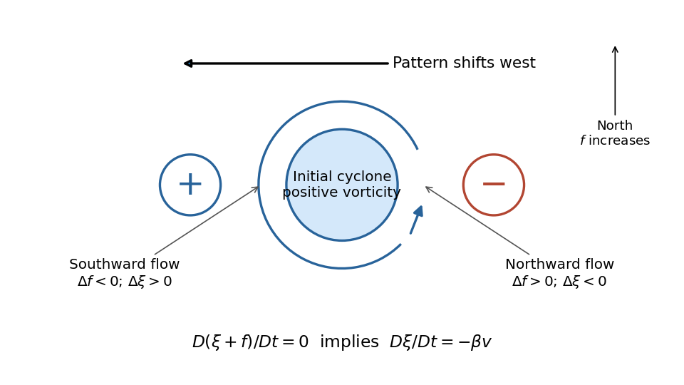

<h1 id="5/a/solution">Solution</h1>

↑ **Parent:** [A](../a.md)

Take a Northern-Hemisphere cyclonic [vortex](../../../../phase-vortex.md), with positive [relative vorticity](../../../../relative-vorticity.md). For a fixed-depth incompressible layer, conservation of [absolute vorticity](../../../../absolute-vorticity.md) gives

$$
\frac D{Dt}(\xi+f)=0,\qquad \frac{D\xi}{Dt}=-\beta v.
$$

The anticlockwise flow on the east side moves parcels northward, increasing their [planetary vorticity](../../../../planetary-vorticity.md) and creating negative [relative vorticity](../../../../relative-vorticity.md) anomalies. On the west side it moves parcels southward and creates positive [relative vorticity](../../../../relative-vorticity.md) anomalies. Initially,

$$
\partial_t\xi\simeq-\beta v,
$$

so the positive anomaly grows on the western flank while the eastern flank loses positive [vorticity](../../../../vorticity-split.md). The cyclonic pattern consequently shifts westward. The induced anomalies themselves drive meridional flow and further [relative vorticity](../../../../relative-vorticity.md) anomalies, transmitting a [Rossby wave](../../../../rossby-wave.md) pattern through the surrounding fluid. The restoring process is this exchange between [planetary vorticity](../../../../planetary-vorticity.md) and [relative vorticity](../../../../relative-vorticity.md), rather than a parcel executing a permanently westward translation.

**[Figure 1](#5/a/image-relative-vorticity-generated-by-a-northern-hemisphere-cyclonic-vortex-on-a-beta-plane). Relative vorticity generated by a Northern-Hemisphere cyclonic vortex on a beta plane**.

The sketch shows the initial tendency, with the generated signs separated from the initial positive core. An isolated disturbance contains many [wavevectors](../../../../wavevector.md) and disperses; westward [phase velocity](../../../../phase-velocity.md) does not imply that all its [wave energy](../../../../wave-energy.md) travels westward. A Southern-Hemisphere cyclonic [vortex](../../../../phase-vortex.md) reverses the signs of the initial and generated [relative vorticities](../../../../relative-vorticity.md), while the same [beta plane](../../../../beta-plane.md) mechanism remains.

## ↑ Ancestors (12)

1. [A](../a.md)
2. [5](../../5.md)
3. [2021](../../../2021-split.md)
4. [Past exam of the physics of atmospheres and oceans course of the University of Oxford](../../../split.md)
5. [Physics of atmospheres and oceans course of the University of Oxford](../../../../physics-of-atmospheres-and-oceans-course-of-the-university-of-oxford.md)
6. [Year 4 of the physics course of the University of Oxford](../../../../year-4-of-the-physics-course-of-the-university-of-oxford.md)
7. [Physics course of the University of Oxford](../../../../physics-course-of-the-university-of-oxford.md)
8. [Undergraduate course of the University of Oxford](../../../../undergraduate-course-of-the-university-of-oxford.md)
9. [Course of the University of Oxford](../../../../course-of-the-university-of-oxford.md)
10. [University of Oxford](../../../../university-of-oxford-split.md)
11. [List of universities](../../../../list-of-universities.md)
12. [Codex Wiki](../../../../split.md)
