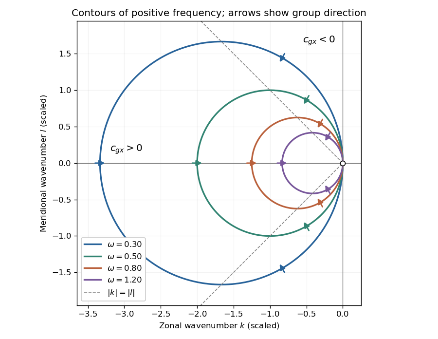

<h1 id="5/c/solution">Solution</h1>

↑ **Parent:** [C](../c.md)

For $U=0$ and fixed $\omega>0$, completing the square in the [dispersion relation](../../../../dispersion-relation-split.md) gives

$$
\boxed{\left(k+\frac\beta{2\omega}\right)^2+l^2=\left(\frac\beta{2\omega}\right)^2.}
$$

These [Rossby-wave isofrequency circles](../../../../rossby-wave-isofrequency-circle.md) lie in the $k\leq0$ half-plane and touch the origin, where the [dispersion relation](../../../../dispersion-relation-split.md) is undefined. Their radii decrease as [frequency](../../../../frequency.md) increases. The zero-[frequency](../../../../frequency.md) line is $k=0,l\ne0$.

The [group velocity](../../../../group-velocity.md) is normal to the constant-[frequency](../../../../frequency.md) curves, toward increasing [frequency](../../../../frequency.md):

$$
\boxed{c_{gx}=\frac{\beta(k^2-l^2)}{(k^2+l^2)^2},\qquad
c_{gy}=\frac{2\beta kl}{(k^2+l^2)^2}.}
$$

At $l=0$, the [group velocity](../../../../group-velocity.md) is eastward; close to $k=0$ it is westward. For the positive-[frequency](../../../../frequency.md) circles its arrows point inward toward the circle centre. Its meridional component is southward in $k<0,l>0$ and northward in $k<0,l<0$.

**[Figure 2](#5/c/image-positive-frequency-rossby-wave-isofrequency-circles-and-group-velocity-directions-in-dimensionless-wavenumber-coordinates). Positive-frequency Rossby-wave isofrequency circles and group velocity directions in dimensionless wavenumber coordinates**.

For $k\ne0$, the zonal [phase velocity](../../../../phase-velocity.md), meaning propagation at fixed $y$, is

$$
\boxed{c_{px}=\frac\omega k=-\frac\beta{k^2+l^2}<0.}
$$

It is westward everywhere it is defined. The zonal [group velocity](../../../../group-velocity.md) is eastward for $|k|>|l|$, westward for $|k|<|l|$, and zero on $|k|=|l|$. There is no region of eastward zonal [phase velocity](../../../../phase-velocity.md). At $k=0$, $\omega/k$ is undefined, though its continuous limiting expression is westward and $c_{gx}=-\beta/l^2$. Using instead the normal-to-wavecrest [phase velocity](../../../../phase-velocity.md) vector gives $\mathbf c_p=\omega(k,l)/(k^2+l^2)$; its zonal component is also westward for $k\ne0$, but is not the same scalar as $\omega/k$.

## ↑ Ancestors (12)

1. [C](../c.md)
2. [5](../../5.md)
3. [2021](../../../2021-split.md)
4. [Past exam of the physics of atmospheres and oceans course of the University of Oxford](../../../split.md)
5. [Physics of atmospheres and oceans course of the University of Oxford](../../../../physics-of-atmospheres-and-oceans-course-of-the-university-of-oxford.md)
6. [Year 4 of the physics course of the University of Oxford](../../../../year-4-of-the-physics-course-of-the-university-of-oxford.md)
7. [Physics course of the University of Oxford](../../../../physics-course-of-the-university-of-oxford.md)
8. [Undergraduate course of the University of Oxford](../../../../undergraduate-course-of-the-university-of-oxford.md)
9. [Course of the University of Oxford](../../../../course-of-the-university-of-oxford.md)
10. [University of Oxford](../../../../university-of-oxford-split.md)
11. [List of universities](../../../../list-of-universities.md)
12. [Codex Wiki](../../../../split.md)
