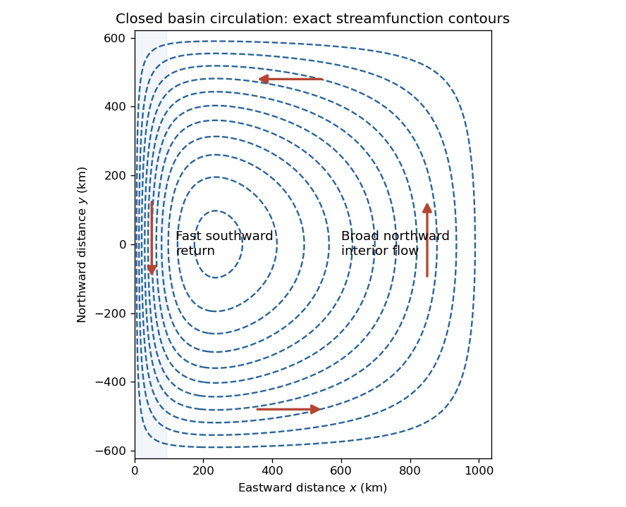

<h1 id="6/c/i/solution">Solution</h1>

↑ **Parent:** [I](../i.md)

The [streamlines](../../../../../streamline.md) are contours of $\psi$. Since $A<0$, the exact [streamfunction](../../../../../stream-function.md) is negative inside the rectangle and zero on its perimeter. It has one interior minimum, with closed anticlockwise [streamlines](../../../../../streamline.md): a broad northward interior flow returns southward along the west wall; flow is westward near the north edge and eastward near the south edge. The western parts of the [streamlines](../../../../../streamline.md) are closely packed because the [western boundary current](../../../../../western-boundary-current.md) is much faster.

**[Figure 3](#6/c/i/image-exact-linear-drag-basin-streamlines-and-flow-direction-for-the-specified-pluto-parameters). Exact linear-drag basin streamlines and flow direction for the specified Pluto parameters**.

The figure uses the exact [ordinary differential equation](../../../../../ordinary-differential-equation.md) solution, so it also remains consistent with both wall conditions when the asymptotic scale separation is only moderate. It depicts the stipulated dynamical model, not observed winds or a reconstruction of the source illustration.

## ↑ Ancestors (13)

1. [I](../i.md)
2. [C](../../c.md)
3. [6](../../../6.md)
4. [2021](../../../../2021-split.md)
5. [Past exam of the physics of atmospheres and oceans course of the University of Oxford](../../../../split.md)
6. [Physics of atmospheres and oceans course of the University of Oxford](../../../../../physics-of-atmospheres-and-oceans-course-of-the-university-of-oxford.md)
7. [Year 4 of the physics course of the University of Oxford](../../../../../year-4-of-the-physics-course-of-the-university-of-oxford.md)
8. [Physics course of the University of Oxford](../../../../../physics-course-of-the-university-of-oxford.md)
9. [Undergraduate course of the University of Oxford](../../../../../undergraduate-course-of-the-university-of-oxford.md)
10. [Course of the University of Oxford](../../../../../course-of-the-university-of-oxford.md)
11. [University of Oxford](../../../../../university-of-oxford-split.md)
12. [List of universities](../../../../../list-of-universities.md)
13. [Codex Wiki](../../../../../split.md)
